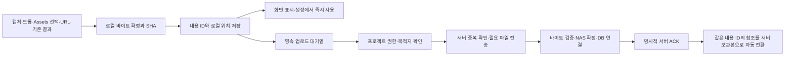

---
tags:
  - mvhub/설계
  - mvhub/assets
status: draft
updated: 2026-10-20
---

# Asset 고유 ID·로컬 우선 저장·프로젝트 imp_cap 자동 보관 설계·구현 인계 v2

현재 결론: **검증 후보29a9를 원본 dev2에 반영하고 같은 안전 데이터 경로로 재시작했다(2026-10-20)**. 실제 반영·DB 보존·남은 검증은 [구조 개편 정본](status/서비스구조_근본진단_2026-10-18.md) §20.79를 먼저 읽는다. §14와 §12~13은 이전 격리 구현·시험 이력이며, 운영 활성화·배포·Claude 독립 검토 완료를 뜻하지 않는다.
§2는 구현 전 진단, §3~11은 설계·초기 검토 이력을 보존한 내용이다. 제안과 실제 구현 범위가 다르면 §12를 따른다.

owner: Codex(설계·구현·통합 검증)
reviewer: Claude(사용량 제한으로 미호출, 후속 독립 검토 대기)
status: 검토 요청
touched_paths: 아래 §12~14의 구현·시험·설계와 원본 dev2 승인된122경로; 원본 별도 안전 DB의 시작 마이그레이션/상태 갱신 확인, 운영 NAS·공유 서버·설치본 변경 없음
updated: 2026-10-20

## 1. 인계와 승인 범위

- 사용자 요청: 생성에 사용한 모든 자료에 고유 식별자를 남겨 추적·재사용·묶음 백업/다운로드하고, 캡처·외부 드롭은 로컬에서 즉시 사용하면서 프로젝트의 `imp_cap/표시이름`으로 자동 보관한다. 프로젝트 트리에는 이 물리 폴더를 따로 노출하지 않고 기존 `imp/cap` 항목을 유지한다.
- 후속 사용자 지시(2026-10-19): **업로드가 완료되면 로컬 사본 참조를 서버 보관본 참조로 자동 교체**한다. 사용자가 다시 연결/새로고침할 필요 없이 자연스럽게 전환한다. 앞선 '동기화 뒤에도 로컬을 정식 참조로 유지' 제안은 이 지시로 대체한다. 로컬 파일 삭제 요청은 아니며 검증된 사본은 투명한 캐시로 유지한다.
- 사용자가 Claude 사용량 제한에 따라 **이번 작업의 Codex 단독 진행과 추후 Claude 검토용 문서 보존을 명시**했다. 전역/프로젝트 운영 규칙을 수정하거나 두 모델 합의로 기록하지 않는다.
- 최초 산출물은 상세설계였다. 사용자의 후속 구현 승인에 따라 **고정 dev2 사본에서 핵심 기능 구현·격리 시험을 완료**했다(§12). 실사용 활성화·원본 dev2 덮어쓰기·운영 NAS 쓰기·커밋·푸시·배포는 하지 않았다. Claude 승인이나 dev2 통합 완료를 뜻하지 않는다.
- 작업실: `D:\ClaudeCode\MV-hub-S-wt-assets`, 브랜치 `codex/mvhub-asset-sync`. 확인한 dev 기준 `16508543a67fe315c1499c6e2cf72ea83d8d2a61`에서 분리했다. 다른 작업실의 미커밋 변경은 복사하지 않았다. 이 작업실의 앱/포트는 기동하지 않았다.
- **구현 대상은 dev2의 구조 변경 이후 코드**다. `D:\ClaudeCode\MV-hub-S-dev2`를 읽기 전용으로 고정 사본화했다. 현재 진행 중인 실측·소스·DB는 건드리지 않는다. 구현 기준은 §12의 파일 지문이며 원본 통합은 dev2 확정본과 이 지문을 대조한 뒤 진행한다.
- 최종 검토자는 [현행 에셋 대장](ASSET_REGISTRY.md), [데이터 소유권](DATA_OWNERSHIP.md), [구조 원칙](../ARCHITECTURE.md)을 먼저 읽는다. dev2에서는 `docs/status/서비스구조_근본진단_2026-10-18.md`의 확정 상태와 실제 파일을 다시 확인한다(이 기능 작업실에는 그 미커밋 문서가 없다).

## 2. 직접 확인한 현재 구현과 보완점

| 현재 사실 | 코드 근거 | 이번 보완 |
|---|---|---|
| 캡처/드롭은 로컬 `captures`/`imports`에 저장하고 스트리밍 중 SHA-256 계산·같은 내용 재사용 | [assets 라우터](../backend/app/routers/assets.py), [asset_io](../backend/app/services/asset_io.py) | 기존 빠른 저장 뒤 같은 DB 트랜잭션에 등록·전송 예약 |
| Assets 패널의 폴더 드롭은 선택한 실제 폴더에 직접 저장하는 별도 경로 | [upload_assets](../backend/app/routers/assets.py) | 네트워크 폴더로 반입하는 입력도 로컬 먼저 확정한 뒤 비동기 저장으로 일관화; 로컬 폴더 반입은 현행 목적지 보존 |
| `registry_asset_id`는 서버가 PM 폴더를 훑으며 발급하는 논리 파일 번호; 같은 경로의 수정은 같은 번호, 복사본은 별도 번호 | [registry 판정](../backend/app/repo/asset_registry.py) | 이를 실제 바이트 ID와 혼용하지 않음 |
| 일반 생성은 제출 직전 실제 파일의 SHA/크기를 reference에 고정 | [gen_requests](../backend/app/repo/gen_requests.py), [agent](../agent_push.py) | 모든 생성 경로에서 정확한 입력 스냅샷과 내용 ID 보장 |
| Comfy 저장/옛 수집 자료는 이 검증을 항상 거치지 않음 | [Comfy](../backend/app/routers/comfy.py), [generations](../backend/app/repo/generations.py) | 실제 Comfy 입력 단계에서 증거를 만들고 저장 단계로 전달 |
| `/locate`는 기존 서버 사본을 찾지만 새 자료를 업로드하지 않음 | [locate](../backend/app/routers/assets.py), [캔버스 재연결](../frontend/src/lib/sceneAssetRelink.ts) | 새 전송 대기열·서버 보관 확인·ID 기반 위치 조회 |
| 현재 파일 서빙은 로컬 마운트 의존; DB 백업은 원본 파일 바이트를 포함하지 않음 | [assets file](../backend/app/routers/assets.py), [작업자 백업](../backend/app/services/worker_backup.py) | 서버의 권한 있는 파일 조회·복원 묶음 추가 |
| 현재 Assets 자동 마운트는 `project.render_root_path`/로컬 폴더 연결을 재사용 | [마운트](../backend/app/routers/assets.py), [프로젝트 경로](../backend/app/services/project_folders.py) | Render 루트와 실제 Assets 루트가 다르면 명시적으로 구분; `assets`를 경로에 추측해서 붙이지 않음 |

이 표는 소스 확인 결과다. 이전 대화의 DB 집계/19개 시험은 이전 점검의 증거이며 이번 신규 기능의 검증 결과가 아니다. 이번에는 운영 서버·NAS에 접속하지 않았다.

## 3. 고유 ID: 논리 파일과 정확한 바이트

세 종류를 유지한다. 생성 결과의 기존 `asset.id`를 바꾸거나 모든 ID를 통합하지 않는다.

| 식별자 | 의미·발급 | 바뀌는 조건 |
|---|---|---|
| `registry_asset_id`(기존) | NAS상의 논리 파일/경로를 따라가는 UUID | 현행 대장 이동·복사 판정 유지 |
| `asset_content_id`(신규) | `sha256:<전체 파일 SHA-256>`; 로컬 허브가 실제 저장한 바이트로 계산, 서버가 수신 바이트로 재검증 | 실제 바이트가 달라지면 새 ID |
| `reference.id`·`gen_reference`(기존) | 어느 생성에서 어떤 자료를 어떤 역할로 사용했는지 | 사용 기록별로 유지 |

UUID만으로 중복을 막을 수 없다. 이미 계산하는 SHA를 내용 ID로 쓰면 오프라인에서도 동일 바이트는 같은 ID가 되고 서버 동기화 뒤 ID 치환이 필요 없다. 앞선 대화의 `asset_id + blob_id` 두 신규 UUID 제안은 확정안이 아니었다. 이 안에서는 **기존 논리 대장 ID + 결정적인 내용 ID**로 충분하므로 중복되는 UUID·별도 레퍼런스 SQLite 파일을 만들지 않는다.

- `asset_blob`는 이 내용 ID의 바이트 메타를 보관하는 테이블 이름이다. ID 자체는 접근 권한/비밀 링크가 아니다.
- SHA는 전체 파일 기준이다. 기존 `result_head_sha`(앞 64KiB)는 후보 찾기용이므로 보관 검증·중복 확정에 쓰지 않는다.
- 같은 이미지라도 재인코딩·캡처·메타데이터 변경으로 바이트가 다르면 다른 내용 ID다. 시각적 유사도 중복 제거는 이 범위에 없다.
- 사용자가 같은 경로의 파일을 수정하면 논리 대장 번호는 유지할 수 있지만 새 내용 ID가 생긴다. **생성 이력은 당시 내용 ID를 고정**하고 최신 판으로 자동 교체하지 않는다. 기존 캔버스의 논리 파일 최신 판 추종은 현행 동작으로 유지하되, 생성 시점에 실제 제출한 판을 다시 고정한다.
- `generation.id`는 현재 DB 범위의 행 ID다. 로컬/공유 서버 값이 다를 수 있으므로 기존 경계 resolve를 따른다. 외부 잡에는 `job_id`, Comfy에는 기존 실행 키/출력 식별자를 함께 보존한다. 내용 ID를 생성 작업 ID로 대신 쓰지 않는다.

## 4. 로컬 우선 처리와 입력 범위



반입 응답은 로컬 파일과 등록/예약의 확정을 기다리되 서버·NAS 조회/업로드는 기다리지 않는다. 대기열 기록 실패를 성공으로 숨기지 않는다. 파일은 남겨 재등록할 수 있게 하고 `로컬 저장됨·보관 예약 실패`를 응답한다. 캡처/드롭은 기존 스트리밍 SHA를 재사용한다. 큰 프로젝트 원본의 지문·로컬 스냅샷 생성은 화면 스레드와 분리한다. 네트워크 지연을 입력 경로에 추가하지 않는다는 목표이지 디스크 복사 시간까지 0이라는 보장은 아니다.

로컬 중복 조회도 디렉터리 전수 해시 대신 내용 ID와 위치 색인을 우선한다. 같은 계정의 imports/captures에 검증된 같은 바이트가 있으면 해당 파일을 재사용하고 이번 입력의 원래 이름은 reference/반입 메타에 별도로 남긴다. 기존 이름을 덮거나 사본이 사라진 위치를 재사용하지 않는다.

| 입력 | 내용 등록·보존 시점 | 자동 업로드 목적지 |
|---|---|---|
| 캡처·붙여넣기·부분수정 그림 | 기존 로컬 captures 확정 때 | 반입 시 고정한 프로젝트의 `imp_cap/표시이름` |
| 프롬프트·캔버스·트레이 외부 드롭/파일 선택 | 기존 로컬 imports 확정 때 | 동일 |
| Assets 패널 폴더 드롭 | 로컬에 먼저 확정; 선택한 대상 폴더는 별도 저장 의도로 기록 | 선택한 폴더의 현행 의미 유지; 임포트/캡처만 imp_cap으로 보관 |
| 기존 프로젝트·개인 마운트 파일 선택 | ID는 등록된 스캔 SHA 재사용 가능; 생성 직전 실제 바이트의 로컬 스냅샷 고정 | 프로젝트에서 사용하는 판은 imp_cap에 보존; 이미 동일 판이 보관돼 있으면 재사용 |
| URL 반입 | 로컬에서 기존 URL 안전 검사·상한을 적용해 실제 파일 확보 후 등록 | 선택 프로젝트; URL 문자열만으로 ready 처리하지 않음 |
| 생성 결과를 레퍼런스로 재사용 | 실제 결과 바이트 확보·등록; 기존 결과 asset.id/출처 생성 연결 보존 | 재사용하는 대상 프로젝트 |
| Comfy 입력·결과 | 입력은 Comfy에 넘긴 파일 스냅샷; 결과는 실제 내려받기 확정 때 | 프로젝트가 있으면 같은 보관 경로 |
| 기존 자료 인벤토리 | 기존 서버 스캔/로컬 등록 작업에서 내용 ID 부여 | **기존 NAS 파일 전부를 imp_cap에 일괄 복사하지 않음**; 사용 판 보존과 신규 반입부터 적용 |

이 기능의 '모든 자료'는 MV Hub로 반입·생성하거나 등록한 폴더에서 관리하는 미디어다. PC의 임의 폴더를 전수 수집하지 않는다. 프로젝트 없는 자료도 로컬 내용 ID로 관리한다. 현재 선택된 프로젝트를 나중에 추측해 업로드하지 않고 `프로젝트 지정 필요` 상태로 남긴다. 프로젝트가 명시되면 기존 내용 ID에 해당 목적지 예약을 추가한다.

## 5. 프로젝트·표시이름 폴더 계약

사용자 지정 예:

```text
Z:\PROJECT_MUDX\10_ai\assets\imp_cap\제이\<내용SHA>.<검증된확장자>
```

- **프로젝트**: 이름이 아니라 `project_id`로 귀속한다. 워크스페이스는 프로젝트 권한 검증 문맥이며 같은 워크스페이스에 프로젝트가 여러 개면 목적지를 추측하지 않는다.
- **Assets 루트**: `project.asset_root_path`(신규 nullable 설정)에 명시한다. 기존 연결이 이미 정확한 Assets 폴더면 그 값을 제시해 재사용한다. 부모 `10_ai`·Render·개인 마운트만 알면 `assets`를 자동 덧붙이지 않는다. 별도 Assets 루트가 필요한 이유는 현행 `render_root_path`를 바꾸면 Resolve/렌더 저장도 바뀌기 때문이다. 연결 화면의 실제 표시/저장 필드 대조는 구현 전 필요하다.
- 서버가 그 설정을 자기 실행 계정의 UNC로 해석한다. 클라이언트가 보낸 `Z:` 절대경로·사용자 이름·owner_uid를 저장 권위로 쓰지 않는다. 기존 `canonical_unc`/드라이브 대응과 안전 경로 결합을 재사용한다.
- **사용자 폴더**: 서버가 인증한 `owner_uid`와 현재 표시이름으로 최초 생성한다. 정상 예는 정확히 `제이`다. 이름은 NFC·Windows 금지 문자/예약명·끝 점/공백을 처리한다. 빈 이름·동명이인·대소문자 충돌은 짧은 UID 접미사로 구별하고 매핑을 DB에 고정한다. 경로를 신원으로 쓰지 않는다.
- 표시이름이 바뀌어도 기존 폴더를 자동 이동/이름 변경하지 않는다. 최초 배정 폴더를 유지하고 UI 표시이름만 갱신한다. 폴더 이름 변경은 별도 명시 작업이다.
- 실제 파일명은 전체 SHA와 서버가 정한 안전한 확장자로 결정한다. 원래 파일명은 메타데이터/다운로드 이름으로 보존한다. 같은 이름의 다른 자료를 덮지 않는다.
- 같은 목적지의 동일 내용 ID는 파일 1개만 확정한다. **중복 방지 보장 범위는 같은 프로젝트 루트·같은 owner_uid**다. 다른 사용자/프로젝트는 각자의 실제 파일 보관 요구와 권한 때문에 별도 사본을 허용한다. NAS 하드링크를 전제로 한 전역 중복 제거는 하지 않는다.
- 프로젝트/루트/계정은 반입 때 고정한다. 루트가 전송 도중 바뀌면 옛 응답을 새 루트 완료로 정산하지 않는다. 기존 사본은 두고 새 위치로 보관을 예약한다. 이름만 같고 다른 물리 루트인 프로젝트는 별개다.
- 서버가 NAS를 쓰지 못하면 `저장소 연결 필요/권한 오류`로 보존한다. 관리자 PC의 기존 읽기 전용 스캔 helper에 쓰기 권한을 암묵적으로 추가하거나 각 PC가 임의로 NAS를 쓰게 우회하지 않는다.

`imp_cap`은 **프로젝트 Assets 트리의 표시에서만 제외**한다. 전역 `hidden_folder()`에 추가하면 스캔/복구에서도 빠질 수 있으므로 그러지 않는다. 에셋 대장 스캔·내용 ID 조회·파일 다운로드는 포함한다. 수동으로 임포트 보관 루트를 마운트해 우회 접근해도 서버 ACL은 별도로 검사한다. OS의 Hidden 속성을 설정하는 요구는 아니다.

기존 `imp/cap`은 imports/captures 합본과 현재 조작을 유지한다. 업로드 뒤 항목을 지우거나 두 번 표시하지 않고, 그 항목의 정식 참조만 서버 보관본으로 자동 전환한다. 표시용 로컬 사본은 캐시다. 다른 PC에서 열린 캔버스는 ID 조회로 서버 사본을 얻는다. '다른 PC의 imp/cap 전부를 자동 내려받기'는 하지 않는다.

## 6. 최소 데이터 변경안

별도 SQLite 파일 없이 기존 계정 DB와 공유 서버 content DB에 필요한 행을 둔다. 로컬 파일/예약과 서버의 보관 사실은 서로 다른 권위를 가진다.

| 테이블/컬럼(초안 명칭) | 핵심 필드·키 | 권위 |
|---|---|---|
| `asset_blob`(신규) | `asset_content_id PK`, `sha256 UNIQUE`, `bytes`, 검증 MIME/종류, 생성시각; 바이트/크기 불일치는 갱신 대신 거절 | 실제 바이트를 검증한 로컬/서버 각각 |
| `asset_location`(신규) | location ID, content ID, `owner_uid`, `project_id?`, `storage_id`, `root_revision`, `kind(local/server)`, 정확한 상대경로, 원래 이름, `state(staging/ready/missing)`; 서버는 `(storage_id,root_revision,project_id,owner_uid,content_id)` 유일 | 로컬 위치는 로컬; NAS 확정은 서버 |
| `asset_sync_outbox`(신규, 로컬) | content ID, 로컬 위치, owner/계정 pin, server identity, project, root revision, revision, 상태, 재시도시각, attempts, lease token/만료, 오류 코드, ACK; 같은 자료·대상 유일 | 로컬 계정 DB |
| `asset_owner_folder`(신규, 서버) | `(project_id, root_revision, owner_uid) PK`, folder label, casefold label UNIQUE(프로젝트/루트 안), 최초 표시이름 | 서버 |
| `project` 추가 | `asset_root_path`, `asset_root_revision` | 서버 프로젝트 설정; 로컬 미러 |
| `reference`·출력 `asset` 추가 | nullable `asset_content_id`; 실제 사용/결과 바이트가 확인된 때만 설정 | 원래 생성/사용 기록을 소유한 DB |
| `gen_reference` 추가 | `position`(슬롯 순서); 기존 role·다대다 키 유지 | 원래 생성 기록 |

- `asset_location.registry_asset_id`는 nullable로 연결한다. 서버에 수신 파일을 확정하는 트랜잭션에서 기존 대장에 등록하고 연결한다. 주기 스캔이 꺼져 있어도 **관리 보관본의 ID 조회는 가능**해야 한다.
- 서버의 폴더 배정/보관 위치는 공유 content DB, 개인 prompt/참조 사용 기록은 로컬 계정 DB다. 서버 보관본을 추가했다고 미공유 생성물의 프롬프트·전체 캔버스를 자동 공개하지 않는다. 팀 발행 시 기존 공유 권한 안에서 내용 ID/슬롯을 전달한다.
- 서버 ID는 저장 계보를 식별해야 한다. 프로세스 재시작으로 바꾸지 않고, 서버 이사는 계보를 보존한다. 원본 바이트가 빠진 DB-only 복원은 보관 세대를 갱신하고 ready 위치를 재검증한다. 메모리 pool epoch만으로 원격 보관 계보를 대신하지 않는다. 현재 서버 신원/복구 계약에 연결할 구체 필드는 dev2 확정본에서 대조한다.
- 계정 DB의 내용 ID가 같아도 서로의 개인 메타·대기열을 공유하지 않는다. 서버에서 content ID만 조회해 남의 파일 존재·경로를 알아낼 수 없게 한다.
- 새 테이블이 공유/휴지통/전체 교체 저장/이관에 빠지지 않게 한다. 등록된 내용 ID는 바이트가 없더라도 '기록된 정체'로 남길 수 있으나 ready가 아니다.
- SceneRef·PromptPart·반입 메타의 신규 필드는 content ID와 정식 server location(storage identity/project/root revision 포함)이다. 전송 상태와 로컬 캐시 경로는 내용 위치 저장소에서 조회한다. 서버 전환 receipt에는 대상 content ID/원래 scope/revision을 기록해 재기동 때 남은 전환을 재실행한다. 파일 업로드 완료와 문서 참조 전환 완료를 서로 다른 상태로 관리한다.

## 7. 업로드 프로토콜·실패 수렴

API 이름은 구현 시 같은 소유권 표로 확정한다. 아래는 필요한 요청·응답 계약이다.

| 호출 | 위치 | 보장 |
|---|---|---|
| 기존 capture/reference-import/upload 확장 | 로컬 전용, 기존 가드 유지 | 파일 + content ID + 원래 문맥의 예약 결과 반환; 원격 대기 없음 |
| `POST /api/asset-sync/prepare` | 인증한 공유 서버 | project/owner/루트 권한 검사 뒤 기존 보관본 ready 또는 upload token/목적지 세대 반환 |
| `PUT /api/asset-sync/uploads/{token}` | 공유 서버 | token에 고정된 content ID·크기·owner·project·루트로만 제한된 스트리밍 수신 |
| `POST /api/asset-sync/resolve` | 서버 메타 조회, 로컬은 명시 위임 | 접근 가능한 content ID/정확한 판의 상태·위치·다운로드 경로 배치 반환 |
| `GET /api/asset-sync/files/{location_id}` | 공유 서버 | 매번 project/owner ACL·현재 저장 위치 검사; 로컬 경로 없어도 파일 제공 |
| 로컬 전송 상태·재시도 | `/api/local-asset-sync/*` 로컬 전용 | 계정별 큐/오류 조회·현재 계정에서 재시도; 대량 경로·비밀값 노출 금지 |

`/api/assets/*` 기존 로컬 가드를 서버 업로드용으로 풀지 않는다. 새 원격 라우트와 로컬 전용 라우트를 분리하고 `_proxy` 소유권 표/요청 상한을 각각 등록한다.

서버의 ready 순서는 **권한/목적지 예약 → 한정 임시 파일 수신 → 실제 SHA/크기 검증 → 최종 파일 덮어쓰기 없이 확정 → DB 위치·대장 등록 → 명시 ACK**다. 파일 I/O/네트워크 대기를 SQLite 쓰기 트랜잭션 안에 넣지 않는다. 최종 파일은 전체 SHA의 결정적 경로를 쓰고, 이미 존재하면 실제 내용 일치만 재사용한다. 다른 내용이면 격리 오류로 멈추며 덮지 않는다.

파일시스템과 SQLite는 하나의 트랜잭션이 아니다. 파일만 확정된 뒤 DB가 실패한 경우 같은 예약으로 파일을 다시 확인해 DB 연결을 마친다. staging 행/임시 파일만 남은 경우 완료라고 하지 않고 같은 대상의 재전송으로 수렴한다. 자기 장부의 예약과 정확한 경로만 정리하며 기존 NAS 파일을 이름만 보고 삭제하지 않는다.

- 서버는 동일 보관 키의 동시 수신/확정을 영속 lease+DB 유일 조건으로 조정한다. 프로세스 내 Python lock만으로 중복 방지를 보장하지 않는다. 만료된 lease의 옛 응답/쓰기에는 fencing 검사를 적용한다. 여러 서버가 같은 NAS를 무조율로 쓰는 구성은 허용하지 않는다.
- ACK는 `protocol_version`, `stored=true`, content ID/SHA/bytes, location ID, project/owner, server storage identity, root revision, 요청 revision을 확인할 수 있어야 한다. HTTP 200이나 바이트 전송 종료만으로 ready 처리하지 않는다. 중복 재시도도 같은 최종 위치를 반환한다.
- 클라이언트의 SHA는 준비용 주장이다. 수신 바이트의 서버 계산 결과가 기준이다. 중복 ready 응답도 권한 있는 확정 위치가 실제 존재하고 올바른 판일 때만 준다. 해시만 안다는 이유로 기존 파일에 새 접근 권한을 주지 않는다. 다른 사용자/프로젝트 재사용은 기존에 읽을 수 있는 location의 명시 참조나 해당 바이트를 실제 전송한 경우로 한정한다.
- 업로드 큐는 우선 1개 스트리밍 워커·제한된 버퍼로 시작한다. 긴 NAS 접근은 제한된 I/O 작업자로 분리해 health/일반 생성 이벤트 루프를 막지 않는다. 정확한 속도·타임아웃은 격리 실측 뒤 정하고 '지연 없음'을 측정 없이 보증하지 않는다.
- 네트워크 실패는 큐 보존·백오프 재시도한다. 업로드 응답 유실은 prepare/resolve로 저장 여부를 재조회한다. 앱 재시작 시 오래된 실행 lease를 회수한다. 인증 실패·권한 철회·용량 부족·잘못된 자료는 이유를 표시하고 자동 고속 재시도를 멈춘다.
- 계정 전환/로그아웃은 진행 요청을 해당 원래 pin으로 정산하거나 멈춘다. 새 계정 토큰으로 옛 큐를 전송하지 않는다. 서버/루트/요청 revision이 바뀌면 늦은 ACK로 새 상태를 완료시키지 않는다.
- 지원하지 않는 옛 서버의 404/모르는 ACK는 `서버 업데이트 필요`다. 큐와 로컬 파일을 유지한다. 새 필드를 버리고 200을 주는 구버전도 완료로 오인하지 않는다.
- 업로드 즉시 대장 등록과 스캔/helper 반영도 같은 프로젝트의 변경 세대를 비교한다. 스캔 시작 뒤 새로 확정한 관리 보관본에 낡은 스캔의 new/missing/이동 판정을 적용하지 않는다. 반영 직전 최신 대장·managed location을 같은 트랜잭션에서 대조하고 충돌한 관리 경로의 스캔 결과는 보류한다. 다음 정상 스캔은 같은 registry ID를 재사용한다. 업로드 위치 ready는 이전 전체 스캔의 complete 플래그와 독립이다.
- `capture-discard`는 새 location/큐/제출 스냅샷의 사용 예약도 확인한다. 업로드/생성 입력에서 사용 중인 파일을 옛 1회용 토큰만으로 삭제하지 않는다. 취소/실패로 예약을 풀더라도 이미 재사용된 파일·서버 파일을 자동 삭제하지 않는다. 취소와 파일 확정 사이 경쟁은 동일 revision/lease로 판정한다.
- 서버 다운로드·묶음 내보내기에도 검증한 바이트와 제공하는 바이트를 같은 파일 스냅샷으로 묶는다. 경로를 해시한 뒤 다른 요청에서 FileResponse로 다시 여는 방식만으로 정확한 판을 보장하지 않는다. 로컬 캐시에 검증된 스냅샷을 확정해 제공하는 기존 파일 IO 패턴을 우선한다.

## 8. 생성 계보·dev2 경계·자동 표시

생성은 서버 업로드 완료를 기다리지 않는다. **실제 생성 공급자에 보낼 로컬 입력 스냅샷의 확정**은 기다린다. 사용자가 NAS 원본을 생성 도중 고쳐도 제출한 바이트가 뒤바뀌지 않게 같은 스냅샷을 SHA 계산·공급자 업로드·이력 기록에 사용한다. 레퍼런스가 사라지거나 판이 다르면 과금 호출 전에 실패한다. 공급자 URL만 보내면 실제 수신 바이트가 입증되지 않는 경로도 로컬 바이트 입력으로 바꿔야 한다.

| dev2 책임 | 확인한 공개 경계 | 추가할 일 |
|---|---|---|
| 생성 접수/실패 분류 | `features/generation/api.ts`, `submit.ts`, `shared/contracts/generation.ts` | content ID를 담은 참조를 기존 PreparedSubmission과 같은 operationId/OperationContext에 고정; 새 과금 재시도 규칙을 만들지 않음 |
| 사용자 반입 | `lib/useSceneClipboardDrop.ts`, SpotlightPrompt, PartialEditModal, assetsApi | 반입 때의 프로젝트/계정 문맥 전달; capture/드롭 응답에 content ID 반영 |
| 캔버스 영속 문서 | `features/canvas/api.ts`의 document port·`relinkCanvasDocuments`, `session.ts` | 서버 보관본으로 참조를 전환하는 멱등 파생 명령을 공개 포트로 추가; App나 업로드 worker가 직접 씬 저장소를 쓰지 않음 |
| 열린 Board·Undo | `useCanvasSession.ts`의 `persistDerived`, `assetRefs.ts` | 현재 입력 flush 보존·정확한 content ID와 revision 대조; 위치 갱신을 새 사용자 Undo로 쌓지 않음 |
| 백엔드 접수·제출 전이 | 기존 usecases/gen_requests와 repo 원자 작업 | 클라이언트 ID를 실제 snapshot 검증 결과와 대조, reference/슬롯 순서에 고정 |
| Comfy | 로컬 실행 저널·실제 input upload | 입력 digest/content ID·역할·슬롯 순서를 실행 증거에 보존 후 기존 결과 저장으로 전달; 나중에 변경된 프론트 폼으로 재구성하지 않음 |
| 자료 조회/신호 | 현행 앱 변경 신호·조회 모델 | `content_id + project + storage/root revision`으로 자료 상태만 무효화; 모든 생성 목록 재로드/모든 NAS 재탐색 금지 |

**사용자 지시에 따라 서버 ready ACK가 오면 정식 참조를 자동 교체한다.** content ID·역할·슬롯·프롬프트는 그대로 두고, 참조의 출처와 위치를 해당 서버 보관본으로 바꾼다. 서버가 반환한 정식 file URL(`/api/asset-sync/files/{location_id}` 형태)과 검증한 storage/project/root 문맥을 저장한다. 절대 서버 주소나 PC별 `Z:` 경로를 씬에 정식 식별자로 박지 않는다. 로컬 허브의 이 경로도 제한 스트리밍/내용 캐시를 지원하도록 명시 배선하며 범용 프록시의 전체 버퍼링에 기대지 않는다. 기존 `asset:imports|...` 토큰은 로컬 캐시 위치와 이관 매핑으로 보존한다.

다음 순서로 사용자가 개입하지 않는 전환을 완료한다.

1. 서버의 실제 파일·권한·지문과 ACK 문맥이 맞는지 확인한 후 로컬 DB에 ready 위치와 전환 receipt를 확정한다.
2. 동일 계정·프로젝트·내용 ID/판을 사용하는 참조만 새 서버 출처로 전환한다. '현재 선택된 카드'나 같은 파일명으로 대상을 잡지 않는다. 이미 다른 파일/판으로 편집된 참조는 바꾸지 않는다.
3. 열린 캔버스는 dev2 문서 세션에서 `persistDerived`로 저장하고, 기존 Undo에 들어 있는 동일 자료의 위치도 기존 파생 보정 방식으로 갱신한다. 닫힌 씬은 공개 document port의 저장 확인을 받는다. 다른 브라우저 프로필·백업에서 뒤늦게 연 씬은 content ID의 전환 receipt를 조회해 자동 적용한다. 한 번에 모든 카드/과거 바이트를 덮어쓰지 않는다.
4. 프롬프트 트레이·Assets imp/cap 항목·라이브러리 reference에도 같은 자료 위치 해석을 적용한다. 재사용/내보내기는 서버 정식 참조를 직렬화한다. 업로드 중 이미 제출된 요청 payload/실행 스냅샷은 바꾸지 않는다. 완료 후 생성 이력의 매체 위치는 바꿀 수 있지만 당시 content ID/입력 정보는 고정한다.
5. IDB/로컬 DB 저장 실패는 `서버 보관 완료·연결 전환 재시도`로 남긴다. 앱 재시작/재연결 때 receipt로 재시도하고, 문서 확정 전에는 전환 완료로 표시하지 않는다.

정식 참조 전환과 전송 속도는 구분한다. 화면은 content ID가 같은 기존 로드 이미지를 유지하고, 검증된 로컬 사본을 **서버 자료의 캐시**로 제공해 깜빡임/재다운로드를 피한다. 캐시가 없는 다른 PC는 서버에서 최초 1회 받아 보관한다. 같은 자료 동시 요청은 단일 다운로드로 합친다. 캐시는 서버 자료의 접근 권한을 대신하지 않으며 로그아웃·계정 전환·권한 철회 시 다른 계정에 노출하지 않는다. 서버 단절 중에도 원래 계정에 승인된 로컬 사본은 오프라인으로 사용할 수 있지만 현재 서버 연결 성공이라고 표시하지 않는다.

상태 표시: `이 PC에 저장됨` → `서버 보관 대기/전송 중` → `서버 보관 완료`. 실패는 로컬 사용을 유지하고 이유를 표시한다. '서버 보관됨'과 '이 PC에서 현재 열 수 있음'을 구분한다. NAS 단절은 '없음'이 아니라 '확인 못 함'이다. 서버 위치가 나중에 삭제/손상되면 ready 증거를 재검증하고 로컬 원본이 있으면 복구 예약한다.

기존 locate 판정 캐시와 새 업로드 상태는 서로 덮지 않는다. 서버 보관 확인과 참조 전환 저장이 완료되면 해당 content ID·프로젝트의 저장된 local/missing/held 판정을 무효화한다. 워크스페이스·계정·문서가 바뀐 뒤 도착한 신호를 새 카드에 적용하지 않는다. 카드 삭제·Undo로 되살린 자료도 원래 내용 ID의 receipt로 서버 참조를 적용한다. ID를 모르는 옛 참조는 이름만으로 바꾸지 않는다.

생성 기록의 필수 목록: prompt/display_prompt, 모델·실제 실행 설정, generation.id와 외부 상관키, 결과 asset.id/content ID, reference.id/content ID, role/position, 출처 생성 연결. 실패/재시도에도 같은 생성의 기존 관계를 보존한다. 서버 업로드 완료는 위치 추가이며 생성 당시 프롬프트·입력 판을 바꾸는 이벤트가 아니다.

## 9. 추적·백업·다운로드

- 생성 정보에서 결과와 입력 슬롯별 원본을 content ID로 조회하고, 권한 안에서 미리보기·개별 다운로드·재사용한다. 내용 ID만 있는 유실 기록은 `원본 없음`으로 표시하며 최신 파일/동명이 파일로 채우지 않는다.
- 묶음 다운로드는 최종 결과 + `manifest.json` + 실제 사용 판의 references를 제공한다. manifest에는 포맷 버전, 로컬/서버 생성 식별자 경계, prompt·실행 설정, 결과/레퍼런스 content ID·크기·슬롯·상대 파일명을 둔다. 파일명은 충돌/경로 탈출을 막고 토큰·서버 절대경로·서명 URL·타인 정보는 넣지 않는다.
- 로컬/서버 파일 위치를 먼저 모두 권한/바이트 확인한다. 하나라도 없으면 기본은 완전 묶음을 만들지 않고 빠진 항목을 알린다. 불완전 묶음은 사용자가 명시적으로 선택했을 때 누락 목록을 포함한다. 파일을 통째로 메모리에 올리지 않는다.
- DB 백업은 새 표·content ID·관계를 포함한다. 서버 NAS의 실제 imp_cap 파일은 **별도 파일 백업 대상**이다. 자동 업로드 자체는 다른 매체로의 재해 백업을 의미하지 않는다. 복원 시험은 DB와 NAS 파일/manifest를 함께 대조한다.
- 동기화 큐/로컬 보관본은 업데이트 보존 경로에 둔다. 현재 설치의 ASSETS_ROOT가 어디에 있는지 확인해 업데이트·DB 복원·계정 분리에서 유실되지 않게 한다. 서버 ACK 전후 모두 자동 로컬 삭제·전역 파일 청소는 1차 범위에 넣지 않는다.

## 10. 이관·구현 순서와 검증 기준

| 단계 | 작업 | 완료 판단 |
|---|---|---|
| D0(이번) | 요구·코드 근거·dev2 경계·실패 계약·인계 설계 | 문서/링크/상태 자기 점검; 공동 승인과 구분 |
| D1 | dev2 최종 SHA/관련 파일 지문 대조, 실제 Assets 루트/표시이름 필드·서버 신원/복원 세대·NAS 쓰기 경계 확인 | 적용 기준과 경로 소유자 확정; 서버/NAS 쓰기는 별도 기존 승인 범위 확인 |
| I1 | 부가 스키마·기존 파일 등록·반입 응답·영속 큐; 구형 필드 유지 | 신규/구형 DB 이관·재적용·등록 실패/재시작 시험 |
| I2 | 서버 목적지·폴더 배정·중복/업로드·정확한 판 서빙 | 격리 2허브/가짜 프로젝트에서 재시도·동시성·권한 시험 |
| I3 | 일반 생성·재생성·Comfy·MCP·Assets 패널 입력의 실제 content ID/슬롯 기록 | 각 경로의 실제 공급자 입력 스냅샷과 DB 참조 지문 일치; 유료 호출은 호환 가짜 서버 |
| I4 | dev2 문서 포트·서버 정식 참조 자동 전환·타 PC 조회/재사용 | 사용자 조작 없이 참조/저장까지 전환, 기존 이미지 유지·중복 다운로드 0, 새로고침/씬 전환/Undo/계정 전환 실제 UI 시험 |
| I5 | 생성 정보·묶음 내보내기·백업 복원·기존 자료 보완 | 파일과 manifest 지문 일치, 누락 정직 표시, 클린/구형 DB 복원 |
| V | 독립 검토·통합 실사용 전 확인 | Claude 미확인 항목을 유지하고 사용자 단독 진행 범위/기존 통합 절차에 따라 별도 판단; 운영 완료를 선포하지 않음 |

기존 데이터는 nullable 부가 이관으로 시작한다. 첫 등록/사용 또는 승인된 제한 스캔에서 SHA·ID를 보강한다. 현재 파일의 SHA를 과거 생성이 사용한 SHA라고 추정하지 않는다. 옛 실제 지문이 있는 기록만 해당 판과 연결하고, 경로/이름만 있는 과거 기록은 `미확인`으로 둔다. 이미 사라진 바이트는 새 ID를 만들어 복원한 척하지 않는다. 구버전 전체 교체 쓰기·공유 재수집·휴지통 복원으로 새 필드가 사라지지 않게 테스트한다. 옛 바이너리로의 롤백 안전성도 별도 확인한다.

### 필수 반례 시험표(미실행)

| 사례 | 기대 결과 |
|---|---|
| 서버 단절 상태의 캡처/드롭/생성 | 로컬 사용 가능, 내용 ID/큐 보존, 원격 완료 아님 |
| 업로드 중 종료·재기동 / 파일 확정 후 DB 실패 / ACK 유실 | 같은 목적지로 수렴, 파일/관계 중복 없이 복구 |
| 두 PC의 동일 파일 동시 업로드(같은 owner/project), lease 만료 후 옛 요청 도착 | 최종 파일 1개·같은 위치·낡은 ACK 거절 |
| 업로드 확정 직후 낡은 대장 스캔/helper 결과 반영 | registry ID 중복/신규 ready의 missing 오판정 없음 |
| capture-discard와 전송·생성 입력 사용이 동시에 실행 | 사용 예약이 살아 있는 로컬/서버 원본 삭제 없음 |
| 같은 이름·다른 바이트 / 같은 바이트·다른 파일명 / PNG 재인코딩 | 각각 새 내용 ID / 같은 ID·사본 재사용 / 다른 ID |
| SHA 위조·바이트 크기 불일치·남의 content ID 추측 | ready·다운로드·권한 부여 없음 |
| 계정 A→B→A, 서버 주소 변경, 루트 변경, project 권한 철회 | 원래 문맥 pin·revision 확인; 새 대상 오염 없음 |
| 표시이름 변경·동명이인·Windows 예약명·정션·경로 탈출 | 고정된 안전 폴더 배정; 범위 밖 쓰기/덮어쓰기 없음 |
| 프로젝트 없음/워크스페이스만 있음 | 로컬 등록 유지, 임의 프로젝트 업로드 없음 |
| imp_cap 숨김·기존 imp/cap 합본·대장 스캔/resolve/file API | 트리만 숨김, 관리·복구·권한 조회는 정상 |
| 서버 ACK 뒤 현재 씬/다른 씬/닫힌 씬/Undo/기존 빨간 판정 | 같은 content ID의 참조가 서버로 자동 전환·영속 저장, 사용자 입력/Undo 보존 |
| 서버 ACK 뒤 IDB 저장 실패·앱 종료·다른 프로필에서 옛 씬 열기 | 서버 보관/참조 전환을 구분, receipt로 자동 재개·사용자 수동 연결 불필요 |
| 이미지를 띄운 채 서버 참조 전환 / 타 PC에서 같은 자료 동시 열기 | 깜빡임/현재 PC 재다운로드 0, 타 PC 단일 최초 다운로드·판 일치 |
| NAS 단절·파일 삭제·같은 경로 덮어쓰기 | 확인 못 함/누락/판 불일치 구별, 다른 바이트로 자동 대체 없음 |
| Comfy 실행 중 폼 변경·출력 재저장 / HF 재생성 / MCP 기본 생성 | 실행 당시 입력 증거, 중복 과금/저장 없음, 캔버스 의존 추가 없음 |
| DB-only 복원 / DB+파일 복원 / 옛 서버의 필드 무시 200 | ready 재검증 / 동일 판 복구 / 미지원·큐 보존 |
| 대형 영상·느린 NAS·동시 생성 | bounded 메모리/작업자, 일반 API 박동과 UI 지연 실측 |
| 묶음에 빠진 소스·이름 충돌·타인 파일 | 명시 누락/충돌 안전 이름/권한 거절, 완전 복원이라고 거짓 표시하지 않음 |

성능은 기존 반입 경로와 새 경로의 같은 파일·같은 환경을 비교한다. 로컬 확정까지 p50/p95, long task/일반 API 최대 지연, 메모리 최고치, 전송 바이트·중복 업로드 수를 잰다. 이미지/영상/오디오 각각과 서버 단절/느림을 포함한다. 수치 목표는 기준선을 잰 뒤 확정하며 현재 성능 개선 비율은 측정하지 않았다.

### 호출부·시험·설정 누락 방지 범위

- backend: `schema.sql`, `db_migrations.py`, `schema_compat.py`, repo의 generation/reference/asset_registry/share/trash/identity, models·generation_rows, gen_requests usecase·agent digest, Comfy 실행 저널·저장, 프로젝트 설정/권한, `_proxy` 소유권, main 수명, WS/변경 신호, 업로드 상한, 백업·복원·업데이트 보존.
- frontend: dev2 generation/OperationContext 공용 계약, canvas 공개 document port/Undo/파생 저장, scenes 저장·가져오기 정규화, prompt parts, Spotlight/PartialEdit/트레이/Assets 패널 반입, MCP 입력, InfoPopup·미디어 해석/다운로드, assetsApi·캐시·계정 전환·오류 표시·번역.
- 시험 재사용 출발점: backend `test_asset_services`, `test_asset_registry*`, `test_capture_discard`, `test_generation_rows`, `test_generation_state_engine`, `test_share_authority`, `test_worker_offdisk_backup`, `test_proxy_ownership`; frontend `sceneAssetRelink`, `comfy*`, `canvas*`, 반입 busy·계정/문서 전환 시험. 구체 파일 목록은 dev2 확정본에서 다시 좁힌다.
- 새 테이블/엔드포인트/잡/환경변수를 실제 추가할 때 inventory·CODE_MAP·데이터 소유권·현행 에셋 계약을 함께 갱신한다. 이번 제안 표를 실제 구현 목록으로 inventory에 미리 넣지 않는다.

## 11. 자기 검토와 Claude가 확인할 항목

설계 중 반례로 보완한 것: UUID만으로 중복 제거 불가 → 전체 SHA 내용 ID; 대장 번호는 수정 가능 → 생성 판 고정; 같은 SHA만으로 권한 부여 불가 → 위치 ACL/실제 전송; 숨김을 전역 규칙에 넣으면 스캔도 누락 → 트리 표시만; 서버 참조 자동 전환의 지연/Undo/저장 실패 → 파생 문서 명령·receipt·로컬 캐시; 파일·DB 원자성 불가 → staging/멱등 재조회; 늦은 ACK/계정 전환 → pin·root/revision; 대장 스캔·capture-discard 경쟁 → 관리 위치/예약 대조; DB-only 백업은 원본 복구 불가 → 별도 파일 보존/manifest. 코드로 해결·검증한 결함 목록이 아니라 설계상 대응 목록이다.

Claude는 다음을 **새로 확인**해야 한다. 자기 검토를 독립 승인으로 읽지 않는다.

1. SHA 기반 신규 내용 ID와 기존 mutable registry ID의 경계가 실제 모든 생성 입력을 표현하는가.
2. 사용자별 물리 폴더와 중복 제거 범위(같은 owner/project)가 요구와 일치하는가. 다른 사용자 파일을 숨긴 폴더에 넣는 것만으로 접근 통제를 대신하지 않는가.
3. 실제 프로젝트 연결 UI의 Assets 루트·server UNC/쓰기 권한과 display name 정본은 무엇인가. `asset_root_path` 부가 필드가 최소 변경인가.
4. dev2 최종 문서 포트/OperationContext/백업 복원 세대가 이 새 업무의 권위를 지키는가. 자동 서버 전환이 공개 포트의 확정 저장·receipt 복구·Undo와 맞고, 기능을 옛 App/Board 직접 writer로 되돌리지 않는가.
5. staging/lease/원자 파일 확정/DB ACK의 모든 중간 종료에서 손실·중복·낡은 성공이 없는가. NAS의 실제 확정 의미는 검증됐는가.
6. 일반·재생성·Comfy·MCP·URL에서 **실제 제출한 바이트**의 지문을 생성 기록에 고정하는가. 구형 자료의 판을 추측하지 않는가.
7. 개인 프롬프트/미공유 생성물은 기존 소유권을 지키면서 프로젝트 레퍼런스 보관·공유가 동작하는가.
8. 구현 후 별도 세션의 독립 리뷰·비용 없는 격리 UI/실패 시험·실사용 반영 범위를 확인했는가.

### dev2 대조 기준(2026-10-19 12:51~12:53 읽기)

dev2 HEAD는 위 dev 기준과 같지만 미커밋/미추적 구조 변경이 있으므로 SHA만으로 이 입력을 재현할 수 없다. 아래 내용 지문은 당시 직접 확인값이다. dev2의 전체 소스 고정·최종 시험 성적을 뜻하지 않는다.

| 파일(dev2 안) | SHA-256 |
|---|---|
| `frontend/src/shared/contracts/generation.ts` | `c370afb880545bed7aa414e458f8eb60018cdfdb69632c3f506f9c94bd9c3e3f` |
| `frontend/src/features/generation/api.ts` | `b324d9df2d8c052041c8be6a98ae6960afd0d95ae8c09782922f56c41f946f3e` |
| `frontend/src/features/generation/submit.ts` | `dbe3e590fdb4440e54b7ff545395fd6ec6da6038e547279f2175a34c55f4a085` |
| `frontend/src/features/canvas/api.ts` | `3b7bf104bd66c6a67ee5fa6813e5ef646c60a7bdd1fb1b2962c8671184ba4434` |
| `frontend/src/features/canvas/session.ts` | `62e17dc8271e4a900a04d99a7525c0dec006543d1268e78a7973d73addb5acce` |
| `frontend/src/features/canvas/useCanvasSession.ts` | `e65442ab263307223fc5d2fded7cc342f56ca2550e5dd1299df602d3529ee179` |
| `frontend/src/lib/useSceneClipboardDrop.ts` | `14a16196eedd8d88780ed063d2798e7823f58d4ca5a47aade70c895d63980b12` |
| `frontend/src/lib/assetsApi.ts` | `983923c4a4c99788a6c85f7854b3e4101ef6972824311b2f35b31624e71e78d6` |

### 최초 설계 단계의 문서 검증 기록(보존)

- 실제 적용: Ponytail full·Karpathy 본문을 읽고 기존 코드/SHA·대장·영속 전송 패턴을 먼저 확인했다. 볼트는 index와 관련 Wiki(원자 파일 확정·응답 ACK·전체 교체 보존·파일 정리 소유권)만 참조했다.
- graft 래퍼의 skeleton/build/check/callers를 시도했으나 그래프가 생성되지 않아 `NO GRAPH`였다. 호출 관계의 근거로 쓰지 않았고 `rg`·실제 소스 직접 읽기로 대체했다. graft 수정·추가 의존성 설치는 하지 않았다.
- 검증: `tools/lint_docs.ps1` exit 0. 현황 문서는 기준 커밋부터 25,553 bytes로 20KiB 예산을 넘었으며 이번 링크 추가 후 26,133 bytes 경고가 남는다. 다른 작업의 현황을 임의 정리하지 않았다.
- 검증: `tools/check_code_map.py` exit 0(문서 이름 932개 중 없는 것 0, 대상 코드 745개 중 문서 누락 0). 설계의 로컬 링크 17개, 추가한 세 진입 링크, 변경 문서 updated/NUL 검사, `git diff --check` 통과. 새 설계 파일은 untracked라 별도로 내용을 확인했다. 전체 옛 문서 링크 탐색에서 만난 대장 운영의 시작 버튼/괄호 표기는 기준 커밋에도 있어 수정하지 않았고, 이번 링크 검증은 신규/추가 링크 범위다.
- 검증: 위 dev2 경계 파일 8개의 실제 내용 지문이 재대조 시에도 동일했다. 구현 착수 때 최종 dev2 기준을 다시 확정해야 한다. 이 작업실의 변경은 문서 4개와 Git 제외 작업판뿐이다. 제품 시험·신규 마이그레이션·파일 전송·NAS 쓰기·앱 실측은 미실행이다.
- 기억/볼트: 프로젝트와 함께 바뀌는 계약이므로 이 문서가 정본이다. 재사용 지식 신규 기록은 Claude와의 실제 후보 합의가 없어 만들지 않았다.

## 12. 2026-10-19 구현·검증 인계 — 원본 dev2 미반영

owner: Codex(통합) · backend/frontend/Comfy 범위 분리 구현
reviewer: Codex 담당 간 교차 검토(Claude 아님), Claude 후속 독립 검토 대기
status: 검토 요청
updated: 2026-10-19

### 실행 기준과 충돌 방지

- dev2 HEAD `16508543a67fe315c1499c6e2cf72ea83d8d2a61`만으로는 미커밋 구조 변경을 재현할 수 없었다. 당시 dirty 항목 261개를 확인하고 **소스 1,673개만 읽어 고정 사본화**했다. 실사용 DB·캡처·미디어·로그·자격증명 파일은 검증 데이터로 쓰지 않았다.
- 구현 위치: `D:\ClaudeCode\MV-hub-S-wt-assets\predeploy-reports\asset-sync-dev2\source`. 비교 원본: 같은 폴더의 `baseline`; 원본별 지문은 `baseline-manifest.json`. 릴리스 소스 fixture 7개는 별도로 읽어 보충했으며 `release-supplement.json`에 지문을 남겼다. 릴리스 스크립트 실행·배포는 하지 않았다.
- 원본 `D:\ClaudeCode\MV-hub-S-dev2`의 소스·진행 중 프로세스·실측·DB를 수정하거나 재시작하지 않았다. 격리 pytest는 임시 DB/미디어와 가짜 통신만 사용했다. 공유 서버·운영 NAS 쓰기·유료 생성은 하지 않았다.
- 기존 dev2의 새 계층을 보존했다. HTTP/권한은 router, 전송·파일 검증은 service, SQL/영속 큐는 repo, 자료 형식은 shared contracts, 캔버스 전환은 기존 공개 document port/`persistDerived`를 사용한다. App/Board로 업무를 되돌리거나 원시 IDB writer를 새로 만들지 않았다.
- 최종 통합은 **원본 dev2의 관련 파일과 고정 baseline의 지문 비교 → 겹친 변경 검토 → 기능 증분 패치 적용 → 재시험** 순서다. 전체 snapshot을 원본에 복사하면 다른 세션의 후속 변경을 덮을 수 있으므로 금지한다. 이 문서의 구현 완료 표현은 격리본 범위이며 원본 반영 완료가 아니다.
- 13:42 직접 재대조: dev2 HEAD·dirty 261개 유지, 이 기능 변경 대상 104개 경로 중 당시 baseline 이후 달라진 원본 경로는 0개였다. 이는 그 시점의 읽기 결과이며 이후 변경을 잠그거나 최종 통합을 승인하는 값이 아니다.

### 실제 구현 범위

| 경계 | 구현 위치 | 내용 |
|---|---|---|
| 추가 스키마 | `backend/app/db_asset_sync.py`, `db.py`, `schema_compat.py` | 내용·위치·대기열·폴더 배정·짧은 업로드 허가·위치 별칭. 기존 v2 checksum 불변, 독립 `content_asset_sync.v1` component 기록. 기존 DB 보강·재실행 검증 |
| 로컬 반입·서버 보관 | `repo/asset_sync.py`, `services/asset_sync.py`, `routers/asset_sync.py`, 기존 assets 입구 | 로컬 해시 사본 등록/영속 대기열, 원격 prepare·stream PUT·전체 SHA/크기 재검증·비덮어쓰기 확정, 권한 있는 조회/복구. 트리 표시에서만 imp_cap 숨김 |
| 계정·루트·대장 | `repo/identity.py`, `repo/projects.py`, 프로젝트 모델/API/UI, Assets mount·registry 서비스 | 요청 진입 계정 pin, 신원 병합 시 옛 위치 별칭·업로드 허가 무효화, Render와 명시 Assets 루트 분리. 루트 변경 시 옛 lease 폐기·재예약·과거 SHA 재사용 차단 |
| 생성 입력·재생성·복구 | `agent_push.py`, `usecases/gen_requests.py`, `repo/gen_requests.py`, generation/reference repo, 응답 모델 | 기대 지문과 검증된 지문 분리. 과금 전 실제 입력 사본의 보존 ACK 확인. orphan 복구도 동일 프로토콜. slot 순서·역할·실제 전체 SHA 보존. 미지원 에이전트에는 신규 프로토콜 요청을 claim하지 않음 |
| Comfy | `routers/comfy.py`, `services/comfy_asset_provenance.py` | 실제 입력·Cloud 변환본·결과 바이트를 보존하고 실제 제출 workflow/seed/역할을 실행 저널로 고정. 늦게 바뀐 폼으로 과거 입력을 다시 만들지 않음. 자격증명/서명 쿼리는 기록에서 제외 |
| 자동 서버 전환 | `frontend/src/shared/contracts/assets.ts`, assets API·트레이·recipe·canvas 연계 | 내용 ID·계정·대상·서버가 같은 receipt만 적용. 열린/닫힌 씬·Undo·라이브러리 초안에 파생 저장. 단순 위치 전환은 실행 입력 변경으로 세지 않음 |
| 생성 이력·공유 위치 | generation 읽기·recipe·공유 export | 현재 연결/소유자/프로젝트의 검증된 ready 위치를 응답에 투영. 원본 DB 출처·입력 SHA·이미 접수한 payload는 변경하지 않음 |
| 다른 PC의 바이트 캐시 | `services/asset_sync_cache.py` | 매 요청 서버 위치 ACL을 확인한 뒤 계정/서버별 전체 SHA 캐시 재사용. 동일 자료 동시 요청을 합치고 part 파일은 검증·fsync 후 원자 확정. 원래 반입 PC의 사본은 원격 요청 없는 빠른 경로 유지 |
| 백업·문서 | `services/worker_backup.py`, `services/db_scrub.py`, inventory·CODE_MAP·DATA_OWNERSHIP | 자료만 추가한 계정도 백업 대상으로 계산. 일회 업로드 허가는 내보내기 사본에서 제거. DB 백업과 실제 파일 백업은 별개 |

파일 토큰은 `asset-sync:<32자리 위치 ID>`, HTTP 조회는 `/api/asset-sync/files/<위치 ID>`다. SHA 내용 ID는 권한 토큰이 아니다.
프로젝트·사용자·루트가 다른 사본은 물리 폴더 요구 때문에 별도 보관할 수 있다. 같은 판을 최신 판으로 바꾸거나 기존 로컬 파일을 자동 삭제하지 않는다.

### 재검토에서 발견해 수정한 경계

1. 같은 파일의 경로만 서버로 바뀌어도 실행 입력 변경으로 인식하던 부분 → 내용 ID+역할/슬롯 기준으로 비교.
2. Comfy Cloud가 변환해 보낸 실제 영상과 원래 입력이 다름 → 원본/변환본의 관계와 각각의 전체 SHA 보존.
3. 일반 프록시의 전체 body 버퍼링·미디어 확장자 누락 → 전용 streaming/cache 경로와 고정 MIME 대응.
4. 신원 전환의 UNIQUE 충돌·옛 위치 토큰 끊김 → 별칭으로 유지하고 오래된 업로드 허가/lease 재승인.
5. 자료만 있는 계정의 백업 누락·새 허가 토큰 유출 가능성 → summary 보강·내보내기 정제.
6. 오래된 스캔이 방금 확정한 파일을 missing으로 바꿈 → 관리 위치 보호·중복 경로 반영 방지.
7. 새 프로토콜/project 값이 claim 직렬화에서 잘림·신규 생성 기대 CID가 사라짐·orphan 복구 누락 → 요청/응답 전체 경로와 실제 agent 과금 전 실패 시험 추가.
8. 계정 전환 중 큰 파일 복사·서버 root 변경·타 PC의 옛 canonical 위치 → admission pin, 새 root 재예약, `supersedes_location_id`의 정확한 이전 위치 CAS 대조.
9. 생성 이력은 캔버스와 별개로 로컬 경로에 남음 → 생성 읽기/recipe/공유의 검증 위치 투영.
10. 별도 Assets 루트와 기존 Render 기준 스캔의 상대경로 불일치 → Assets 루트만 명시 루트를 우선하고 Render 결과물 루트는 보존.
11. `/media`·legacy Comfy 경로를 자기 것이라고 주장해 타 계정 바이트를 업로드할 가능성 → 경로/클라이언트 참조 주장 대신 실제 복사한 바이트의 검증된 owner+CID 위치 증거를 요구. 증거 없는 옛 자료는 자동 공유하지 않음.
12. Comfy 로컬 경로형 영상의 동명 병렬 입력 덮어쓰기 → 전체 SHA 파일명·비덮어쓰기 원자 확정·실제 SHA 대조.
13. 새 표만 생기고 이관 기록이 빠지는 중단 지점 → 신규 DDL과 component 기록을 같은 트랜잭션으로 묶고 실패 주입·재기동 시험.

### 검증 결과와 미확인

아래 최종 통합 확인은 root가 직접 실행 출력을 회수했다. 격리 코드 시험 결과이며 실제 NAS·원본 dev2의 실측 결과를 대신하지 않는다.

- 직접 확인: backend 관련 **54개 모듈 1,108개 + 하위 시험 48개 통과**(140.79초, 기존 websockets 경고 2개). 고유 ID·반입·전송·권한·cache·root 변경·생성/복구·Comfy·신원·스키마·백업·구조/inventory를 포함한다. 전체 backend 전수 시험은 아니다. 정확한 선택 목록은 감사 폴더 `backend-test-selection.json`, 결과는 `backend-regression-final.log`다.
- 직접 확인: 별도 DB 백업 streaming 6개 통과(1.34초). 신규 DDL/ledger 동시 rollback, 기대 CID 손실·orphan claim·MIME·stale ACK·경로/metadata 소유권 위조·복사 중 바이트 변경·토큰 정제·Comfy 동명 영상 경합을 반례로 시험했다.
- 직접 확인: frontend 전체 395개 파일 **4,547개 통과**(217.63초). 최초 실행은 변경된 반입 인자를 반영하지 않은 기존 시험 2개가 실패해 기대 인자를 갱신하고 전체 재실행했다. TypeScript+Vite production build와 전체 architecture ESLint도 exit 0(기존 큰 chunk/시험 act 경고).
- 직접 확인: 코드맵 이름 992개 중 없는 것 0, 대상 코드 805개 중 누락 0. inventory 재생성 및 `--check` exit 0. 사본에는 Git 작업 트리가 없으므로 비교용 baseline index를 `GIT_DIR`/`GIT_WORK_TREE`로 명시해 검사했다.
- 직접 확인: 원본 dev2에 대한 `git apply --check` exit 0. **105개 변경 경로의 증분 패치는 적용 가능하지만 실제 적용하지 않았다.** 구현 소스의 whitespace 검사와 양쪽 문서 lint도 exit 0. 기존 현황 문서 크기 예산 초과 경고는 남겼으며 무관한 이력을 임의 삭제하지 않았다.
- 담당 실행 보고: Comfy/cache 최종 9개 모듈 281개와 이전 영역별 회귀들이 통과했다. 이후 root의 위 1,108개 묶음으로 통합 재확인했다. 중복된 묶음은 합산하지 않는다.
- 전체 backend 시도는 release fixture를 사본에서 제외한 상태에서 package fixture 시험 실패가 있어 중단했다. fixture를 원본에서 읽기 보충한 뒤 해당 session-guard 시험을 재실행해 통과했고 구조/inventory 게이트도 재확인했다. 처음의 전체 시도를 통과로 기록하지 않는다.

남은 기능/검증:

- 원본 dev2 통합·실행 활성화·실제 브라우저 상호작용·느린/끊긴 NAS·대용량 전송 지연·혼합 배포 실측은 하지 않았다. `AUTH=1 + NO_PROXY=1` 격리 개발 모드는 실제 서버 자동 전송 worker를 켜지 않는다. 일반 로컬 허브(`AUTH=0`, 외부 위임 차단 아님)에서 동작하는 worker는 가짜 transport로 검증한다.
- Comfy workflow가 공급자 쪽 파일을 직접 가리키고 MV Hub에서 전달한 미디어가 없는 경우, 읽지 않은 바이트의 CID를 지어내지 않는다. `comfy_unverified_input_slots`로 남긴다.
- DB-only 복원 후 이미 ready인 원격 파일의 주기적 재점검/자동 재업로드는 아직 별도 잡으로 구현하지 않았다. 서버 GET/prepare는 실제 바이트를 재검증해 잘못된 파일을 정상 자료로 내주지 않는다.
- §9의 **결과+실제 레퍼런스 ZIP/manifest 묶음 내보내기 UI는 후속 I5**다. 현재 구현은 ID·사용 기록·보관·자동 위치 연결과 기존 개별 다운로드/공유·DB 백업 연결이다. ZIP/파일 재해복구까지 완료했다고 표시하지 않는다.
- 신원/프로젝트·서버·루트가 불명확하거나 권한이 사라지면 임의 목적지를 고르지 않는다. 프로젝트 없는 자료는 로컬에 유지한다. 다른 PC의 최초 파일 다운로드는 네트워크 시간이 든다.
- 파일의 전체 SHA 검사와 사본 확정에는 실제 디스크 시간이 든다. '지연 0'이나 성능 개선 비율을 측정했다고 주장하지 않는다. 캐시는 현재 자동 삭제하지 않으며 용량 상한/LRU 정리는 후속 운영 검토 대상이다.
- `content_asset_sync.v1`을 모르는 옛 앱은 새 DB를 열 때 거절된다. 구버전 롤백은 이관 전 DB 사본을 사용해야 한다. 실제 공유 서버/클라이언트 업데이트 순서는 후속 배포 설계에서 확정한다.
- Claude 사용량 제한으로 실제 Claude 응답/승인은 없다. Codex 담당 간 교차 검토를 두 모델 합의로 기록하지 않는다.

프로젝트 문서: 본 문서·기능 증분·소스 지도/소유권/인벤토리를 인계 기준으로 남긴다.
기억: 개인·전역 기억 설정을 변경하지 않았다.
볼트: 프로젝트 종속 계약이며 실제 Claude 후보 합의가 없어 신규 Wiki를 쓰지 않았다.

### 적용용 산출물

- `asset-local-sync-dev2.patch`: 고정 baseline과 구현 사본의 차이만 포함한다. dev2의 기존 미커밋 구조 변경 전체를 복제/커밋하는 패치가 아니다.
- `asset-local-sync-dev2.manifest.json`: 변경 전/후 파일별 raw·LF 정규화 SHA와 검증 결과를 함께 보관한다. 패치 적용 전 해당 경로의 후속 변경을 반드시 대조한다.
- 위 패치는 통합 준비물이다. 자동 적용·기존 파일 대량 덮어쓰기·커밋·푸시·배포를 수행하지 않는다. Git에서 제외된 감사 source/baseline을 지우더라도 이 두 산출물과 본 문서는 남겨야 한다.

## 13. 2026-10-19 14:05~14:09 수신 확인·병렬 읽기 검토

owner: Codex(수신 확인·근거 대조·인계 통합)
reviewer: 해당 구현에 참여하지 않은 Codex 서버/UI 검토 담당 2명; Claude 검토 아님
status: 검토 요청
touched_paths: 본 문서만 갱신; 구현 사본·패치·manifest·원본 dev2·실측 DB/프로세스는 미변경
updated: 2026-10-19

### 수신·검사 범위

- 사용자 요청: dev2 수신을 확인하고 기존 실측에 영향을 주지 않는 검사부터 병렬 진행한다.
- dev2 담당의 실제 응답: 전달 자료를 받았고, 현재 동결 후보에는 적용하지 않고 읽기 전용 영향 검토부터 진행하겠다고 확인했다. 수신 확인이지 패치 적용·기능 실측 착수·승인이 아니다.
- 업무를 나눴다. dev2 담당은 현재 동결 후보 영향과 8h/T12 게이트를 유지하고, 이 세션은 서버 권한·실제 입력 보존과 프론트 자동 위치 전환을 읽기 전용 병렬 검토했다. 통합 담당은 파일 지문·패치·기존 시험 로그 및 발견 사항의 호출 연결을 직접 대조했다.
- 직접 재확인: 105개 변경 경로 모두 구현 사본과 manifest의 raw SHA가 일치하고 패치 SHA도 일치했다. 경로 중복·절대경로/상위 경로 이탈·운영 지침/비밀 설정/DB 파일 포함은 이 105개 목록에서 발견하지 않았다. 원본 dev2 `git apply --check`는 exit 0이며 실제 적용하지 않았다.
- 원본 dev2 HEAD와 dirty 항목 261개를 확인했다. 해당 105개 경로 중 baseline 이후 바뀐 원본은 `docs/CURRENT_STATUS.md`의 14시 실측 현황 갱신 1곳뿐이며 기능 소스의 차이는 없었다. 현재 패치는 이 문서의 다른 위치에 인계 링크를 추가하므로 사전 검사는 통과한다. 향후 적용 시에도 dev2 담당의 현황 갱신을 보존하고 지문을 다시 대조해야 한다.
- backend 1,108개+하위 48개와 frontend 4,547개, 빌드·아키텍처의 기존 로그 끝부분을 다시 읽었다. 새 실행 결과로 합산하지 않았으며 새 앱/부하 프로세스·빌드·pytest/npm·API/운영 DB/NAS 접근은 하지 않았다. 단기 읽기 명령과 작은 파일 해시 대조도 호스트 자원을 쓰므로 자원 영향이 문자 그대로 0이라고 보장하지 않는다.
- 14:07경 기존 실측 진행 JSON은 `running`, server PID 20532, WS/agent 각 100, SQLite lock 및 WS 전송 오류 0이었다. 이는 진행 파일의 읽기 값이며 OS 프로세스 신원·8시간 완료·최종 판정은 dev2 담당의 별도 검증을 따른다.

### 통합 전 보완 3건 — 정적 연결 확인, 실행 재현 미실시

1. **재생성의 레퍼런스 순서 복제 누락.** `backend/app/usecases/gen_requests.py`의 regenerate 분기는 `repo.import_generation`을 호출한다. `backend/app/repo/generations.py:998`은 원본 `gen_reference.position`/정렬 없이 자료를 읽고 `_link_reference`에 위치를 전달하지 않아 자식 위치가 NULL이 된다. `gen_recipe`는 위치/rowid로 정렬하고 agent는 그 순서로 제출하므로 여러 이미지의 슬롯 의미가 어긋날 수 있다. 원본 위치·기존 자료 fallback 순서까지 보존하는 최소 수정과 실제 재생성 진입점의 반례 시험이 필요하다.

2. **다른 제출 경로를 사용하면 생성 이력의 내용 ID가 빠지는 경로.** `backend/app/repo/gen_requests.py:543`의 레시피는 `source_url`이 있으면 agent의 `file_path`로 그것을 선택한다. agent는 이 실제 제출 경로를 `ref_digests`의 키로 보고하지만 같은 파일 `:60`의 `_attach_submission_ref_digests`는 원본 DB `r.file_path`로만 찾는다. 둘이 다른 허용 입력에서는 바이트 보관이 성공해도 해당 생성 reference에 CID/SHA가 연결되지 않을 수 있다. 기존 지문 연결에도 있던 단절이며 이번 내용 ID 계약의 미보완 범위다. 이름/URL만으로 타 reference에 덮어쓰지 않는 정확한 매핑과 `file_path != source_url` 반례 시험이 필요하다.

3. **타 PC의 트레이 전용 참조가 프로젝트 루트 변경을 따라가지 못하는 경로.** `frontend/src/lib/sceneAssetRelink.ts:641`의 서버 위치 조회 대상은 씬·Undo뿐이고, `frontend/src/components/SpotlightPrompt.tsx:334`는 `server_location`이 있는 트레이/인라인 초안을 재등록 대상에서 제외한다. 같은 자료가 씬에 없고 그 PC에 로컬 업로드 기록도 없으면 새 위치가 준비돼도 receipt를 조회할 경로가 없다. 옛 위치는 서버의 root revision 검사로 거절돼 미리보기/다운로드와 새 생성 입력 취득이 실패할 수 있다. 생성 실패는 agent 과금 전 차단 경로로 연결된다. 기존 상태 주기에 트레이·인라인·보관 초안의 CID/프로젝트/옛 위치도 포함하고 기존 promote 가드를 유지하는 보완 및 씬 없는 타 PC 반례 시험이 필요하다.

두 검토 담당의 지적을 통합 담당이 해당 소스와 호출부에서 다시 대조했다. 실행으로 재현하거나 수정한 것은 아니므로 발생 빈도·성능 영향·실측 성공을 주장하지 않는다. 기존 통과 시험에 위 세 반례가 포함돼 모두 안전하다고 읽지 않는다.

### 다음 검증 순서

- 현재 8h 동결 후보는 그대로 유지한다. 이 Assets 패치를 적용하거나 T12 게이트를 우회하지 않는다.
- 세 항목은 격리 사본에서 재현→최소 수정→해당 회귀 확인 후 패치/manifest를 새로 확정할 대상이다. 이번 요청의 읽기 검토에서는 코드 수정·시험 실행을 하지 않았다.
- 원본 dev2 통합 시점에는 원본 후속 변경을 다시 대조한다. Assets 변경 후 통합 회귀와 관련 실측 범위는 dev2 담당이 결정하며, 현재 진행 중인 구조 후보의 8h 결과를 Assets 기능 검증 결과로 대체하지 않는다.
- 원본 통합·실제 브라우저/NAS·혼합 버전·Claude 독립 검토와 §12의 후속 I5는 여전히 미확인/미완료다.

프로젝트 문서: 수신·검사 근거·보완 3건·남은 검증을 본 절에 보존한다.
볼트: 프로젝트 종속 계약이며 Claude 후보 합의도 없어 새 Wiki 기록은 하지 않았다.

## 14. 2026-10-19 후속 3건 수정·격리 회귀 인계

owner: Codex(root: 서버 수정·시험·통합, 프론트 담당: Library 자동 재연결)
reviewer: Codex 서버 읽기 검토 담당(root 서버 구현과 분리); 프론트는 root 교차 검토. Claude 독립 검토 미실시
status: 검토 요청
touched_paths: 아래 제품/시험 7개, 본 문서와 전달 패치·manifest; 원본 dev2·실측 DB/프로세스는 미변경
updated: 2026-10-19

### 승인·환경·수정 내용

- 사용자가 별도 사본에서 3건 수정·관련 테스트, 기존 dev2 실측 미변경, 결과 전달·문서화를 명시 승인했다. §13의 세 정적 지적은 이번 시험으로 재현한 뒤 수정했다. §13은 발견 시점의 이력으로 보존한다.
- 같은 고정 dev2 구현 사본을 사용했다. 원본 HEAD의 구조 변경을 다시 복사하거나 원본에 패치를 적용하지 않았다. 기존 dev2 담당에게 사본 한정 수정·단기 관련 시험 범위를 먼저 전달했다.
- **순서와 과거 증거**: `backend/app/repo/generations.py`는 원본 position/legacy row 순서대로 읽고 자식에 위치를 복제한다. CID 없는 과거 reference는 기존 upsert로 자식 전용 행을 만들고 share URL도 보존한다. 따라서 자식의 새 제출 증거를 부모의 미확인 과거 입력에 소급해 쓰지 않는다.
- **정확한 입력 연결**: `backend/app/repo/gen_requests.py`는 레시피에 서버의 `reference_id`를 넣는다. `agent_push.py`는 ID별로 실제 바이트 지문을 보고하고 서버는 같은 생성의 정확한 reference에만 연결한다. 같은 URL을 여러 슬롯에서 써도 ID별 지문을 잃지 않으며 잘못된 ID는 파일 경로로 우회하지 않는다. 기존 SHA/크기/CID와 모순되는 보고는 기존 증거를 섞어 갱신하지 않는다.
- **이전 계약 보존**: ID 없는 구형 보고의 원래 file_path 매칭은 유지한다. `backend/app/usecases/gen_requests.py`의 재시도 비교에서는 서버 내부 reference ID만 제외한다. 기존 full SHA/양수 크기가 있고 신규 CID만 비어 있으면 레시피에 기대 CID를 읽기 파생해 과금 전 변경 검사를 유지한다. 신규 DB 열·라우트·환경변수·공개 모델·의존성을 추가하지 않았다.
- **Library 자동 재연결**: `frontend/src/components/SpotlightPrompt.tsx`의 기존 상태 이벤트에서 현재 트레이·인라인·저장 초안도 프로젝트별/500개 묶음으로 resolve한다. 같은 OperationContext와 기존 CID/소유자/서버/루트 가드로 적용하고, 대기 후 최신 트레이·DOM·저장 초안을 읽어 편집을 보존한다. 숨은 Library 초안의 메모리 사본도 보정한다. 캔버스 공개 문서 포트·저장 소유권은 바꾸지 않았다.
- 회귀 반례는 기존 `backend/tests/test_asset_provenance.py`, `frontend/tests/spotlightLibraryDraft.test.tsx`에 추가했다. 이번 제품/시험 변경은 이전 인계 패치 대비 위 7개 파일이다. 문서 갱신은 별도이며 기존 담당자의 파일을 임의로 되돌리지 않았다.

### 직접 회수한 시험 결과

- **수정 전**: 서버 5개 실패(1.49초), 프론트 2개 실패(3.57초)를 회수했다. 순서 NULL/역전, URL 제출 지문의 CID 미연결, 잘못된 ID 경로 fallback, Library 위치 조회 0회라는 예상 원인으로 실패했다. 안전한 mock/임시 데이터만 사용했다.
- **수정 후 최종 backend**: 관련 11개 모듈 **337개 + 하위 시험 13개 통과**, 35.00초. 순서·생성/재생성·레시피·agent·placeholder 재시도·멱등/경합·지문 상태 전이·위치 투영·구조 경계를 포함한다. 로그는 감사 폴더 `fixes-backend-regression-final.log`다. 앞선 30개/332개 중간 결과와 합산하지 않는다.
- **수정 후 최종 frontend**: 관련 11개 파일 **176개 통과**, 21.00초. Library/트레이/인라인·A→B→A·대기 중 편집/다른 탭 저장/씬 전환·씬/Undo 재연결·생성 제출/키보드·OperationContext를 포함한다. 로그는 `fixes-frontend-regression-final.log`다. 27개/28개 중간 결과는 합산하지 않는다. 신규 비동기 반례의 React act 경고가 남아 있으며 실패를 통과로 바꾸거나 경고를 숨기지 않았다.
- TypeScript 전체 타입 검사(`tsc --noEmit --incremental false`)와 변경 프론트 컴포넌트의 architecture ESLint가 exit 0이다. 산출물은 `fixes-typescript.log`, `fixes-frontend-architecture.log`다. Vite production bundle은 이번에 재빌드하지 않았으므로 §12의 이전 빌드를 현재 소스의 새 빌드로 표시하지 않는다.
- 시험은 순차·프론트 worker 1개로 실행했다. 실행용 셸만 논리 CPU 4~7과 BelowNormal로 제한했고 기존 실측 프로세스의 설정은 바꾸지 않았다. 프론트 configLoader runner와 사본 내 cacheDir를 사용해 공유 node_modules에 시험 캐시를 쓰지 않도록 했다. pytest conftest는 CONTENT_HUB 환경을 비우고 임시 DB/자료를 사용한다. 이것은 OS 샌드박스나 호스트 자원 영향 0의 증명이 아니다.
- Ponytail/Karpathy와 프로젝트 운영안을 읽고 최소 경계 수정으로 진행했다. graft 초기 callers는 상위의 오래된 색인을 가리켜 실제 소스/rg로 확인했다. 사본에서 래퍼 build/check를 실행해 **1,528개 파일의 wiring graph in sync**를 확인했다. deep/유료 의미 분석은 하지 않았다. `blast`는 commit 없는 비교용 index/사본에서 diff를 읽지 못해 exit 1이었으며 실행 커버리지 근거로 쓰지 않았다.
- backend 변경은 구현하지 않은 Codex 담당이 읽기 재검토했고, root는 프론트 변경·시험·실제 호출을 교차 확인했다. 마지막 지문 갱신의 기존 SHA/크기/CID 모순 방지 조건은 root가 관련 회귀로 다시 확인했다. 실제 Claude 응답이나 두 모델 합의로 기록하지 않는다.
- 코드맵 992개 이름/805개 코드 파일의 누락 0, inventory `--check`, 사본/기능 작업실 양쪽 문서 lint가 exit 0이다. 기존 CURRENT_STATUS 크기 상한 경고는 보존했다. 신규/이동 제품 파일은 없으며 기존 파일 지도를 임의로 바꾸지 않았다.

### 전달·적용 경계와 미확인

- 전달 패치/manifest는 이 수정과 문서를 반영해 재생성한다. 이전 패치와 manifest는 감사 폴더의 before-fixes 사본으로 보존한다. 현재 패치 SHA와 파일별 최종 지문은 manifest를 따른다. 생성물은 수정본 준비이지 원본 dev2 통합·커밋·푸시·배포 승인이 아니다.
- 원본 dev2의 동결 후보와 진행 중 8h/T12 게이트는 유지한다. 원본 후속 변경을 다시 대조하고 담당자가 통합 가능 시점을 확인한 뒤 증분만 적용해야 한다. 현재 구조 후보의 진행 중 실측을 Assets 기능의 실측으로 대신하지 않는다.
- `reference_id`를 모르는 구형 asset-content agent와의 혼합 실행은 이번 수정의 성공 범위가 아니다. 구형 보고의 path fallback 자체는 유지되지만 `source_url != file_path` 연결 복구까지 구형 agent에서 해결됐다고 주장하지 않는다. 공유 서버/클라이언트/agent의 실제 업데이트 순서는 통합·배포 전에 확인한다.
- 원본 dev2 통합, 실제 브라우저·NAS/느린·끊긴 저장소·대용량·유료 생성·혼합 버전, Claude 독립 리뷰와 §12의 I5는 여전히 미확인/미완료다. 전체 backend/frontend 전수 재실행 대신 이번 변경의 직접 관련 회귀를 수행했다.

프로젝트 문서: 변경 7개·재현/최종 회귀·전달 지문·남은 검증을 이 기준 문서에 보존한다.
기억: 개인·전역 기억과 운영 정책을 변경하지 않았다.
볼트: 프로젝트 종속 계약이며 Claude 후보 합의가 없어 새 Wiki를 쓰지 않았다.

검증 사본의 문서에는 위 산출물 자체를 재귀 포함하지 않는다. 적용용 원본은 기능 작업실 `D:\ClaudeCode\MV-hub-S-wt-assets\docs`에 보관한다.

## 18. 2026-10-20 후속 기능 일괄 구현 — 격리 사본

owner: Assets 세션 Codex root(후속 구현·증거 통합), dev2 작업장(원본 반영·최종 실측)
reviewer: Codex 별도 세션의 범위별 독립 코드 검토 완료(마지막 다운로드 경계 포함); dev2 통합 검토 대기. Claude 실제 검토 미실시
status: 검증 중
touched_paths: `predeploy-reports/followup-20261020/source`의 후속 제품·시험; 원본 dev2 소스/DB/프로세스는 변경하지 않음
updated: 2026-10-20

- 실제 사용자 승인: "전달 받은거 포함해서 dev2에 나머지 작업들을 모두 완료하자." 앞선 가능 여부 질문 때에는 제품을 수정하지 않았다.
- 기준: dev2 고정 사본 cd280149(공식 소스 1615개와 보충 이미지 3개). 기존 `finalcd28-source-pack.json`의 SHA를 읽기와 복사 뒤 각각 대조했다. 새 `source`는 수정 대상이고 `baseline`은 변경하지 않는다. 이 사본은 Git상 독립 checkout이 아니므로 상위 작업실의 Git diff를 신규 구현 diff로 사용하지 않는다.
- 원본 단독 소유자에게 새 범위와 경로를 전달했다. 진행 중인 원본 UI/부하 실측을 중단하거나 중복 실행하지 않는다. 패치와 검증을 전달한 뒤 원본 담당자가 최신 변경과 대조하여 반영한다.
- 모델 요청: Assets 저장·복구/DDL와 Draft 과금 경계는 Astra high, 기존 UI는 Sol medium. 각 호출은 별도 사본만 수정하도록 범위를 나눴다. 실제 모델 실행 metadata 확인 여부는 결과와 구분한다. Claude를 호출하거나 공동 승인으로 기록하지 않는다.

| 후속 묶음 | 담당·진행 | 완료 조건 |
|---|---|---|
| 폴더 드롭 로컬 확정·CID·선택 폴더 비동기 보관 | 사본 구현·관련 시험 통과 | 지정 목적지·등록 루트·권한·비덮어쓰기·중복 ACK 복구 보존. 캡처의 imp_cap 큐와 별도의 `asset_destination_outbox` 사용 |
| 결과+정확한 입력 원본+manifest ZIP | 사본 API·정보창 연결·관련 시험 통과 | 실제 CID/지문·열람 권한 확인; 누락은 기본 409, 사용자의 추가 선택만 불완전 내보내기. 계정/취소 변경 시 폴더 쓰기·다운로드 우회 중단 |
| ready 파일 정기 재검증 | 사본 구현·관련 시험 통과 | 한 번에 1건·행별 1시간 간격. 단절·권한/문맥 변화·내용 변경과 확정 유실 구별. 원래 imp_cap 보관 큐 대상이며 신규 폴더 저장 큐의 정기 재검사는 이번 범위 아님 |
| 썸네일 명칭/표시·통계·목록/보기·하위폴더 탐색 | 사본 구현·관련 시험 통과 | 기존 카드·탭·키보드 계약 재사용. 감독 최종 표시는 유지. 폴더/전체보기 layout·scale·fit만 분리, 검색/정렬은 기존 공유 정책 유지 |
| Seedance 2.5 Draft/옵션 복원/고화질 완성 | 사본 구현·관련 시험 통과 | 480p→draft=true, 실제 완료 Draft+원격 job ID로만 완성. 원본 참조/설정·기존 큐·멱등성·유료 호출 전 payload ACK 검증 보존 |
| CLI 1.2.2 고정 및 호환 | 사본 pin·별도 runtime 준비, 직접 실행 파일 무료 계약 34 PASS; 앱 wrapper 경로 인수 중 | 공식 아카이브 SHA 검증·실행 버전 1.2.2. 원본 pin·전역 설치는 변경하지 않음 |
| 신원 합치기·백업·공유 계약·관련 회귀 | 사본 구현·관련 시험 통과 | 신규 큐의 location FK·신원 병합·worker 백업 포함. 앱 삭제 의도는 병합 후 실제 사용처가 없으면 유지 |
| MCP 외부 소스/MV CH 연결·캐시 정책 | 설계 결정 대기 | 16:04 감사의 계획·조건부 항목. 대상/읽기·쓰기 권한/ID 대응, 삭제할 캐시의 기준이 미확정. 기존 MCP 참조 발급·권한·내용 재검증은 유지 |
| 실제 NAS/예비 PC/유료 생성/최종 설치 | 외부 검증 미실행 | 코드 시험과 별개로 기존 승인/운영 절차에 따라 실측; 임의 실행하지 않음 |

UI 시안 인계: CLI 작업의 Draft 최신 그림 `exec-6d4edeb4-59ff-4d9c-958f-4593e2618224.png`를 기준으로 평상시 라임 Draft 배지, 조작 시 기존 컨트롤 우선, 캔버스 하단 선택 작업줄의 반투명 `Draft 생성 · 1080p` 버튼을 구현한다. 시안 자체는 실제 동작 근거가 아니다.

안전선: 운영 NAS/공유 서버 쓰기, 실제 유료 생성, 전역 CLI 교체, main 병합·배포는 자동 실행하지 않는다. NO_PROXY 격리에서는 자동 외부 저장도 켜지 않는다. 과거 크레딧/환불 데이터 수정·장치 전원손실 검증은 사본 코드 구현으로 완료됐다고 표시하지 않는다.

### 사용자 삭제 의도와 자동 복구

- 이번 직접 답변은 **"앱에서 삭제한 자료는 제외하고, 유실된 보관본만 자동 복구"**다. 서버가 완전한 상위 폴더 열람으로 실제 부재를 확인하고 로컬 사본의 CID·바이트가 맞을 때만 다시 대기열에 넣는다. 접속 실패·일시 단절을 유실로 간주하지 않는다.
- 앱 휴지통으로 옮긴 생성 결과의 미사용 로컬 보관 큐는 `deleted/asset_deleted_in_app`으로 중단한다. 다른 살아 있는 결과/참조가 같은 CID를 사용하면 그 사용처는 유지한다. 명시 복원은 이 중단 사유만 되돌린다. 다른 기기의 모든 사용처까지 전역 삭제한 것으로 간주하지 않는다.
- 서버 location의 명시 삭제는 옛 업로드 ticket으로 되살리지 않는다. 읽을 수 없는 로컬 사본은 `recovery_required`, 바뀐 서버 내용은 `verification_failed`로 남긴다.

### 검토와 검증 범위

- 별도 Codex 세션이 확인한 지적: 활성 UID가 없는 폴더 큐 처리, Draft 자식 실패 후 잠금, 신원 충돌 병합 시 삭제 상태, ZIP 폴더 권한 대기 중 계정 전환. 각 수정 뒤 코드 재확인에서 해당 지적은 해소됐다. Claude의 승인 또는 전체 제품 무결함 판정이 아니다.
- root 직접 실행: 신원 회귀 5개, MCP Draft 계획 5개, ZIP/저장폴더 회귀 11개 통과. 구현 담당 보고: Assets 관련 163개 및 UID 추가 17개, Draft backend 관련 49개·기존 gate 3개, Draft frontend 40개, UI 관련 173개·추가 hook/완료 10개, 폴더 반입 최신 12개 통과. **이 숫자들은 서로 중복하며 합계로 사용하지 않는다.** 최종 묶음 재검증 결과는 아래 인계 기록에 별도 남긴다.
- 코드 지도 검사: 1010개 문서 파일명·822개 대상 파일의 없는 것/누락 0. 생성 inventory 재생성 및 `--check` 통과. 정책 파일 수정 없음. graft는 후속 수정 직후 최초 check가 stale로 나온 사실을 보존하고 최신 재생성/검사를 진행한다.
- 공식 CLI 1.2.2 Windows 아카이브 SHA-256은 `c759ad937b5c3d84b59e66448799235ea60232191fd526aee1c202f0e47a83ff`. 후보 npm wrapper와 vendor 실행 파일을 격리 `runtime/higgsfield`에 배치했다. 작성자 보고와 전달 로그의 실행 버전 1.2.2 및 무료 계약 **34 PASS / WARN 0 / FAIL 0**은 `cli-1.2.2/hf.exe` 직접 실행 결과다. 실제 앱이 선택하는 JS wrapper/runtime 경로의 검증은 dev2 인수 중이며 이 34개로 대신하지 않는다. 계정·거래·결과 URL 원문은 기록하지 않았다. 유료 생성/완성·실제 설치 업데이트 시험은 하지 않았다.
- 원본 TLS 부하 시험과 같은 PC에서 작은 시험·색인 생성이 겹쳤다. OS 자원 격리가 아니므로 원본 실측에 영향이 없다고 주장하지 않는다. 큰 전체 시험/빌드는 원본 담당자와 순서를 조율한다.
- 연결 회귀 최초 실행은 **223 통과 / 3 실패 / 30 하위 검사 통과**였다. 실제 구조 결함 1건(`assets` 라우터가 `asset_sync` 라우터의 owner 함수를 역참조)은 기존 요청·active-account 계산을 같은 입구에서 수행해 순환을 제거했다. 나머지 2건은 새 스키마 component가 빠진 기존 기대 튜플이었다. 실패 근거는 `root-connected-backend.log`, 수정 뒤 해당 경계/스키마/보관 묶음은 **84 통과 / 13 하위 검사 통과**(`root-boundary-fixed.log`)다. 기존 실패를 테스트 통과로 덮어 기록하지 않는다.
- ZIP 중단 잔재는 기존 24시간 임시파일 청소에 이 앱의 `mvhub-bundle-*.zip`만 추가했다. 입력 검증 사본은 닫히면 지워지는 TemporaryFile을 사용한다. **격리 7개 시험**으로 최근 파일·사용자 ZIP·원본 PNG·하위 폴더를 지우지 않음을 확인했다. 실제 TEMP/운영 폴더를 청소한 것이 아니다.
- 해당 보완 뒤 연결 회귀는 **502 통과 / 30 하위 검사 통과**(`root-final-backend.log`), 신규 destination DDL·버전기록의 원자적 롤백/재시작 회귀는 별도 **1 통과**다. 이 결과는 아래 Draft 영속 중복 차단과 즉시 표시 UI를 추가하기 전의 범위다.
- 16:47 dev2 검토 보고를 받고 직접 호출 경로를 대조하여 **Draft 새 창·새로고침의 새 요청 키가 서버 단위 중복을 막지 못함**을 확인했다. 화면 메모리 잠금만으로 종결하지 않고 서버의 영속 요청/자식 기록과 트랜잭션 경계로 보완했다. 초안 `1279dd17...`는 적용 금지이며 아래 확정 SHA가 이를 대체한다.
- 폴더 드롭의 로컬 바이트는 저장되지만 기존 선택 폴더에는 전송 완료 전 카드가 보이지 않는 UI 공백도 확인했다. 실제 imports 주소를 유지한 임시 로컬 카드·참조/미리보기 경로를 보완했다. 목적지 주소로 위장하거나 사용자 로컬 파일을 삭제하지 않는다. 대기 카드의 화면 상태는 메모리이므로 앱 재시작 후 자동 복구까지 구현한 것은 아니며, 백엔드 대기열과 imports 원본은 유지된다.
- 추가 Draft 서버 차단 뒤 관련 묶음은 **118 통과 / 13 하위 검사 통과**(`root-draft-final-check.log`)다. 별도 담당 시험은 **57 통과**(`draft-dedup-tests.xml`)이며 중복 집계하지 않는다. 원격 Draft ID별로 기존 트랜잭션 안에서 충돌을 검사하고, 자식이 없어져도 요청 payload 표식으로 진행/불명/완료 재접수를 막는다. 거절된 빈 `preparing` 예약은 남지만 guard를 점유하거나 과금 claim으로 넘어가지 않음을 시험했다. 기존 retention에 연결할 때 placeholder·완성 표식 없는 행만 정리해야 한다.
- 로컬 즉시 사용 카드까지 포함한 프런트 관련 **19파일 326개 통과**, 타입 검사·architecture lint·production build 통과(`root-final-frontend.log` 등). 이는 마지막 다운로드 경계 보완 전 결과다. 계정 전환 예외가 fallback을 타지 않도록 수신·저장·지연 갱신에 같은 보호 콜백을 연결했고, 서로 다른 계정/보호 유무의 다운로드가 합류하지 않도록 수정했다.
- 최종 고정 소스의 프런트는 **22파일 347개 통과, 50.58초**(`frontend-final-locked-tests.log`). 전체 타입 검사, architecture lint, production build도 다시 통과했다(`typescript-final-check.log`, `architecture-final-lint.log`, `frontend-final-build.log`). React act/jsdom 미디어 경고와 큰 chunk 경고는 남는다. 독립 Codex는 마지막 4파일을 읽고 앞선 P2 해소 및 추가 P1/P2 미발견을 회신했다. 이는 읽기 검토이며 그 담당자의 시험 실행/Claude 승인 주장이 아니다.
- 최종 graft는 **1564파일 / 22611노드, wiring in sync**다. deep 분석은 하지 않았다. 코드 지도 **1011개 이름 / 823개 대상, 없는 것·누락 0**, inventory `--check` 통과. `followup-verification.json`에 검증 범위와 각 로그 지문을 남겼으며 서로 겹치는 검사 수를 합산하지 않는다.

### 반영 단위

- 산출물은 이 작업실 `predeploy-reports/followup-20261020`의 `source`, 고정 `baseline`, `followup-product.patch`, `followup-manifest.json`, 검증 로그와 별도 `runtime/higgsfield`다. 제품/시험 증분 패치와 문서 재생성은 분리한다. 원본 코드가 baseline과 달라지면 덮어쓰지 않고 3자 대조한다.
- 최종 패치 SHA-256은 `fecb7ab0a9eb6c744fa78fb91ece2d51954f468fcc7ca758844f878213b0a840`(293516바이트). 제품/시험/도구 88경로와 문서 6경로의 지문을 보존했고, 문서는 패치에서 제외했다. 고정 baseline 적용 검사와 최종 94파일 지문 재대조를 통과했다. 원본 dev2 읽기 대조 시 제품/시험 88경로는 모두 baseline과 일치했다. 문서는 2경로 baseline 일치·2경로 후보 일치·2경로 별도 변경이므로 원본 담당자가 지도/CLI 기록을 합치고 inventory를 재생성한다. 아직 원본 적용 완료를 뜻하지 않는다.
- 최종 SHA와 런타임/검증 파일 경로, 실제 사용자 승인, 남은 실측을 `dev2 작업장`에 전송했다. 17:02 담당자가 최종 **88경로 수신**을 직접 회신했다. 현행 T04 실측을 마치고 후보 코드·지문·검증 결과를 대조하겠다고 했으며, 현행 시험 결과를 새 후보 통과로 옮기지 않겠다고 명시했다. 수신은 확인했지만 담당자의 전체 지문 대조·실제 반영·새 통합 검사 완료는 아직 확인되지 않았다. 기능 작업실 문서 lint는 통과했으며 기존 CURRENT_STATUS 크기 경고는 남는다.
- 신규 스키마 component는 `content_asset_destination.v1`. 구버전의 알 수 없는 DB 쓰기 방어를 유지하므로 새 DB를 구버전으로 임의 다운그레이드하지 않는다. 롤백은 업데이트 전 세트로 별도 검증한다.
- 실제 Explorer/LLM 드롭, 운영 NAS/예비 PC 복구, 최종 패키지 업데이트/복귀, 유료 Draft 완성, 브라우저 전체 UI는 별도 실측이다. 메모리의 ZIP blob 저장과 OS 파일 close를 계정 전환에 대해 원자적으로 취소하는 것까지 보장하지 않는다.

프로젝트 문서: 이 절을 후속 기준 기록으로 사용하고 검사/반영 증거를 이어 적는다.
볼트: 프로젝트 전용 상태이므로 복제하지 않는다.
