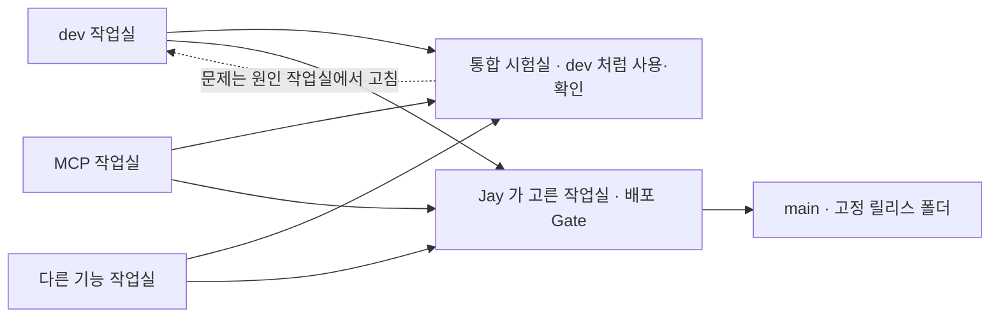

---
tags:
  - mvhub/운영
status: active
updated: 2026-10-15
---

# 기능 작업실과 통합 시험실

owner: Codex · reviewer: Claude · status: 완료

## 흐름 (Jay 2026-10-15)

**작업실 = 배포 단위**다. dev(기존 Claude 작업)도 그중 하나이고, MCP·AI 분석 같은 기능은 각자
브랜치에 두어 섞지 않는다. 작업실에서 커밋하면 **커밋한 쪽이 그 차례에 이 통합 브랜치로 일반
병합**한다 — Jay 는 통합 시험실을 dev 처럼 쓰며(화면 즉시 반영·실제 생성) 합쳤을 때의 문제·버그·
지연을 확인한다. 통합에서 나온 문제는 원인 작업실에서 고쳐 다시 병합하고, 이 브랜치에서 제품 코드를
직접 고치지 않는다. 배포는 Jay 가 고른 작업실만, 통합 검토 뒤 기존 Gate 로 main 에 병합한다.
이 브랜치는 배포 원천이 아니다(MCP 고정 사본 등이 섞여 있다).



미커밋 편집은 그 작업실 화면에만 보인다. 병합 전에 이 폴더의 미커밋을 확인하고 충돌이 나면 멈추고
보고한다. 병합 뒤 통합 화면이 새 코드를 주는지 확인하고서 "반영됨"이라고 말한다. 지침 문서
(AGENTS.md·CLAUDE.md·docs/AGENT_WORKFLOW.md)는 dev 판을 따르고, 이 문서는 통합 시험실 판을 유지한다.
MCP 작업은 아직 미커밋 변경의 고정 사본(`234fcb00`)으로만 들어와 있다 — MCP 작업실이 자기 브랜치에
커밋해 병합하는 방식으로 옮긴다. 실제 생성까지 되는 실사용 모드(dev 와 같은 `data_test`·같은 포트,
한 번에 하나만)는 설계·검토 중이며, 그 전의 격리 모드(`test_workroom.bat`)는 생성이 막혀 있다.
어느 화면이든 백엔드는 수동 재시작하며 `uvicorn --reload`를 쓰지 않는다.

## 현재 작업실 배치

| 작업실 | 브랜치 / 역할 | 화면 / 백엔드 |
|---|---|---|
| 기존 dev | `dev` · 기존 Claude 작업 유지 | 5173 / 8012 |
| 기존 MCP | `codex/mvhub-mcp` · MCP 원본 구현 유지 | 기존 5174 / 8016, 수동 실행 |
| 실행기 구현 | `codex/dev-workrooms` · 새 실행기·운영 정책 | 시험 때 임시 포트 |
| 통합 시험실 | `codex/mvhub-integration` · 모든 작업실 병합 + MCP 사본 | 5175 / 8017(격리 모드) |

통합 작업 폴더는 `C:\Users\FX-PC06\.codex\worktrees\mvhub-integration\MV-hub-S-dev`다.
여기의 `test_workroom.bat`를 실행한다. 데이터·브라우저 프로필은
`C:\Users\FX-PC06\AppData\Local\MVHub-Workrooms\integration-20261015`에 있다.
이 경로와 포트는 이 PC의 준비값이며 실행 코드에 고정하지 않았다. 기존 편집 개선 작업실은
해당 작업자의 작업을 이어가고, 커밋하면 그 차례에 이 통합 브랜치로 병합한다.

## 사본과 커밋

- 기능 브랜치에서 의미 있는 변경을 커밋한다. 문서와 제품 코드 커밋은 분리한다.
- 탐색용 통합은 기준 SHA + binary patch + 미추적 허용 파일의 SHA256 목록으로 고정할 수 있다.
  검증 결과에 이 대상 ID를 묶는다. 움직이는 작업 폴더 전체를 동기화하지 않는다.
- dev에 정식 반영할 때는 검증한 커밋 SHA를 사용한다. 일반 병합으로 이력을 보존하며,
  rebase·강제 푸시·일괄 복사로 다른 변경을 지우지 않는다.
- 통합 성공은 main 병합이나 배포 승인이 아니다. 기존 배포 권한과 Gate는 유지한다.

## 실행 경계

기존 `test_dev.bat` / `MV_agent.bat`는 유지한다. 새 `test_workroom.bat`는 작업실별
포트·데이터 사본·브라우저 프로필로 실행하고, 작업자 에이전트나 CLI 설치·로그인을 시작하지 않는다.
포트가 사용 중이면 기존 프로세스를 죽이지 않고 중단한다. 종료 시 자신의 자식 프로세스만 정리한다.

데이터는 처음 한 번 SQLite backup으로 복사한다. 재실행 때 덮어쓰거나 초기화하지 않는다.
계정·비밀번호 해시는 보존하고 인증 비밀은 새로 발급하므로 기존 계정으로 사본에 로그인할 수 있다.
공유·Comfy 자격증명과 외부 경로 설정, 기존 MCP 권한은 제거하거나 무효화한다. 사본도 개인 데이터이므로
Git이나 공유 산출물에 넣지 않는다. 원본 미디어는 자동 복사하지 않아 과거 이미지 일부가 안 보일 수 있다.

백엔드 전용 진입점은 외부 쓰기·다른 허브/외부 네트워크·명령 실행·실제 생성 경로를 차단한다.
이것은 개발 중 사고 방지 장치이며 OS 샌드박스나 악성 코드 격리 경계가 아니다. 실제 유료 생성,
Resolve 조작, 설치·업데이트·전역 MCP 등록 검증은 이 시험실의 완료 범위에 포함하지 않는다.

브라우저 전용 프로필은 쿠키 충돌을 피한다. 기존 편집 문서는 브라우저 저장소에 있으므로 새 프로필로
자동 이동하지 않는다. 기존 프로필은 그대로 보존한다. 실제 LLM 설정은 시작·종료 시 해시만 대조하며
다른 세션이 변경했더라도 자동 복구하거나 덮지 않는다.
정상 종료·처리된 오류에서 종료 해시를 기록한다. 부모 창을 강제로 종료하면 Job이 자식을 즉시
정리하므로 종료 기록은 남지 않을 수 있다. 이 경로의 보존 여부는 별도 실측에서 대조한다.

## 실행 방법

작업실 루트에 Git에서 제외되는 `.mvhub-workroom.json`을 만든 뒤 `test_workroom.bat`를 연다.
경로는 자신의 환경에 맞춘다. 의존성은 각 소스 폴더에 먼저 준비하며 실행기가 자동 설치하지 않는다.

```json
{
  "runtime": "C:/Users/USER/AppData/Local/MVHub-Workrooms/my-room",
  "backend_port": 8017,
  "frontend_port": 5175,
  "source_db": "D:/my-dev/backend/data_test/db/content_hub.db",
  "python": "D:/my-dev/.venv/Scripts/python.exe"
}
```

`source_db`는 첫 복사 때만 쓰며 이후 원본을 다시 받지 않는다. 창을 닫으면 해당 작업실만
종료된다. 백엔드 수정은 창을 닫고 다시 연다. 다른 작업실에는 다른 runtime과 두 포트를 지정한다.
화면 없는 자동 시험은 `--no-browser`를 사용한다. `.mvhub-workroom.json`·runtime·브라우저
프로필을 커밋하거나 공유하지 않는다.

## 진행과 완료 기준

진행률은 완료 단계의 가중치 추정이며 코드량·시간의 실측 백분율이 아니다.

| 단계 | 비중 | 상태 |
|---|---:|---|
| 설계 합의·대상 고정 | 10% | 완료 |
| 정책·실행기·데이터 분리 | 30% | 완료 |
| 격리·동시 실행 시험 | 20% | 통과 |
| MCP 통합 화면·회귀 | 20% | 통과 |
| 독립 리뷰·최종 근거 대조 | 20% | 통과 · 최종 합의 완료 |

완료 기준 100%. 실행기·데이터·접근 차단 관련 시험 29개와 두 작업실 동시 실행 실측 통과.
전용 임시 브라우저 두 개의 쿠키 분리, 로그인·MCP 연결창·편집 화면과 통합 HTTP 시험도 통과했다.
독립 리뷰의 첫 호출은 최종 판정 미회수였으며, 같은 독립 세션에서 판정을 회수하고 수정 후 재검토·최종 대조를 마쳤다.
사용자 요청에 따라 매시간 진행률·지난 시간의 완료·현재 작업·남은 작업과 예상 시간을 보고한다.
완료 또는 취소 시 정기 보고를 종료한다.

설계: Claude 실제 `claude-fable-5-1`, 세션 `26bd8c3b-f94b-49f8-a470-01ff18050c2f`.
추론 high 요청, 실제 effort 메타데이터 미제공. Codex 사전 검토 후 추가 계약에 실제 동의했다.
독립 리뷰는 구현 후 별도 Claude 세션 `ac58d3cb-a941-4dcf-ac28-5c6975a9a65e`에서 수행했다.
실제 모델은 `claude-fable-5-1`이며, 최종 판정은 로컬 작업실 실행기·선택 통합 화면 범위의 마감 동의다.

완료에는 원본 DB·사용자 설정 보존, 다른 실행 앱 유지, 두 시험실의 포트·쿠키·데이터 분리,
재실행 보존, 자신의 프로세스 정리, 유료/외부 쓰기 차단, 통합 회귀와 독립 리뷰 근거가 필요하다.

## 검증 증거 (2026-10-15)

모든 시험은 별도 사본/임시 데이터에서 수행했다. TEMP 경로는 로컬 증거 위치이며 공유·배포 대상이 아니다.

| 범위 | 결과 | 로컬 증거 폴더 (`%TEMP%` 아래) |
|---|---|---|
| 작업실 단위·기존 격리 회귀 | 29 passed | pytest 직접 실행 |
| 두 실행기·충돌·재실행·강제 종료 | 동시 ready, DB 분리, 원본/설정 해시 보존, 부모 종료 시 각 자손 정리 | `mvhub-workroom-launcher-probe-2aeb9bef79bd46e0bbcf3bde709fb7cf` |
| 최신 dev + MCP 회귀 | backend 169, frontend 136, adapter 21 passed; 타입·아키텍처·Vite build 통과 | `mvhub-mcp-snapshot-ukvakk25` |
| SDK → HTTP → 실제 main.app → 임시 DB | 19.56초, 두 클라이언트·재시작·권한·중복 요청·JPEG 디코딩 통과 | `mvhub-integration-sdk-jisjtoeu 한글 공백` |
| 통합 UI·브라우저 쿠키 | 로그인·연결창·편집 확인, 프로필 간 fixture 쿠키 분리, 생성/등록 요청 0 | `mvhub-integration-ui-probe-a4aedb6097df40bda3b3183bf9a6be1f` |

SDK 시험의 공급자 결과는 합성 fixture이며 유료 호출은 0건이다. UI에는 시험 모드의 모델/Resolve 503과
미로그인 조회 401 등이 기록됐지만 JS 예외는 없었다. 이를 실제 생성 성공이나 네트워크 오류 0건으로
표현하지 않는다. MCP 통합에서 App.tsx의 충돌 한 곳은 sceneBackupSkippedIds와 refreshSceneById를
모두 보존했다. 기존 계정 시험은 getter 함수 동일성 대신 실제 A/B 계정 고정·복원 경로를 검증했다.

리뷰 P2의 Windows native copy 경로는 Python 3.14.3의 `shutil.copy2`가 `_winapi.CopyFile2`를
사용함을 소스·실행으로 확인했다. 실패 회귀를 먼저 만든 뒤 해당 audit 이벤트의 목적지 검사와
shutil 복사/이동 검사를 추가해 통과시켰다. 모델 목록은 cold start 시 CLI가 필요해 시험실에서는
차단한다. 화면 제목과 하단에 시험실 포트·실제 생성 꺼짐을 표시하며 제품 HTML은 바꾸지 않는다.

실행기의 독립 시험에서는 원본 LLM 설정 해시가 일치했다. 별도로 Claude 리뷰가 함께 실행 중이던
통합 서버의 시작/종료 사이에는 `.claude.json` 해시 변경을 감지했다. 변경 원인을 단정하거나 되돌리지
않았다. 종료 해시 불일치는 경고이며 외부 세션의 변경과 실행기 변경을 자동 판별하지 않는다.

## 최종 고정 대상과 남은 범위

- 실행기 코드: `4d51d933d7c8c4b2702c06a6e82a652956db454d` (`codex/dev-workrooms`).
- 선택 MCP 통합 코드: `234fcb00a80b9e95872947d19851046c27a586ac` (`codex/mvhub-integration`).
- Claude 최종 근거: `%TEMP%\mvhub-workroom-review-e677438ac95c4d589c599b8552be01c0\closing.json`.
- WAL 회귀는 원본 연결을 연 상태에서 커밋된 데이터를 복사하고 원본 DB·WAL 해시 불변을 확인했다.
  SQLite 조정용 SHM 파일의 불변까지 보장한 것은 아니다.
- 사용자 확인 창은 `[시험실 5175] MV Hub`다. 로그인은 전용 프로필에서 수행한다.
- 기존 MCP 원본 53개 파일의 해시는 보존됐다. 마지막 확인 때 기존 5174/8016 서버는 종료돼 있었으며
  종료 원인은 확인하지 못했다. 동시 실행 실측 중에는 기존 프로세스가 보존됐고 임의로 재시작하지 않았다.
- 정책·운영 문서도 새 브랜치에만 반영했다. dev/main 병합·푸시·배포는 하지 않았다.

이번 구축 범위는 완료다. 실제 유료 생성·전역 LLM 등록·배포는 별도 검증과 권한이 필요한 후속 범위다.
프로젝트 운영 계약은 이 문서에 보존하며 볼트에 별도 사본을 만들지 않는다.

최종 정리 검사: 두 트리 모두 graft wiring graph in sync, 코드 맵 누락 0, 생성 목록 최신,
문서 린트·diff 공백 검사·AGENTS/CLAUDE 본문 일치를 확인했다. 현황판은 20,472 bytes·6개 항목이다.

## 자료 표시 보완 (2026-10-15)

기존 구축 완료는 실행·격리 범위였다. 실제 dev 자료를 보는 시험실로 안내한 것은 불충분했다.
원래 snapshot 함수가 실제 프로젝트 폴더 연결을 제거하고 미디어를 복사하지 않아, 폴더가 사라지고
카드가 원본 없음으로 표시됐다. 이제 별도 명시 도구로 사본 자료를 추가한다. 자동 시작 때 동기화하지 않는다.

```powershell
# 소스 폴더에서, 먼저 계획만 확인한다. source-data는 개발 자료 폴더다.
& '<venv>\Scripts\python.exe' tools\workroom_materials.py --source-data '<dev>\backend\data_test' --runtime '<시험실 runtime>'
# 시험실 창을 닫은 후 같은 명령에 --apply를 붙여 적용한다.
```

기존 DB·미디어를 덮거나 지우지 않는다. 기존 파일 내용이 다르면 보존하고 수량을 보고한다.
미디어의 숨김 원본 캐시(.thumb-sources)도 실제 바이트로 복사하며 원본 hardlink/junction을 만들지 않는다.
media 바로 아래 .thumbs는 절대 경로 기반의 재생성 캐시라 제외한다. 중첩·assets의 동명 폴더는 보존한다. Render는
실제 디렉터리 구조만 복제하므로 NAS 파일 자체와 폴더 파일 수·최종본 저장 상태까지 복제하는 것은 아니다.
프로젝트 ID·이름을 확인하고 사본 content_hub.db의 개인 project_folder_link만 추가하거나 빈 root만 채운다.
기존 selected_path·공유 root·시험실 작업은 유지한다. 적용 직전 사본 DB 백업을 runtime에 남긴다.

로컬 조사: media 32,307개·2,231,544,097 bytes, assets 5개·17,427,669 bytes.
뻘뻘뻘 Render 396개 폴더(e001/c0010 포함), RnD 10개 폴더를 확인했다. 산해학원 원본 경로는 접근 불가다.
이미지755개와 영상467개의 썸네일 자료는 로컬에 있지만, 영상131개는 썸네일이 없고 DB의
로컬 영상 원본 경로139개는 dev에도 파일이 없다. 모든 원본 확대·재생을 보장하지 않는다.

실제 Claude 설계 합의: Fable5.1, 세션051d428a-60eb-4d22-9cf3-ece9b34ac43d.
저장 DB는 content_hub.db라는 실제 소스 근거로 초기 manage_hub 표기를 정정하고 합의했다.
보완 검증: 회귀 28개 통과, 통합 트리의 신규 회귀 6개 통과. 독립 Claude 리뷰에서 필수 지적 없음.
코드 커밋은 실행기 브랜치 2a19e389, 통합 브랜치 d4131408이다.

실제 적용 대상 1,380개(재생성 캐시 제외), 신규 1,336개·기존 44개 해시 일치·충돌 0개.
뻘뻘뻘·RnD 개인 폴더 연결 2개를 추가했다. 원본 DB 해시·전체 테이블 내용은 동일했고,
사본에서 바뀐 테이블은 project_folder_link 하나뿐이었다(앱 재시작 전에 비교).
최초 복사 중 발견한 재사용 불가 .thumbs는 Claude와 계약을 수정해 후속 복사에서 제외했다.
앞서 복사된 캐시와 남은 임시 파일은 삭제하지 않았다.

독립 UI 확인 8/8 통과: 시험 계정의 카드 4개 실제 표시, 뻘뻘뻘/e001/c0010 표시,
폴더 API 397개 노드(루트 포함), 대표 이미지3·영상 포스터2의 HTTP200·이미지 해독 성공.
사본에서 이미지755·영상포스터467개의 썸네일 파일 존재를 확인했다. 전체 HTTP 전수검사는 아니다.
PNG·MP4·WebP 표본3개의 SHA일치·다른 파일·링크수1 확인, 원본 DB 해시 보존, 유료/등록/외부요청0,
JS예외0. 로그인 전401과 시험 모드503은 관측됐다. 검증 브라우저만 종료했고 전용 사용자 창은 유지했다.

증거: runtime의 materials-apply-result-v2.json, materials-preservation-result.json,
%TEMP%/mvhub-material-ui-independent/{result.json,target-coverage.json,01-grid.png,02-folders.png}.
Claude 독립 세션97a8b09c-43c8-4035-80ba-870514208d8c, 실제Fable5.1. 최초180초 호출은
최종판정 미회수였고 추가56초에서 실제 판정을 회수했다. 재생성 캐시 제외는 추가30초 계약 검토를 받았다.

Ponytail 최소 변경 원칙과 graft callers prepare_runtime·blast·build/check를 적용했다.
이 보완은 프로젝트별 사본 준비 절차이므로 볼트에는 별도 사본을 기록하지 않았다.

최종 공동 마감: 실제 Claude Fable5.1이 정확한 cache 제외 delta와 집계 결과3개를 읽고
자료 표시 복구 범위에 동의했다(필수 미해결 없음, evidence-final.json, 27.43초).
처음 증거읽기는 권한경계로 거부돼 통과로 처리하지 않았고, 허용된 리뷰 TEMP에 집계 JSON만
바이트 복사해 원본/사본 SHA3개 일치를 확인한 뒤 판정을 회수했다.
근거 폴더: %TEMP%/mvhub-material-review-ccac0e97a5754b82b19bcadd3e210a52.
진행률 100%는 이 자료 표시 보완 범위이며 원본 누락·원격 원본 재생·실제 유료생성의 해결을 뜻하지 않는다.
