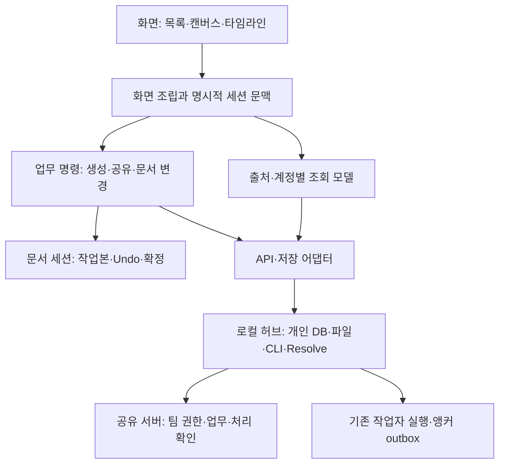

---
aliases:
  - MV Hub 서비스 구조 근본진단
tags:
  - mvhub/구조
  - mvhub/설계
status: active
updated: 2026-10-21
---

# 실제 서비스 관점의 구조 근본진단과 상세설계 v1

owner: Codex(총괄·통합) · reviewer: 실제 Claude Fable 범위별 설계·구현 검토 승인과 Codex 근거 대조; 새 브라우저 실측은 Codex 직접 확인
status: 검증 중(현재1644/d6eea3: 원래T16/20=80%, 시간·운영준비율 아님. 전체source-only gate6620/4716·문서/구조/build PASS·전후지문불변. 실제Fable128읽기 잔여조건검토 완료. 최종동일ZIP/설치/운영/실자료전환·T12/T15/T17/T19 미완료; §20.123)
touched_paths: dev2의 P0 검증 도구, P1 생성, P2 조회/변경 신호, P3 문서 세션, P4 공유 명령, P5 DB, P6 설치·복구, P7 경계 검사와 관련 시험·문서. 실제 파일 지문·기존 변경 보존·검증 범위는 §20 및 증거 폴더 참조. 정책 파일·운영 공유 서버/NAS·설치본·실제 배포 변경 없음. 원본의 별도 안전 DB는 승인된 재시작에 따른 스키마/상태 갱신을 확인했다(§20.79).
updated: 2026-10-21

## 요청과 결론

사용자는 파일을 조금씩 분리하는 작업을 반복하는 대신, 실제 서비스로서 프런트엔드·백엔드·DB·배포의 근본 원인을 분석하고 잘 설계된 공개 사례와 비교한 목표 구조를 요청했다. Claude 사용량 한도로 Codex만 진행하며, 사용자가 나중에 요청할 때 Claude가 독립 검토할 수 있는 근거를 남긴다.

**추천은 기술 전면 교체가 아니라, 업무별 소유권과 실행·저장·배포의 계약을 먼저 확정하는 모듈형 구조다.** 브라우저, 로컬 허브, 팀 서버, 작업자 에이전트라는 실제 실행 위치는 유지한다. 각 위치의 내부를 업무 단위로 나누고, 경계를 통과하는 명령·조회·확정 상태를 명시한다.

현재 큰 파일은 원인인 동시에 누적 결과다. 화면에서 업무를 꺼내도 같은 업무의 규칙이 다른 화면·훅·라우터·스크립트에 남으면 새 변경 때 조정 코드가 다시 늘어난다. 이번 제안은 **기능의 정답과 완료를 누가 소유하는지, 다른 곳이 어떤 계약으로 접근하는지, 그 규칙을 무엇이 자동 검사하는지**를 바꾸는 것이다.

앞선 A~D의 “완료”는 합의한 구현·격리 검증의 완료다. 전체 서비스 구조가 최적화됐거나 운영 준비가 모두 끝났다는 뜻은 아니다. 8시간 부하와 24개 DB 무결성 결과는 유효한 해당 조건의 증거로 유지하며, 구조 품질·분산 원자성·최종 배포 자격의 증거로 확대하지 않는다.

## 1. 대상·방법·근거의 수준

- 대상: `D:\ClaudeCode\MV-hub-S-dev2`, branch `dev2`, HEAD `16508543a67fe315c1499c6e2cf72ea83d8d2a61`와 기존 미커밋 수정본.
- 감사 기준선: `predeploy-reports/architecture-audit-2026-10-18/baseline.json`. 지정한 소스·시험·도구·배포 경로 1,458파일의 지문을 보존했다. 저장소 전체 모든 파일의 지문이라는 뜻은 아니다.
- Codex 분야별 읽기 조사: 프런트 `archive_verify`, 백엔드·DB `d_perf`, 배포·운영 `d_reconnect`. 총괄은 핵심 소스·호출자·수신자·검사 설정과 위험 경로를 다시 읽어 통합했다. 이 조사는 Claude의 독립 승인이나 새 구현 검증이 아니다.
- 실제 서비스 가정: Windows 로컬 허브·작업자 설치본과 팀 공유 서버, 로컬 파일·CLI·Resolve 및 외부 공급자가 함께 동작한다. 기존 100명 합성 시험은 참고 기준이다. 실제 사용자 수·쓰기 부하·서비스 가용성 요구는 조사하지 않았다.
- 최초 진단(§1~10)에서 실행한 것은 소스 파싱·지문·정적 집계와 가짜 환경 사전 대조다. 그 시점에는 앱·서버·smoke·전체 시험·실제 DB·NAS·외부 생성·설치·배포를 실행하지 않았다. 이후 구현·실측은 §20의 시점별 근거를 따른다.
- 공개 자료의 구조 원칙과 현재 코드의 소스 경로를 비교했다. 공개 프로젝트의 전체 코드 품질을 인증하거나 우리 앱과 동등한 성능 비교를 한 것은 아니다.
- 아래 “확인”은 소스나 안전한 정적 대조의 직접 근거다. “제안”은 아직 구현·성능·운영 효과가 검증되지 않은 설계다.

### 측정한 배치 지표

| 범위 | 파일 수·규모 | 해석 |
|---|---|---|
| 프런트 lib | 273개 TS/TSX, 45,173줄 | 훅·업무 흐름·API·순수 계산·저장소가 같은 평면 이름공간에 공존 |
| 프런트 components | 188개 TS/TSX, 54,664줄 | 화면별 그룹은 이미 존재. 폴더 재배치만으로 소유권이 생기지 않음 |
| 백엔드 routers / usecases | 36개·21,840줄 / 6개·2,179줄 | 일부 업무 조합이 라우터에 남는 조사 출발점. 줄 수 비율은 품질 점수가 아님 |
| 백엔드 repo / services | 57개·21,938줄 / 81개·26,972줄 | 데이터·IO 분리 자산은 이미 많음. 새 계층을 무조건 추가할 이유는 아님 |
| App / SceneBoard | 2,787줄 / 4,409줄 | 이전 책임 분리 후에도 화면이 업무 조립 중심 |
| 정적 상대 import 선언 | App 99개, SceneBoard 77개 | 최상위 TS import 선언만 센 값. 동적 의존·실행 결합의 전수 측정은 아님 |

## 2. 잘 설계된 공개 사례와 무엇을 비교했나

| 비교 자료 | 가져올 원칙 | 우리 앱에 적용할 판단 | 그대로 가져오지 않을 것 |
|---|---|---|---|
| [VS Code의 소스 조직](https://github.com/microsoft/vscode/wiki/Source-Code-Organization) | 공통 계산·브라우저·호스트 실행 환경을 구분하고 업무 내부 접근은 명시한 경계로 제한 | 로컬 CLI/파일/Resolve와 팀 서버 업무를 인터페이스로 구분. 기능 내부 상태를 화면 밖에서 직접 수정하지 않기 | VS Code 규모의 DI 프레임워크·확장 호스트·전체 폴더 구조 |
| [Bulletproof React의 기능 중심 구조](https://github.com/alan2207/bulletproof-react/blob/master/docs/project-structure.md) | 기능별 코드 응집과 단방향 의존, 경계 검사 | lib를 단순히 더 늘리는 대신 생성·문서 편집·미디어 등 업무별 명령/조회/화면을 응집 | 예제의 모든 도구·하위 폴더·전역 export 파일. 해당 자료도 불필요한 폴더 생성을 요구하지 않음 |
| [React 상태 구조 원칙](https://react.dev/learn/choosing-the-state-structure) | 중복·모순 상태와 동기화 부담을 줄이고 상태 주인을 정함 | 서버 자료 사본, 사용자 작업본, UI 선택을 구별. 같은 자료의 갱신 정책을 여러 화면이 다시 구현하지 않기 | 모든 상태를 하나의 전역 store에 합치기 |
| [Microsoft의 웹 아키텍처·eShopOnWeb 참조 설명](https://learn.microsoft.com/en-us/dotnet/architecture/modern-web-apps-azure/common-web-application-architectures) | 단일 배포 안에서도 업무 핵심과 UI·인프라를 분리할 수 있음 | React/FastAPI와 현재 실행 위치를 유지하며 업무 단위·트랜잭션 경계를 먼저 정리 | .NET 전환, 마이크로서비스나 컨테이너의 의무 도입 |
| [FastAPI의 큰 앱 구성](https://fastapi.tiangolo.com/tutorial/bigger-applications/) | HTTP 진입점과 의존성·라우터의 조립 | 기존 APIRouter를 유지하고 HTTP와 복구/저장 업무 조합을 분리 | 라우터 파일만 잘게 나누면 설계가 끝났다는 판단 |
| [SQLite 적합 조건](https://www.sqlite.org/whentouse.html), [WAL](https://www.sqlite.org/wal.html), [ATTACH](https://www.sqlite.org/lang_attach.html) | 한 파일의 쓰기 직렬화와 여러 파일의 지속성 경계를 구분 | 로컬 DB는 우선 유지. 공유 서버 이전은 쓰기 확장·가용성·복구 목표로 판단 | 100명 연결만을 이유로 PostgreSQL로 일괄 이전 |
| [Google SRE 릴리스 엔지니어링](https://sre.google/sre-book/release-engineering/) | 재현 가능한 빌드·명확한 산출물 식별·패키지 시험·승격 연결 | 검증한 ZIP과 설치한 ZIP을 지문으로 연결하고 운영 위치 빌드에서 준비·전환 방식으로 개선 | Google 규모의 빌드·클러스터 시스템을 복제 |

위 비교에서 도출한 아래 목표 구조와 우선순위는 Codex의 제안이다. 외부 자료가 우리 프로젝트의 구체적 변경이나 운영 성공을 보증하는 것은 아니다.

## 3. 근본 원인과 구체적 근거

아래 번호는 참조용이다. 조치 우선순위는 다음과 같으며, 정적 위험을 실제 장애 발생으로 해석하지 않는다.

| 우선순위 | 대상 | 이유·확인 한계 |
|---|---|---|
| 우선 보완 | F8 검증 격리·결과 자격 | 검증 자체가 다른 DB·dist를 선택할 수 있는 정적 경로. 실제 피해·오승격은 미확인 |
| 운영 안전 계약 | F5 DB 원자성/호환, F7 배포 신원/복구 | 전원 손실·중간 실패·구버전 복귀 조건에서 복구 보장이 달라짐. 새 장애 재현은 하지 않음 |
| 반복 수정의 구조 원인 | F1 문맥, F2 조회 상태, F3 완료 의미, F6 경계 검사 | 여러 소비자가 같은 정책을 다시 맞춰야 하는 현재 소스 배치를 확인 |
| 사용 목적에 따라 결정 | F4 업무 사실의 내구성 | 메트릭을 업무 원장으로 쓸 때 필요한 보장. 현재 best-effort 계약을 무조건 결함으로 보지 않음 |

### F1. 업무 소유권이 화면·전역 문맥·경로 분기에 흩어져 있다

**확인:** App이 생성 제출뿐 아니라 씬 그래프를 하단 프롬프트로 해석한다(`App.tsx:1518`). SceneBoard는 작업본·씬 전환·Undo·입력 예약을 `cardsSceneId/switchingRef`, `useSceneHistory`, `useSceneInputCommit` 사이의 시간 순서로 연결한다(`SceneBoard.tsx:534`, `useSceneHistory.ts:167`, `useSceneInputCommit.ts:36`). 백엔드는 `_proxy.py:582,617,654,857`의 전송 경로 분기와 개별 라우터의 소유권 분기를 함께 사용한다. DB는 `db_paths.py:20`에서 환경·활성 계정으로 선택된다.

**반복되는 이유:** 새 업무가 일부 문맥만 받고 나머지는 현재 전역 상태를 다시 읽으면, 비동기 대기 중 계정·문서가 바뀔 때마다 해당 위치에 새 가드를 붙여야 한다. 현재 가드는 필요한 보호이며 잘못된 코드라는 뜻은 아니다.

**목표:** 진입점에서 계정·권한 주체·공간·서버 출처·DB 범위·실행 모드·세대를 확정한 불변 작업 문맥을 만든다. 비밀 토큰은 통신 어댑터에 남기고 업무 DTO나 새 로그에 넣지 않는다. 문서 변경은 활성 화면을 암묵 참조하지 않고 대상 문서 세션에 명령으로 전달한다. 기존 account pin·문서 세대·씬 전환 차단은 동등성이 확인될 때까지 유지한다.

### F2. 같은 서버 자료의 갱신 규칙을 여러 화면이 소유한다

**확인:** App 목록/탭 캐시(`useGenerationLibraryData.ts:94,164`), 씬의 자료와 생존 캐시(`useSceneGenData.ts:95`, `sceneGenDataStore.ts:8`), 편집 풀(`useEditSequence.ts:58`)이 별도 사본을 관리한다. 태그 저장과 각 화면이 재조회·낙관 반영·순서·필드 보존을 조정한다. DOM·BroadcastChannel·WS는 전달 의미도 다르다(`appEvents.ts:12,52`, `libraryBroadcast.ts:31`, `EditTab.tsx:950`).

**반복되는 이유:** 필드 하나의 변경도 생산자와 여러 소비자가 각자의 갱신 규칙을 맞춰야 한다. 앞선 부분 조회 개선은 실제 전송량을 줄였지만 이 정책 소유권까지 통합한 것은 아니다.

**목표:** 서버 레코드의 반영·신선도·무효화는 공통 조회 모델이 소유한다. 화면별 목록 포함 여부·필터·집계·선택은 구별한다. 의미 있는 변경 신호와 DOM/BC/WS 전송 어댑터를 분리한다. 구버전·알 수 없는 신호의 전체 재조회 보정은 유지한다.

**금지할 단순화:** Generation을 ID 하나의 전역 Map으로 합치지 않는다. 로컬과 팀 자료의 ID·소유권은 다르며 같은 job_id라도 별개 카드일 수 있다(`useGenerationLibraryData.ts:52–62`). 자료 키에는 서버 출처·계정·권위 영역·실제 API 식별자가 필요하다. 세대와 workspace/filter는 조회 티켓·목록 키에 따로 둔다(§13.4). 서버 조회 사본과 편집 문서/Undo도 합치지 않는다.

### F3. 생성·공유의 완료 의미가 진입점·네트워크 상태 해석에 중복된다

**확인:** 프롬프트(`useSpotlightSubmit.ts:207–235`), 씬 배치(`useSceneGenerationSubmission.ts:153–230`), MCP(`mcpPlans.ts:175–195`)가 표식 확정→제출→거절/결과 불명→로컬 연결을 각각 조립한다. `sceneGenerationSubmission.ts:62`는 불명 결과를 메시지 문자열과 비교한다. 공유는 서버가 명령별 완료 확인을 주지 않아 로컬 intent/CAS와 24시간 관측으로 수렴한다(`share_state_reconciler.py:49–54`).

**목표:** UI별 입력·안내는 유지하되, 준비 실패/확실한 거절/접수 불명/서버 접수 후 로컬 반영 실패/성공을 구조화된 결과로 표현한다. 서버에 operation ID·요청 hash·대상 revision·처리 결과를 호환 추가하는 안을 검토한다. 명령 완료와 최신 표시 상태의 조회를 구분한다.

**보존:** 기존 중복 방지 예약·claim, 생성 위치의 IndexedDB 확정, agent 앵커 outbox와 공유 intent CAS를 대체하지 않는다. 외부 공급자까지 exactly-once를 보장한다고 주장하지 않는다. 구서버에는 현재의 안전한 관측 경로가 필요하다.

### F4. 정답 상태·필수 전송 사실·관측 로그의 내구성 구분이 충분히 드러나지 않는다

**확인:** 결과 본체 종결은 `repo/generations.py:496`에서 원자적으로 처리한다. 그 뒤 journal·PM·WS는 별도 단계다(`usecases/gen_requests.py:696`). `services/event_journal.py:14`는 저장 실패를 로그로 남기고 진행하며 PM/dirty도 best-effort 경로가 있다. 이는 부가 메트릭 장애가 생성을 막지 않는 기존 계약이다.

**문제의 조건:** 이 관측 이력을 완전한 업무 원장이나 청구 근거로 취급하면 실제 보장보다 강하게 해석하게 된다. 이번에 결과 누락을 새로 실행 재현했다는 뜻은 아니다.

**목표:** 필수 결과·재전송/청구에 필요한 사실만 본체와 같은 트랜잭션의 작은 outbox에 둔다. WS·운영 로그·재생성 가능한 통계는 계속 부가 기능으로 남긴다. `trash.py:429`와 기존 telemetry의 같은 연결 outbox를 재사용하며 시스템 전체를 event sourcing으로 바꾸지 않는다.

### F5. 물리 DB 분리와 업무 원자성·버전 계약이 어긋난 곳이 있다

**확인:** content/trash를 WAL+ATTACH로 이동한다. 정상 SQL 오류의 롤백과 전원 손실 때 여러 파일의 지속성은 다른 보장이다. `trash.py:10`의 강한 크래시 설명은 `trash.py:799`, `backup.py:263–267`의 실제 한계 설명과 불일치한다. 이는 기존 보류 이슈다. SQLite 공식 문서도 여러 ATTACH DB의 WAL 트랜잭션은 세트 전체 원자성을 보장하지 않는다고 설명한다.

**확인:** `db.py:372`와 `db_migrations.py:226,250`는 구조 검사 기반 멱등 보강을 한다. 확인한 경로에는 일관된 migration 적용 원장이 없고, backup의 `schema_version`은 `PRAGMA user_version`에서 읽는다(`worker_backup.py:170`). 조사한 경로에서는 이를 의미 있는 버전으로 올리는 구현을 찾지 못했다. trash payload는 소비 시 옛 형태를 해석한다. 이 사실만으로 현재 DB가 손상됐다는 뜻은 아니다.

**목표:** 같은 업무에서 반드시 함께 확정할 사실을 정한 뒤 물리 배치를 선택한다. 현재 스키마를 baseline으로 등록하고 새 migration ID·checksum·적용 상태, 백업 형식 버전, payload 버전을 구분한다. 옛 payload는 복원 입구에서 변환한다. 기존 멱등 마이그레이션 전체 재작성은 피한다.

### F6. 문서의 구조 규칙과 실행 가능한 경계 검사가 일치하지 않는다

**확인:** 프런트 `eslint.config.js:6–27,67–125`는 선별된 순수 파일과 순환 의존을 warning으로 검사한다. 모든 feature 내부 접근·UI/API/저장 경계를 차단하지 않는다. 반면 `backend/tests/test_architecture_boundaries.py`는 역방향 계층 import와 순환을 실패로 검사하는 자산이 이미 있다.

**목표:** 목표 모듈마다 허용 의존·공개 계약·상태 소유자를 정하고, 전환 완료한 범위부터 기존 ESLint/AST 검사로 강제한다. 기존 위반을 숨기는 전역 예외나 파일 줄 수 제한을 완료 기준으로 쓰지 않는다. 구조 검사 통과는 업무 소유권까지 바르게 설계됐다는 보증이 아니므로 대표 흐름 시험과 함께 판단한다.

### F7. 시험·패키지·서버 설치·DB 되돌림이 같은 릴리스 신원으로 닫히지 않는다

**확인:** 소스 gate가 시험과 빌드를 한 뒤 `make_release.ps1:515–527`이 다시 빌드한다. `candidate.json`은 ZIP SHA·크기·판을 담지만 소스 SHA·시험 run·DB 호환 범위는 포함하지 않는다(`:754–761`). ZIP 동일 바이트 승격·동일 이름 재제작 금지·원자 교체는 이미 있다. 부족한 것은 시험 증거와 ZIP의 연결이다.

**확인:** 공유 서버 갱신은 `update_git_worker.bat:112,183–213`에서 운영 작업 트리 pull→의존성 설치→빌드를 한 뒤 재시작한다. 중간 실패에 pending marker로 다음 실행을 이어갈 수 있지만, 소스·의존성·dist를 이전 묶음으로 복귀시키는 계약은 아니다.

**확인:** 파일 교체 실패 복원과 사용자 DB 보존은 있다. 새 앱이 DB를 바꾼 뒤 구 ZIP으로 돌아갈 수 있는지는 별도다. 현재 실제 비호환을 재현한 것은 아니다.

**목표:** 선택한 소스→한 번 만든 불변 산출물→같은 지문에 연결한 시험→공개 승인→같은 산출물 설치→실행 build ID·ready 확인→DB 호환에 맞춘 복구로 연결한다. 서버와 작업자가 같은 ZIP일 필요는 없지만 같은 릴리스 계약으로 추적돼야 한다.

### F8. 검증 도구의 격리·실행 결과 계약이 도구마다 다르다 — 우선 보완

**직접 확인한 정적 위험:** `smoke_release_package.py:163–174`, `smoke_server_boot.py:58–76`는 부모 환경을 복사하고 DATA 등 일부만 덮는다. 가짜 환경 사전과 AST 대조에서 DB·MEDIA·SHARED·ASSETS_DIR·BACKUP_DIR·FRONTEND_DIST가 남았다. server smoke에는 EXTERNAL_RECOVERY도 남았다. 제품 import·서버·실제 DB 접근은 하지 않았다.

`db_paths.py:22–24`는 DB 환경을 DATA보다 우선한다. `main.py:313→db.py:375–387`의 기동은 그 DB에 스키마를 적용할 수 있다. FRONTEND_DIST가 남으면 패키지 내부가 아닌 다른 빌드를 확인할 수도 있다. **실제 피해는 미확인**이나 이 두 smoke는 보완 전 실행하지 않는 것이 타당하다. 이미 있는 `conftest.py:35–43`, `load_test_100.py:453–474`의 환경 초기화 계약을 재사용하는 것이 최소안이다.

**실행 결과의 정적 위험:** `predeploy_gate.ps1:212–232`는 성공 끝에서만 고정 `predeploy-latest.json`을 쓴다. 이전 성공 후 새 실행이 실패하면 옛 성공이 남을 수 있다. Skip 실행도 `passed=true`이며 제외는 별도 필드다. 문서는 최종 승인에 쓰지 말라고 제한하지만 결과 형식에 배포 자격이 따로 없다. 잘못된 자동 배포가 실제 발생했다는 증거는 없다.

**목표:** 실행마다 고유 run ID로 running/failed/passed·대상 지문·시험 목록·제외·정리 상태를 남기고, `release_eligible`을 별도로 계산한다. 환경은 깨끗한 기본값으로 시작해 필요한 값만 추가하며, 실제 경로가 임시 루트 안인지 확인한다. 이전 8시간 harness의 환경 초기화·관측 결과와 이 두 도구의 한계는 구분한다.

## 4. 목표 구조: 업무 경계를 가진 코드, 명시한 실행 위치



업무 모듈의 예시는 생성, 공유·라이브러리, 문서 편집(캔버스/타임라인), 미디어 보존·내보내기, 팀 관리다. 인증·통신·런타임·릴리스는 공통 실행 기반이다. 이 이름만으로 새 서비스 프로세스나 DB를 만들지 않는다.

### 책임별 배치 제안

| 책임 | 현재 주 위치 | 목표 소유자와 접근 |
|---|---|---|
| 화면·선택·메뉴·배치 | App/SceneBoard/EditTab 및 기존 컴포넌트 | 기능 화면·컨테이너. 업무 순서·SQL·파일 IO는 직접 소유하지 않음 |
| 생성 제출·결과 분류 | Spotlight/Scene/MCP 훅과 api | 생성 업무 명령. UI 입력 어댑터는 다르게 유지하며 결과 계약 공유 |
| 서버 자료 조회·갱신 | 여러 목록 훅·캐시·이벤트 소비자 | 출처·계정별 조회 모델. 목록 포함/집계와 엔티티 필드 정책을 분리 |
| 캔버스·타임라인 편집 | 화면 state/ref + 저장/Undo 훅 | 문서별 편집 세션. 외부 결과는 대상 ID·세대가 있는 명령으로 반영 |
| 순수 계산·정책 | lib의 sceneEdges/editTimeline 등 | 해당 업무의 domain. React·HTTP·브라우저 저장 접근 금지 |
| HTTP·권한·위임 | router·proxy | 전송 어댑터. 업무 문맥을 확정하고 usecase 호출 |
| 업무 성공·커밋·필수 outbox | router/usecase/repo 조합 | usecase가 원자적으로 확정할 업무 범위를 정하고 repo가 동일 연결 트랜잭션을 수행. 외부 IO·대기는 커밋 밖에서 처리 |
| 배포·시험 증거 | gate·release·updater 스크립트 | 공통 릴리스 식별자에 묶인 빌드 설명서·시험 증거·설치 기록 |

### 물리 폴더는 경계 확정 후 옮긴다

- 프런트 예시: `app/`는 부팅·화면 조립, `features/generation/`, `features/canvas/`, `features/timeline/` 등은 업무 묶음. 공통 타입·계약과 인증/통신 기반은 기존 shared 성격의 위치에 둔다.
- 서로 다른 feature는 다른 feature 내부 store를 읽지 않는다. 필요한 공통 계약을 하위 타입 계층에 두고 App에서 실제 구현을 주입·연결한다. 전체를 re-export하는 거대 index는 만들지 않는다.
- 백엔드는 기존 `routers→usecases→repo/services`를 활용한다. usecase/repo/services 안의 업무 묶음부터 응집하며, 현재 import facade와 API URL은 호환 어댑터로 유지한다.
- 폴더별로 domain/api/store/hooks를 빈 채 미리 생성하지 않는다. 상태 주인·명령/조회 경계가 바뀌지 않는 단순 파일 이동은 구조 개선 완료로 세지 않는다.
- 서버 기동·종료 순서와 미들웨어 조립은 composition root에 남긴다. 그 안에서 호출하는 구현을 분리할 수는 있으나 회수 순서를 여러 모듈에 흩지 않는다.

## 5. DB는 “더 나누기”보다 원자성·호환성 단위로 설계한다

| 실제 자료 | 현재 물리 소유 | 목표 기준 |
|---|---|---|
| 개인 generation/asset/gen_request/share intent | 계정별 content DB | 요청 종결·결과·필수 재전송 사실을 같은 확정 단위로 처리 |
| 팀 계정·프로젝트·PM 업무 | 공유 서버의 content DB 테이블 | 권한 확인·업무 변경·처리 확인의 서버 소유권 |
| 팀 생성 통계 | 별도 manage_hub DB의 team_generation_fact | 멱등 수신·재구성 가능한 집계. 업무 원장과 구별 |
| 휴지통 payload | content 옆 별도 trash DB | 아래 A/B 선택과 백업 세트 일관성 기준 필요 |
| agent 제출 앵커 | 에이전트 영속 outbox | 외부 제출을 재실행하지 않고 결과 상관관계만 재전송 |
| 문서 작업본·DB 백업 | 브라우저 원본과 로컬 허브의 계정 DB 백업 | 현 계약 유지. 브라우저 저장·계정 DB 백업 확정·원격 백업 배송을 구분 |

주의: `DATA_OWNERSHIP.md`의 “PM 공유 서버 manage DB” 요약과 실제 `repo/manage.py:15`의 content DB 연결·CODE_MAP 설명은 용어가 일치하지 않는다. 새 구조 설계에서는 실제 물리 DB와 논리적인 관리 업무를 구별해 기록해야 한다. 이번 진단에서 해당 기준 문서를 자동 수정하지는 않았다.

### 휴지통의 근본 해결 대안

| 안 | 내용·이득 | 비용·위험 |
|---|---|---|
| A: 정답을 content 트랜잭션에 남김 | 삭제 표식·복원에 필요한 정답을 같은 DB에서 먼저 확정. 별도 trash는 비동기 보관본, 검증 완료 뒤 본체 정리 | 현재 “메인에서 즉시 제거” 계약·쿼리·용량·이관을 바꿈. 기존 사용자 합의의 변경이므로 별도 결정 필요 |
| B: 물리 분리 유지·복구 가능한 이동 | 이동 journal/단계·체크섬·재조정, 필요한 백업 시 짧은 쓰기 정지. 중단 후 손실 없이 수렴하는 계약 | 복구 상태가 더 복잡하고 장기 정체·중복·누락 드릴 필요. 즉시 세트 원자성과 동일하다고 부르면 안 됨 |

목표 원칙은 정답의 손실 없는 확정이다. 현 분리 계약을 무심코 뒤집지 않기 위해 A/B를 사용자·후속 Claude 검토 결정으로 남긴다. A는 구조가 단순한 기준안, B는 현 배치와 호환하는 대안이며, 규모·삭제/복구 요구·쓰기 정지 예산 확인 없이 비용 우열을 확정하지 않는다.

### SQLite 유지/공유 서버 DB 이전

로컬 허브의 SQLite는 유지안을 추천한다. 공유 서버도 단일 머신의 짧은 쓰기 트랜잭션·대기 예산·복구 정지를 수용하면 우선 유지할 수 있다. 여러 서버의 동시 쓰기, 고가용성 자동 전환, 실제 쓰기 지연/잠금 또는 복구 목표 초과가 확인되면 **공유 서버만** PostgreSQL 등으로 이전 검토한다.

브라우저 100개 연결은 DB 이전 기준이 아니다. DB를 바꿔도 로컬 파일·외부 CLI 과금·접수 불명·여러 문서 사본·운영 산출물 문제는 남는다. NAS의 원본 미디어와 SQLite DB 파일을 같은 것으로 취급하지 않으며, 여러 PC가 네트워크 파일시스템의 같은 SQLite DB를 직접 쓰는 구조는 목표로 삼지 않는다.

## 6. 배포 목표: 같은 산출물에 시험과 복구 근거를 묶기

목표 흐름은 **고정 소스 → 불변 산출물 → 해당 지문에 묶인 격리 검증 → 사람의 공개 승인 → 동일 산출물 설치 → 실행 신원·ready 확인 → 호환성에 맞춘 복구**다.

최소 세 종류의 기록이면 시작할 수 있다.

1. **빌드 설명서:** 내부 manifest에는 build ID, 소스 SHA, 의존성 잠금 지문, 실행 역할, 지원 앱/서버/agent 프로토콜·DB 읽기/쓰기 범위. 최종 ZIP SHA는 압축 후 외부 descriptor에 기록한다(§16.1).
2. **시험 증거:** run ID, 대상 build/산출물 지문, running/failed/passed, 수행/제외 항목, 정리 상태, 배포 자격. dirty·필수 Skip·이전 대상 결과는 최종 자격이 없다.
3. **설치 기록:** 이전/새 build, 준비·전환·ready 결과, 비공개 백업 세트 참조, 실패/복구 상태. 비밀값·토큰은 기록하지 않는다.

서버도 운영 위치에서 pull/build하지 않고, 별도 준비 위치의 완성된 산출물을 검사한 뒤 전환하는 방식을 목표로 한다. 작업자 ZIP과 서버 산출물은 역할별로 달라도 된다. 기존 후보 동일 바이트 승격·해시 확인·사용자 DB 보존·복구 도구를 재사용한다.

**파일 롤백과 DB 롤백은 구별한다.** ready 실패에 프로그램 파일을 무조건 되돌리지 않는다. DB가 구버전과 호환되면 파일 복귀, 비호환이면 검증된 복원 또는 전진 복구를 선택해야 한다. 새 업무 쓰기가 발생한 DB를 자동으로 옛 백업으로 덮지 않는다. 마이그레이션 전 복사본 시험·호환 범위와 유지보수 경계를 릴리스에 연결한다.

관측은 새 시스템보다 현재 ready·오류·DB잠금·RSS·WS·백업 지표에 build ID·업무 operation ID를 연결하는 방향이 우선이다. `SERVER_RECOVERY.md:177`의 기존 10분 복구 목표는 실제 다른 장치 드릴로 확인해야 한다. 데이터 종류별 허용 손실 시간(RPO)은 아직 확정하지 않았으므로 임의 수치를 만들지 않는다.

## 7. 대안 평가와 추천

| 대안 | 판단 |
|---|---|
| 파일·훅만 계속 추출 | 증상을 줄이는 데 유효했으나 업무 소유권·프로토콜·배포 신원을 바꾸지 않으면 반복됨 |
| **업무 모듈·명시 문맥·확정/복구·산출물 계약 통합** | **추천.** 기존 React/FastAPI/SQLite·보호·시험을 활용하면서 원인을 직접 다룸 |
| 전면 재작성·마이크로서비스·모든 DB 이전 | 현재 근거 부족. 통신·배포·데이터 이관의 실패 지점을 더 늘릴 수 있음 |
| Redux/Zustand/새 ORM/새 workflow 프레임워크부터 도입 | 소유권·식별자·완료 의미가 정해지기 전에는 해결책이 아님. 필요한 경계가 도구 기능을 요구할 때 별도 평가 |

**핵심 변경의 우선순위:** F8의 검증 안전성을 먼저 보완한다. 그다음 전체 목표 계약을 고정하고 생성 업무 하나를 프런트→허브→agent→결과→조회·문서 연결까지 끝까지 정리한다. 공유 명령, 조회 모델, 문서 세션, DB/배포 호환은 같은 목표 구조 아래 후속 단위로 전환한다.

이는 무작위로 작은 파일을 계속 고치는 계획이 아니다. 먼저 전체 구조·소유권·완료 기준을 정한 뒤, 실서비스의 기존 보호를 잃지 않도록 전환을 업무 단위로 완결하는 계획이다.

## 8. 실행 가능한 전환 계획과 종료 기준

| 단계 | 바꾸는 구조·결과물 | 그 단계를 끝냈다고 말할 조건 |
|---|---|---|
| 0. 검증 기반의 안전성 | 독립 smoke 환경 초기화, 고유 실행 결과·자격 분리 | 오염된 가짜 환경의 경로가 모두 임시 루트 안이며 실제 패키지 dist 확인. 실패/Skip/새 대상은 이전 성공으로 승인되지 않음 |
| 1. 전체 계약 고정 | 업무 소유권 표, 문맥/명령/결과/이벤트/DB·릴리스 호환 계약 | 정상·확실한 거절·접수 불명·로컬 반영 실패·계정/문서 전환을 모든 진입점에서 같은 의미로 설명. A/B 결정·미결 명시 |
| 2. 생성 업무 한 흐름 완결 | 공통 실행 결과와 명시 문맥, 기존 IDB 확정·중복방지·agent 앵커 재사용 | 프롬프트/씬/MCP의 계약 시험. 동일 요청 경쟁·다른 payload·응답 유실·계정 전환·로컬 연결 실패에서 중복 제출·상태 오분류 없음 |
| 3. 조회 모델·변경 의미 | 태그 필드부터 출처별 갱신 정책 통합, 전송 어댑터 분리 | 씬/풀/목록 값 일치, 불필요한 목록·집계 증가 없음, 늦은 응답·실패·구형 이벤트 보정 유지, 문서 원문·Undo 보존 |
| 4. 문서 세션 | 외부 쓰기를 대상 문서 명령으로 모으고 작업본·예약·Undo 소유권 정리 | 빠른 전환·A→B→A·입력 예약·생성 완료·화면 이탈·복구 시험 통과. 인증·IDB 저장 계약 유지 |
| 5. 서버 명령·DB 진화 | capability 기반 receipt, 현재 DB baseline·payload 변환, 선택한 trash 대안 | 구서버/구agent 호환, 지연 명령, migration 중단·재개, 옛 payload, 각 커밋 사이 중단·복원 후 실제 동작 검증 |
| 6. 동일 산출물 배포 | 빌드 설명서·시험 증거·설치 기록 연결, 서버 준비·전환·복구 | 잘못된 ZIP/SHA/시험/DB 범위는 승격 불가. 설치·빌드 실패가 현재 파일을 바꾸지 않음. 허용된 이전판 왕복과 ready 실패 복구를 사본에서 검증 |
| 7. 구조 검증·운영 마감 | 전환된 모듈 경계 자동 검사, 대표 업무 변경 드릴, 관측·복구 목표 대조 | 새 업무 규칙의 소유자가 한곳이며 다른 모듈은 계약으로만 접근. 같은 대상의 전체 회귀·산출물 시험, 승인된 실환경·다른 장치 복구 근거 확보 |

추가 실행 원칙:

- 논리 변경 묶음은 관련 시험·빌드, 고정 후보는 전체 회귀, 동일 산출물은 설치/업데이트/복원·부하/장기 검증으로 나눈다. 매 파일 이동마다 전체 8시간 시험을 반복하지 않는다.
- 데이터 원자성·권한·중복 과금·실패 보존이 깨지는 경우는 단계 통과로 미루지 않는다.
- 개선 효과는 파일 길이 대신 “정책 한 번 수정 시 다른 화면/진입점에 같은 규칙을 다시 고쳐야 하는가”, “기존 계약 시험을 UI 없이 검증 가능한가”, “시험한 산출물을 그대로 설치하는가”로 판정한다.
- 공개 계약 자체를 바꾸는 작업은 여러 소비자 수정이 정상일 수 있다. 임의의 수정 파일 수 제한이나 근거 없는 감소율은 완료 기준이 아니다.
- 구조 변경 전 필요한 대표 사용 흐름을 고정하고, 같은 대상·환경의 유효한 결과는 재사용한다. 측정하지 않은 속도·개발시간 절감 수치는 주장하지 않는다.

## 9. 최초 진단의 독립 검토 인계 질문 — 실제 상태는 §18

### 검토 대상과 상태

이 절은 최초 진단 때 준비한 인계 질문이다. 이후 사용자 요청으로 상세설계와 Fable 호출을 진행했으며 실제 검토 결과는 §18에 기록한다. 제품 구현·정책 변경·Git 커밋·통합·배포는 하지 않았고 현재의 미커밋 A~D 변경을 보존했다. 호출 자체를 합의·승인으로 기록하지 않는다.

검토 시작 시 현재 Git 상태와 `baseline.json`의 1,458지문을 비교한다. 소스가 달라졌으면 바뀐 경로와 기존 판단 영향을 먼저 대조하며, 옛 기준선의 승인을 새 소스에 승계하지 않는다.

### 검토 질문

1. F1~F8이 실제 반복 수정의 원인인가? 이미 다른 호출자·미들웨어·서비스가 보장하는 부분을 중복 설계했는가?
2. 로컬/팀 Generation의 다른 ID와 동일 job_id를 조회 모델의 키로 안전하게 구별하는가? 목록 포함·집계와 레코드 필드 소유를 분리했는가?
3. 공통 생성 실행 결과가 각 UI의 의도와 부분 성공을 보존하는가? 문자열/HTTP 판정 통합이 접수 불명과 “서버 성공·로컬 실패”를 섞지 않는가?
4. OperationContext와 문서 세션이 새 거대 컨트롤러·전역 store가 되지 않는가? 기존 pin·세대·Undo·flush를 언제까지 유지해야 하는가?
5. 서버 receipt의 저장 단위·idempotency·대상 revision·구버전 capability가 충분한가? 관측 이력을 정확한 과금 원장으로 오해하지 않는가?
6. trash A/B 중 현재 사용자 정책·용량·복구 요구에 맞는 안은 무엇인가? 전원 손실·백업 시 이동 중단·재개를 어떻게 입증할 것인가?
7. migration baseline/버전과 ZIP 되돌림·DB 복구의 연결이 충분한가? 기존 데이터·payload의 호환 범위가 명확한가?
8. smoke의 환경 잔존 정적 경로와 gate의 이전 성공 잔존을 더 안전하게 닫을 수 있는가? 시험 증거가 실제 ZIP·역할별 설치와 연결되는가?
9. 전면 재작성·새 상태관리·ORM·메시지 브로커 없이 가능한 최소안인가? 기존 경계 검사와 복구 도구를 재사용했는가?
10. 단계별 완료 기준과 운영 RPO/RTO·다른 물리 장치 드릴의 미결이 충분한가? 구현 전에 사용자 결정이 필요한 지점이 더 있는가?

### 원하는 검토 응답

지적마다 번호, 심각도, 실제 호출 경로/파일:줄, 반례, 최소 수정안, 영향 시험을 남긴다. 설계 동의와 구현 승인·배포 자격은 구분한다. “좋아 보임” 대신 승인/수정 요청과 미확인 범위를 명시하고, 실제 읽은 소스 지문과 실행한 검증을 기록한다.

## 10. 검증·미확인·기록

- 직접 읽은 핵심 근거: 기존 구조/소유권/시험/복구 문서, 프런트 소유권·이벤트·생성·문서 경계, 백엔드 DB 선택·기동·공유 관측·trash/백업 경계, release/gate/server update/smoke 설정.
- 분야별 Codex 보고에서 상세 호출 경로·시험 본문을 보완했다. 시험은 실행하지 않았으며, 제안한 구조의 실행·성능 효과와 실제 피해를 검증한 것은 아니다.
- 안전한 정적 증거: `predeploy-reports/architecture-audit-2026-10-18/smoke-isolation-static-proof.json`. fake sentinel 환경만 사용했다.
- 최종 지문 대조·문서 검사 결과는 같은 감사 폴더의 `verification.json`에 보존한다. 사용한 외부 자료의 확인일은 2026-10-18이다.
- 미확인: 실제 운영 설정·사용자/쓰기 부하·전체 과거 DB migration 경로·구버전 설치 행렬·원격 CI·물리 NAS/다른 장치 복구·실제 외부 생성·전면 보안 감사.
- 프로젝트 문서: 이 문서를 단일 진단·목표 설계·Claude 인계 기록으로 보존. 기존 A~D 구현 보고서와 목적을 구분한다.
- 기억: 전역 개인 설정이나 운영 정책은 바꾸지 않음.
- 볼트: 프로젝트 설계는 복사하지 않음. 새 재사용 지식 후보의 두 모델 합의를 확보하지 않았으므로 쓰지 않음.

## 11. 구현용 상세설계 v1 — 이번 요청의 산출물

**작성 범위:** 2026-10-18 사용자가 위 구조를 실제 설계로 완성하고 가능하면 Claude Fable 검증을 요청했다. 아래는 기존 진단을 구체화한 Codex 설계다. 제품 코드·DB·배포 정책을 바꾼 것이 아니다. §9의 “추후 요청”은 최초 진단 당시의 상태이며, 이번에는 Fable 검토를 명시적으로 요청받았다.

### 11.1 고정할 설계 결정

| ID | 결정 | 지키는 이유 |
|---|---|---|
| C01 | 브라우저·로컬 허브·팀 서버·단일 파일 agent의 실행 위치 유지 | 로컬 우선·배포·개인/팀 소유권을 보존. 새 마이크로서비스 없음 |
| C02 | 프런트 `app → features → shared`, 백엔드 `routers → usecases → repo/services` | 기존 루트 ARCHITECTURE의 방향을 구체화. 새 정책 체계로 교체하지 않음 |
| C03 | 업무 규칙은 업무 모듈이, 조립은 App/부팅 코드가 소유 | App에서 기능을 연결하되 업무 알고리즘을 다시 만들지 않음 |
| C04 | 계정·소유자·대상 문맥은 작업 입구에서 함께 캡처 | 요청 중 전환 때문에 DB와 신원이 섞이지 않음. 기존 pin·epoch 재사용 |
| C05 | 전송 접수, 공급자 작업 완료, 로컬 반영 완료를 별도 상태로 표현 | HTTP 성공을 영상 생성 완료로, 로컬 연결 실패를 제출 실패로 해석하지 않음 |
| C06 | 조회 사본·편집 작업본·UI 선택의 주인을 구분 | 같은 자료의 정책 중복은 제거하되 모든 상태를 하나로 합치지 않음 |
| C07 | 필수 기록만 본체와 같은 트랜잭션에 확정 | best-effort 통계·WS 장애가 생성 완료를 막지 않는 현 계약 유지 |
| C08 | SQLite 유지, 휴지통 물리 분리 정책 유지안을 상세 기본안으로 작성 | PostgreSQL 전환과 영구 payload의 content 회귀는 이번 구현 기본 범위에서 제외 |
| C09 | migration 이력·payload 버전·백업 형식을 별도로 관리 | 프로그램 파일 복귀와 데이터 복구를 혼동하지 않음 |
| C10 | 최종 산출물 한 번 제작 → 동일 파일 검증 → 동일 파일 승격 | 소스 시험 결과만으로 최종 ZIP을 검증했다고 하지 않음 |
| C11 | 기존 보호·API·import 경로는 새 경로 검증 전 유지 | 이관 중 손실 방지. 완료 후 호환 어댑터를 근거 없이 영구 보존하지 않음 |
| C12 | 새 라이브러리·ORM·메시지 브로커·상태관리 프레임워크 추가 없음 | 현재 TypeScript·React·Python·SQLite로 필요한 경계 구현 가능 |

C08은 정책을 뒤집지 않기 위한 설계 기본안이지, 아직 확인하지 않은 전원 손실 무손실을 보증한다는 뜻은 아니다. 상세 조건은 §15와 Fable 검토 기록을 따른다. 전체 계층은 동시에 갈아엎지 않고 §17의 완결 단위로 전환한다.

### 11.2 기존 기능의 보존 범위

로그인/로그아웃과 계정 전환, 개인·팀 자료 구분, 프롬프트/캔버스/MCP 생성, 생성 상태·취소·복구, 태그·공유·최종/보류, 캔버스와 타임라인 편집·Undo·저장·가져오기, 미디어·Resolve 전송, 관리·권한, 백업·업데이트를 보존한다. 새 UI나 사용자 동작을 목표로 삼지 않는다. 문서·그림의 상자는 별도 프로세스라는 뜻이 아니다.

## 12. 모듈 배치와 접근 계약

### 12.1 프런트 목표 배치

다음은 최종 책임의 주소다. 이관되는 파일이 있을 때 해당 폴더를 만든다. 이 표를 이유로 빈 폴더·통과 함수·추상 클래스를 먼저 만들지 않는다.

```text
frontend/src/
  main.tsx                   부팅, 환경·인증·저장 준비 순서
  App.tsx                    호환 진입점; 화면과 업무 기능 조립
  app/                       계정 세션·화면 연결·기능 간 신호 연결
  features/
    generation/              준비·접수·접수 상태·결과 분류
    library/                 목록·태그·공유·서버 자료 조회 모델
    canvas/                  캔버스 문서·입력 확정·Undo·생성 결과 연결
    timeline/                타임라인 문서·Undo·저장/복구·Resolve 입력
    media/                   미디어 탐색·참조·내보내기
    manage/                  팀 관리·권한 화면과 업무
  shared/
    contracts/               경계를 넘는 최소 자료형·포트
    transport/               HTTP·WS·인증 전달, 통신 오류 분류
    storage/                 현 저장 포맷·키·IDB/로컬 저장 어댑터
    ui/                      업무 규칙을 모르는 공통 화면 부품
```

- feature는 다른 feature의 내부 훅·store·컴포넌트를 직접 import하지 않는다. 필요한 작동은 `shared/contracts`의 작은 포트로 받고 `app`에서 연결한다.
- `shared`는 모든 코드를 모으는 새 lib가 아니다. 두 기능이 필요로 하는 계약·통신·저장 기반만 둔다. 생성/공유 규칙 자체는 해당 feature에 둔다.
- `domain`은 기존 순수 계산을 둘 필요가 있는 기능에만 둔다. React·HTTP·브라우저 저장에 의존하지 않는다.
- UI 선택/열림 상태는 해당 화면에 둔다. 공통 업무 모듈에 메뉴·토스트·포커스 상태를 넣지 않는다.
- `index.ts` 전역 모음은 만들지 않는다. 공개 진입점을 이름으로 import하고, 내부 접근을 ESLint로 차단한다.
- App의 허용 업무는 기능 생성·세션 전달·화면 연결이다. 입력 해석/재시도/성공 판정/DB와 동일한 업무 규칙을 다시 작성하면 이관 완료가 아니다.

### 12.2 백엔드·agent 목표 배치

```text
backend/app/
  main.py                    미들웨어·라우터·기동/종료 조립
  operation_context.py       불변 작업 문맥 자료형(새 경계, 비밀 없음)
  routers/                   요청 검증·인증·HTTP 응답
  usecases/
    gen_requests.py          기존 생성 접수·준비 흐름 유지
    share.py                 공유 명령·로컬 반영·복구 흐름
    document_backups.py      문서 DB 백업 업무(필요한 조립만)
    trash.py                 삭제/복원 단계 조립
  repo/                      기존 facade 유지; SQL·원자적 작업
  services/                  통신·파일·CLI·Resolve·백업·업데이트 IO
  generation_result.py       기존 순수 결과 정규화 유지
agent_push.py                단일 파일·표준 라이브러리 배포 유지
```

위 usecase 파일은 기존 라우터의 실제 업무 조합을 이전할 때만 생성한다. CRUD 한 줄마다 새 usecase를 만들지 않는다. repo는 같은 연결의 원자적 작업을 완료하고 usecase는 필요한 원자성 단위를 선택한다. HTTP·파일·CLI 대기를 DB 쓰기 트랜잭션 안에 넣지 않는다. agent와 서버 사이의 중복 코드를 이유로 agent가 backend 패키지를 import하도록 바꾸지 않는다.

### 12.3 현행 경로를 옮기는 규칙

| 현행 위치 | 목표 책임/배치 | 이관 중 보존할 것 |
|---|---|---|
| `App.tsx`의 생성·조회·씬 연결 조립 | `app`의 명시적 기능 연결 | 메인 부팅 게이트·오류 안내·화면 배치 |
| `components/spotlight/useSpotlightSubmit.ts` | 입력/UI는 유지, 제출 규칙은 generation으로 | 서버 접수 뒤 로컬 연결 실패 분류 |
| `lib/useSceneGenerationSubmission.ts`, `sceneGenerationSubmission.ts` | generation 공통 제출 + canvas 입력 어댑터 | 씬별 실행권, 작업별 병렬 준비·결과 순서 |
| `lib/mcpPlans.ts` | MCP 입력/권한 어댑터 + 동일 생성 결과 계약 | 기본 생성은 캔버스를 요구하지 않음 |
| `lib/useCanvasGenerationLinks.ts` | canvas의 영속 연결 포트 | IDB 확정 후 접수, 대상 문서 검증 |
| `useGenerationLibraryData/useSceneGenData/useEditSequence` | library 조회 모델 + 각 화면의 목록 선택기 | 출처·필터·카드 순서·집계 의미 |
| `useGenerationTagActions`, `useGenerationShareActions` | library 업무 명령 | 태그 큐·공유 intent/CAS·실패 후 권위 재조회 |
| `SceneBoard/useSceneCoordination/useSceneHistory/useSceneInputCommit` | canvas 문서 세션 + 화면 | 씬 전환 차단·입력 flush·Undo·생성 링크 |
| `EditTab/useEditDoc/editTimelineStore` | timeline 문서 세션 + 화면 | command ID/revision·Undo·저장 포맷·가져오기 |
| `http/api/assetsApi/appEvents/libraryBroadcast` | 전송 기반과 의미 신호를 분리 | 인증 실패 확정 조건·전체 재조회 fallback |
| `routers/_proxy.py` | 전송 위임·라우트 소유권 표 | local 예외·서버 권한 검사·루프 방지 |
| `routers/share.py` | HTTP는 유지, 업무 조합은 usecases/share | intent 먼저 기록·claim/CAS·구서버 관측 |
| `repo/generations.py`, `repo/gen_requests.py` | 원자적 핵심 유지 | 예약/claim/종결·idempotency |
| `routers/db_transfer.py` | HTTP/업로드는 유지, 교체 업무만 서비스/유스케이스 | 계정 pin·유지보수 게이트·epoch·복원전 백업 |
| `repo/trash.py`, `services/backup.py` | 삭제·복구 SQL과 단계 조립 구분 | 공유 삭제 표식·참조 보호·구 payload 해석 |
| `main.py` | 기동/종료 조립만 남김 | startup 준비 완료 전 요청 차단·역순 종료 |

모든 경로는 계획이다. 실제 이동 후 기존 import를 한꺼번에 깨지 않도록 기존 파일은 한시적 어댑터가 될 수 있다. “새 코드와 옛 코드가 각각 상태를 쓰는” 이중 권위는 허용하지 않는다.

## 13. 문맥·상태·프런트 업무 상세 계약

### 13.1 작업 문맥

브라우저 문맥은 `accountNamespace, serverOrigin, authority(local/team), workspaceId, sessionEpoch`를 가진 불변 값이다. 문서 작업이면 `documentId, documentEpoch`를 더한다. 필요한 필드만 해당 포트에 전달하고 모든 함수가 거대한 문맥을 받게 만들지 않는다.

백엔드 문맥은 인증된 `actor`, `accountKey/creatorUid` 쌍, 서버가 확인한 `workspaceId`, 서버가 선택한 `dbScope`, `dbEpoch`, `operationId`다. `dbScope`는 서버가 검증한 식별자이며 클라이언트가 보낸 경로가 아니다.

- 브라우저 문맥은 권한 증명이 아니다. 서버는 인증·역할·자료 소유권을 다시 검증한다.
- 토큰·이메일·원본 경로를 새 추적 로그에 복제하지 않는다. 기존 인증 전송 어댑터가 자격 증명을 관리한다.
- 계정/UID는 `capture_account_pin/pinned_account_scope`를 재사용해 같은 짧은 잠금에서 얻는다. 느린 IO는 잠금 밖이다.
- DB 교체는 기존 유지보수 게이트가 활성 연결을 비우고 epoch를 올린다. 오래된 작업은 새 DB에 이어서 쓰지 않고 명시적으로 중단/재확인한다.
- `sessionEpoch/documentEpoch`는 브라우저 세대이며 DB revision과 다르다. A→B→A 전환도 증가한다. 문자열 ID가 같다는 이유로 이전 결과를 새 세션에 적용하지 않는다.
- 서버에 이미 접수된 작업은 화면 전환만으로 취소됐다고 간주하지 않는다. 원래 계정의 영속 복구 경로가 소유하고 새 화면에는 적용하지 않는다.
- workspace는 접수 시 입력에 고정한다. 나중에 선택 공간이 바뀌어도 원래 씬/타임라인의 작업을 새 공간으로 옮기지 않는다. 화면 응답 폐기와 원래 문서의 영속 정산은 별개다.

### 13.2 생성 제출 결과

최소 결과의 판별 값은 다음과 같다. 외부 공급자 작업 상태 `pending/running/done/failed`와 별도로 관리한다.

| 결과 | 확정 사실 | UI/복구 |
|---|---|---|
| `prepare_failed` | 제출하지 못함 | 입력 수정 후 새 시도 가능 |
| `rejected` | 수신자가 미접수를 확정 | 원인 안내; 권한·입력 수정 후 새 시도 |
| `acceptance_unknown` | 접수 여부를 증명하지 못함 | 같은 operation/idempotency로 조회·조정; 새 유료 제출 자동 생성 금지 |
| `accepted` | 서버 request ID 확보 | 생성 진행을 관측, 문서 연결은 별도 |
| `accepted_local_pending` | 접수는 됐고 로컬 문서 연결만 미확정 | 연결 표식으로 복구. 재생성하지 않음 |

```typescript
// 개념 계약. 지금 추가한 실행 코드는 아님.
type SubmissionOutcome =
  | { kind: "prepare_failed"; reasonCode: string }
  | { kind: "rejected"; reasonCode: string }
  | { kind: "acceptance_unknown"; operationId: string }
  | { kind: "accepted"; operationId: string; generationId: string; requestId?: string }
  | { kind: "accepted_local_pending"; operationId: string; generationId: string; requestId?: string };
```

기존 오류를 공통 전송 경계에서 분류하며 메시지 문자열 비교를 소비자에게 퍼뜨리지 않는다. 결과에 성공 단어가 있더라도 공급자 완료를 뜻하지 않는다. 각 입력 어댑터는 사용자 메시지·선택·포커스를 소유한다. 배치는 항목별 결과를 보존하고, 준비가 느린 한 항목 때문에 다른 항목 접수를 직렬화하지 않는다.

현재 Generation 응답은 requestId를 항상 제공하지 않는다. P1에서는 기존 요청 키/캔버스 attempt를 operationId에 대응시키고 generationId를 필수 접수 식별자로 사용한다. requestId는 수신한 경우만 보존하며 새 서버 응답 필드를 가정하거나 임의 생성하지 않는다. 실제 호출자는 기존 Generation 객체도 함께 받아 표시 정보를 잃지 않는다.

### 13.3 생성의 끝까지 이어지는 흐름

1. 입력 어댑터가 현재 문맥·입력을 캡처한다. 문서 연결이 필요하면 canvas 포트가 대상 세션과 IDB 표식을 먼저 확정한다.
2. generation 업무가 이미 준비한 입력과 동일 요청 키를 사용해 기존 예약 API를 호출한다.
3. 허브는 권한·계정 pin·입력 fingerprint를 검증하고 기존 gen_request 예약/활성화를 수행한다.
4. agent는 기존 claim/lease와 제출 직전 표식을 사용한다. 공급자 응답 유실은 앵커·조회로 조정하며 새 과금 제출로 덮지 않는다.
5. 원자적 종결 repo가 request·generation·asset과 필수 발신 사실을 같은 연결에서 확정한다.
6. 앱은 서버 자료 갱신을 해당 출처의 조회 모델에 알린다. canvas/timeline은 원래 문서 세션과 표식을 확인한 뒤 별도 연결을 적용한다.
7. 연결이 늦거나 실패하면 영속 표식을 유지한다. 목록 갱신 성공이 문서 저장 성공을 대신하지 않는다.

같은 요청 키+같은 입력은 같은 작업을 가리킨다. 같은 키+다른 입력은 충돌로 거절한다. 프로세스 재시작 시 재사용할 키는 기존 영속 요청/표식에서 복구하며 렌더마다 새 키를 만들지 않는다.

### 13.4 조회 모델과 변경 신호

`GenerationKey = (serverOrigin, accountNamespace, authority, apiResourceId)`로 자료를 구분하고 조회 적용 시 별도 `sessionEpoch`를 확인한다. 실제 식별자는 API 계약에 맞춘다. job_id는 상관관계용이며 로컬/팀 카드 병합의 유일 키로 쓰지 않는다.

조회 모델은 레코드 필드·진행중 조회·신선도·무효화를 소유한다. 목록은 `QueryKey=(scope, endpoint/filter/sort/page)`별 ID 순서·페이지·총수를 소유한다. 화면은 선택/열림 상태만 소유한다. 태그 변경은 레코드를 보정할 수 있지만, 태그 필터의 목록 포함 여부·집계가 바뀌는 경우 관련 목록도 재조회한다.

변경 신호는 `scope, resourceIds, changedFields, affectsMembership, source`를 갖는 최소 사건이다. 수신자가 필드 갱신과 목록 재조회를 판단한다. DOM·BC·WS는 운반 수단이며 업무 규칙을 넣지 않는다. 버전/출처/범위가 모호하면 안전한 전체 재조회로 돌아간다.

- 같은 탭은 즉시 알리고 BC는 다른 탭으로 전달한다. 자기 메시지 재수신·WS echo가 무한 재조회를 만들지 않도록 전달 ID와 발생 출처를 구별한다.
- 중복 수신은 멱등이어야 한다. 신호 유실 후 포커스 복귀/재연결 재조회도 유지한다. 이벤트 전달만으로 데이터 정합성을 보증하지 않는다.
- 태그의 낙관 화면은 저장 큐가 정리될 때마다 권위 값으로 확인한다. 오래된 응답은 요청 세대가 다르면 적용하지 않는다.
- 취소 가능한 조회는 AbortController로 정리하되 응답 적용 시 세대 검사도 한다. 취소 자체가 서버 작업 취소의 증거는 아니다.
- 캐시 수명/상한은 기존 사용 패턴을 보존하고 측정 후 결정한다. 계정 종료 시 해당 사본·구독을 해제한다. 다른 계정 자료를 임시 표시하지 않는다.
- 유효한 빈 ID 목록은 조회 0건이며 구형/깨진 payload의 broad 보정과 구별한다. broad가 partial보다 우선하고, partial 실행 중 접수한 다음 요구는 누락하지 않는다. 정렬·membership·집계는 query 소유자가 바꾸며 필드 patch가 임의로 재구성하지 않는다.

### 13.5 문서 세션

canvas와 timeline이 각자 자기 문서 형식·Undo를 소유한다. 공통 거대 DocumentStore는 만들지 않는다. 다른 feature에 필요한 포트만 노출한다.

| 공개 작동 | 의미 |
|---|---|
| `snapshot(target)` | 해당 문서 세션의 읽기 전용 현재 값 |
| `commit(command, target)` | 하나의 사용 의도를 작업본/Undo/저장 규칙에 따라 반영 |
| `flush(target)` | 예약 입력을 같은 문서에 확정한 결과 반환 |
| `linkGeneration(target, marker, result)` | 표식·세대·기존 연결을 확인한 멱등 연결 |
| `dispose(target)` | 리스너/타이머/진행 조회 정리. 미확정 영속 표식은 임의 삭제하지 않음 |

실제 메서드 이름은 구현 시 기존 함수를 우선하며 새 포트에 5개를 모두 만들 의무는 없다. 타임라인은 기존 command ID/revision과 저장 분쟁 처리를 유지한다. 캔버스는 입력 확정 뒤 씬 전환하고 기존 cardsSceneId/switching guard를 대체 시험 전 제거하지 않는다. 이미지/미디어 파일 보존은 문서 JSON 보존과 별개다.

공개 명령은 canvas/timeline별 구체적인 union으로 정의한다. `setState`, `Partial<Scene>`, 외부가 선택하는 `undo:false`는 공개하지 않는다. 사용자 입력/파생 반영 구분은 해당 세션의 정책이다. `flush`는 큐 접수와 저장소 확정 Promise를 따로 반환하며, 확정 뒤에도 생성 예약 표식이 실제로 남아 있는지 재검사한다.

문서 open 세대는 입력마다 증가하는 revision이 아니다. 복원 중 "한 글자라도 달라지면 중단"하는 검사는 기존 ArchiveSnapshot/내용 version을 보존한다. 활성 문서에는 세션 명령, 비활성 문서에는 원래 계정·문서 ID와 표식의 저장 어댑터로 연결한다. 모든 문서를 붙잡아두는 전역 세션 registry는 만들지 않는다.

## 14. 백엔드 명령·트랜잭션·복구 계약

### 14.1 경계별 책임

라우터는 스키마·인증·자료 접근 권한을 확인한 뒤 업무 호출과 HTTP 매핑만 한다. usecase는 무엇을 먼저 확정하고 어떤 실패를 복구할지 정한다. repo의 기존 원자적 함수는 나누지 않는다. service는 HTTP/CLI/파일과 결과 관측을 담당한다. 기동·종료와 재시도 스케줄은 기존 실행 루프에 붙이며 새 상주 worker를 불필요하게 추가하지 않는다.

공유 요청은 기존 local intent를 원격 호출 전에 확정한다. 원격 성공/실패와 로컬 반영 CAS는 분리한다. 권한은 원격 서버가 마지막에 확인하며 로컬 캐시의 역할 정보만 믿지 않는다.

### 14.2 공유 명령 receipt v1

생성에는 기존 gen_request ledger를 재사용한다. 새 receipt는 서버에 명령별 확정 응답이 없는 공유/최종/보류 등의 필요한 업무부터 추가한다. 전역 범용 workflow 엔진을 만들지 않는다.

| 필드/제약 | 의미 |
|---|---|
| `operation_id` | 클라이언트가 영속 보존한 한 명령의 ID |
| `actor_id, workspace_id, command_kind, target_id` | 인증·대상 범위. 서버가 정규화/검증 |
| `request_hash` | 의미 입력·명령·대상·expected revision의 정규화 지문 |
| `expected_revision` | 사용자가 기준으로 삼은 서버 자료 revision |
| `state, resulting_revision, result_code` | 확정 처리 결과. 민감 payload/토큰 제외 |
| `created_at, completed_at` | 서버 시간 |
| UNIQUE(scope, actor, operation_id) | 같은 요청의 멱등 처리. 다른 hash는 409 |

일반 상태 변경은 짧은 단일 DB 트랜잭션에서 receipt 중복 확인→현재 권한/기준 revision 확인→업무 행 갱신→완료 receipt를 확정한다. 응답이 유실돼도 같은 actor의 재조회가 확정 결과를 돌려준다. 조회도 범위/권한을 검사한다. 이미 원하는 상태인 경우의 무쓰기 성공과 다른 명령을 덮는 갱신을 구별한다.

기존 receipt의 같은 ID/hash를 재전송한 경우, 조회 권한을 확인하고 **저장된 결과를 반환**한다. 새 명령에만 현재 revision 충돌을 판정하며, 이후 revision이 바뀌었다는 이유로 과거 성공을 실패로 바꾸지 않는다. 구클라이언트도 서버의 같은 상태 변경 핵심을 지나 revision을 올려야 한다. 생성의 기존 fingerprint는 `contract_version`을 붙여 재사용하고 옛 요청의 hash 의미를 바꾸지 않는다.

여러 원격 명령이 필요한 “공유 후 최종”은 전체 원자성을 약속하지 않는다. 각 명령의 별도 operation ID와 복구 단계를 둔다. 접수 receipt는 현재 표시 상태와 다르며, 나중에 다른 사용자가 상태를 바꿔도 과거 결과를 변조하지 않는다. 오래된 미처리 명령은 expected revision을 재검사해 새 의도를 덮지 않는다.

기능 지원은 서버 capability와 응답 표식으로 확인한다. 구서버에는 현재 intent/CAS·관측 경로를 유지한다. receipt 만료 후 같은 ID를 새 작업으로 처리하면 안 되므로, 재시도 허용 기간과 최소 ID/hash tombstone 보존을 함께 정한 뒤 정리 기능을 켠다. 이 기간이 미확정인 첫 구현에서는 자동 receipt 삭제를 넣지 않는다.

### 14.3 필수 사실과 관측

- request/generation/asset 및 반드시 나중에 전송할 업무 사실은 같은 본체 트랜잭션에서 outbox에 기록한다.
- 기존 outbox를 먼저 재사용하고, 소비자 처리 키를 유일하게 만들어 재전송이 중복 효과를 만들지 않게 한다.
- 소비자는 적용이 확정된 뒤 확인한다. 전송 성공만으로 수신 DB 확정을 추측하지 않는다.
- WS·운영 로그·재구성 가능한 통계는 best-effort 유지. 업무 원장으로 승격할 요구가 없으면 필수 outbox를 추가하지 않는다.
- 중앙 이벤트 버스나 무제한 event log를 새로 만들지 않는다. 처리 지연·미해결 수·마지막 확정 상태를 관측하되 비밀을 로그에 남기지 않는다.

## 15. 데이터 버전·휴지통·백업 상세안

### 15.1 스키마 버전 전환

DB 종류별 `schema_migrations(migration_id PRIMARY KEY, checksum, applied_at)`를 둔다. 날짜 문자열이나 앱 버전만으로 호환 여부를 판단하지 않는다.

물리 DB별 `schema_meta`에는 `database_kind, database_id, schema_version, minimum_reader_protocol, minimum_writer_protocol`을 둔다. `database_id`는 백업/복원과 이동 journal의 DB 짝을 확인하는 지속 식별자다. 실행 중 교체를 차단하는 기존 pool epoch·프로세스 세대와 혼용하지 않는다. 영속 작업은 재기동 시 저장된 계정/DB 식별자를 검증해 새 실행 문맥을 만들며 옛 메모리 문맥을 재사용하지 않는다.

1. 기존 구조를 검사하고 지원한 현행 상태임을 확인한 DB만 `baseline`으로 등록한다. 손상·알 수 없는 구조를 “이미 적용”으로 표시하지 않는다.
2. 기존 멱등 보강 코드는 현행 baseline까지의 진입 경로로 유지한다. 새 변경부터 ID/checksum을 기록한다.
3. 단일 DB DDL과 이력은 가능한 경우 같은 트랜잭션에서 확정한다. 실패 시 이력만 먼저 남기지 않는다.
4. 인덱스 생성은 필요한 컬럼 이후다. 같은 migration의 재적용·중단·잘못된 checksum은 각각 시험한다.
5. 앱이 모르는 최신 schema는 쓰기 전에 차단한다. 옛 앱이 새 이력을 무시하면 이 차단이 되지 않으므로 구버전 호환 범위 밖 자동 복귀를 허용하지 않는다.
6. `PRAGMA user_version`은 보조 호환 표식으로 동기화하되 이력의 대체물로 삼지 않는다. 백업 형식·trash/document payload 형식은 별도 버전이다.

첫 릴리스는 expand(기존 칸/경로 유지·새 테이블/칸 추가) 위주로 한다. 삭제·이름 변경 같은 contract는 지원 구버전이 없어지고 관련 조회/복구 시험을 통과한 뒤 별도 변경으로 시행한다. 팀 서버→로컬 허브→agent의 배포 순서와 지원 capability 조합을 릴리스 문서에 명시한다.

### 15.2 휴지통 B안의 설계 요구

현재 “메인에서 지우고 별도 trash DB에 보관” 정책을 유지한다. 장기 payload를 content에 계속 보관하는 A는 기본 구현에 포함하지 않는다. B에는 단순히 한 ATTACH 트랜잭션을 사용했다는 이유로 세트 원자성을 주장하지 않는다는 전제가 있다.

아래는 구현을 통과시킬 조건과 구체적 전이 설계다. 구현 뒤 내구성·호환 조건을 증명하기 전에는 기존 전원손실 이슈를 종료하지 않는다.

- 모든 삭제/복원/영구삭제 쓰기자가 같은 이동 프로토콜에 참여해야 한다. 일반 삭제뿐 아니라 일괄 정리·동기화·계정 이관·복구 경로도 포함한다.
- 원본을 파괴하기 전에 작업 ID·방향·대상·payload/checksum·예상 revision이 복구 가능한 저장소에 확정돼야 한다.
- 새 위치가 검증·내구성 확정되기 전 마지막 복구 가능한 원본을 지우지 않는다.
- 단계별 중단 후 조정은 멱등이며, 같은 ID의 다른 payload 충돌은 임의 최신 선택이 아니라 보류/보고한다.
- 복구 표식이 있는 자료는 새 쓰기·영구삭제와 경합시키지 않는다. 재시작 시 해당 자료의 조정이 끝난 뒤 제공한다.
- 초기 전환 시 기존 중복/고아 상태를 보고하고 명시한 정책으로 조정한다. “양쪽에 있으니 한쪽 삭제”를 자동 일반화하지 않는다.

`db.py:116`의 현재 synchronous=NORMAL은 전원손실 때 최근 커밋 보존을 보장하는 설정이 아니다. B의 “다른 DB에 기록했으니 안전하게 원본 삭제”를 성립시키려면 양쪽의 내구성 경계(FULL 및 실제 flush/장치 보장 포함)를 별도로 확인해야 한다. 이 검증과 다중 쓰기자 배제가 없으면 프로세스 중단 복구와 전원손실 무손실을 구별해서 보고한다.

**B1의 구체적 저장 계약:** trash DB에 `move_operation`을 둔다. 필드는 `operation_id`(PK), `direction`(delete/restore), `generation_id`, `account_scope_digest`, `source_database_id`, `target_database_id`, `payload_version`, `payload_json`, `payload_sha256`, `expected_source_fingerprint`, `phase`, `created_at`, `updated_at`, `last_error_code`다. main에는 같은 operation ID·generation ID·방향·DB 짝·checksum만 담은 `generation_transfer` 표식을 둔다. 이는 본체 commit을 증명하는 작은 메타데이터이며 payload 복사본이 아니다. 완료 전 같은 자료에 다른 활성 이동을 허용하지 않는다. 완료 뒤 임시 payload/표식은 지우고 ID·결과 요약만 남긴다. 장기 복원 payload의 정본은 기존 `trashed`이며 content에 영구 복사하지 않는다.

| 단계 | 저장·잠금·응답 | 해당 직후 중단 시 재시작 판단 |
|---|---|---|
| D0 삭제 준비 | 계정 pin/권한·자료 단위 실행권 → main의 쓰기 잠금 안에서 최신 행·자식/요청 상태 캡처 | journal 없으면 원본 유지 |
| D1 `prepared` | 전체 복원 payload+지문을 trash journal에 FULL 커밋. main 원본은 유지 | main 표식이 없으면 원본 보존; 지문 확인 후 명시적 재개/취소. 바뀐 원본은 자동 덮기 금지 |
| D2 본체 제거 | 기존 미제출 요청 취소·tombstone·필수 outbox·transfer 표식과 본체 제거를 main의 한 FULL 트랜잭션으로 확정 | main 표식과 D1의 durable journal로 같은 삭제의 확정을 판정 |
| D3 `completed` | main 표식 확인 후 trash 정식 보관 행 + journal 완료를 한 FULL 트랜잭션으로 처리 | 정식 보관 행과 op 결과 확인. 이 단계 뒤 성공 응답 |
| D4 정리 | 일반 trashed/op 결과를 확인한 뒤 main 표식·임시 payload 정리 | 실패하면 정리 잔재만 남고 정답 자료 유지 |
| R0 복원 준비 | trash 원본을 남긴 채 restore journal FULL 확정 | 원본을 계속 보존하며 복원 재개 |
| R1 본체 복원 | main에 본체/자식/요청 복구와 transfer 표식을 한 FULL 트랜잭션으로 확정 | 같은 op/지문의 복원인지 확인. 다른 내용은 충돌 보류 |
| R2 `completed` | main의 동일 op 표식 확인 후 trash 원본 정리와 journal 완료를 같은 FULL 트랜잭션으로 처리 | main의 동일 복원 결과 유지. 이 단계 뒤 성공 응답 |
| R3 정리 | main 표식·임시 payload 정리 | 정리 실패는 자료 손실이 아닌 잔재 |

잠금 순서는 모든 경로에서 계정/유지보수 경계 → main → trash로 통일한다. 원본 snapshot부터 main 제거/복원 commit까지 main 쓰기 잠금을 유지한다. 서로 다른 DB에 걸친 SQL을 하나의 원자 트랜잭션이라고 부르지 않는다. 로컬 SQL·필수 flush만 이 구간에서 수행하며 네트워크·대용량 파일 복사는 잠금 밖이다. pending 자료는 조회에서 복구 중으로 구별하고, 동기화 재수입·생성 종결·purge가 우회해 변경하지 못하게 한다. 삭제된 자료 판정은 정식 trashed뿐 아니라 main의 삭제 transfer 표식도 포함한다. 계정 준비/부팅 및 복원 완료 시 미완료 op를 먼저 재조정한다. D1만 있고 main 표식이 없으면 삭제 미확정이므로 원본/지문을 보존해 취소 또는 명시적 재개로 처리한다.

**구버전 쓰기 차단은 활성화 조건이다.** launcher marker만으로 옛 실행파일의 직접 DB 쓰기를 막을 수 없다. 호환 기동 검사와 함께 관련 main·자식·trash·journal 쓰기 테이블에 프로토콜 버전 trigger를 설치하고, 새 연결만 `mvhub_write_protocol()`을 등록하는 안을 검증한다. 옛 연결은 함수 부재/낮은 버전으로 해당 DML이 실패해야 한다. 이 gate와 활성 marker는 각 DB의 migration 안에서 함께 확정한다. 두 DB 중 일부만 준비됐다면 launcher는 유지보수 상태로 두고 B1 쓰기를 시작하지 않는다.

쓰기 차단 대상은 generation 하나가 아니다. 기존 gather/복원/삭제 SQL이 만지는 asset·reference·태그 연결·history·comment/read/seen·share·gen_request·관련 telemetry·transfer·trashed/journal의 모든 mutation 경로를 목록화하고 검사한다. main의 enabled 표식은 양쪽 준비 검증 후 마지막에 확정한다. 기동 시 일부 표식만 맞거나 guard가 누락되면 ready를 내지 않는다.

trigger는 임의 DDL·직접 파일 교체를 차단하는 보안 장치가 아니다. 지원할 옛 앱의 startup/migration/복원·독립 도구가 gate를 제거/우회하지 않는지 실제 사본으로 확인한다. 우회 가능한 writer가 남거나 저장 장치가 flush 보장을 만족하지 못하면 B1을 활성화하지 않고 기존 한계를 유지한다. 이 활성화 제한은 설계 미작성과 다르며, 사용자 DB에서 즉석 실험해 통과시키지 않는다.

### 15.3 백업·복원

백업 세트는 `set_id, account_scope_digest, schema IDs, payload/format version, DB별 hash, captured_at, consistency_kind`를 가진다. 토큰·이메일·개인 경로는 참조 자료에 복제하지 않는다.

- 일반 온라인 스냅샷은 “DB별 유효 사본”으로 표현한다. content/trash의 같은 업무 시점 사본이라 주장하지 않는다.
- 세트 일관성이 필요한 백업은 쓰기자 게이트와 이동 조정을 멈추고, 양쪽 확정 상태에서 SQLite Backup API로 복사한 뒤 게이트를 푼다.
- 장시간 네트워크 복사는 게이트 밖에서 한다. 확정한 로컬 사본을 전송한다.
- DB 무결성/FK뿐 아니라 request↔generation↔asset, trash 이동, 문서 head/revision, outbox 미확정 상태를 검사한다.
- 복원은 기존 계정 전환 잠금→유지보수 게이트→활성 연결 비움→검증한 사본 교체→epoch 상승→ready 순서를 유지한다. 실패하면 기존 복원전 사본으로 확인 가능한 복구를 한다.
- 브라우저 저장, 허브 계정 DB 백업, 원격 배송 성공은 독립 상태다. 원격 배송 성공 전 오프디스크 보존 완료라고 표시하지 않는다.
- 기존 10분 복구 목표는 다른 장치의 실측 대상이다. 데이터 종류별 RPO는 운영 결정 항목이며 설계 완성만으로 충족 표시하지 않는다.

## 16. 검증·패키지·설치 상세 계약

### 16.1 세 종류의 증거와 순환 지문 방지

| 기록 | 핵심 필드 | 작성·확인 주체 |
|---|---|---|
| 패키지 내부 build descriptor | 형식 버전, build ID, source commit/tree/dirty, source/lock 지문, 실제 runtime/CLI 판, role, payload 파일 목록, protocol/schema 읽기·쓰기 범위 | 빌더 작성, gate·설치기가 확인 |
| 패키지 외부 validation receipt | 형식 버전, run ID, artifact SHA/size, descriptor hash, 검증 profile/도구 지문, 시작/종료·상태, 시험 결과/제외·정리, 자격 | 격리 검증기 작성, 승격기가 확인 |
| 설치 journal | 형식 버전, install/attempt ID·순번, 전/후 build·artifact SHA, receipt 지문, 단계, 대상 역할, 백업 세트 참조, DB 변경/업무 쓰기 가능 표식·ready 결과 | 설치기 작성, 복구기가 확인 |

ZIP 자체의 SHA를 ZIP 내부에 넣지 않는다. 내부 descriptor는 최종 ZIP 제작 전에 고정하고, 최종 ZIP SHA와 시험 증거는 외부 sidecar에 둔다. 설치 시 내부 descriptor와 외부 증거가 같은 산출물인지 확인한다. 같은 곳의 변경 가능한 hash 파일만으로 악의적 변조 방지를 주장하지 않는다. 기존 관리자 권한·게시 잠금·검증 채널을 유지한다.

내부 payload 목록은 manifest 자신을 제외한다. `build_id`는 빌드 실행의 불변 ID이며 ZIP SHA나 표시 버전과 다르다. 형식 버전도 DB migration/앱 버전과 구별한다. 최종 ZIP이 생긴 후 candidate에 ZIP·내부 manifest 지문을 연결하고, 시험 후 외부 receipt 지문을 연결한다. 기존 잠금/CAS로 후보 원문을 재대조한 뒤 그 최종 candidate 바이트를 latest로 승격한다. receipt를 추가한다고 ZIP을 재제작하지 않는다.

### 16.2 빌드·승격

1. 기존 정책대로 고정 release 작업실의 깨끗한 origin/main 대상을 사용한다. 이번 dirty dev2 설계/구현본을 바로 배포 원천으로 삼지 않는다.
2. 소스 시험을 수행하고, 의존성 잠금/런타임과 역할을 고정해 최종 산출물을 한 번 만든다.
3. 환경을 격리한 검증기가 실제 산출물을 새 위치에 풀어 실행한다. frontend dist도 그 패키지의 것인지 확인한다.
4. 실패/필수 Skip/대상 지문 변경/정리 미확인은 `release_eligible=false`다. `passed`와 별도다.
5. 관리자 승인 후 기존 게시 경로·잠금·동일 이름 덮어쓰기 금지 규칙으로 같은 파일을 승격한다. 검증 뒤 다시 빌드하면 새 후보로 돌아간다.
6. 설치기는 승인된 후보·receipt·descriptor를 대조한다. 필수 capability/schema 불일치는 파일 전환 전에 거절한다.

기존 make_release의 제작/게시가 같은 실행에 묶여 있으므로, 구현 때 제작·검증·게시의 진입점을 분리해야 한다. 기존 배포 지시/관리자 승인 요건을 생략하는 새 자동 경로를 만들지 않는다. 고정 latest 성공 파일은 편의 조회용이며 승인 원장은 고유 run 기록이다.

격리 패키지 시험·명시적으로 승인된 후보 선설치는 최종 receipt를 만들기 위한 단계일 수 있다. 여기에 이미 최종 receipt가 있어야 한다고 요구하는 순환을 만들지 않는다. 이 경로는 무결성·호환성·격리 조건을 먼저 검사하고, 팀 공개/일반 업데이트에 최종 자격을 요구한다.

구 updater가 새로운 JSON 필드를 무시할 수 있으므로 새 descriptor만으로 차단이 생기지 않는다. 먼저 기존 DB와 호환되는 bridge 판에 build 신원·필수 capability 검사를 배포하고 실제 적용을 확인한 뒤 새 계약을 필수화한다. 지원하지 않는 판은 `legacy/unverified`로 표시하고 호환 불명의 자동 업데이트/되돌림을 제공하지 않는다. installer capability와 서버/agent 업무 capability는 별도다.

구현 경로는 `release/make_release.ps1`(제작/manifest), `release/release_manifest_io.ps1`(잠금/후보 연결), `tools/predeploy_gate.ps1`(run/검증), 두 smoke(격리 실행), `services/release_update.py`와 router(권한/승격), `update_release_worker.bat`(설치/복구), `tools/update_git_worker.bat`와 안정된 server launcher(서버 전환)로 나눈다. 공통 형식 fixture를 공유하되 설치 전 검사를 아직 신뢰하지 않은 새 Python 런타임에 맡기지 않는다. 언어별 최소 검사기를 같은 거절 사례로 검증한다.

### 16.3 서버 전환과 프로그램 복구

`prepare → verified → draining → quiesced → checkpointed → activation_pending → starting → ready → committed`를 영속 journal의 상태로 사용한다. 소스·의존성·dist는 별도 version 디렉터리에서 완성하고, 사용자 DB/미디어/설정은 버전 디렉터리 밖에 둔다. 현재 사용자 데이터 위치와 예약 작업을 승인 없이 이동/재등록하지 않는다. 한 서버·한 포트이므로 무중단 배포를 약속하지 않는다.

- `prepare/verified` 실패는 현재 실행 파일을 바꾸지 않는다.
- 전환 전에 기존 작업자·HTTP 쓰기·장기 IO를 확인하고 정지/대기 범위를 적용한다. 애매하면 강제 종료 대신 전환을 거절한다.
- Windows의 실행 중 파일 잠금 때문에 활성 트리를 덮어쓰지 않는다. 실행기를 안정된 위치에 두고 닫힌 뒤 다음 실행 경로를 원자적으로 교체한다.
- quiesced 후 검증 가능한 checkpoint를 만들고, 그 실패 시 새 앱을 시작하지 않는다. current pointer는 다음 실행 의도이며 실제 실행 중인 판의 증거가 아니다.
- 새 프로세스를 시작하기 **전에** `db_mutation_possible=true`를 필수 기록한다. startup 자체가 migration을 실행하므로 ready 실패를 DB 무변경의 증거로 삼지 않는다. 업무 접수를 열기 전에 `business_writes_possible=true`도 기록한다.
- `ready`는 포트가 열린 것뿐 아니라 build ID·role·실행 nonce·실제 listener 소유권·DB 호환·필수 초기화 완료를 확인한다. 확인 전 업무 접수는 닫아 둔다.
- 새 버전의 DB 쓰기가 없거나 구버전이 새 schema를 지원하면 프로그램 파일 복귀가 가능하다.
- 비호환 migration 뒤에는 무조건 옛 프로그램/DB를 덮지 않는다. 승인된 복원 또는 새 버전의 전진 복구로 분기한다. 새 업무 쓰기가 있으면 데이터 유실 범위를 사용자가 판단해야 한다.
- journal은 성공/복구가 확인된 뒤에만 종료한다. 예외가 났다는 이유로 복구 표식을 지우지 않는다.

복귀 판단은 ①새 DB 접근 전 실패 → 이전 프로그램 복귀, ②새 DB 접근 후 구버전의 현재 DB 읽기/쓰기 호환 입증 → DB 유지+프로그램 복귀, ③비호환/불명 → 유지보수 상태에서 전진 복구 또는 검증된 checkpoint 복원으로 구별한다. `business_writes_possible=true` 이후 checkpoint 복원은 새 업무 손실 범위를 확인한 사용자 결정이 필요하다. 관측 로그가 비었다고 표식을 false로 되돌리지 않는다.

서버의 supervisor/재시작 루프도 전환 중 재기동하지 않도록 같은 coordinator와 협력해야 한다. launcher PID와 실제 listener PID를 구별하고 PID·생성시각·실행 파일/nonce로 소유권을 검증한다. journal 저장 실패 전에는 부작용을 시작하지 않고, 부작용 후 기록 실패는 실물 대조 후 `recovery_required`로 남긴다.

이 상태는 새 자동 배포 서비스가 아니다. 기존 updater/서버 실행기의 단계와 기록을 정리하는 계약이다. 로컬 hub·team server·agent의 개별 산출물은 같을 필요 없으나 역할별 build와 지원 범위를 추적해야 한다.

### 16.4 검증 환경

두 smoke의 환경은 부모의 CONTENT_HUB 접두사를 대소문자 무시하고 제거한 뒤, 필요한 임시 DB/미디어/backup/dist와 외부 동작 차단 값을 명시한다. 환경을 지우는 것과 경로의 안전성을 검사하는 것은 둘 다 필요하다. 실제 product import/프로세스 시작 전에 최종 경로가 허용한 임시 루트 아래인지 검사한다.

겉으로 임시 폴더인 junction/symlink·UNC·상대경로·다른 드라이브를 허용하는지 명시하고 기본은 거절한다. 부모의 다른 비관련 OS 환경은 프로세스 실행에 필요한 것만 유지한다. 서비스·스케줄 등록/유료 생성/실사용 서버 연결은 시험에서 금지한다. 소유 프로세스와 하위 프로세스의 종료·포트 반환까지 기록한다.

`PYTHONPATH/PYTHONHOME`·Node 주입 옵션 및 실행기가 별도로 읽는 `HOST/PORT/PYEXE/BACKEND`도 제거/재구성한다. 시작한 자식의 실제 DB/dist·listener 신원이 기대와 같은지 확인한다. 이 가드는 사고 방지이며 OS sandbox/방화벽 수준의 임의 실행 차단을 뜻하지 않는다.

## 17. 구현 묶음·시험·종료 판정

### 17.1 순서와 변경 범위

| 묶음 | 구현 단위 | 다음으로 가는 조건 |
|---|---|---|
| P0 | smoke 환경·고유 검증 receipt·격리 가드 | 오염 환경에서 외부 경로 접근 차단, 이전 성공/Skip 오승인 차단 |
| P1 | 생성 공통 결과·문맥 + Spotlight/Scene/MCP 어댑터 | 기존 생성 예약/IDB/claim/복구 계약과 아래 T01~T04 통과 |
| P2 | library 조회 모델·태그 갱신·DOM/BC/WS 어댑터 | T05~T07; 태그/진행 갱신과 목록 집계가 구분됨 |
| P3 | canvas/timeline별 문서 세션·외부 연결 포트 | T08~T10; 저장/Undo/전환 동작 동일 |
| P4 | 공유 usecase·receipt와 구버전 capability | T11~T12; 구서버 경로 보존·과거 명령이 새 상태를 덮지 않음 |
| P5 | migration baseline·휴지통 B·세트 백업 | T13~T16; 전원손실 보장 범위 입증 전 해당 이슈 미종료 |
| P6 | 최종 산출물 검증·서버 준비/전환·복구 journal | T17~T19; 기존 배포 Gate와 승인 별도 충족 |
| P7 | 잔여 진입점·업무 경계·전체 회귀·실환경 검증 | T20 및 §17.3 충족. 운영 검증 미수행이면 운영 완료 아님 |

P1~P4는 단순 파일 이동 묶음이 아니라 해당 업무의 입력→확정→표시/복구를 완결하는 묶음이다. 관련 계약을 바꾸면 모든 소비자를 같은 묶음에서 전환한다. 다른 묶음의 공유 파일을 동시에 수정하지 않는다.

### 17.2 검증 행렬

“기존 근거”는 재사용할 시험의 위치이며, 새 설계가 이미 통과했다는 뜻은 아니다. 신규 사례는 기존 파일에 추가할지 새 계약 시험으로 둘지 구현자가 실제 변경 범위에 맞춰 결정한다.

| ID | 핵심 반례·합격 조건 | 기존 근거/추가 필요 |
|---|---|---|
| T01 | 프롬프트/씬/MCP 모두 동일 접수 분류, 씬 배치 병렬/결과 순서와 MCP 승인·순차 중단 유지 | sceneGenerationSubmission·spotlightSubmitRender·MCP 관련 시험; 공통 계약 추가 |
| T02 | 같은 키/같은 입력 한 작업, 다른 입력 충돌 | backend test_gen_request_idempotency |
| T03 | 공급자 호출 뒤 응답 유실에 새 과금 제출 없음 | canvas_generation_recovery·agent 앵커/복구 시험 |
| T04 | 준비/전송 중 계정 A→B→A: 잘못된 화면/DB 적용 없음 | test_cross_route_account_pin·test_agent_account_snapshot + 브라우저 세대 사례 |
| T05 | 로컬/팀 같은 job_id 별개, 늦은 응답·재연결도 정합 | generationTabCache·generationProgressReconnect + 출처 충돌 |
| T06 | 태그 큐 성공/실패 후 권위 일치, 필터 목록·총수 반영 | sceneTagsSettled·tagSaveFailureSync·editTabQuiet + 목록 포함 변경 |
| T07 | DOM/BC/WS 중복·유실·구형 신호·다른 계정 | 이벤트 경계 시험 추가; 재연결 전체 보정 유지 |
| T08 | 예약 입력/생성 완료와 빠른 문서 전환·A→B→A | sceneSwitchFlush·sceneInputPersist·sceneCardSetters |
| T09 | Undo/redo·외부 연결·저장 충돌·IDB 실패·비활성 씬 정산 | editDocStore·useCanvasGenerationLinks·editDocBackup·sceneUndoScope·editClipMeasure |
| T10 | 빈 작업본·손상 archive·media 미존재·복원 중 충돌 | editArchive·editImportConfirm·sceneBackup |
| T11 | 원격 적용 후 응답 유실/로컬 CAS 실패/새 명령 경합 | test_share_slow_upstream·share intent 시험 + receipt 손실 사례 |
| T12 | 구서버/구agent 조합·capability 없음·미지원 필드 | 기존 계약 시험 + 지원 행렬 조합 |
| T13 | 구 DB baseline·중단·재적용·checksum 변조·최신 DB 거절 | test_db_legacy_gen_request_migration·test_comment_index_migration + migration 원장 |
| T14 | 휴지통 이동/복원 매 단계 종료·동시 생성종결/정리 | trash 관련 시험 + 프로토콜 실패 주입 |
| T15 | 양쪽 DB의 전원손실 내구성·구버전 쓰기자 차단 | 실제 장치/실행 환경 근거 필요. kill-process만으로 대체 금지 |
| T16 | 온라인 사본과 일관 세트 구분·복원 중 계정전환·epoch | test_backup_atomicity·test_db_restore_account_boundary·test_backup_scope_handoff |
| T17 | 잘못된 SHA·descriptor·필수 Skip·이전 receipt | test_release_promote·test_release_candidate_install + receipt 위조/혼합 사례 |
| T18 | 서버 prepare/build 실패는 현재 실행에 영향 없음 | test_release_update·test_release_recovery_marker + staging 실패 주입 |
| T19 | ready 실패·새 DB쓰기 후 구버전 복귀 차단·journal 재개 | test_release_update_state_gate·test_release_update_state_writer + 호환 행렬 |
| T20 | 새 업무 규칙이 한 소유자, 내부 우회 import/옛 이중 writer 없음 | lint:architecture·test_architecture_boundaries + 실제 변경 드릴 |

각 묶음은 관련 시험·자기 검토, 고정 후보는 전체 회귀·빌드, 최종 산출물은 패키지 실행·업데이트·복원 검증을 한다. 대규모/장기 부하는 변경 영향과 기존 결과의 유효성을 보고 배치한다. 매 파일 이동마다 8시간 시험을 반복하지 않는다.

### 17.3 구조 개선의 완료 기준

- §12 경계 위반이 전환 완료 영역에서 자동 실패한다. 아직 전환하지 않은 영역은 이름·제거 묶음을 기록한 한시적 예외만 허용한다.
- 같은 저장 자료에 옛/새 권위 writer가 남지 않는다. 한시적 어댑터는 새 소유자에 위임하며 독자 상태를 보관하지 않는다.
- 핵심 입력별 정상/거절/불명/로컬 반영 실패/계정·문서 전환을 계약 시험과 실제 격리 흐름으로 설명할 수 있다.
- “태그 정책 변경”, “생성 결과 분류 추가”, “저장 형식 추가” 변경 드릴에서 관련 업무 모듈·계약 소비자만 수정한다. 파일 수/줄 수 감소율을 목표로 삼지 않는다.
- 실제 설치/복구 증거는 그 산출물 SHA와 DB 범위를 가리킨다. 마지막 수정 뒤 다른 바이트를 검증했다고 하지 않는다.
- 기존 비기능 요구(인증·권한·접근성·부하·Windows 파일 잠금·종료·복구)를 보존한다.
- 미결인 실제 운영 RPO/다른 장치 RTO·과금 실환경 확인은 별도로 표시한다. 설계/코드 완료를 운영 검증 완료로 확대하지 않는다.

## 18. 검토·완료 기록

### 18.1 Codex 설계 점검

앞선 소스 1,458파일 기준선을 유지한 채 문서만 구체화했다. 계정 pin, gen_request ledger, 결과 정규화, intent CAS, 문서 Undo/IDB, repo 원자적 함수, agent 단일 파일, 기존 Gate를 재사용하는 방향이다. 폴더 이동·새 추상화만으로 끝내지 않도록 각 묶음에 작동 계약과 종료 시험을 연결했다.

프런트·백엔드/DB·배포 분야의 Codex 읽기 조사를 통합했다. 통합 시 자료 키와 조회 세대 분리, 비활성 문서의 생성 정산, queue 접수/영속 저장 구분, 공유 receipt 재전송 순서, 휴지통 main commit 표식, 구버전 writer 차단, ZIP 자기해시 제외, 신규 기동 전 DB 변경 가능 표식을 추가 점검했다. 분야별 보고는 별도 모델의 승인이 아니며 제안의 실행 효과도 미검증이다.

### 18.2 Claude Fable 요청

요청 모델 `claude-fable-5-1`, 요청 추론 `high`; 설치된 CLI 2.1.296의 새 세션을 사용한다. Read/Glob/Grep만 노출하고 제품 수정·명령 실행·추가 에이전트·외부 호출을 허용하지 않는다. 별도 역할 본문을 전달하며, 역할 파일의 기본 Opus가 자동 적용된 것으로 기록하지 않는다. 최대 2회(초회+지적 수정 확인), 15분 범위로 검토한다. 사용량/모델 오류면 자동 하향·계속 재시도하지 않는다.

검토 요청/원응답/실행 주체/종료/지문은 `predeploy-reports/architecture-design-2026-10-18/`에 보존한다. 실제 실행 도구 목록과 모델 메타데이터를 확인한 범위만 기록한다. 요청한 high가 API에서 실제 어떻게 적용됐는지 별도 필드가 없으면 미노출이라고 쓴다. 최종 결과는 이 절에 갱신한다.

**실제 결과: 검토 불가(주간 사용량 한도).** 새 CLI 세션 `5d1628df-42f8-44a6-9873-cdd0f5437e22`, 프로세스 종료 코드 1. 초기화 메타데이터의 모델은 `claude-fable-5-1`, 노출 도구는 `Glob, Grep, Read`이고 실제 도구 호출은 0회였다. 본문 읽기·설계 검토·승인 응답은 없었다. high는 명시 요청했으나 실제 적용 메타데이터는 미노출이다. 서버 추론이 수행됐다고 기록하지 않는다.

응답은 “You've hit your weekly limit · resets Oct 20, 11pm (Asia/Seoul)”였다. 반복 재시도·모델 하향은 하지 않았다. 사용자 지시에 따라 Codex 설계안을 완성했고, Fable 독립 검토는 향후 가능한 때의 미완료 항목으로 남긴다. `reviewed-design-v1.md`는 호출 당시 전달 대상의 고정 사본일 뿐 Claude가 읽었다는 증거가 아니다. 호출 이후 Codex 보완 사항은 최종 문서 지문과 함께 기록한다.

### 18.3 설계 v1 작성 당시의 완료 상태 — 현재는 §20

아래 표는 상세설계를 작성한 시점의 이력이다. 이후 사용자 승인에 따른 제품 구현·검증은 §20에 누적하며, 이 표의 미착수는 현재 상태를 뜻하지 않는다.

| 대상 | 상태 |
|---|---|
| Codex 상세설계 | v1 작성·자체 점검 완료. 모듈/계약/DB 전이/배포/20개 검증 묶음/이관 종료 조건 포함 |
| Claude Fable 검토 | 주간 한도로 미실행. 승인 없음; 실제 원응답 보존 |
| 제품 구현·새 구조 시험 | 미착수 |
| 병합·배포·실사용 데이터 변경 | 미수행 |
| 정책 파일 변경 | 없음 |

검증: 문서 lint와 `git diff --check` 통과. 현황판 26.2KiB의 기존 크기 예산 초과 경고는 남아 있으며, 이를 해결하려고 관련 없는 현황 기록을 지우지 않았다. 선택한 제품 소스·시험·도구·배포 기준선 1,458파일의 지문 및 보호 지침/설정의 불변을 최종 `verification.json`에 대조한다. 새 제품 시험·서버·DB·설치·배포는 실행하지 않았다.

프로젝트 문서: 본 문서를 단일 상세설계·검토 인계 기록으로 사용한다. 기억: 전역 설정 변경 없음. 볼트: 프로젝트 계약은 복사하지 않으며 재사용 지식 쓰기를 이번 범위에 추가하지 않는다.

## 19. 구현 작업서 v1 — 구현 직전에 사용할 순서

2026-10-18 사용자가 “실제 구현 설계”와 구현 전 준비를 요청했다. §11~18은 구조·자료 계약이며, 이 절은 **변경 파일·함수 역할·시험·중단 조건을 묶은 실행 작업서**다. 작성 당시 아래 이름은 예정 경로였고 제품 구현 전이었다. 이후 사용자 승인으로 실제 구현을 시작했으며 현재 경로·변경·검증 상태는 §20을 따른다.

### 19.1 구현 전에 확인할 것

| 순서 | 준비 결과물 | 지금 상태 / 통과 기준 |
|---|---|---|
| 1 | 작업 범위와 기준선 | dev2의 기존 미커밋 A~D를 보존. 수정 직전 대상 파일/HEAD/지문을 다시 고정하며 다른 세션 변경과 섞지 않음 |
| 2 | 첫 묶음 고정 | 아래 P0-A부터 시작. 같은 변경에 UI 재설계·DB migration·실제 배포를 섞지 않음 |
| 3 | 안전한 시험 입구 | 앱 import 전에 환경/경로 검사를 수행하는 P0-A의 순수 시험부터 통과. 현재 두 smoke를 그대로 먼저 실행하지 않음 |
| 4 | 지킬 동작 목록 | 생성 ID/요청키, IDB 확정, 계정/문서 전환, Undo, 구서버 fallback을 기존 시험과 연결 |
| 5 | 자기 변경 복구점 | 변경 파일의 기존 바이트와 내 diff만 보존. 기존 미커밋 작업을 reset/restore로 지우지 않음 |
| 6 | 단계 종료 조건 | 각 작업서의 시험·변경 범위·리뷰 상태를 기록. 실패나 미확인을 다음 단계 성공으로 넘기지 않음 |

이 표를 작성할 당시 제품 구현은 실행하지 않았다. 이후 사용자가 Codex 단독 전면 구현·실측을 승인해 §20의 구현을 진행한다. Claude 주간 한도는 이미 확인했으므로 반복 호출하지 않는다. 독립 검토 상태와 실사용 통합 절차는 따로 기록하며, 설계 문서 작성 완료를 구현·독립 검토 완료로 바꾸지 않는다.

### 19.2 P0-A — 검증 도구의 환경 격리

**변경 대상**

| 파일 | 바꿀 내용 |
|---|---|
| 신규 `tools/smoke_env.py` | 제품 import 없는 표준 라이브러리 전용 환경 구성·경로 사전 검사 |
| `tools/smoke_release_package.py` | 최초 bundled Python 실행 전 공통 환경을 만들고 version/help/server 전부에 전달 |
| `tools/smoke_server_boot.py` | 같은 환경 규칙으로 서버 실행; 기대 DATA/DB/dist와 실행 파일을 명시 |
| 신규 `tools/tests/test_smoke_env.py` | 가짜 부모 환경·임시 폴더·경로 이탈 거절 시험. 앱/서버를 띄우지 않음 |

**함수 책임**

- `build_smoke_env(parent_env, work_root, *, frontend_dist, python_exe, port)`는 부모 환경을 변경하지 않고 새 사전을 반환한다. 필요한 Windows 실행 환경만 보존하고 제품/런타임 주입값을 재구성한다.
- `validate_smoke_paths(work_root, paths, *, allowed_frontend_root)`는 절대경로·허용 루트·reparse 이탈을 검사한다. 실제 제품의 config를 import해 경로를 얻지 않는다.
- DATA/DB/MEDIA/SHARED/ASSETS/BACKUP은 시험 루트 안이다. dist는 패키지 시험이면 해제한 payload 내부, 소스 기동 시험이면 명시한 해당 checkout의 dist만 읽게 한다. 임의 부모 dist는 허용하지 않는다.
- 외부 복구·동기화는 기존 지원 스위치로 차단한다. 지원되지 않는 외부 경로가 있으면 제품 실행 전에 확인해 그 smoke를 보류하며, 설정 이름을 지어내서 차단됐다고 하지 않는다.
- 함수가 반환하기 전에 검사가 끝나야 한다. 호출자는 검증 실패를 기록하고 어떤 child도 실행하지 않는다.

**최초 시험**

```powershell
& '<검증된 Python 경로>' -m unittest discover -s tools/tests -p test_smoke_env.py
```

이는 향후 해당 시험 파일 구현 뒤의 명령이며 지금 실행한 명령이 아니다. 사례는 대소문자가 다른 CONTENT_HUB 키, 기존 DB/dist override, PYTHONPATH/HOME 주입, 공백 포함 경로, 형제 경로 접두사 충돌, junction/UNC 이탈, 부모 사전 불변이다. 금지 경로를 열어보는 방식 대신 계획된 값과 자식 실행 횟수 0을 검사한다.

**종료:** 순수 시험 통과 후, 격리한 기동 시험에서 실제 DB/dist·listener와 자식 종료를 확인한다. 테스트용 외부 sentinel·기존 제품 지문이 바뀌면 즉시 중단한다. 이 단계에서 새 배포 ZIP을 제작하지 않는다.

### 19.3 P0-B — 실행 결과를 이전 성공과 구분

**변경 대상:** `tools/predeploy_gate.ps1`, 신규 `tools/validation_result.ps1`, 신규 `tools/tests/test_validation_result.py`. 새 모듈은 run JSON의 생성/최종화만 맡으며 테스트 실행·게시·서버 기동을 하지 않는다.

| 함수/단계 | 계약 |
|---|---|
| `Start-ValidationRun` | 출력 경로 확인 후 고유 run ID와 `running`을 먼저 원자적으로 저장. Python 탐색·Git/시험 실패도 이 run에 남김 |
| 기존 `Invoke-Checked` | 현재 단계·종료 코드를 보존. 명령 실패를 뒤 명령의 성공으로 덮지 않음 |
| `Complete-ValidationRun` | `passed/failed/interrupted`, source fingerprint, 수행/제외·cleanup을 저장. 최종화 실패도 실패로 취급 |
| 편의 latest 포인터 | 새 run을 가리킴. 불완료 run을 이전 성공처럼 표시하지 않음 |
| `release_eligible` | 사람이 덮는 bool이 아니라 계약에 따라 계산. 대상 artifact/필수 검증 없는 source-only run은 false |

Git commit만으로 dirty 대상의 신원을 대신하지 않는다. 검증 범위에 포함한 실제 소스/설정/잠금 파일과 미추적 소스의 목록·지문을 남긴다. 비밀 환경/사용자 DB를 지문 입력에 넣지 않는다. 제외된 부하·백업 시험은 제외 사실을 보존한다.

시험은 helper를 임시 디렉터리에서 실제 호출해 running→passed, 중간 실패, 최종화 실패, 시작 후 중단, 이전 성공 존재, 필수 Skip, 다른 대상 지문을 검사한다. 전체 predeploy를 반복 실행하는 방식으로 writer를 시험하지 않는다. P6가 artifact 검증을 붙이기 전에는 source-only 통과를 공개 자격으로 승격하지 않는다.

**종료:** 새 실패/Skip/run 중단이 이전 성공으로 오인되지 않고, 기존 시험 exit와 오류 원인이 유지돼야 한다.

### 19.4 P1-A — 기존 생성 API를 보존하는 준비·결과 계약

**실제 소스 대조로 수정한 가정:** 현재 `frontend/src/api.ts`의 prepareCreate/prepareRegenerate는 같은 요청 키를 가진 전송 클로저를 만들고, 응답은 Generation이다. requestId가 항상 온다는 가정은 하지 않는다.

| 변경 위치 | 구현할 책임 |
|---|---|
| 신규 `frontend/src/shared/contracts/generation.ts` | 기존 Generation/Workspace 공통 자료형을 재사용한 PreparedSubmission·SubmissionOutcome·목적지 포트. 실행/React import 없음 |
| 신규 `frontend/src/features/generation/api.ts` | 기존 create/regenerate 전송을 옮기되 URL·body·오류·요청키 의미 유지. 구 api 객체를 다시 import하지 않음 |
| 신규 `frontend/src/features/generation/submit.ts` | 준비된 요청의 접수 분류와 목적지 결과 연결. UI 문구·토스트·메뉴 상태 없음 |
| `frontend/src/api.ts` | 기존 메서드는 새 준비 객체의 동일 send를 호출하는 호환 입구. 키 생성기가 둘이 되지 않음 |
| `frontend/src/lib/http.ts` | 기존 surelyNotRun/ApiPausedError를 재사용. 안전한 근거가 있는 경우만 거절 판정 |

PreparedSubmission은 `operationId, context, send`를 갖는다. operationId는 일반 생성의 기존 requestKey 또는 canvas의 기존 attempt 식별자에서 오고, `send()` 재호출은 같은 키를 사용한다. 호환 메서드가 새 준비 객체를 매번 만들어 재시도 키를 바꾸면 안 된다. 새 factory가 객체를 만들고 옛 prepare 메서드는 그 객체의 send를 한 번 받아 반환한다.

`runSubmission(prepared, destination?)`은 저장 확정된 목적지가 필요한 경우 이를 먼저 검증하고 send를 호출한다. 응답 뒤 `outcome`과 기존 Generation을 보존한다. 전송 실패와 목적지 반영 실패를 다른 try 경계에서 다루고, 목적지 실패가 이미 받은 Generation을 지우지 않게 한다.

canvas의 신규 예약과 link 생성은 기존 입력 어댑터에서 한 번만 한다. runSubmission은 이미 확정된 같은 표식을 재검사하며 새 attempt/link를 만들지 않는다. 전송 클로저를 준비할 때 그 link가 포함돼야 하므로 예약과 준비의 순서를 뒤집지 않는다.

거절 분류는 기존 surelyNotRun을 기준으로 한다. 408/429·응답 유실 등은 실패 문구만으로 미접수라고 단정하지 않는다. 예상하지 못한 오류도 보수적으로 접수 불명으로 남기되 원인 코드를 기록한다. 같은 요청의 해소는 기존 영속 요청/표식 경로를 사용한다.

**시험:** 신규 `frontend/tests/generationSubmissionContract.test.ts`에서 동일 준비 객체 재시도 키 유지, 다른 사용자 동작의 다른 키, 거절/불명/접수/연결 실패, 응답 Generation 보존, missing requestId, 목적지 저장 실패 시 send 0회를 확인한다. transport 자체와 서버의 멱등성은 기존 시험을 재사용한다.

### 19.5 P1-B~D — 세 입력 경로를 하나씩 연결

| 순서·파일 | 남길 책임 | 공통 모듈로 넘길 책임 / 시험 |
|---|---|---|
| P1-B `components/spotlight/useSpotlightSubmit.ts` | 입력 직렬화·트레이/포커스·안내, 현재 canvas 예약 포트 연결 | 접수/실패/연결 결과 분류. spotlightSubmitRender·useCanvasGenerationLinks·requestRetry |
| P1-C `lib/useSceneGenerationSubmission.ts`, `sceneGenerationSubmission.ts` | 씬별 실행권·그래프 해석·작업별 병렬 준비·결과의 입력 순서 | 각 항목 제출과 Outcome 집계. sceneGenerationSubmission·sceneSwitchFlush·sceneTagsSettled |
| P1-D `lib/mcpPlans.ts`, 필요 시 `components/mcp/McpConnection.tsx` | 승인 revision·순차 실행/중단·대상 권한·선택적 canvas 추가 | 동일한 접수 결과 계약만 연결. mcpConnection 및 관련 MCP 계약 시험 |

P1 전체에서 backend schema, agent 제출 알고리즘, 캔버스/타임라인 저장 형식을 변경하지 않는다. 기존 기능을 포기해야 공통화되는 경우 공통 함수의 범위를 줄인다. 특히 MCP의 순차 실행을 씬 배치처럼 병렬화하거나, 기본 MCP 생성에 canvas를 필수로 만들지 않는다.

각 경로가 관련 시험을 통과하면 다음 경로를 연결한다. 세 경로 완료 뒤에 프런트 전체 회귀·타입/빌드·경계 검사로 묶음을 닫는다. 실제 유료 생성은 자동 계약 시험에 넣지 않는다.

### 19.6 후속 묶음의 파일·함수 작업서

| 묶음 | 주 변경 파일/새 책임 | 구현 직전 추가로 확정할 입력 | 해당 묶음 종료 증거 |
|---|---|---|---|
| P2 조회 | library의 `readModel.ts/changes.ts`, 기존 useGenerationLibraryData/useSceneGenData/useEditSequence, appEvents/libraryBroadcast | EntityKey와 QueryKey, fields/broad 우선순위·진행 중 보호 | T05~07, 한 저장 결과의 화면 간 일치·늦은 응답/계정 이탈 차단 |
| P3 편집 | canvas/timeline별 세션, 기존 useSceneHistory/useSceneInputCommit/useEditDoc/editTimelineStore | 공개 command union, 사용자/파생 Undo와 flush 확정 의미 | T08~10, 문서 전환·외부 연결·복원·입력/Undo 보존 |
| P4 공유 | usecases/share, repo/share, share_state_intents, share_state_reconciler | 기존 모든 writer의 revision 증가, receipt scope/hash·구서버 capability | T11~12, 응답 유실 후 동일 결과·새 의도 보호·구판 동작 |
| P5 자료 | db/db_migrations/manage_schema, repo/trash, 백업/복원, 신규 transfer SQL | DB별 baseline, 지원할 구판, FULL/guard 활성화 행렬 | T13~16. B1 활성화는 writer·내구성 조건 증명 전 금지 |
| P6 배포 | make_release/release_manifest_io/predeploy, release_update, update worker/server launcher | bridge 최소판·역할별 payload·artifact 검증 profile | T17~19, 동일 ZIP·실패 복귀·구판 DB 호환·정확한 listener |
| P7 마감 | 전환 범위 ESLint/AST 검사, CODE_MAP·운영/복구 문서, 잔여 어댑터 | 실제 남은 호출자·반영된 지원판·보존 기간 | T20·전체 회귀·고정 후보 Gate·요청된 실환경 검증 |

후속 입력은 해당 파일을 고치기 직전의 현재 상태로 확정한다. 전체 구조를 다시 선택하기 위한 재조사가 아니다. 예를 들어 P5의 “구판 지원 범위”는 실제 사용 판과 fixture가 필요하므로, 숫자를 추측해 지금 확정하지 않는다. 해당 사실이 없을 때 멈출 곳도 위 표에 명시했다.

### 19.7 변경·검증·되돌림의 실무 규칙

1. 묶음 시작 전에 해당 파일의 호출자·시험·설정·export를 조사하고 원본 지문과 이번 내 변경을 기록한다. 새 반례/계약 변화가 없으면 앞선 설계를 반복 검토하지 않는다.
2. 먼저 실패 조건을 순수 시험/기존 fixture로 표현한 뒤 구현한다. 실제 DB·운영 서버를 재현 대상으로 쓰지 않는다.
3. 한 묶음 안에서는 변경→관련 확인으로 진행한다. 전체 회귀는 묶음 종료, 설치/부하는 고정 후보에서 수행한다.
4. 내 변경을 되돌릴 때는 이번 diff만 역적용하거나 보존한 내 대상 바이트를 대조한다. 다른 변경이 섞였으면 자동 덮어쓰기하지 않는다.
5. P4~P6의 영속 자료/배포 변경은 이전 코드로 돌리는 것만으로 복구됐다고 판단하지 않는다. 새 쓰기 전후에 따라 §15~16의 복구 계약을 적용한다.
6. 코드를 옮긴 뒤 옛 import가 남았는지 확인한다. 호환 어댑터가 필요한 동안에는 새 소유자만 호출하게 하며 이중 실행/이중 저장을 두지 않는다.
7. 완료 보고는 변경 파일·통과한 시험·미확인·실행 가능한 다음 묶음을 남긴다. 파일 수 감소나 설계 문서 길이를 성과 지표로 삼지 않는다.

**이 작업서를 작성한 시점의 첫 구현 순서는 P0-A → P0-B → P1이었다.** 검증 도구의 격리와 실행 결과를 먼저 확인한 뒤 생성 흐름을 연결하는 순서다. 당시 권고를 현재의 다음 작업으로 다시 실행하지 않으며, 이후 적용·실측 상태는 §20을 따른다.

이 작업서 작성 당시에는 설계 문서 보완까지 완료했고 제품 구현·시험·배포는 실행 전이었다. 이후 구현과 격리 검증은 §20에서 진행했으며 실제 배포는 수행하지 않았다. Claude Fable 미검토 상태와 주간 한도는 §18 그대로 유지한다.

이번 작업서 추가의 문서·지문 검증은 `predeploy-reports/architecture-design-2026-10-18/implementation-plan-verification.json`에 별도 보존한다. §18의 verification은 상세설계 v1 완료 시점 기록이며 덮어쓰지 않는다.

### 19.8 실제 구현 설계의 읽는 순서와 준비 결과물

사용자의 “실제 구현 설계도” 요청은 이 문서의 구조 그림에서 끝내지 않고 아래 여섯 결과물로 연결한다. 새 문서나 별도 설계 체계를 만들지 않고 기존 상세 계약·작업서·현재 증거를 함께 읽는다.

| 준비 결과물 | 구현자가 확인할 구체적 내용 | 이 문서의 위치 |
|---|---|---|
| 모듈과 파일 책임표 | 화면 조립·업무 판단·통신·SQL의 소유 파일, 기존 경로의 호환 입구와 호출자 | §12, §19.2~19.6 |
| 업무별 처리 순서 | 생성·태그·편집·공유의 입력부터 저장·응답까지, 계정/문서 전환과 재시도 조건 | §13~14 |
| API·자료 계약 | 입력/출력 자료형, 요청 식별자와 중복 제출 방지, 접수 불명·서버 접수·로컬 반영의 구분 | §13.1~13.3, §14.2 |
| DB 변경·구판 호환표 | 자료 소유권, 트랜잭션 범위, migration baseline, 구판 writer 차단과 복원 조건 | §15 |
| 단계별 작업과 합격 조건 | 변경 파일·함수 책임·관련 시험·중단 조건, P0~P7과 T01~T20의 대응 | §17, §19.1~19.7 |
| 배포·실패 복구 계획 | 같은 최종 ZIP의 신원과 검증, 새 설치/서버 전환, 새 DB 쓰기 뒤 구판 복귀 제한 | §16, §20.11 |

실제 적용 예로 생성 업무는 `features/generation/api.ts`의 `prepareCreateSubmission`/`prepareRegenerateSubmission`이 같은 요청의 식별자를 보존하고, `features/generation/submit.ts`의 `runSubmission`이 접수 결과와 목적지 반영 결과를 구분한다. `shared/contracts/generation.ts`가 경계를 넘는 자료형을 정의하고 기존 Spotlight·Scene·MCP 입력부는 각자의 화면·권한·실행 순서를 유지한다. 파일을 나눈 것만으로 완료하지 않고 §17의 전환·실패·복구 사례로 확인한다.

**현재 적용 시점의 안내:** P0부터 다시 시작하는 단계가 아니다. 파일·함수별 구현 작업서는 §19.1~19.7, 모듈·업무·DB·배포 계약은 §12~16을 사용한다. 이후 실제 구현·격리 검증·결함 수정의 현행 상태는 아래 §20의 마지막 기록을 따른다. 이전c166의16/20 계약 증거와 연속8h는 새 후보의 운영 준비율로 사용하지 않는다. 실제 Claude 검토는 사용자 요청 때의 후속 작업이며 인계 자료를 보존한다.

## 20. 전면 구조 개편 구현·실측 — 진행 기록

owner: Codex(통합) · reviewer: Claude(주간 한도로 미검토, 사용자 요청의 단독 진행)
status: 구현 중
touched_paths: P0 검증 도구, P1 생성 계약/전송/입력 어댑터, P2 조회/신호/태그 큐, P3 canvas/timeline 세션, P4 공유 명령/receipt, P5 DB 호환/B1, P6 릴리스/설치·복구, P7 정적 경계. 세부 파일은 아래 기준선·실행 기록 참조.
updated: 2026-10-18

사용자 목표는 P0~P7 전체 개편과 실측이다. 작은 기반 모듈만으로 목표를 축소하지 않는다. 설계/작업서가 완성됐다는 앞 절의 기록은 해당 시점이며 지금은 실제 구현을 진행한다. 운영 서버·설치본·사용자 DB·NAS 쓰기·유료 생성·정책 파일 변경·공개 배포는 수행하지 않는다. 실제 코드와 격리한 환경에서의 요건별 검증으로 마감한다.

- 기준선/진행률/소유권 정본: `predeploy-reports/architecture-implementation-2026-10-18/baseline.json`, `progress.json`.
- 1시간 보고: 기존 dev2 heartbeat를 이번 목표의 T01~T20 증거 기반 보고로 갱신했다. 완료 개수/20을 표시하며 이는 작업시간 비율이 아니다. 남은 시간은 추정 범위와 근거를 구분한다.
- **P0-A 검증:** 신규 smoke_env가 부모의 제품/런타임 주입 환경을 받지 않고 실제 DB·미디어·backup·profile·alert 경로를 임시 루트로 고정한다. 7개 순수 시험 통과. 실제 MV_server.bat 기동 실측은 6.653초, 기대 dist와 응답 일치·오염된 외부 시험 DB/폴더 불변·소유 PID 종료·임시 폴더 삭제를 확인했다. 최종 릴리스 ZIP 실행 검증과는 구별한다.
- **P0-B 관련 검증:** 고유 run/실패·중단/실행 전후 소스 지문/이전 성공 분리·기록 실패 보존 helper의 11시험을 통합 담당이 다시 실행해 12.736초에 통과했다. latest는 고유 run 파일을 가리키는 포인터이며 source-only run의 release_eligible은 false다. 전체 gate는 고정 후보 단계에서 실행한다.
- **P0-B 후속 보강:** 소스 지문 범위에 deploy 및 XML 실행 설정을 포함했다. 보강한 11시험을 통합 담당이 다시 실행해 15.270초에 통과했으며 `p0b-unit-tests-final.txt`에 보존했다. 앞선 12.736초 기록은 보강 전 결과다.
- **P1 관련 구현:** Spotlight/Scene/MCP·재생성·계정/서버 ABA·HTTP 내부 재시도까지 공통 결과 계약을 연결했다. 분야 담당의 최종 관련 10파일 123시험 PASS와 build/lint 로그 끝을 통합 담당이 확인했다(`architecture-p1/p1-results.json`). 분야 담당 전체 382파일 4,371시험은 마지막 좁은 guard/P2 연결 직전 결과이며 마지막 변경은 123개 관련 시험으로 확인했다. 이후 P2/P3 변경까지 포함한 전체 회귀·실측은 별도로 남긴다.
- **P2 구현/관련 확인:** library/team 목록·Edit·Scene의 서버 필드 적용 순서를 공통 read model이 소유하고, 기존 query 순서/페이지·Undo·로컬 색상 덧입힘은 분리했다. 계정/서버 변경은 캐시와 진행 중 ticket을 폐기한다. 통합 담당 실행에서 관련 15파일 134시험 PASS 후 신호 입구·구버전 fallback을 더 보강 중이다. DOM/BC는 명시된 다른 계정을 무시하고 중복/빈 ID/구형 신호를 구분한다. 태그 큐는 원래 세대·입력과 매 HTTP chunk 전 검사를 사용한다.
- **P2 실제 재현:** 종전 batch 조회는 팀 요청에도 같은 ID의 로컬 행을 먼저 돌려줬다. 신규 출처 계약 시험의 변경 전 6실패/1통과를 확인한 뒤 `authority`를 명시하는 입구와 응답 확인을 추가했다. backend 관련 78시험 및 15 subtest PASS. 구서버가 출처를 확인하지 않으면 Edit가 전체 team 목록을 조회하고 모호한 partial 반복을 중단한다. 현재 이것은 격리 자동 시험 근거이며 실제 구 설치본 조합 실측과는 다르다.
- **P3:** 기존 입력/Undo/IDB 엔진을 유지하면서 canvas/timeline의 구체 명령 포트로 실제 생성·MCP·복구·가져오기 writer를 전환 중이다. App 직접 prompt/결과/snapshot/camera writer도 해당 포트로 연결했다. 전체 회귀·저장 실패/전환 실측은 남아 있다.
- **P5:** baseline 기동·복원 통합과 B1 실제 move/restore·재조정·구 연결 DML 거절·pending backup 복원까지 분야 담당 격리 시험을 진행 중이다. WAL 정적 사본 검사 부작용 회귀를 발견해 수정 후 restore 196시험과 B1/compat/scrub 96시험 PASS라는 분야 담당 보고를 받았다(중복 합산하지 않음). 실제 전원손실·옛 실행 파일 DDL 우회 증거는 미확인이고 B1은 opt-in이다.
- **P6:** P6-A는 immutable ZIP/descriptor/receipt와 실제 승격 소비자를 연결했다는 분야 담당 보고를 받았다(관련 257시험, 이후 계약 보강 33시험; 중복 합산 금지). P6-B는 설치 worker·안정 supervisor의 단계별 전환/ready 신원/쓰기 전 journal/DB 호환 복구를 구현 중이다. 설치·게시·자동시작·서버 스크립트를 실제 운영 경로에서 실행하지 않는다.

후속 Claude 인계에는 최종 소스 지문·대상 diff·계약별 시험·실측·미확인·사용자 단독 진행 승인을 함께 남긴다. 상대 검토를 자체 검토로 대체해 승인으로 표시하지 않는다.

### 20.1 14시대 통합 확인 — 아직 최종 후보 아님

- **P2 추가 반례와 수정:** 분야 담당의 독립된 Codex 읽기 검토에서 캐시 용량을 넘긴 늦은 응답이 마지막 완료 카드를 비울 수 있음을 지적했다. 실제 hook/API와 용량 2의 캐시로 재현한 뒤, 폐기된 조회를 다시 예약하고 현재 화면을 유지하게 고쳤다. 변경 전의 완료 카드 누락을 임의로 빈 결과로 확정하지 않는다. `p4-p2-frontend-related.txt`의 6파일 65시험에는 이 hook 반례와 read model·공유 API·세대 guard가 포함된다.
- **전체 프런트 첫 통합:** 389파일 4,403시험 중 37실패를 확인했다(`frontend-full-p1-p3.txt`). 36건은 P2 시험의 계정 캐시 seed가 실제 계정과 달랐고, seed를 바로잡은 파일의 37시험은 통과했다. 나머지 1건은 실제 P3 회귀였다. timeline 세션이 닫히기 전에 이미 모은 영상 길이를 저장하게 고치고, 닫힌 뒤 온 새 응답은 차단한다. 분야 담당의 관련 124시험 통과 로그를 보존했다. 이 부분 재시험을 전체 회귀 통과로 확대하지 않으며 P4 연결 뒤 전체를 다시 실행한다.
- **P4 실제 연결:** content v2는 share_revision과 명령 receipt를 소유한다. 동일 명령/입력은 과거 결과를 재생하고 다른 입력은 충돌로 거절한다. 의도 원장은 최초 expected_revision과 전송 본문을 고정한다. 프런트는 team 목록·명시한 team batch·locate에서 받은 번호만 클라이언트 snapshot으로 유지하고, 실제 카드/등급 조작이 그 snapshot을 API에 전달한다. local/lookup의 같은 ID·같은 숫자를 팀 번호로 간주하지 않는다. 변경 전 신규 12시험 중 10실패를 확인했으며 연결 후 12시험은 통과했다. 후속 조작의 번호는 실제 authoritative current와 함께 받은 remote_share_revision만 사용한다. 구판/누락 번호에 대한 지원 행렬과 backend 회귀는 진행 중이다.
- **P5 순환 참조:** 새 transfer가 db/repo.trash를 다시 부르는 순환을 기존 자동 검사에서 발견했다. 담당자는 연결 수명·payload 함수를 주입하는 방식으로 고쳤다고 보고했으며, 관련 57시험/13 subtest와 전체 graph 검사 통과 로그를 제공했다. 통합 담당의 최종 고정 후보 재확인이 남았다. 실제 장치 전원 손실·구 실행 파일 차단은 미확인이고 B1은 계속 opt-in이다.
- **P6-B 인계:** 담당자는 최종 관련 100시험/46.63초와 실제 임시 content v2 호환 검사 5시험/0.59초를 보고했다. `architecture-p6b/handoff.json`에 26파일 지문을 남겼다. 기본 수동 업데이트는 검증 재시작을 요청하고, 명시한 재시작 0은 journal을 starting으로 남겨 완료라고 안내하지 않는다. 실제 설치·운영 서버 전환·NAS·사용자 DB는 실행하지 않았다.
- **P7 경계:** 분야 담당의 `architecture-p7/results.json`에는 합성 경계 30시험, 실제 ESLint/production build 통과가 있다. backend 계층 3시험은 통과했으나 당시 전체 graph의 P5 순환 실패는 위 후속 수정과 대조해야 한다. 정적 검사는 OS 권한 격리를 뜻하지 않으며 실제 변경 드릴·최종 전체 회귀·브라우저 실측은 남아 있다.

진행률은 T01~T20의 최종 증거 대조가 끝난 개수로 계산한다. 코드 작성량·서로 겹치는 시험 수를 합해 완료율로 바꾸지 않는다. 14:15 보고 시점에는 0/20을 유지했고, 잔여 시간은 새 8시간 관찰을 포함해 12~24시간의 낮은 확신 추정이다. 실제 장치 증명과 향후 Claude 가용 시점은 이 시간에 포함하지 않았다.

### 20.2 전체 회귀와 브라우저 확인 — 14:53 중간 기록

- **직접 재실행:** 프런트 전체 392파일/4,453시험 PASS(52.00초), production build PASS. 현재 App 묶음 576.30 kB의 기존 500 kB 경고는 남아 있다. 결과는 `frontend-full-final.txt`, `frontend-build-final.txt`에 보존했다.
- **전체 backend gate:** `source-gate.log`에서 5,901 PASS, 28 FAIL, 2 SKIP, 991 subtest PASS(965.08초). 이 run은 실패이며, 이후 프런트/빌드 단계와 부하·백업 검증 통과로 간주하지 않는다. 최초 지문 이후 프런트의 동일 조회 객체 안정성 수정도 있었으므로 새 고정 후보의 gate가 필요하다.
- **실패 분류와 후속 확인:** 부모가 DB 호환 메타 조회와 업무 조회의 트랜잭션 범위를 구분하고, 공유 서버 권위 라우트 3개를 proxy snapshot에 명시했다. 계정 고정 시험은 capability 조회를 포함한 모든 호출을 기록하도록 보강했다. 보호를 제거한 대조군은 첫 조회 A 이후 mutation B로 새며, 실제 장식 라우트는 모두 A를 유지했다. 선택 revision의 실제 FastAPI query 해석도 확인했다. 관련 24시험 PASS(`backend-gate-root-after.txt`); 제품 변경은 없다.
- **P6 정정과 상대 보고:** 처음 selector 오류를 helper 경로 문제로 추정했으나 담당자의 재현 근거는 임시 ZIP 옆 candidate/receipt 누락이었다. 기존 qualified fixture를 사용한 뒤 13시험 PASS라고 보고했다. low-spec 시험도 새 인자 배열 전달에 맞춰 보강했고 관련 26시험 PASS라는 보고를 받았다. 실제 배포는 수행하지 않았다. P5의 legacy fixture·독립 도구 import 실패는 원인별 수정 중이다.
- **직접 브라우저 확인:** P0 환경과 외부 연결/쓰기 가드를 적용한 localhost 합성 런타임(24생성물·개인 프로젝트)에서 로그인, 태그 저장 후 실제 임시 DB, 캔버스 A→B→A 전환·Undo/redo·새로고침 저장, 타임라인 1클립 삽입·Undo/redo·화면 전환·새로고침 복원을 확인했다. `browser-tag-db.json`, `browser-canvas-restored.jpg`, `browser-timeline-restored.jpg`가 근거다. 외부 workspace 조회는 가드에 의해 503이며 전체 workspace 보기로 합성 자료를 확인했다. 다른 탭의 태그 즉시 갱신은 미확인으로 별도 검토한다.
- **독립성의 범위:** P4/P6 교차 검토는 구현하지 않은 Codex 담당의 읽기 검토다. Claude 독립 리뷰로 기록하지 않는다. 신규 8시간 관찰·실제 산출물 설치·물리 장치 증명은 시작/완료하지 않았다.

### 20.3 고정 소스 재검증 — 15:03 시작

- P2의 같은 탭 전용 태그 신호를 기존 scope/id/fields 그대로 BC로 전달하고, peer 목록의 기존 조회·메타 경로까지 연결했다. 폴더 집계용 broad 신호로 바꾸지 않았다. 수정 전 2실패, 관련·호출자 중복 제외 328시험 PASS라는 담당 보고를 받았다. 부모의 전체 재실행은 392파일/4,456시험 PASS(50.50초), 빌드 PASS다. App 묶음은 576.91 kB로 경고가 남는다.
- 부모가 최종 dist로 두 실제 탭을 다시 연 뒤 태그를 저장했다. 다른 Workspace의 태그에 `창간전달검증`이 새로고침 없이 나타났다. `browser-integration-proof.json`은 실제 서버의 index 바이트 지문 `076838345b3313421f621e383baed2e341d0055381a82d1a1a8e5f65c95cdcae`, 화면 `browser-tag-peer.jpg`와 한계를 기록한다. 별도 실제 HTTP 요청은 revision 6/current 7의 공유 변경을 409로 거절했고 현재 shared/held/revision을 보존했다(`browser-share-http-stale.json`). 브라우저 조작 요청 자체의 HTTP 상태는 수집하지 않아 이 API 실측과 구분한다.
- 온라인 백업 helper의 기본 원본 연결이 쓰기 가능했던 점은 공유 helper에서 기존 `mode=ro` URI를 사용하도록 고쳤다. active WAL 행 포함·원본 DML 거절·통제 fixture의 DB/WAL 지문 보존을 재현 후 확인했다. 담당의 관련 122시험 PASS와 실제 가드 적용 `verify_backup_restore.py --source` 결과는 `p5-backup-readonly/handoff.json`, `p5-backup-online/result.json`에 있다. 합성 content v2 24생성물/62테이블의 행·스키마 일치와 integrity/FK/quick_check 정상이다. 세트·미디어·서버 기동·실제 장치 복원 증거로 확대하지 않는다. 다른 Codex 담당의 읽기 검토도 추가 결함을 찾지 못했으며 Claude 리뷰는 아니다.
- 부모는 소스/시험을 동결한 뒤 `source-gate-fixed`의 새 run `bdca0a0f7e754a61866e893b6aa2ec1b`를 시작했다. 시작 지문은 1,568파일 `58672db24de08ddad661cf7f51dd5047bc224a1681978c9e6ddffacbed53d17f`다. 이 run도 source-only이며 부하·백업 단계를 Skip했다. 별도 단일 DB 훈련 근거와 신규 8시간 관찰을 구분한다. 완료 전 통과나 배포 자격으로 표시하지 않는다.
- 실제 브라우저 검증을 마친 임시 두 탭은 닫고 화면 크기 override를 해제했다. 소유 localhost 서버도 기존 종료 helper로 정리했고 11073 포트 해제를 확인했다. 합성 DB·그림은 근거로 보존했다. T20 변경 드릴은 고정 소스와 분리한 사본에서 확인하며, 설계 제안만으로 통과 처리하지 않는다.
- **후속 P0 반례:** 별도 Codex 담당은 `restore_runtime_verify.py`의 직접 호출이 부모 Python/홈/임시 경로를 상속함을 가짜 환경과 MockPopen으로 확인했다(`predeploy-reports/p0-p5-env-probe.json`). 앱/실제 부모 환경/서버 실행은 없었다. worker backup·alert에 실제 쓰기가 있었다는 뜻은 아니며, 기존 P0 환경 안의 실측 근거도 유지한다. 당시 gate의 소스는 그대로 두고, 동일 허용목록의 공통 helper 재사용·Python 기동 옵션·명시 입력 CLI의 지연 import를 사본에서 먼저 준비했다. 이후 적용·검증 상태는 §20.4를 따른다.

### 20.4 후속 수정 동결 — 15:33 통합 기록

- **앞선 고정 후보 결과:** `source-gate-fixed/validation-bdca0a0f7e754a61866e893b6aa2ec1b.json`은 PASS다. backend 5,932 PASS/2 SKIP/991 subtest PASS, frontend 4,456 PASS와 빌드·문서·경계 검사를 통과했고 시작/끝 1,568파일 지문이 일치했다. 이 결과는 아래 후속 수정 전 소스의 증거이며 부하·백업 단계는 Skip, `release_eligible=false`다.
- **P0 직접 복원 검증의 환경 상속 수정:** 환경/경로 순수 코드는 `backend/app/services/isolated_env.py`가 소유하고 `tools/smoke_env.py`는 앱을 import하지 않는 호환 입구로 남겼다. 복원 runtime은 DB·log 경로 검사 뒤 환경을 구성하고 Python `-E -s -B -X utf8 -u`로 실행한다. 명시한 원본/백업/세트 CLI는 기본 사용자 DB를 import하지 않는다. 기본 helper 출력 계약은 보존했다. 담당의 `restore-env-prepared/applied-handoff.json`과 실제 로그는 136 PASS/31 subtest PASS(59.26초)를 기록한다. 여기에는 합성 content/trash/manage 3DB를 실제 임시 서버로 열어 ready/login/행 보존을 확인한 시험이 포함된다. 다른 Codex 담당의 읽기 검토와 통합 담당의 6파일 SHA 대조를 마쳤으며 Claude 리뷰는 아니다. 경로 사전 검사는 OS의 원자적 잠금/격리가 아니다.
- **T06의 잘못된 요구 해석 정정:** 앞선 검토의 “정확한 filtered-total API가 빠졌다”는 해석은 철회한다. 현 UI는 일반 목록의 적재 수와 `+`, 비필터 서버 집계, 필터 집계의 최대 2,000건과 안내를 구분한다. 신규 API는 필요하지 않다. 실제 결함은 태그로 묶은 201번째 항목이 바뀌어도 첫 200행·대표·비필터 집계가 같으면 기존 그룹 집계가 재조회되지 않던 것이다. 기존 `useLocalFolderCards`가 scope/id/fields로 검증한 관련 태그 완료 신호에만 재조회하도록 2파일을 고쳤다. 수정 전 6 FAIL/1 PASS, 수정 후 관련 10파일/160 PASS와 빌드·해당 소스 lint PASS다. 실제 BC→DOM→React hook, 201→200 집계·실패 재시도·계정 전환·중복/무관 신호 거절을 포함한다. 부모가 diff·호출 문맥·9파일 SHA를 대조했다. 실제 브라우저의 신규 201행 시나리오는 실행하지 않았다. 근거는 `t06-filtered-folder-fix/handoff.json`이다.
- **T20 변경 실험:** `p7-drills/evidence-summary.json`은 격리 사본에서 접수된 생성의 대기 사유, 자동 태그의 필터 포함 의미, 외부 archive v2 문서 수용을 각각 실패→수정→통과·타입 검사로 실행한 기록이다. 변경 제품 파일은 각 2/2/1개, App 수정은 0개였고 실제 소스 885파일 지문은 변하지 않았다. 신규 outcome 종류·내부 DB 저장 엔진 교체·실제 브라우저 실험으로 확대하지 않는다.
- **다음 고정 검증:** 두 담당의 소스는 동결됐다. 통합 담당이 코드 지도·자동 목록·graft를 확인한 뒤, `continue_validation.ps1`에서 새 전체 source gate→고정 source/dist 지문→100사용자 HTTPS/WSS 30분 자격 확인→8시간 관찰을 순서대로 실행한다. 앞 단계 실패 또는 지문 변화가 있으면 다음 단계로 넘어가지 않는다. 실행 시작/상태/종료는 `progress.json`, `final-pipeline-state.json`과 원본 로그로 확인하며, 준비된 스크립트만으로 관찰 시작·성공을 주장하지 않는다.

후속 수정 빌드의 App 묶음은 577.42 kB로 기존 크기 경고가 남는다. 앞선 실제 브라우저 캡처는 §20.3의 dist 지문에 한정되며 후속 T06 수정은 관련 hook/bridge 시험으로 확인했다. 실제 전원 손실·구 실행 파일·최종 배포 산출물/설치·Claude 검토는 아직 미확인이다. B1 휴지통 전달은 계속 opt-in이다.

### 20.5 계정 왕복 실측과 실행기 중단 대응 — 15:46

- **실제 계정 A→B→A:** 새 합성 런타임에서 최신 dist와 실제 인증·생성 요청 큐를 사용했다. A의 카드 재생성은 실제 HTTP 201과 원래 계정의 pending 1건을 만들고, fixture가 응답 전달을 기다렸다. 실제 UI로 A→B→A 로그인한 동안 B는 0건, 돌아온 A는 25건을 표시했다. 이후 지연 응답을 해제해도 같은 request/generation ID 한 건만 남았고 B 소유 요청·생성물은 없었다. 생성물 합계·quick_check·FK를 임시 DB에서 대조했다. 근거 `browser-aba-proof.json`과 `browser-aba-{accepted,before-release,after-release}.json`, 화면 3개다.
- **증명의 범위:** 모델 목록/비용은 합성 응답이며 생성 라우트는 실제 로컬 큐만 실행했다. begin-submission·외부 통신/프로세스는 기존 가드로 차단해 유료 실행은 없었다. 실제 계정 변경은 문서를 새로 여므로 옛 요청 취소가 포함된다. 브라우저 안에서 IDB 준비를 기다리는 별도 ABA는 실행하지 않았고, 해당 경로는 실제 context/confirm/detached send/retry 함수의 기존 시험으로 구분한다. MCP 요청 크기 검사에서 ClientDisconnect 로그가 있었으며 취소된 endpoint·정확한 원인은 수집하지 못했다. 서버는 계속 실행됐고 원래 접수 결과는 보존됐다.
- **정리·대상:** index 지문 `2ae047ce4eed913fc15d823ea31e4a6ab5d0bd7d99e2de1d0dae51a0558051d3`가 브라우저 시험 전후 같았다. 소유 launcher/listener 종료·7565 포트 해제·임시 탭 닫기를 확인했다. Windows 소유 프로세스 강제 정리의 exit 1을 정상 종료 0으로 바꾸지 않는다. 합성 runtime은 근거로 보존했다.
- **검사 실행기 중단:** 15:33 시작한 `final` run의 핸들이 사라지고 OS를 두 차례 확인해 pipeline/gate/pytest 프로세스가 없음을 확인했다. 마지막 로그는 backend 48%, receipt는 오래된 running 상태였다. 원인은 미확정이며 시험 실패/성공으로 처리하지 않는다. 기존 receipt·로그를 보존하고 `final-pipeline-interruption.json`에 사후 관측을 남겼다.
- **새 백그라운드 실행:** 15:44 `final-detached-1`을 숨긴 별도 PowerShell 프로세스로 시작했다. PID와 생성 시각을 상태 파일에 기록하고 호출 셸 종료 뒤 OS 프로세스 신원을 다시 확인했다. 소스는 여전히 1,571파일 `f11adbf2b4ce548da5c95b2e06251bff35e6f54cd60cfff3d6f2241501fa9cd3`로 같다. 새 실행도 전체 gate 통과·지문 일치 후에만 30분 자격/8시간 관찰로 간다. 현재 상태는 `final-detached-1-pipeline-state.json`이 가리키며 살아 있음은 상태 파일만으로 단정하지 않는다.
- **T20 남은 범위:** 앞선 생성 드릴은 같은 outcome의 사유 세분화였다. 최상위 outcome 분류를 새로 추가할 때의 소비자 영향을 모두 증명한 것으로 확대하지 않는다. `p7-drills-outcome-kind/`의 별도 사본에서 실제 공통 분류기와 Spotlight/Scene/MCP 소비 경로로 추가 실험한다. 제품 소스·시험·dist는 고정 상태를 유지한다.

### 20.6 P6 구현 누락의 정정 — 15:50

P6의 남은 항목을 “실제 최종 ZIP 검증 미실행”만으로 기록했던 범위를 정정한다. `release_contract.validate_receipt`는 artifact profile/필수 5검사/cleanup/도구 지문을 검사하고 `tools/release_contract.py qualify`는 이미 있는 receipt를 결합하지만, 실제 검사 결과로 그 receipt를 **생산하는 입구가 없다**. `tools/backend/app/release`의 생산자·소비자 검색과 smoke의 실제 반환을 읽어 확인했으며, 시험 fixture의 합성 receipt를 실제 생산자로 보지 않는다. 다른 Codex 담당도 읽기 검색으로 같은 누락을 확인했다.

기존 전체 gate는 이전 소스의 기준선으로 계속 실행하되, 소유 PowerShell orchestrator만 신원 대조 후 종료해 자동 부하/8시간 실행으로 넘어가지 않게 했다. 하위 source gate PID 143292의 생존을 확인했다. 이는 시험 실패나 사용자 목표 중단이 아니다. P6 보완 후 새 후보·관련 시험·전체 gate·관찰을 연결한다.

보완은 사본의 `p6-artifact-qualifier/`에서 먼저 준비한다. 명시한 candidate/동일 ZIP을 기존 무결성 검사로 확인하고, 격리 해제·기동·실제 ready/listener·패키지 정적 파일·읽기 전용 DB 호환·소유 프로세스/포트/임시 자료 정리의 실제 결과를 고유 artifact receipt로 남긴다. 기존 source gate를 artifact 자격으로 바꾸거나 candidate를 자동 게시하지 않는다. 최종 ZIP·실사용 설치·게시 실행 권한과 결과는 계속 별개다.

### 20.7 P6 사본 보완과 실행 종료 확인 — 16:13

- **gate 상태 정정:** §20.6의 하위 gate 생존은 15:49 종료 전 관측이다. `validation-d2eb7fac38f84b3083e6488098721b47.json`은 Backend exit120으로 종료됐고 pytest의 최종 성공/실패 집계는 없다. 소유 orchestrator를 종료한 뒤 출력 파이프가 닫힌 정황이 있지만 정확한 원인은 확인하지 못했다. 16:13에 두 PID의 부재를 다시 확인했다. 이 실행을 시험 통과로 세지 않으며 8시간 관찰도 시작되지 않았다. P6 반영 뒤 새 대상 지문으로 재실행한다.
- **P6 누락 범위:** 실제 artifact receipt 생산자 외에도 빈 설치 대상에 없는 verifier/Python/DB를 먼저 요구하는 초기 설치 경로, 서버 prepare의 source gate·격리 stage 기동 검증 연결, TLS 기동에 HTTP로만 접근하는 ready 제어가 남았다. 기존 worker의 ZIP 무결성·DB checkpoint·journal과 서버의 stage/CAS/owned-listener 기능까지 없었다는 뜻은 아니다. 근거는 `p6-completion-audit.json`의 생산자·소비자 대조다.
- **artifact 검증기 사본:** worker 번들 Python과 server stage `.venv`를 구분하는 공통 기동 probe를 준비했다. 실제 합성 SQLite WAL 사본을 읽는 과정에서 SHM이 생기는 반례를 부모가 재현했다. 데이터가 담긴 main/WAL/journal은 그대로 대조하고 SHM의 링크 검사는 유지하는 보완 뒤 관련 47시험을 통과했다. 기동/HTTP/process는 시험 대역이며 최종 ZIP의 실제 기동을 실행한 결과는 아니다. 지문은 `p6-artifact-qualifier/prepared-wal-manifest.json`이다.
- **설치 자료 보호 반례:** ZIP이 `backend/content_hub.db`, `content_hub_trash.db`와 sidecar를 포함하면 기존 updater의 backend 파일 교체 대상에 들어간다. 순수 계약 시험에서 16건이 실패했고 금지 조건 보완 뒤 통과했다. Windows 임시 텍스트 파일로 끝 `.`/공백이 같은 기존 파일을 덮는 것도 확인했다. 경로 성분의 별칭을 거부하는 6반례를 더해 사본 관련 23시험을 통과했다. 사용자 DB를 열거나 설치 스크립트를 실행하지 않았다. Python·PowerShell 두 검사에 같이 반영하며 독립 Codex 검토·통합 시험은 진행 중이다.
- **T20 실제 최상위 분류 실험:** 별도 사본에서 가상 `accepted_replayed` 분류를 공통 실행기와 실제 Spotlight/Scene/MCP 소비 경로에 추가했다. 공통부만 바꾸면 MCP가 접수 불명으로 오분류하는 실패를 재현했고 소비자 보완 뒤 9파일 152시험·타입 검사를 통과했다. 제품 3파일 변경으로 이 실험이 성립했으며 실제 제품에는 적용하지 않았다. 원래 제품 소스·시험·dist 940지문이 유지됐다. 이 한 사례의 결과를 임의의 미래 분류 변경으로 확대하지 않는다. 근거 `p7-drills-outcome-kind/handoff.json`, `scoped.diff`와 로그다.
- **정리 한계:** 위 T20 사본의 `node_modules` 연결 삭제는 자동 승인 검토가 `blocked by policy`로 거부해 남겼다. 다른 방법으로 재시도하지 않았고 원래 의존성 폴더는 수정하지 않았다. 시험 프로세스는 종료됐다. 기존 두 임시 부하 폴더의 삭제 거부도 계속 보존한다. 이 사본들은 제품 데이터가 아니다.

P6 사본 작업은 설치기·서버·공통 검증기로 경로를 나누고 통합 담당자 한 명이 원본 지문을 대조해 반영한다. Codex의 별도 검토를 Claude 독립 검토로 기록하지 않는다. Claude 주간 한도 때문에 사용자 승인 범위에서 단독 진행하며 나중에 검토할 대상·증거·미해결을 이 문서에 남긴다.

### 20.8 P6 공통 검증기·신규 설치 통합 — 16:28

- **통합한 코드:** `tools/qualify_release_artifact.py`와 관련 시험, Python/PowerShell의 구형 DB·Windows 별칭 금지, 내장 verifier를 가진 최초 설치 경로와 기존 updater의 fresh 판정·실패 보존을 원본 지문 대조 후 반영했다. `p6-common-applied-manifest.json`, `p6-installer-bootstrap/applied-manifest.json`이 정확한 대상이다. 별도 Codex가 공통 검증기·설치기와 실제 BAT→runner→worker의 호출 연결을 읽었으며, 실제 BAT 실행까지 검증한 것은 아니다.
- **정리 성공의 거짓 양성 수정:** 공통 `_stop_owned`는 launcher가 먼저 사라졌을 때 자식 목록을 빈 값으로 바꾸고 포트만 비었으면 성공하던 경로가 있었다. 별도 Codex가 실제 함수를 AST로 추출해 모의 재현했고 부모의 관련 시험에서도 실패를 확인했다. 이제 해당 상황은 정리 불명으로 처리해 qualifier의 임시자료 보존·receipt 미발행으로 연결한다. 정상 소유 launcher/자식 종료 경로는 유지한다. 통합 관련 **132시험·4subtest PASS**다(`p6-common-integration.json`).
- **최초 설치 확인:** 추출한 실제 함수·임시 ZIP/receipt·stage rename·journal을 실행하고 process/HTTP/TCP/runtime만 대역으로 둔 관련 **146시험 PASS**다(`p6-installer-integration.json`). 첫 실행 성공 시 committed, 실패 시 새 자료와 recovery_required를 보존했다. 최초 시험 호출은 저장소 루트에서 `-E`를 사용해 app import 수집에 실패했고, 프로젝트 지침대로 backend 폴더에서 다시 실행해 통과했다. 제품 코드 오류로 바꾸어 기록하지 않는다.
- **실제 격리 서버 probe:** 소스·dist와 기존 검증용 `.venv`를 새 임시 폴더에 복사하고, 외부 실행·통신·시험 폴더 밖 쓰기를 막는 guard를 둔 serve wrapper로 실제 앱을 시작했다. 공통 probe가 빈 content-v2 DB의 두 component, ready의 nonce/build/role/listener, 프런트 **52파일**의 제공 바이트를 확인했다. 종료 후 launcher/자식 **3PID 부재**, **12127 포트 listener 0**, probe 작업 폴더 삭제와 원래 소스/dist **268지문 불변**을 부모가 대조했다. 종료 code1은 Windows 강제 종료 정리 결과이며 기동 실패가 아니다. 사본 stage는 보존했다. 근거 `p6-actual-probe.json`과 redacted stdout/stderr다. 준비 runner의 첫 시도는 baseline 상수 이름 오타로 자식 시작 전에 실패했고 수정 후 새 사본으로 실행했다. 실제 배포 ZIP·서버 전환·기존 DB 이행의 증거는 아니다.
- **소스 지문 범위 정정:** `validation_result.ps1`의 전역 `shared/` 제외가 실제 `frontend/src/shared/contracts/generation.ts`까지 빼고 있었다. 이 파일이 포함된 clean commit도 서버 준비와 receipt가 불일치할 수 있음을 별도 Codex가 지적했고 helper 시험에서 재현했다. positive source 경로는 그대로 두고 전역 shared 제외만 없앴다. 실제 root/backend/frontend의 자료용 shared 경로가 계속 제외됨과 소스 포함을 관련 **11시험 PASS**로 확인했다. 현재 실제 source manifest에서도 해당 파일을 확인했다(`p6-source-scope-integration.json`). 앞선 전체 시험 실행 결과는 보존하되 당시 `source_unchanged`는 이 누락 파일의 불변까지 보증하지 않는다. 새 전체 gate는 보완 범위로 실행한다.
- **서버 묶음 잔여:** source receipt·실제 stage probe·CLI 파일/버전·Python base 결합 사본은 정상 합성 전환을 확인했으나, 독립 읽기 리뷰에서 TLS 키 파싱/짝 확인과 전환 전 재검사가 빠진 것을 찾았다. 현재 이 반례를 먼저 수정 중이며 실제 서버 정지·전환은 실행하지 않았다. TLS 키 내용·지문은 문서/로그/manifest에 남기지 않는다.

최종 후보의 전체 gate·30분 자격·8시간 관찰은 아직 시작하지 않았다. 16시대 hourly 보고의 0/20은 최종 검증 묶음 마감 비율이며 코드 작업량의 비율이 아니다. 12~24시간은 새 회귀와 장시간 관찰을 포함한 잠정 추정이고, 실제 장치·구 실행 파일·최종 설치/배포·향후 Claude 사용 가능 시점은 별도 미확인이다.

### 20.9 서버 준비·TLS 보완 통합과 다음 고정 검증 — 16:34

`p6-server-qualification/applied-manifest.json`의 5파일을 원본 지문 대조 후 통합했다. 서버 prepare는 명시한 clean selected-commit source receipt의 필수 검사·원래 source 바이트를 대조하고, 실제 공통 fresh-data probe 결과·전체 stage/도구·CLI npm 진입 파일/버전·stage Python/base를 묶어 요청한다. 안정 supervisor는 journal verified 전과 전환 전에 다시 확인한다. 기존 단일 listener PID 실행 방식을 유지하며 source-only 검증을 ZIP 공개 자격으로 바꾸지 않는다.

- **서버 관련 결과:** 신규 qualification/기존 activation/supervisor/move의 통합 **108시험 PASS / 15.00초**. 정상 prepare→request→committed, 변조·source receipt 불일치·준비 실패·ready 실패·복구는 합성 fixture/프로세스 대역 범위다. 기존 서버를 실제로 정지하거나 전환하지 않았다. 별도 Codex가 초기 지적 2건과 후속 TLS/공통 TOOLS 변경을 읽어 해소를 확인했다. 실제 실행 모델 메타데이터는 확인하지 못했고 Claude 검토가 아니다.
- **TLS 수정:** 초기 server SSL parser가 cert/key의 파싱·대응성을 검사한다. 정규화한 파일의 바이트 신원은 supervisor 메모리에만 두고 요청 시작·stop 직전에 불변을 확인한다. 키 내용·지문은 기록하지 않으며 기존 client SSL context를 유지한다. 파일 불변 검사는 원자적 파일 잠금이 아니다.
- **실제 HTTPS transport:** 새 합성 인증서와 표준 라이브러리 루프백 HTTPS 서버로 실제 `ServerActivation.ready`를 호출했다. 정상 ready 응답, 서로 다른 cert/key 거부, 잘못된 hostname 거부, 다른 CA 거부를 확인했다. **12650 포트 해제·시험 thread 종료**도 확인했다. 인증서는 OS 저장소에 설치하지 않았고 키 값은 출력하지 않았다. 근거 `p6-tls-actual/result.json`. 이 결과는 transport 실측이며 실제 앱의 서버 전환을 대신하지 않는다.
- **실행 범위 정정:** 담당자의 최초 TLS RED fixture는 spawn 차단이 빠져, 없는 사본 serve.py를 Python으로 한 번 호출했다. 정확한 file-not-found stderr와 이후 해당 사본 command line 프로세스 0은 확인했지만 PID/생성시각/자식 종료값은 수집하지 못했다. pytest exit를 그 자식 종료값으로 쓰지 않는다. guard를 보완한 RED와 후속 시험을 따로 보존했다(`p6-server-qualification/tls-first-red-scope-correction.json`). 이 최초 실행을 모두 mock으로 표현하지 않는다.

**서버 준비의 명시 입력:** `tools/update_git_worker.bat`의 공유 서버 경로는 `MVHUB_SERVER_SOURCE_RECEIPT`와 `MVHUB_SERVER_VERIFICATION_PYTHON`을 요구한다. 전자는 선택한 commit의 clean source gate JSON이고, 후자는 psutil을 가진 신뢰된 검증용 Python이다. 실제 server stage의 `.venv`와 역할이 다르다. source receipt와 git archive의 소스 바이트는 줄바꿈까지 같아야 하며 CRLF/LF가 다르면 준비를 거부한다. 지원하는 CLI 확인 profile은 Windows npm shim→인접 package/JS→실제 node.exe이며, native CLI나 다른 탐색 환경을 추측해 통과시키지 않는다. CLI 버전/파일 검사는 실제 공급자 실행의 증거가 아니다.

통합 담당이 코드 지도·자동 목록·graft를 마감한 후 새 이름의 백그라운드 실행으로 전체 source gate→source/dist 고정→100사용자 HTTPS/WSS 30분 자격→8시간 관찰을 연결한다. 하나라도 실패하거나 지문이 바뀌면 다음 단계로 넘어가지 않는다. 배포 제작·게시·실사용 설치·물리 전원 손실·구 실행 파일·Claude 검토는 이 실행 범위에 포함됐다고 주장하지 않는다.

### 20.10 고정 소스 전체 검증 통과와 계약별 마감 — 16:54 이후

`final-p6-frozen-1`의 전체 source gate가 16:54에 통과했다. 실행 전후 1,577파일의 source SHA는 `4519a7841eb781e86b32206d2a2f76ba77686dacb4c3566c534b0d376d3993b2`로 같고, 통합 담당도 receipt에 기록한 파일을 다시 읽어 대조했다. 문서·경계 검사, **백엔드 6,095 PASS·991 subtests PASS**, **프런트 392파일·4,464 PASS**, 타입/빌드가 통과했다. App 묶음 577.42 kB의 크기 경고와 외부 라이브러리 폐기 예정 경고 2건은 남는다.

- **Skip 2건:** Windows symlink 생성 권한이 없는 경로 시험 1건과 부모 수집에서 제외하는 child-only 날짜 시험 1건이다. 별도의 Windows junction 시험은 Skip되지 않았다. 날짜 시험의 부모는 자식 종료값 0과 `1 passed`를 요구한다. 정확한 native symlink 사례까지 실행됐다고 확대하지 않는다.
- **계약 검증 마감:** T01~T11, T13~T14, T16, T18, T20의 **16/20개(80%)**를 해당 계약·fixture·기존 실측의 범위로 마감했다. 통합 담당이 원장의 시험 파일 43개 지문과 이번 프런트 시험 모듈 27개의 통과 기록을 대조했고, 별도 Codex의 읽기 전용 마감 의견도 받았다. 코드 작성률·배포 준비율·Claude 검토 완료율을 뜻하지 않는다.
- **T12 부분 근거:** 문서상 세 릴리스에 연결된 같은 agent Git blob과 역사 `c9677511`의 실제 함수, 현재 route/repo를 연결한 사본 시험 **15 PASS / 5.34초**를 확인했다. 세 릴리스의 agent는 두 retirement ACK를 수락하고, 역사 agent는 추적을 유지했다. 실제 배포 ZIP이나 전체 구서버 실행의 검증은 아니며, 명시적인 지원 버전·조합 전체 판정은 남는다. 초기 guard·fixture 실패와 정정 근거도 보존했다.
- **장기 실측:** 같은 후보의 100사용자 HTTPS/WSS 30분 자격 시험이 16:54에 시작됐다. OS에서 실행기 PID/생성시각·하위 프로세스·루프백 listener를 대조했다. 자격 시험을 통과한 뒤에만 8시간 관찰을 시작한다. 진행 중 통계는 최종 합격 결과로 계산하지 않는다.

이번 receipt는 `source-only`, `release_eligible=false`다. 내부 backup/load 단계의 Skip을 별도 복원 근거나 후속 부하 시험의 성공으로 바꾸지 않는다. 원문·실행 범위는 [고정 source 검증 대조](../../predeploy-reports/architecture-implementation-2026-10-18/source-gate-final-p6-frozen-1-review.json), [계약별 원장](../../predeploy-reports/architecture-implementation-2026-10-18/frozen-group-evidence-ledger.json), [구판 사본 인계 대조](../../predeploy-reports/architecture-implementation-2026-10-18/p6-t12-integration.json)에 보존한다. 시간별 최신 상태는 [진행 원장](../../predeploy-reports/architecture-implementation-2026-10-18/progress.json)을 실제 실행 핸들과 함께 읽는다.

### 20.11 남은 실제 검증의 진입 조건

| 묶음 | 아직 필요한 증거 | 실행 전 확인할 입력·제한 |
|---|---|---|
| T12 | 확인 대상 버전별 구서버/agent 조합의 실제 처리와 수용 판정 | 실제 두 ZIP의 원래 Python·HTTP main·현재 호출자 연결과 명시 revision 차단 수정의 부분 근거는 §20.15~20.18에 있다. 전체 lifespan·TLS·설치 조합과 지원 조합 수용 판정은 남는다. 지원 정책을 추측해 확정하지 않는다. |
| T15 | 양 DB 전원손실 내구성과 구 실행 파일 writer 배제 | 실제 구판의 DML/초기화 차단과 살아 있는 구판 프로세스의 파일 복원 우회를 확인했다. 실제 전환에서 외부 writer 정지·재진입 배제를 입증해야 한다. 전용 장치 정보는 요청 중이며 프로세스 종료를 전원손실로 대체하지 않는다. B1은 계속 opt-in이다. |
| T17 | 같은 최종 ZIP의 필수 artifact 검사·실제 실행·종료 receipt | 승인된 후보가 반영된 고정 release 작업실, 명시한 compatibility 선언, 새 로컬 출력 경로가 필요하다. 제작은 `-SkipPublish` 경로로 분리하고, `qualify_release_artifact.py --candidate … --receipt …`가 만든 receipt를 `release_contract.py qualify`로 같은 후보에 연결한다. 이 명령들은 아직 실행하지 않았다. |
| T19 | 실제 새 설치/서버 전환·ready 실패·새 DB 쓰기 후 구판 복귀 거부·journal 재개 | 최종 ZIP/서버 stage와 폐기 가능한 시험 장치·자료가 필요하다. installer의 `MVHUB_BASE_URL`·`MVHUB_TARGET_DIR`를 새 시험 경로로 고정해야 하며, 기본값인 사용자 Desktop 설치본으로 실행하지 않는다. |

고정 release 작업실은 읽기 전용 Git 확인에서 깨끗했고, 로컬 `HEAD`와 로컬 `origin/main`은 `8a02dec0f20359cdd69d3642efcdfefd30fc929e`였다. 원격을 새로 조회한 결과는 아니다. dev2의 `HEAD`는 `16508543a67fe315c1499c6e2cf72ea83d8d2a61`이고 해당 로컬 main보다 46커밋 앞서며 이번 미커밋 변경도 있다. 따라서 이 작업실에서 검증한 바이트가 이미 배포 작업실에 들어 있다고 판단할 수 없다. 기존 변경을 보존한 선택 후보·Gate 6-A와 사용자의 명시적인 main 병합/배포 지시가 선행되어야 한다. 이번 작업에서 커밋·병합·원격 갱신·제작·게시를 실행하지 않았다.

`server_release_update.py`의 CLI는 읽기 전용 준비 검사 명령이 아니다. source/runtime 검증 후 전환 요청 파일을 쓰고 supervisor의 commit을 기다린다. 실제 서버 대상에 시험용으로 실행하지 않는다. 새 서버 전환 시험은 명시한 시험 root와 supervisor·이전/다음 runtime·합성 DB가 준비된 뒤 수행해야 한다. 이 제한은 구현 누락을 성공 처리하는 예외가 아니며 T17/T19가 남은 이유다.

Claude 주간 한도와 사용자 Codex 단독 진행 승인은 §18·§20의 기록을 유지한다. 이번 읽기 전용 Codex 대조를 Claude 독립 리뷰로 기록하지 않는다. 운영 RPO·다른 장치 RTO·실제 공급자 과금 검증은 앞 절의 미확인 범위를 유지한다.

### 20.12 구판 소스·페이지 밖 태그 실측과 30분 자격 통과 — 17:28

**구판 소스의 추가 확인:** 문서상 `0836/a83afe20`의 188파일과 `1358/c2463e4f`의 202파일을 실제 Git tree/blob 및 파일 SHA와 대조했다. 각각 격리한 app 모듈에서 실제 router/repo/model의 ASGI 요청 6건씩, 총 12건과 현재 batch reader 2건을 확인했다. 보류→최종 지정→해제에서 0836은 일반 공유, 1358은 이전 보류로 복귀하는 기존 정책과 일치했다. 출처 표식 없는 구판의 실제 batch 응답은 현재 reader가 각각409로 거부했다. 원래 Python/의존성·전체 앱 기동·인증·동시성·소켓 검증은 아니다. 현재 `supported/send`는 실제 capability404를 받아 `None`을 반환했으며, 이어진 legacy POST는 시험 driver가 보냈다. 전체 현행 hub의 intent/mirror 호출까지 실행했다고 확대하지 않는다. `1247` import 결함 제외 판정은 유지한다. 근거는 [구서버 사본 인계 대조](../../predeploy-reports/architecture-implementation-2026-10-18/p6-t12-server-integration.json)다. 앞선 agent15시험은 재실행하거나 새 요청 수에 합산하지 않았다.

**T06 실제 두 창:** 새 임시 DB의 공유 프로젝트에 태그가 같은 201카드를 만들었다. 첫 창은 태그 조건의 폴더 묶음201건, 다른 창은 첫200개 밖인 `t06-000`을 실제 검색·태그 편집 UI로 조작했다. 첫 창은 reload 없이200건으로 바뀌었다. DB 대조에서 첫200개 ID/선택한 행 필드·전체201카드는 그대로였고, 대상 한 건의 태그 연결만201→200으로 감소했으며 quick_check는 `ok`였다. 유효한 전후 화면은 desktop1280×900에서 태그 창과 집계를 함께 보존했다. 초기 좁은 패널/필터 해제 상태의 준비 캡처는 전후 근거에서 제외했다. 새 시험 탭3개와 소유 프로세스를 닫고4739 포트 반환을 확인했다. 합성 자료는 보존했고 재귀 삭제는 하지 않았다. 화면 아래503은 시험 환경의 외부/공급자 실행 차단이며 유료 생성을 시도하지 않았다. [실측 증거](../../predeploy-reports/architecture-implementation-2026-10-18/browser-t06-proof.json)에 범위·DB 지문·화면·종료 근거를 연결했다.

**100사용자 30분 자격:** 같은 source/dist/도구846파일을 고정한 HTTPS/WSS 혼합 부하의 15분×2구간이 통과했다. 업무 요청은 총318,603건이며 두 구간 모두200응답, 오류·SQLite 잠금·WebSocket/장기 대기 오류0이었다. 구간별 업무 요청 P95는177.59/177.58ms, 최대RSS는335.65MiB였다. 마지막 구간의 100명 로그인 P95는4,257.44ms다. listener의 실제 CPU affinity4개와 below-normal priority를 확인했다. 응답·메모리·연결 등17판정이 통과했고, 종료한 소유 PID와2789 포트 반환도 OS에서 대조했다. 이 P95는 혼합 업무 요청의 값이며, 의도적으로 길게 대기하는 agent polling이나 모든 앱 기능의 지연으로 확대하지 않는다. 유료 공급자 실행·최종 ZIP/설치·전원손실 검증은 포함하지 않는다. [30분 판정 대조](../../predeploy-reports/architecture-implementation-2026-10-18/qualification-final-p6-frozen-1-review.json)에 원본 보고서 지문과 판정을 보존했다.

8시간 관찰은 **17:24:48 시작**, 17:28 OS 대조에서 같은 실행기와 새 소유 listener가 동작 중이다. 예상 종료는 다음 날01:30 전후이며 실제 종료/성공은 아직 미확인이다. 이 문서 갱신 뒤 제품 소스1,577파일과 실행 대상846파일의 불변을 다시 확인한다. 검증 묶음16/20은 유지하고 T12/T15/T17/T19를 성공으로 바꾸지 않는다.

### 20.13 구판 실제 ZIP의 읽기 대조와 구현 작업서 안내 보완

고정 release 작업실의 로컬 보관 ZIP 네 개를 조사했다. 통합 담당이 전체 ZIP SHA·`VERSION.txt`와 선택한 소스 7개의 Git 바이트를 직접 대조했다. 1721의 비교 기준 두 개를 포함해 소스 대조는 총35건이다.

| 로컬 ZIP 판본 | 선택한 소스의 직접 확인 결과 | 판정 범위 |
|---|---|---|
| 2026.10.08-0836 | `a83afe20`과 7개 일치 | 기존 소스 사본 근거와 실제 로컬 ZIP의 선택 파일 연결 |
| 2026.10.16-1247 | `23e2eb74`와 7개 일치 | 기존 import 결함 제외 판정 유지 |
| 2026.10.16-1358 | `c2463e4f`와 7개 일치 | 기존 소스 사본 근거와 실제 로컬 ZIP의 선택 파일 연결 |
| 2026.10.16-1721 | `c2463e4f`와 6개 일치, `library.py` 내용 차이 | 지원 판본·현재 운영판으로 추정하지 않음 |

경로·중복·Windows 별칭 등의 중앙 목록 검사에서 발견 0건이라는 결과는 담당 Codex의 보고이며, 통합 담당이 그 검사기를 독립 재구현한 것은 아니다. 압축 해제·번들 실행·전체 구서버 기동·원격/NAS 조회는 수행하지 않았다. 전체 ZIP의 호환 성공이나 지원 조합 확정으로 확대하지 않으며 T12는 계속 미완료다. 직접 대조와 초기 메타데이터 조회 가정의 수정 근거는 [구판 ZIP 통합 대조](../../predeploy-reports/architecture-implementation-2026-10-18/legacy-package-integration.json), 상세 목록은 [조사 인계](../../predeploy-reports/architecture-implementation-2026-10-18/legacy-package-inventory/handoff.json)에 보존했다.

사용자의 구현 설계·착수 준비 질문에는 기존 §19 작업서를 기준으로 §19.8의 결과물별 안내를 추가했다. §19 끝의 “아직 구현 전”과 “지금 다음 작업”은 초안 작성 당시의 기록임을 명시해 §20의 진행 상태와 구분했다. 이번 보완은 제품·시험·설정·정책 변경이 아니다.


### 20.14 원래 구판 runtime과 B1 쓰기자의 실제 확인

0836·1358 실제 로컬 ZIP에서 Python/backend만 별도 사본으로 준비했다. 담당 Codex는 원래 Python 3.14.3 AMD64의 `-I -S`와 자동 site 미실행을 확인하고 실제 handler/repo/model의 ASGI 요청 12건을 기록했다. 두 판의 보류 복귀 정책 차이는 유지됐다. 이 실행의 legacy POST는 driver가 보냈으며 현재 전체 호출자는 다음 절에서 별도 확인했다. 통합 담당은 인계가 묶은 파일 17개의 SHA와 요청 결과를 대조하고, 두 ZIP의 추출 5,607파일을 실제 ZIP 멤버 바이트와 직접 비교했다. [원래 runtime 대조](../../predeploy-reports/architecture-implementation-2026-10-18/legacy-runtime-integration.json)에 원문과 범위를 연결했다.

통합 담당의 실제 원래 실행 파일 시험은 다음과 같다.

| 시험 조건 | 두 구판의 실제 결과 | 의미 |
|---|---|---|
| 활성 B1 합성 DB에 일반 DML·`init_db` | `mvhub_write_protocol` 함수 부재로 거절. 관측 schema/행/차단 표식 177개 유지 | 일반 쓰기와 이 DB 초기화 경로의 차단 근거 |
| 구판 복원 helper에 활성화 전 단일 DB 사본 입력 | 복원 성공, 차단 표식 177→0, 최소 writer 2→1, 후속 구판 DML 허용 | trigger가 파일 교체를 막지 못하는 실제 반례 |
| 동일 사본을 현재 복원 helper에 입력 | 실제 DB 짝 검사에서 HTTP400, 원인 `transfer_database_pair_mismatch`, 관측 상태 불변 | 현재 구현의 단일 파일 복원 방어 확인 |
| 구판 프로세스를 먼저 정상 DB 초기화한 뒤 같은 PID를 유지하며 별도 현재 프로세스가 B1 활성화 | 두 구판 모두 활성화 전후 생존, DML 차단 후 복원 helper로 파일 교체·후속 쓰기 가능 | 활성화 전에 외부 writer를 배제해야 하는 실제 프로세스 근거 |

마지막 시험은 원래 구판 프로세스 2개와 현재 활성화 프로세스 2개를 stdio로 순서 제어했다. 같은 PID/생성시각의 생존을 활성화 전후 확인했다. 같은 SQLite 핸들이 복원까지 계속 열렸다는 증거는 아니며, 실패한 DML 뒤 pool이 연결을 버리고 복원 helper가 자체 pool을 비운다. 전체 lifespan·인증된 복원 route·동시 경합·물리 전원손실은 시험하지 않았다. 실험의 활성화 evidence는 자격이 없다고 명시한 fixture 문자열이며 실제 활성화 전제 충족을 주장하지 않는다.

[원래 writer 결과](../../predeploy-reports/architecture-implementation-2026-10-18/legacy-writer-probe/result.json), [현재 복원 대조](../../predeploy-reports/architecture-implementation-2026-10-18/legacy-writer-probe/current-control/result.json), [활성화 전 구판 생존 실측](../../predeploy-reports/architecture-implementation-2026-10-18/legacy-preexisting-writer/result.json), [별도 Codex 검토](../../predeploy-reports/architecture-implementation-2026-10-18/legacy-preexisting-writer-review.json)를 보존했다. 통합 담당의 추가 writer/대조 자식 8개는 정상 종료 후 같은 생성시각의 프로세스가 남지 않았고 원래 추출 사본도 불변이었다. 이 근거는 B1의 기존 외부 writer 배제 조건을 강화한다. T15 완료나 현재 동결 코드의 새 결함으로 확대하지 않으며 B1은 사용자 DB에서 비활성 상태를 유지한다. 장치 flush·전원손실과 실제 전환의 writer 정지/재진입 배제는 남는다.

### 20.15 실제 현재 호출자에서 찾은 revision 조건 유실 — 18:15 수정 창

현재 앱의 실제 router/계정 pin/identity lock/intent/mirror와 두 구판 원래 ASGI 서버를 미리 준비한 자식 stdio로 연결했다. 담당 인계의 최신 실행은 current ASGI14건·old ASGI30건이다. `expected_revision` 없음과 명시값99999가 모두 구판 capability404 뒤 조건 없는 legacy POST·200으로 이어지고, intent가 converged가 됐다. 응답 유실 뒤 조회로만 수렴하고 옛 intent 순번의 CAS는 거절된 근거도 보존했다. 이 경로에서 proxy 업무는 router에 있고 usecase 전체 실행으로 확대하지 않는다. [현재 호출자 인계](../../predeploy-reports/architecture-implementation-2026-10-18/legacy-current-caller/handoff.json)는 원래 RED 기록이며 수정 뒤 덮지 않는다.

별도 Codex 읽기 검토는 명시한 조건을 무조건 쓰기로 낮추는 이 동작을 §14.2의 실제 P1 정합성 결함으로 판정했다. [판정과 시험 범위](../../predeploy-reports/architecture-implementation-2026-10-18/legacy-revision-review.json)에 근거를 남겼다. 실제 브라우저에서 modern 서버가 old로 전환되는 사례는 실행하지 않았고 가능한 촉발 조건이다. 구판에 revision을 평소 보내지 않는다는 이유로 명시 조건을 버리지 않는다.

공통 전송 경계에서 조건을 검증할 수 없는 명시 요청을409로 거절하고, 조건 없는 기존 fallback과 저장된 명령 재생을 보존하는 수정을 진행한다. 공유 후 최종 지정은 전송보다 앞선 publish가 있으므로 첫 변경 전 조건 검증까지 함께 확인한다. modern composite의 첫 명령도 같은 입력 조건을 지키는지 관련 반례로 확인 중이다. 새 cache·UI·상주 worker나 DB 스키마를 추가하는 작업은 아니다.

이 때문에 17:24 시작한 이전 후보의 8시간 관찰은 **18:11 의도 중단**했다. 최초 PID/생성시각과 하위 conhost를 포함한 소유 8개를 대조한 뒤 종료했고5341 포트 반환을 확인했다. [중단 근거](../../predeploy-reports/architecture-implementation-2026-10-18/final-p6-frozen-1-observation-stop.json)에 원인과 원래 지문을 보존했다. 도구가 기록한 failed는 이 조작 종료의 결과이며 런타임 자연 장애나8시간 합격으로 해석하지 않는다.

§20.10의 전체 source gate와 §20.12의30분 자격 합격은 `4519a784…` 이전 후보의 증거로 유지한다. 새 수정 후보의 통과로 재사용하지 않는다. 공통 공유 계약 T11을 재검증으로 열어 현재는 **15/20개(75%)**이며 [이전 동결 원장](../../predeploy-reports/architecture-implementation-2026-10-18/frozen-group-evidence-ledger.json)은 보존하고 [수정 후보 원장](../../predeploy-reports/architecture-implementation-2026-10-18/revision-fix-group-evidence-ledger.json)을 분리했다. 관련 시험·검토 후 새 전체 gate→30분→8시간을 진행한다. 18:15 기준 로컬 후속 검증 예상은9~11시간의 낮은 확신 추정이며 실제 전원손실·지원 조합·최종 선택 배포판 준비를 포함한 전체 종료 시각은 미정이다. Claude 실제 검토는 수행하지 않았다.

### 20.16 공유 revision 수정 동결과 새 검증 — 18:34 시작

구판의 capability 미지원 경로에서 명시한 `expected_revision`을 버리던 공통 원인을 수정했다. `services/share_commands.py`는 조건이 있는 요청을 원격 쓰기 전에 HTTP409로 거절하고, 조건이 없는 기존 호출은 유지한다. `routers/share.py`와 `routers/publish.py`는 발행을 동반한 최종 지정의 첫 발행부터 실제 대상 anchor에 사용자가 보낸 조건을 전달한다. 다른 bundle 항목·성공 receipt의 후속 revision·기존 명령의 동일 재전송은 보존한다. 이번 추가 변경은 제품3파일, backend 시험1파일, frontend 시험1파일이다. 이전 작업의 미커밋 바이트는 `legacy-revision-fix/before/`와 incremental diff로 보존했다.

- 수정 전 유효 실패43건을 확보했다. 수정 후 backend 관련3모듈158시험과 frontend 공유 API20시험이 통과했다. frontend 제품 코드는 추가 변경하지 않았다.
- 실제0836/1358 ZIP의 원래 Python·ASGI와 현재 전체 route를 다시 연결했다. 각 판에서 명시 조건0/7의 일반 hold·복합 finalize4건은 HTTP409, capability GET만1회, 원격 POST0, intent `rejected/remote_409`, 실제 reconciler `claimed=0`이다. 조건 없는 hold/finalize/unfinalize3건은200·converged이며 각 구판 정책을 유지했다. 실제 ASGI 진입은 current14·old20회, 소유4자식은 exit0/wait 후 종료했다. HTTP 전송은 표준입출력 IPC 어댑터이며 실제 소켓·로그인·전체 lifespan 검증을 뜻하지 않는다.
- 별도로 각 ZIP의 agent 전체 모듈을 원래 Python3.14.3으로 불러와 동일 agent22계약을 판별로 통과했다. 실제 원래 함수와 개인 격리 SQLite를 사용했고 HTTP·CLI 응답 경계만 통제했다. final4+초기4자식은 모두 exit0/wait했으며, root가 IPC4를 합한12 PID를 재조회해 생존0을 확인했다. 상시 main loop·공급자·실제 HTTP는 실행하지 않았다.
- 별도 Codex 세션의 소스 검토와 실행 근거 대조에서 이번 P1 범위 추가 수정 요청은 없었다. root는 fix23·agent34증거의 SHA, 현재 소스1577파일, 원문 PASS 로그·조건부8건을 대조했다. 이는 Claude 리뷰나 T12 전체 완료가 아니다. `legacy-revision-fix-integration.json`과 `legacy-revision-fix-execution-review.json`에 범위·한계를 기록했다.

새 공식 소스 지문은 `5e584adb7725a2be0d2a84bf1157bae3c32834b01f591795807e743f8fa82345`(1577파일)다. `continue_validation.ps1 -RunName final-p6-revision-1`을18:34에 시작했고 root PID142596/생성시각을 기록했다. source-only 전체 gate 통과 후 같은 source/dist를 고정해100사용자 TLS/WSS30분 자격→8시간 관찰을 이어간다. 이 절 기록 시 새 전체 gate는 실행 중이며 30분·8시간 성공을 주장하지 않는다. 예전4519 소스의6095/4464 및30분 PASS는 새 수정본 근거로 바꾸지 않는다.

현재 계약 마감은 T11 재검증을 포함한15/20(75%)이다. 소스 수정 뒤 graft build/check는 in sync, blast의 후보는 기존 전체 미커밋 범위를 포함한다. CODE_MAP975이름/791소스 누락0과 inventory --check는 exit0이다. 새 gate 완료 뒤 T11·전체 결과를 같은 지문으로 다시 대조한다. 지원판 확정·실제 장치·최종 배포판/설치/복구와 Claude 검토는 여전히 미완료이며, 사용자 DB의 B1을 켜거나 실제 배포를 하지 않았다.

### 20.17 설계 일치성 대조로 완료 판정 정정 — 18시 후반

5e584adb/1577파일의 새 source-only gate는18:51에 backend6147·991subtests·2skip·2warning, frontend392파일/4469시험과 lint/build를 통과했다. root가 receipt의5필수 단계·전후 지문과 현재1577바이트를 대조했다. 두 skip은 Windows symlink 권한과 child-only 날짜 시험이며 앞선 동일 시험 대상의 추가 확인 근거/한계는 보존한다. 이 PASS는 아래 설계 구현 누락을 반증하지 않는다.

실제 소스까지 다시 읽은 결과, 이전 T16/T18/T20 마감은 시험이 닿은 범위를 전체 구현 계약으로 넓힌 판단이었다. 다음 항목은 장치·설치 실측 미확인과 별개인 코드 보완 대상이다.

| 대상 | 직접 확인한 누락 | 보완 방향 |
|---|---|---|
| P3/T20 Canvas | `useCanvasSession`이 history/input raw 함수를 spread로 공개하고, SceneBoard가 persistUser/persistDerived/deferUser와 undo 옵션을 선택한다. 기존 경계 시험은 일부 외부 hook만 검사했다. 단일 엔진에 위임하므로 이중 DB writer라고 주장하지 않는다. | 화면에는 기하·선택을 남기고 저장/Undo·취소 정책을 세션의 의미별 명령으로 소유. 이동·크기·clipboard·workflow modal과 내부 저장 투영도 함께 전환하며 dispose/늦은 callback 반례를 보존. |
| P5/T16 백업 | worker manifest는 roles hash/단일 user_version을 기록하지만 §15.3의 account scope·DB별 schema/identity·consistency_kind를 생산하지 않고 서버 정규화/복원도 보존하지 않는다. 기존 B1짝/guard 검사는 구현되어 있다. | 실제로 캡처한 파일에 메타를 묶고 생산→수신→저장→복원을 함께 전환. 옛 세트 재사용·version1·온라인 개별 사본을 일관 세트로 오인하는 경우를 검사. |
| P6/T18 updater | 예약작업 조회 성공일 때만 coordinator로 가며, 예약작업 없이 `MV_server.bat`가 supervisor를 켠 지원 경로에서는 legacy git/pip/npm 갱신으로 갈 수 있다. 관측한 운영 사고가 아니라 직접 읽은 조건부 실행 경로다. | 지원하는 서버 진입점을 모두 식별해 활성 원본을 바꾸는 우회 경로를 닫고 worker 갱신은 보존. |

추가로 §13.1의 DB 교체 세대 대비 공유 caller가 계정 pin만 유지하는 경로에서, 같은 intent/seq/claim이 있는 백업 복원 뒤 옛 응답의 CAS가 성립할 수 있다는 소스 기반 조건부 지적이 있다. 아직 실제 재현 결과가 아니며, 고정5e584adb 사본의 실제 `_install_db`와 지연 공유 응답으로 숨은 가드·정상 수렴 control을 대조한다. T11은 이를 확인하기 전 다시 닫지 않는다.

§20.16 뒤 자동으로 시작된30분 자격은 위 보완을 위해18:54에 root가 의도 중단했다. 원래 source gate는 끝난 뒤였고 소유8프로세스 종료·12381의IPv4/IPv6 exclusive 재bind를 확인했다. 이 후보의30분/8시간 PASS는 없고8시간은 시작하지 않았다. Python/PowerShell harness의 사전 identity 비교에서 날짜 자동변환·dual-loopback 개수 가정을 바로잡은 시도는 중단 전 무변경 검사였으며 stop 기록에 보존했다.

현재 계약 마감은12/20(60%; 코드 작성량·시간 비율 아님)이다. 보완·관련 시험과 별도 Codex 검토를 모은 뒤 새 후보를 한 번 고정해 전체 gate→30분→8시간을 진행한다. 로컬 자동 경로 예상은10~13시간의 낮은 신뢰 범위이며, 장치·지원 조합·최종 배포판/설치 조건을 포함한 전체 종료 시각은 미정이다. 검토용 원문1577파일+문서13은 `review-source-final-p6-revision-1.zip`에 SHA/CRC를 대조해 보존했으며, 배포판이나 Claude 승인으로 기록하지 않는다. 정책·운영 서버·사용자 DB·NAS·설치본은 바꾸지 않았다.

### 20.18 설계 보완의 구현과 독립 검토 — 19시대

19:19 정시 보고는12/20개(60%; 계약별 증거 수)와 로컬 자동 경로10~13시간의 낮은 신뢰 추정을 전달했다. 이번 네 보완의 최종 공통 소스 검증 전에는 완료 수를 올리지 않는다.

- **DB 복원 세대:** 고정5e 사본의 실제 공유 caller·`_install_db`·reconciler로 다섯 합성 사례를 실행했다. 같은 intent/seq/claim이 남은 복원본에서 늦은 응답이 최종1/보류0을 최종0/보류1로 바꾸는 두 반례를 확인했다. 다른 순번 control은 기존 CAS가 차단했다. 운영 사고·발생 빈도의 측정이 아니다. account pin과 DB epoch를 함께 캡처하고 SQL 진입·원격 I/O 전후·선택 미디어 보존까지 같은 세대로 제한하는 보완본은 담당 관련17모듈268시험을 통과했다. root 독립 읽기가 하위 I/O의 취소 예외를 epoch 오류로 덮는 반례를 추가 발견했고, 담당은18유효 실패를 재현해 관련121시험·2subtests를 통과했다. root는 현재27개 backend/백업/updater 입력과 재리뷰 SHA를 [통합 검토](../../predeploy-reports/architecture-implementation-2026-10-18/conformance-corrections-backend-integration-review.json)에 묶었다. 새 전체 후보 gate 통과는 아직 아니다.
- **백업 메타:** 실제 사본의 account digest·DB별 schema/identity·일관성 범위를 manifest v2에 묶고, v1 호환과 수신·다운로드·복원·ACK·복제까지 연결했다. 별도 Codex 읽기는 미공개 사본의 metadata 잔재와 같은 이름 목적지의 추가 DB 역할을 지적했고, 담당은 두 유효 실패를 재현해 복제 경계만 보완했다. 관련28시험 후 재리뷰는 원래 두 지적을 닫는 범위로 승인했다. 실제 NAS·사용자 백업 실행이나 전체 새 후보 통과는 뜻하지 않는다.
- **수동 업데이트:** 공통 진입의 직렬화, 실제 supervisor/update 잠금과 정확한 서버 신원을 사용해 서버 갱신을 기존 coordinator로 제한했다. 예약작업 조회 실패·불명확한 실행 환경은 원본 갱신을 거절한다. 독립 검토에서 상대 하위경로 `backend\serve.py`의 누락을 추가 확인해 두 BAT 입구의 유효 실패16건을 재현했고, 보완 뒤 관련34시험과 별도 읽기 재리뷰를 통과했다. fake 도구와 소유 fixture의 증거이며 실제 git pull·pip·배포를 실행하지 않았다.
- **Canvas:** 문서 명령의 변환, 생성 참조, Comfy 결과·복구, 이동·크기 조절을 feature 내부에서 나누고 기존 history/input 엔진 하나를 사용한다. UI의 raw 저장·Undo 옵션과 전체 Board 사본 교체 명령을 제거했다. 소유자가 다른 Comfy 관련86시험과 root의 통합8파일149시험은 각각의 입력에서 통과했다. 이동 handle의 최종158시험·타입/소유 lint와 root의 최종 공개 경계24시험도 통과했다. 이들 입력은 뒤의 독립 검토 보완 전이므로 새 후보 전체 통과로 합치지 않는다.

20시대 독립 검토는 새 경계에서 아직 지키지 못한 기존 동작도 구현 계약으로 다시 확인했다. 그룹만 크기를 바꾸면 dirty 판정이 cards/edges만 보아 `flush`·`dispose`·unmount가 저장0회인 세 반례를 실제 세션으로 재현했다. 그룹까지 같은 내부 판정에 포함한 최소 수정 후, 동일 세 반례와 root 관련66시험을 통과했고 [후속 독립 리뷰](../../predeploy-reports/architecture-implementation-2026-10-18/canvas-lifecycle-followup/independent-review.json)는 CFI-01을 해당 입력 범위에서 닫았다.

다른 독립 리뷰는 실제 고정 helper→library→API/http 함수의 메모리 전송에서, 첫 저장 응답 대기 중 계정A→B 전환 뒤 두 번째 POST가 B 인증으로 시작함을 확인했다. 실제 HTTP/backend 쓰기나 운영 발생의 측정이 아니다. 같은 계정의 문서 전환 뒤 원래 결과를 내 작업에 보관하는 양성 control은 보존한다. root는 기존 OperationContext를 원래 Board 렌더에서 고정해 각 저장 API 전후를 검사했다. 파일 읽기 중 unmount/카드 삭제 뒤 새 parse API가 시작되는 두 반례도 수정했다. 관련 집중9시험은 통과했으며, 원래 RED의 Node 환경에서는 계정 저장소가 없던 두 fixture 사례를 유효 계정 반례로 세지 않는다. 실제 계정 반례의 독립 메모리 전송 근거와 수정 뒤 브라우저 저장소 확인 시험을 구별해 보존했다. 복구 조회의 다음 페이지 진입도 보완 중이며 [Comfy 최초 리뷰](../../predeploy-reports/architecture-implementation-2026-10-18/canvas-comfy-independent-review.json)의 세 지적 재검토·최종 전체 검증이 남는다.

구판 HTTP는0836/1358의 원래 Python·main·미들웨어로 loopback 요청을 판별15회씩 실행한 기록을 통합했다. root는 HTTP 증거22파일과 epoch 증거239파일의 SHA/크기를 다시 대조하고 원문 사례·자식 wait0·포트 반환 기록을 읽었다. 현재 caller14회는 메모리 ASGI, 원래 서버30회는 실제 HTTP이며, 전체 구판 lifespan·TLS·설치·상주 agent를 검증했다고 확대하지 않는다. [통합 대조](../../predeploy-reports/architecture-implementation-2026-10-18/legacy-http-and-epoch-integration.json)에 직접 확인과 실행 담당의 범위를 구분했다. T12 지원 범위·T15 실제 장치·T17/T19 최종 동일 산출물 조건 및 Claude 검토는 계속 미완료다.

### 20.19 설계 보완 후보 고정과 전체 검증 시작 — 결과는 §20.20

현재 고정 후보의 공식 소스 지문은 `5e8d66fae3755e62010eb67265e51cb2b0f975a2fea98aed87fc6d808a65163a`이며1587파일이다. dev2/HEAD `16508543a67fe315c1499c6e2cf72ea83d8d2a61`의 미커밋 변경을 포함한다. 최종 Canvas30파일 사본의 manifest 지문은 `f672fe2eaa5dc31a13d1df85526107edd2edd955e9f34e1ca211ec1a27ea7330`이다. 초기29파일 사본과 수정 요청 리뷰는 이력으로 보존했다.

root는 이1587파일의 검증 전후 SHA가 같은 상태에서 관련11파일131시험, 타입 검사, 프런트 전체 구조 경계 lint, CODE_MAP982이름/796소스 누락0, inventory, 문서 lint, graft build/check/blast 및 diff-check를 통과했다. [로컬 검증 receipt](../../predeploy-reports/architecture-implementation-2026-10-18/canvas-final-local-verification/result.json)에 각 exit와 지문을 묶었다. 문서 lint의 CURRENT_STATUS 크기 경고와 graft의 의미 계층 미생성·파서 범위 한계는 남는다. wiring in sync를 업무 설계 전체의 증명으로 삼지 않는다.

root는 backend/백업/updater27파일과 최종 Canvas30파일의 현재 SHA를 별도 리뷰 근거와 대조했다. [설계 일치성 후속 통합 기록](../../predeploy-reports/architecture-implementation-2026-10-18/implementation-design-conformance-review-v2.json)은57입력·실행 담당과 직접 확인·해결 범위·미확인을 묶는다. [Comfy 후속 독립 리뷰](../../predeploy-reports/architecture-implementation-2026-10-18/canvas-comfy-independent-rereview.json)는 원래 세 지적의 최소 변경 범위를 승인했으며, 첫 수정 요청 기록과 초기 사본은 덮지 않았다. 이 기록들은 전체 gate·브라우저·배포 검증을 대신하지 않는다.

복구 후속 조회는 같은 문서의 순번·계정/서버 작업문맥·대상 카드 존재를 각 API 전후에 확인한다. 담당은 실제 첫 페이지 대기 뒤 다음 요청의 유효5실패를 재현해 관련34시험을 통과했고, root의 최신131시험에도 포함됐다. 다른 Codex 리뷰어는 원래 렌더에서 고정한 실제 OperationContext와 수정 library/API/http를 메모리 전송으로 다시 실행했다. A→B는 첫A POST1회·두 번째API0·현재문서 commit0, 같은 계정 문서 전환은 원래A POST2회·commit0, 정상 control은 POST2회·commit2였다. 실제 HTTP·backend 보존·전체 React 앱 기동의 증명은 아니다. library가 새 계정 UI 오류를 생략하는 것과 별개로 기존 실행 hook의 전역 완료/실패 안내가 다른 화면에 보일 수 있는 알림 정책 한계는 구분해 남긴다.

추가로 의심했던 같은 workflow의 두 실행 사이 늦은 저장 덮기는 실제 실행 hook·fingerprint·library·command를 연결한 두 메모리 사례에서 재현되지 않았다. 입력 지문이 대상 카드의 runId까지 포함해 옛 응답을 차단했으며, 처음의 정적 지적을 정정했다. [독립 반례 대조](../../predeploy-reports/architecture-implementation-2026-10-18/canvas-late-save-probe/review.json)에 원래 주장·정정 근거·import만 바뀐 후속 바이트의 한계를 보존했다. 이 의심 때문에 새 제품 코드를 추가하지 않았다.

`continue_validation.ps1 -RunName final-conformance-1`을20:22:49에 소유 PID91788/생성시각을 기록해 숨김 실행했다. [파이프라인 상태](../../predeploy-reports/architecture-implementation-2026-10-18/final-conformance-1-pipeline-state.json)의 현재 단계는 source-only 전체 gate다. 성공 후 같은 source/dist의100사용자 TLS/WSS30분 자격→8시간 관찰을 순서대로 수행하며, 실패하면 뒤 단계를 성공 처리하지 않는다. 이 절 작성 시 전체 gate·새30분·새8시간은 미완료이고 배포 자격은false다. 최신 브라우저 동작 확인도 이전 bundle의 성공을 새 후보로 이전하지 않는다.

20:19 정시 보고는12/20개(60%; 계약 증거 묶음 비율), 로컬 자동 경로10~13시간의 낮은 신뢰 추정을 전달했다. 실제 장치·지원 조합·같은 최종 배포판/설치와 Claude 검토는 여전히 미확인이다. 사용자 DB의 B1·실사용 서버·설치본·NAS·정책은 바꾸지 않았고 커밋·병합·배포도 하지 않았다.

### 20.20 전체 회귀의 시험 준비 계약 수정 — 20:48 새 검증

§20.19의 전체 gate는20:40에 백엔드6251PASS·991subtest PASS·5FAIL·2SKIP으로 실패했다. 프런트 전체 시험·빌드·새30분/8시간은 이 실행에서 시작되지 않았다. 실패한 receipt와 로그는 원래 결과로 보존했다. root는 해당 두 시험 파일만 따로 실행해 같은5FAIL·23PASS를 재현했다.

네 R11 실패는 계정 전환 대역이 `set_active(B)` 뒤 `flush_pool()`까지 호출해 DB 교체 세대를 무효화한 데서 발생했다. 실제 계정 전환 setter와 로그인 호출 경로는 이 flush를 하지 않는다. 대역의 해당 한 줄을 제거하고 A 토큰·원장·미러·보존 작업 assertion 및 고정을 벗긴 음성3사례를 유지했다. 백업의 한 실패는 스냅샷 대역이 새 metadata를 반환하지 않아 `**capture`가 실패한 것이었다. A/B를 실제 임시 SQLite로 만들고 실제 snapshot 함수를 동기화 장벽 뒤 호출·반환하도록 고쳤다. 실제 검증 함수, 성공 bool, A/B 원본과 A 백업의 SQL 표식, manifest 계정·역할·스키마·파일 지문, A만 회전/B 보존과 callback 계정을 확인한다. 제품의 복원 epoch·백업 검증을 완화하지 않았다.

root의 관련5파일106시험은25.41초에 통과했다. 실제 동일 경로 복원·오래된 응답·취소 반례도 포함된다. 두 Codex 리뷰어는 각각 해당 시험의 정확한 최종 바이트를 읽고 승인했으며 직접 재실행한 결과로 기록하지 않았다. [수정·시험·독립 검토 통합 기록](../../predeploy-reports/architecture-implementation-2026-10-18/conformance-gate-fixture-correction/integration.json)에 원인, 원본 사본, 두 리뷰 SHA와 실행 종료를 묶었다. 공식 지문 대조 결과 변경은 시험2파일뿐이고 나머지1585입력(소스·시험·설정 포함)은 이전 후보와 같다. 새 공식 소스는1587파일 `5faf6da928a3fff7eb1cd7dacbed818c3c0183593149e2197c767e7128aea129`다.

앞선57입력 통합 기록에서 빠진 `useSceneCoordination.ts`는 미검토 코드가 아니었다. 초기 독립 리뷰의 정확히 같은 바이트를 [조합 경계 연결 기록](../../predeploy-reports/architecture-implementation-2026-10-18/conformance-composition-binding.json)에 추가했다. [이전 후보 검증 범위 대조](../../predeploy-reports/architecture-implementation-2026-10-18/current-candidate-verification-scope.json)와 이번2시험 변경을 함께 읽으며, 과거 review manifest를 덮지 않는다.

다른 Codex 담당의 [현재 후보 증거 연결 대조](../../predeploy-reports/architecture-implementation-2026-10-18/conformance-2-evidence-scope.json)를 root가 다시 계산·지문 확인했다. 이전5e584adb/1577 기준선에서 현재5faf/1587까지 변경은60입력(수정50·신규10·삭제0)이며57+조합1+시험리뷰2가 정확한 SHA로 연결된다. [root의 대조 기록](../../predeploy-reports/architecture-implementation-2026-10-18/conformance-2-scope-root-binding.json)은60실제 파일과12근거 문서 지문의 일치를 확인했다. 검토 근거 연결 성공을 새 실행 성공이나60입력 전체에 대한 새 의미 검토로 확대하지 않는다.

`final-conformance-2`를20:48:26에 소유 PID59024/생성시각으로 숨김 실행했다. [현재 파이프라인](../../predeploy-reports/architecture-implementation-2026-10-18/final-conformance-2-pipeline-state.json)이 성공하면 같은 source/dist의100사용자TLS/WSS30분→8시간을 잇는다. 브라우저용 실행기는 임시 별도 DB·합성 계정·기존 외부 접근 방지 장치를 쓰도록 준비했고, 종료 오류·지문 오류·로그 오류를 포함한 private5사례 자기 점검을 통과했다. 실제 기동·브라우저 동작·종료 검증은 새 gate 성공 뒤 수행하며 아직 성공으로 세지 않는다. 계약 증거 집계12/20(60%)과 실제 장치·지원 정책·최종 배포판/설치·Claude 미검토 조건은 유지된다.

### 20.21 파일 가져오기 시험 계약 정정과 현재 v2 실제 복원 — 21:18

`final-conformance-2`는 백엔드6256PASS·991subtest PASS·2SKIP(1011.04초)을 통과했지만, 프런트4530PASS·1FAIL/394파일(47.35초)로21:06:44에 실패했다. 빌드와 후속30분/8시간은 시작하지 않았다. 실패는 `busyIndicators.test.tsx`가 씬A→B→A 뒤 이전 업로드로 카드1개가 생기기를 기대한 데서 발생했다. 설계§13.1의 문서 open 세대와 실제 session/clipboard guard는 이 응답을 새 문서에 적용하지 않는다. 기존 `failureFeedback`에도 같은 왕복 뒤 카드·저장0과 새 놓기 성공 검사가 있다.

root는 실패를 해당 파일에서1FAIL·1PASS로 재현했다. 정상 업로드의 자리 표시→카드1, 실패 표시·닫기와 카드1 유지 assertion은 보존하고, 씬 왕복의 자리 표시와 옛 응답 적용0을 별도 렌더 사례로 분리했다. 관련3파일41시험이4.36초에 통과했고 다른 Codex 담당이 정확한 시험 SHA를 읽고 승인했다. [시험 정정 통합 기록](../../predeploy-reports/architecture-implementation-2026-10-18/canvas-import-busy-correction/integration.json)은 실제 씬 왕복을 로그인 계정 왕복으로 확대하지 않는다. 제품 변경0·시험1파일 변경이며 새 공식 소스는1587파일 `842094a38f2e1a296798869a66984f746a5fb41e9202fcea67e0c1225300d739`다. 이전60개 검토 입력은 그대로이고 이번 시험1개를 더한61입력(이전5e584adb 대비 수정51·신규10)이 현재 SHA에 연결된다. graft build/check와 diff-check도 통과했다.

병행한 [현재 v2 실제 복원 인계](../../predeploy-reports/architecture-implementation-2026-10-18/current-v2-restore-drill/handoff.json)는 새 합성 content/trash/manage3DB를 실제 producer로 백업하고 원래 CLI로 복원·서버 기동했다. 준비 검사3DB 모두ok, 실제 로그인ok, generation2/project1/share1·trash1·manage1을 확인했으며 bootstrap account/creator만 각각1행 증가했다. 첫 private seed의 필수 색인 누락은 정상 거부됐고 원문을 보존했다. 뒤의 두 성공 실행 중 마지막은 현재 trash 초기화 함수를 재사용했다. guard의 bound ATTACH 제한을 바꾸지 않고 seed에만 적용했으며 producer/CLI는 새 명시 경로·양성 환경으로 별도 실행했다. OS 격리·B1 일관 세트·실제 장치·NAS·RTO 검증은 아니다.

root는 [복원 근거 재확인](../../predeploy-reports/architecture-implementation-2026-10-18/current-v2-restore-root-verification.json)에서61근거 파일과9도구/제품 지문, 원본3DB와백업3+manifest의 불변, 두 복원본의 실제 WAL까지 포함한 읽기 전용 SQL·무결성/FK와 IPv4/IPv6 독점 포트 재연결을 확인했다. [소유 과정 재확인](../../predeploy-reports/architecture-implementation-2026-10-18/current-v2-restore-root-processes.json)의 기록된 PID/정확한 생성시각30항목에는 살아 있는 같은 소유 과정이 없었다. root가 서버를 다시 띄우거나 다른 과정을 종료하지 않았다. 실측 당시 공식 소스는5faf였고 이후 차이는 프런트 시험1파일뿐이므로 동일한9실측 입력 근거를 재사용한다. root의 첫 보고서 reader 필드 이름과 immutable 읽기 설정 오류는 private 기록에 정정했으며 제품 실패로 분류하지 않는다.

`final-conformance-3`을21:11:51에 소유 PID120424/생성시각으로 숨김 시작했다. [현재 파이프라인](../../predeploy-reports/architecture-implementation-2026-10-18/final-conformance-3-pipeline-state.json)의 새 source-only 전체 gate가 통과하면 같은842 source/dist의100사용자TLS/WSS30분→8시간과 브라우저 확인을 진행한다. 브라우저 실행기는 실행 식별자와 예상 SHA만 새 후보로 연결했으며 기존5종 종료 자기 점검과 같은 AST임을 확인했다. 실제 브라우저 기동은 아직0이고 완료 집계는12/20(60%)다. Claude·실제 장치·구판 지원 정책·최종 산출물/설치 조건과 사용자 DB B1 비활성은 그대로 남는다.

21:20 정시 보고는12/20(60%, 누적 계약 증거 묶음)을 유지했다. 현재 후보가 통과한다는 가정에서 로컬 자동 검증 잔여9~11시간을 낮은 신뢰 추정으로 전달했고, 실제 장치·지원 정책·최종 산출물/설치 조건 때문에 전체 종료 시각은 미정임을 구분했다. 실제 보고 시각과 다음 보고용 기존 필드는 `progress.json`에 보존했다.

### 20.22 현재 소스 전체 통과·화면 실측과 계약 증거16/20 — 10-19

§20.21에서 실행 중이던 `final-conformance-3`의 source-only 전체 gate는10-18 21:30에 통과했다. 같은1587소스 `842094a38f2e1a296798869a66984f746a5fb41e9202fcea67e0c1225300d739`에서 백엔드6256PASS·991subtest PASS·2SKIP, 프런트4532PASS/394파일, 문서·구조 lint와 production build의 필수5단계가 성공했다. [원본 receipt](../../predeploy-reports/architecture-implementation-2026-10-18/source-gate-final-conformance-3/validation-5cc590370fbc4575a18ec2f0d88d5530.json)는 `release_eligible=false`다. 별도 부하·복원은 이 receipt의 생략 항목을 성공으로 바꾸지 않고 각각의 실행 근거로 연결한다. 이번 회차 제품·시험 변경은0이다.

root의 실제 CUA 조작은 같은 dist에서 씬 전환 직전 텍스트 저장, 카드 이동·크기 조정, 두 카드 그룹 이동·그룹만 크기 조정과 Undo/Redo, 편집 타임라인2클립의 Undo/Redo·재접속을 확인했다. 캔버스와 타임라인의 되돌리기가 서로의 문서를 바꾸지 않았고 전체 새로고침 뒤에도 카드·그룹726×326·두 클립이 보존됐다. 외부 워크스페이스/공급자 접근은 guard가503으로 차단해 ‘모든 워크스페이스 보기’로 합성 자료를 다시 확인했다. 완료한 드래그의 결과이며 누른 채 문서 전환·실제 클립보드·유료 생성 성공 실측으로 확대하지 않는다. 현재 인증 HTTP에서도 revision4로 보류하면5가 되고, 오래된4의 최종화는409로 거절돼 새 보류 상태가 유지됐다. [root 화면 근거](../../predeploy-reports/architecture-implementation-2026-10-18/current-browser-root-verification.json)는 저장한 실제 DOM·10화면과 현재1587소스·실제 서빙52dist 지문을 연결한다.

원본 화면 실행기는 상태 파일이ready인 채 기록된 과정이 사라졌으므로 정상 종료 코드를 확인했다고 하지 않는다. root는 알려진4과정 부재와2196의 IPv4/IPv6 독점 재연결을 확인했다. 뒤에 같은 실행기 바이트를 새 합성 실행에 복사해 ready/52자료 확인→소유 stop flag→정상 finalizer/exit0과3과정 부재·1573의 양쪽 독점 재연결을 실제 확인했다. 이 [별도 종료 검사](../../predeploy-reports/architecture-implementation-2026-10-18/current-browser-finalization-root-verification.json)를 원본 실행의 종료 원인 증명으로 소급하지 않는다. 원본 CUA 탭6은 root가 닫고 관련 없는 두 탭을 보존했다.

별도 Codex의 [계약 증거 대조](../../predeploy-reports/architecture-implementation-2026-10-18/current-contract-audit.json)는 현재1587입력, 설계 보완 리뷰, 실제 v2 합성3DB 복원, 화면/409 및 유지보수 실험의 사용 입력을 읽었다. 원래 마감12항목 중 바뀐 시험은 T09/T13의2입력이며 기존 저장 실패 assertion과 migration 시험 함수 보존을 확인해12항목을 유지했다. T11 공유 명령, T16 온라인 사본/복원, T18 서버 중지 전 검증, T20 경계/단일 소유자/유지보수의 원장 완료 조건도 충족한다고 권고했다. root는 그34근거 파일과 검토 입력 지문을 다시 확인하고 [현재 원장](../../predeploy-reports/architecture-implementation-2026-10-18/current-candidate-contract-evidence-ledger.json)에16/20(80%)으로 반영했다. **계약 증거 묶음의 집계이며 코드·시간·운영 준비도 비율이 아니다.** 이전12/20 원장을 덮지 않았다. Claude의 실제 검토는 수행되지 않았다.

장시간 실행은 별개다. 10-19 06시 재개 때 기존30분 실행에는21:47의2회차90.18초 중간 기록만 있었고30분·8시간 최종 보고서가 없었다. 기록 PID120424/103072/125636/94564는 없었고1605의 양쪽 독점 포트 반환은 확인했다. [중단 대조](../../predeploy-reports/architecture-implementation-2026-10-18/conformance-3-interruption-root-verification.json)는 원인 미확인으로 남긴다. 시스템 재기동이나 제품 시험 실패로 단정하지 않는다. 21:20부터이번06시 재개까지 시간별 보고 성공도 확인되지 않아 연속 보고를 완료한 것으로 기록하지 않는다.

기존 기록을 보존하고06:04부터 [같은 소스의 재실측](../../predeploy-reports/architecture-implementation-2026-10-18/same-source-soak-resume-1.json)을 등록된 exec session58001로 실행했다. PID103528/정확한 생성시각, 기존 gate receipt와 frozen manifest를 연결하고100사용자TLS/WSS30분 자격→8시간 관찰을 순서대로 수행한다. root는 현재 PID 생성시각과 중간 파일 갱신을 확인했으며 아직 통과로 세지 않는다. 실패·소스 변화·사용자 중단 시 뒤 단계를 성공 처리하지 않는다. 새 실행의 무중단 소요는최소8시간30분으로14:35 전후 종료가 예상되지만 결과 통과와 정리는 실제 보고서로 확인해야 한다.

미완료 T12(지원 구판 조합), T15(실제 장치·전원/기존 외부 writer·다른 장치RTO), T17(선택한 같은 최종 산출물의 artifact 검증), T19(실제 설치·전환·준비 실패·DB쓰기 후 rollback 거부·journal 재개)와 Claude 검토는 유지한다. 따라서 전체 목표 종료 시각은 미정이다. 사용자 DB의 B1, 실사용 서버·설치본·NAS·정책을 바꾸지 않았으며 커밋·병합·배포도 하지 않았다.

### 20.23 구판·현재판의 실제 기동/종료·TLS·일반 소유자 권한 보완

T12의 앞선 HTTP 실측은 원래 앱의 lifespan을 끈 범위였다. 별도 Codex 담당이 원본0836/1358의 포함 Python3.14.3·의존성과 현재842를 각각 새 합성 환경에서 실제 lifespan on으로 기동했다. 현재 `_proxy.raw_request`와 원래 opener로 검증한 private HTTPS를 사용해 구판 각각8요청, 현재판11요청을 확인했다. 시작/종료 complete와 성공 실행6소유 핸들의 exit0, 일반 승인 소유자의 hold200·비소유자403·미인증/틀린 비밀번호401, 구판 capability404·현재200을 확인했다. 현재판의 stale finalize409와 새 API 상태 보존도 포함된다. 신뢰하지 않는 인증서 거절은 별도의 stdlib URL 호출이며, 같은 raw_request의 부정 인증서 실행으로 확대하지 않는다.

root는 [인계](../../predeploy-reports/architecture-implementation-2026-10-18/legacy-full-lifespan-tls/handoff.json)의49근거, 현재1587입력·원본5607파일·원본ZIP와 실제 main/guard/인증서 지문, 클라이언트27요청과 서버의 실제 상태/경로 기록을 직접 대조했다. [root 검증](../../predeploy-reports/architecture-implementation-2026-10-18/legacy-full-lifespan-tls-root-verification.json)은 기록9PID와5포트의 IPv4/IPv6 독점 반환을 추가 확인했다. 버전별 합성 주DB를 `mode=ro`로 읽어 share 행 존재를 통한 shared=1·held=1·final=0, 일반 계정2개, 무결성/FK와 DB/기존WAL 불변을 확인했다. 상대의 추가 SQL reader가 API 파생필드shared를 물리열로 잘못 읽은 오류는 원문을 보존하고 이 join/EXISTS 대조로 보완했다. 서버를 다시 실행하지 않았다.

이 실행은 외부 복구·동기화·주기 백업·manage/보존 작업을 기존 환경키로 끈 명시적 profile이다. 알려진 `ATTACH DATABASE ? AS trash`만 guard로 목적지를 확인한 뒤 literal로 바꾸는 SQLite 연결 어댑터를 실행 전체에 사용했다. 앱 함수 대체0은 DB driver까지 원형 실행했다는 뜻이 아니다. 첫 준비의 role 응답 필드와 ready URL 오류2건, 첫 실패의 강제 종료도 성공 실행과 분리했다. 원본 main·middleware/lifespan·권한 함수와 실제 TLS transport의 근거이며, 현재 full main→구판 서버의 전체 중계/agent 흐름·LAN/프록시/설치나 전체 지원 정책은 미확인이다. T12와16/20 집계는 그대로 유지한다.

### 20.24 다회차 실측의 제어 판정 누락 — 17개 표시의 범위 정정

§20.22의 같은842 재실측은06:34에30분 도구 판정17개가 모두true였고8시간 단계로 진입했다. 두15분 구간의 실제 워크로드는159810/160014요청(합319824), 표본P95 173.91/172.32ms, 최대RSS353.58MiB였다. 원본 보고서와 숫자는 보존한다. 하지만 이 **도구의 합격 표시를 모든 회차의 필수 검증 완료 근거로 쓰는 결론은 정정**한다.

root가 `_evaluate`와 앞 회차 집계·호출자·제어 측정 함수까지 읽고 누락 가능성을 발견했다. 별도 Codex의 [독립 반례](../../predeploy-reports/architecture-implementation-2026-10-18/load-cycle-control-audit/result.json)는 실제 source AST의 앞 회차 집계식과 실제 `_evaluate`를8개 메모리 fixture에 적용했다. 첫 제어요청 P95=600ms나500응답을 넣고 마지막을 정상으로 두면 합격했고, 반대 순서·첫 워크로드 지연·첫 로그인 지연은 거절됐다. 첫 회차 예외는 메모리 워밍업에만 있으며 제어 검사 예외라는 근거는 없었다. 실제 첫 제어 값은 회차 요약에 저장되지 않아 그 구간이 실제로 불량했는지는 확정할 수 없다. 이 반례는 전체 CLI·네트워크 장애 재현이 아니다.

root는 도구 수정 전 [소유 실행 종료 기록](../../predeploy-reports/architecture-implementation-2026-10-18/same-source-soak-resume-1-stop-for-cycle-control.json)에 coordinator103528과 소유6과정의 생성시각·관찰 표본을 보존하고 종료했다.3348/14784의 양쪽 독점 반환과 중단 전후 frozen9c9e34a3… 일치를 확인했으며 exec58001은 exit1로 끝났다. 원본 producer 상태 파일은 덮지 않았다.8시간 완료나 정상 finalizer로 기록하지 않으며 합성 runtime은 보존한다.

코드 소유자는 별도 Codex이며 `tools/load_test_100.py`·`backend/tests/test_load_tool.py` 두 파일만 수정한다. root는 공통 문서·진행·비구현자 검토와 통합 검증을 담당한다. 제어 기준을 공통 함수 한 곳에서 소유하고 모든 회차에 적용하며, 회차별 로그인/제어 원값을 보존한다. 첫 메모리 워밍업·기존 optional probe 조건을 보존하고 앞600/500/0표본과 정상·반대순서·원값 보존의 실제 CLI 공통 집계 경로를 RED→GREEN으로 확인한다. 앱 소스·정책·사용자 데이터는 수정 범위가 아니다. 수정·검토 뒤 새 공식 지문으로 전체 gate→30분→8시간을 실행한다. **14:35 종료 예상은 철회하며 새 실행 뒤 재산정한다.** 계약 증거16/20은 앱 입력과 기존 원장 범위의 집계로 유지하고 운영 검증은 미완료로 남긴다.


### 20.25 실측 판정 보완의 검토와 새 전체 검증 시작

`tools/load_test_100.py`와 `backend/tests/test_load_tool.py`만 이전842 이후 바뀌었다. 기존 회차 집계를 실제 CLI가 호출하는 `_aggregate_cycles`로 옮기고, 모든 회차와 마지막 판정이 같은 `_login_control_probe_healthy`를 사용하게 했다. 회차별 로그인 P95·제어요청 표본 수/응답/지연 원값을 최종 `cycle_summaries`에 남긴다. 로그인 구간의 제어요청 검사이며 장기 부하 내내 주기적으로 제어 API를 재는 기능이라는 뜻은 아니다. 중단 실행에는 여전히 완전한 최종 보고서가 없을 수 있다.

구현자는 유효 runner에서7실패 RED→관련51시험·30하위사례 GREEN을 기록했다. 비구현자 Codex root가 호출자·실제 집계/종료 경로와 증거 파일을 다시 읽고 같은 관련 시험을 별도로 실행해51+30 통과를 확인했다. 복사한 실제 완료 보고서를 입력으로 앞/중간/마지막 회차의600ms·500응답·0표본9사례를 실행해 모두 거절됐고,500ms 경계·첫 메모리 워밍업은 통과했다. 이 반례는 메모리 내 실제 집계 함수 시험이며 새 네트워크 실측 결과가 아니다. 인계와 비구현자 검토는 `load-cycle-control-fix/handoff.json`, `root-review.json`에 보존했다.

root가 공식1587입력을 다시 읽은 새 소스 지문은 `c166890617a1bc4355f489d0dfe3153b25022bf085d5fc7ace764a46d2a640f9`다. 이전1587입력 중 지정 두 파일만 다르며, 백엔드 앱·프런트 소스715입력과 기존 동결 dist는 같았다. 기존 UI·복원·구판 TLS/SQL은 그 실행 당시842 지문을 유지하고, 변경되지 않은 앱 범위의 근거로만 재사용한다. 새 전체 소스 gate 통과로 바꾸지 않는다.

06:55 등록된 exec 세션28940·조정 PID44080의 실제 시작 신원을 확인해 `final-conformance-4` 전체 source-only gate를 시작했다. 새 gate가 통과해야 같은 소스의100사용자 TLS/WSS30분→8시간으로 넘어간다. 현재 gate는 실행 중이며 부하 시험은 아직 시작하지 않았다. 직전 실행 시간에 근거한 자동 검증 잔여는 약9~11시간 추정이고, 실패·중단 없는 경우에 한정한다. 전체 목표의 종료 시점은 외부4묶음과 나중의 Claude 검토 때문에 미정이다. 자동 배포·사용자DB/B1 활성화·커밋·병합은 하지 않았다.

구현 전에 사용할 준비물과 파일/함수 작업서는 §19.1~19.8로 연결하고 오래된12/20 안내를16/20으로 바로잡았다. 새 문서 체계나 중복 설계서는 만들지 않았다. 프로젝트 문서에만 남겼으며 볼트에는 프로젝트 전용 내용·실제 두 모델 합의 부재로 기록하지 않았다.


### 20.26 새 전체 검증 통과와 현재 main 구판 경로의 실제 대조

07:13:14 새c166/1587 source-only 전체 gate가 통과했다. 백엔드6262시험·999하위사례, 프런트394파일/4532시험, 타입·프로덕션 빌드와 경계 검사를 확인했다. 백엔드2SKIP은 Windows 심볼릭 링크 생성 권한 부재와 외곽 수집에서 제외한 자식 프로세스 전용 날짜 사례다. 새 공식 소스 목록과 gate 앞/뒤c166, 필수5단계 exit0, 동결851입력과 이전 실제 화면의52dist 바이트 일치를 root가 다시 확인했다. 최종 ZIP 자격은 없으며 `release_eligible=false`다. 원문은 `source-gate-final-conformance-4/validation-c3303c6d746c412d804badffa662232a.json`, root 근거는 `source-gate-final-conformance-4-root-review.json`이다.

실측 판정의 실제 호출 경로도 추가 확인했다. 원래 도구의 main·파서·실제4사용자 TLS/WSS 부하·2회차 집계·최종 JSON을 실행하고, 첫 회차의 실제 제어요청 뒤 P95/최대를600ms로 주입했다. 원래 main은2를 반환했고 마지막 제어요청을 포함한 나머지16판정은 정상이며 `prior_cycles_functional_ok`만 실패했다. 이는 실제 서버가600ms로 느렸다는 성능 근거가 아니다. 처음 runner의 tools 검색 경로 누락은 앱 시작 전 실패로 보존했다. 실제 실행 뒤에는 결과 확인 코드가 JSON의 문자열 상태 키와 메모리의 정수 키를 그대로 비교해1로 종료했으므로 이를0으로 바꾸어 보고하지 않았다. 저장 결과를 별도 읽기 검사로 확인했고 새 서버 실행 없이3개 알려진 PID 종료·7874 IPv4/IPv6 반환·1587소스 불변을 대조했다. 첫 회차의 주입 전 P95는 저장되지 않았으며, `load-cycle-control-cli-probe/result.json`에 이 한계를 포함한다.

T12는 실제 현재 main 호출 범위를 보완했다. 별도 Codex는 현재 앱의 지원 작업자 프로필(AUTH=0, NO_PROXY=0, 임시 DATA·기본 DB)을 실제 ASGI/TestClient와 전체 lifespan으로 실행했다. 현재 `/api/shared-server/login`과 `/api/auth/me`, 공유 라우터/명령/intent를 그대로 거쳐 원본0836·1358의 실제 AUTH1/TLS 서버에 접속했다. 버전별9개, 총18ASGI 요청과 양쪽SQL12 checkpoint에서 조건부 변경409·그 구간 upstream mutating HTTP0회, 일반 소유자 hold/unhold200·양쪽 반영과 intent 수렴, 비소유자403·행 보존과 intent rejected를 확인했다. 로컬 intent 기록까지 무쓰기라는 뜻은 아니며, 보존 비교 대상은 해당 생성물 projection이다.

root는 인계117파일·현재1587입력·원본5607입력·원본 ZIP2종·dist52를 재해시하고, 실제 모듈 경로·원격 요청 기록·6개 실제 DB의 `mode=ro` 행/quick_check/FK와 읽기 전후 main/기존WAL 바이트를 따로 확인했다. 성공2쌍은 총4개 정상 lifespan·직접 소유 Popen exit0이며, 준비 실패2회도 원문을 보존했다. 알려진8PID의 종료/부재와4포트의 IPv4/IPv6 독점 재바인드를 확인했다. root의 최초 SQL 확인은 bootstrap 관리자까지 전체 계정을2개라고 가정해 실패했으므로, 실제 요청 주체인 두 일반 계정만 승인·비관리자인지 재조회했고 그 잘못된 확인 원문도 보존했다. 보고 메시지의0836 포트7981은 전사 오류였으며 원본 기록과 root 확인의 실제 포트는7995다. 근거는 `current-main-old-upstream-tls/handoff.json`, `current-main-old-upstream-tls-root-verification.json`이다.

이 추가 검증은 현재 AUTH1 강제·현재 TCP listener·전체 생성/agent loop·실제 설치·운영망·WebSocket 호환의 증거가 아니다. 구판 하네스는 ws를 끈 상태이며 관측32HTTP 중6건의 `/ws` GET404는 WebSocket 성공으로 세지 않는다. SQLite는 기존 가드의 정확한 literal ATTACH trash 보조를 유지한 프로필이다. root가 추가로 제안한 “CA 환경을 바꾸면 기존 opener의 신뢰도 바뀐다”는 가정도 정정했다. 실제 Python3.14 HTTPSHandler는 생성 시 SSLContext를 보관하므로 CA 환경 제거 뒤200은 이미 신뢰한 문맥의 동작이며 인증서 우회나 새 비신뢰 문맥 거부의 증거가 아니다. 함수/opener를 바꾸지 않았으며 이 음성 조건은 미확인으로 남긴다.

현재20개 계약 표는 `current-c166-contract-evidence-ledger.json`로 새 gate에 연결했다. 관련 시험54파일 지문과 Python 이름46개를 재확인했으며 이전842 표를 덮어쓰지 않았다. 완료는 여전히16/20이고 T12/T15/T17/T19는 미완료다. 07:13 시작한100사용자30분 시험은 실제 launcher97624·listener88568·port8708·4core/below-normal을 확인했다. 중간 snapshot은 WS100·에이전트100, SQLite lock·최종30분/8시간 판정은 완료 보고서가 나와야 확정한다.07:14 정기 보고는 자동 구간8.5~10시간·무중단15:45전후 추정, 외부 조건을 포함한 전체 종료는 미정으로 전달했다. 다음은30분 결과의 모든 회차 제어 원값·판정과 정리를 확인한 뒤 같은 후보8시간을 이어가는 것이다.

완료 조건의 표현을 정정한다. 사용자는 “코덱스로만 작업을 진행하고 나중에 내가 말하면 클로드가 검토할수있도록 별도로 기록”을 요청했다. 이번 목표에서 Claude 관련 조건은 검토 자료 보존이며 실제 Claude 실행은 사용자 요청 때의 후속 작업이다. 현재c166 소스1587개·문맥/근거104개·메타데이터1개를 읽어 되검증한 `review-source-final-conformance-4.zip`과 기존 기록으로 인계 자료를 마련했다. 앞서 실제 Claude 검토까지 전체 목표 종료의 선행 조건처럼 적은 표현은 잘못이므로 이를 기다리며 Codex 목표를 미완료로 두지 않는다. 실제 검토·공동 승인이 없다는 사실은 그대로 남긴다. 사본 작성 뒤 이 정정을 담은 `codex-only-goal-scope-clarification.json`을 함께 보존하며 제품 단계와 실측/외부4묶음의 완료 조건은 줄이지 않았다.

프로젝트 문서와 격리 증거에 남겼다. 사용자DB/B1·운영 서버·설치본·NAS·정책·커밋·병합·배포는 변경하지 않았다. 볼트는 프로젝트 전용 근거이고 실제 두 모델 합의가 없어 갱신하지 않았다.

### 20.27 현재 후보 30분 통과와 같은 후보 8시간 시작

이 절은07:43~07:48의 통과·실행 확인 기록이다. 이후 Windows 종료·재부팅과 새8시간 실행 상태는 §20.28을 따른다.

07:43 현재c166/1587 후보의 격리 TLS/WSS 100사용자·15분2회 시험이 끝났고17판정이 통과했다. root는 보고서의 모든 회차 제어요청 원값과 업무/연결/메모리 조건을 별도로 계산하고 공식 소스 목록1587개·동결851개를 재해시했다. 별도로 새 공식 소스 목록을 생성해 실제 현재 후보도c166/1587임을 확인했다. 전체 gate 통과와 같은 코드의 근거이며 최종 배포 ZIP 검증은 아니다.

| 관측 | 1회차 | 2회차 |
|---|---|---|
| 업무 요청·HTTP 상태 | 160567건·모두200 | 156355건·모두200 |
| 업무 표본P95 / P99 | 166.85 / 267.24ms | 205.04 / 315.99ms |
| 로그인 P95 | 4020.90ms | 4021.06ms |
| 로그인 중 제어요청 | 49표본·모두200·P95 27.33ms | 54표본·모두200·P95 25.52ms |
| SQLite 잠금 / 연결 오류 | 0 / 0 | 0 / 0 |
| 표본 최소 에이전트 연결 계정 | 100 | 100 |
| 런타임 표본 수 | 31 | 31 |

총 업무 요청은316922건이며 최대 RSS는340.72MiB로512MiB 기준 이내다. 첫 회차 종료 RSS와 마지막 회차 종료 RSS의 변화는-1.18%이며20% 기준 이내다. 이는 첫 회차 전체 연결 후 고수위를 워밍업으로 삼은 두 종료점 비교다. 두 회차의 업무/로그인 P95·제어요청을 모두 검사했으며 제어요청의 첫 회차 최대801.58ms는 보존했다. 합격 조건은 제어요청 P95≤500ms이므로 모든 개별 요청이500ms 이내였다고 보고하지 않는다. 제어요청 표본은 로그인 구간이며 전체30분의 지속 제어 탐침을 뜻하지 않는다.

실제 서버의4core/below-normal·ready PID88568을 보고서와 이전 OS 관측으로 대조했다. 정리 뒤 launcher97624·자식2160/88568의 생성 시각을 포함한 세 소유 신원이 끝났고,8708의IPv4/IPv6 독점 bind·listen·close와 임시 runtime 제거를 root가 확인했다. 서버는 시험 도구가 의도적으로 종료했으며 보고서의 exit1을 정상 앱 종료0으로 바꾸어 해석하지 않는다. 등록된 부모 PID44080/session28940은 계속 살아 있다.

원문은 `https-soak-final-conformance-4/https-100-users-30m.json`, 독립 재계산/정리 대조는 `qualification-final-conformance-4-root-review.json`(SHA256 `3a8cabc759e22497b1fb9de0e6ab1fdc06a2591c068e5ffdfe0d3686888aaa77`), 새 공식 소스 목록은 `qualification-final-conformance-4-current-source.json`다. 원문·소스·근거를 읽는 전용 검증 스크립트는 `verify_qualification_final_conformance_4.py`이며 제품 파일을 수정하거나 서버를 다시 실행하지 않는다.

같은 파이프라인이07:43:49 `soak_8h` 단계로 넘어갔다. 실제 owner111780·생성시각1792363431.9329531, listener87696·port11859를 OS에서 확인했고4core/below-normal·loopback 소유 관계가 맞았다. 시작 근거는 `observation-final-conformance-4-start-root-review.json`(SHA256 `22cbabcc565e83a4203c75a50466fa214aa6c61ca7bc7705d2a6812dc4df5d5c`)이다. 첫 주기 표본은 웹소켓100·에이전트100·SQLite lock0이었으며 이는8시간 합격이 아니다.4시간2회 완료와 최종17판정·소스 불변·정리 결과를 확인할 때까지 목표는 검증 중이다. 무중단이면15:45전후 종료를 추정하며 실패·중단은 시간을 늘릴 수 있다.

앱 계약 증거16/20개와 T12/T15/T17/T19의 남은 실제 조합·장치·최종 ZIP/설치 조건은 유지한다. 현재 고정 release 폴더는 clean main이며 로컬에 저장된 origin/main과 같지만 이번dev2 후보가 반영된 배포판은 아니다. 원격 갱신·후보 반영·제작을 실행하지 않았다. Claude 인계 ZIP은 작성 시점의 불변 사본으로 유지하고 이번 실측 결과는 현재 프로젝트 기록과 별도 JSON 근거로 잇는다. 실제 Claude 검토는 사용자 요청 때 진행한다.

이번 변경은 프로젝트 현황·작업판과 격리 검증 기록에 한정한다. 제품 소스·시험·dist·정책·사용자 자료·설치본·원격·NAS는 바꾸지 않았다. 볼트는 프로젝트 전용 수치이고 실제 두 모델 합의가 없어 기록하지 않았다.

### 20.28 Windows 종료·재부팅 확인과 같은 후보 8시간 재개

08:13 재확인에서 등록 session28940이 없고 이전 부모44080·관측 조정26680·부하 launcher111780 및 두 자식의 소유 신원5개가 모두 사라진 것을 확인했다.11859는IPv4/IPv6 독점 bind·listen·close가 가능했고8시간 최종 보고서와 cleanup receipt는 없었다. 이전 producer의 `running` 파일은 원본 이력으로 남기며 실행 중이라는 현재 근거로 사용하지 않는다. 마지막 원문 표본은08:08:06,1회차1443.209초까지이며8시간 완료에 합산하지 않는다.

실제 System 이벤트를08:00 이후의 지정 ID로 조회한 결과1074(08:08:20),6006(08:08:27), Kernel-General13(08:08:35), Kernel-General12(08:09:17),6005(08:09:40)를 확인했다. OS가 보고한 현재 부팅 시각도08:09:15다. 이는 시험 도중 Windows 종료·시작이 있었던 직접 근거다. 시작 주체·사유의 본문/개인정보는 수집하지 않았으므로 앱 장애·전원손실·재부팅 원인을 확정하지 않는다. 메타데이터5개는 `conformance-4-host-restart-events.json`에 보존했다.

남아 있는 해당 시험 전용 runtime의 `load.db`와 `data/db/manage_hub.db`를 `mode=ro`로 열어 두 DB의 quick_check `ok`·FK 위반0과 읽기 전후 main/기존WAL 바이트 불변을 확인했다. runtime은 삭제하지 않았다. 이는 그 합성 시험 DB 두 개의 재부팅 후 읽기 근거이며, 통제한 실제 전원손실·양 DB 내구성이나 T15 완료를 대신하지 않는다. 원문과 소유/포트/DB 확인은 `conformance-4-host-restart-root-verification.json`(SHA256 `82715f81ba7c173db8134b828cbee7c89592061a08ccb2d6bd89ddc60128fc3d`)이다. 실제 부모 종료 코드와 정상 driver 최종화는 미확인이다.

재부팅 후 공식 소스 목록을 새로 생성해c166/1587을 확인했고 동결851개와 기존30분 root receipt도 다시 대조했다. 제품 소스·시험·dist가 같은 바이트이므로 전체 gate와 통과한30분을 반복하지 않고8시간 관측만 새 격리 경로에서 시작했다. 새 공식 목록은 `post-reboot-conformance-4-current-source.json`이다. 기존 source-only 통과를 최종 배포판 자격으로 바꾸지 않는다.

재개 전용 `resume_conformance4_observation.ps1`은 기존 실행기의 Python 시작 전 환경 격리 본문이 토큰 기준으로 같은지 검사했고 PS7 파서·100사용자/4시간2회·4core/below-normal·30초표본·RSS512MiB/P95500ms/login10000ms/growth20% 인자를 확인했다. 기존 로컬 TLS 쌍을 읽어 유효성과 키 일치를 확인했으며 키를 복사·해시·출력하지 않았다. 이 스크립트는 격리 증거 폴더에만 추가했고 제품 실행기·정책은 바꾸지 않았다.

08:18:13 새8시간 실행이 시작됐다. 부모72376(생성시각1792365485.8835924)·등록 session74895, 부하 owner72392(1792365497.0317366)·실제listener14480·port9266과 소유 관계를 확인했다. 서버는 실제4core/below-normal이며 최초 표본은 웹소켓100·에이전트100·SQLite lock0이다. 원문은 `conformance-4-observation-resume-1.json`, 실제 기동 대조는 `conformance-4-observation-resume-1-root-start.json`(SHA256 `b27201c16c23e26451e9b784735606071d707cbf913d9248e7bdb8bc314aad5b`)이다. 최종 보고서 경로는 `https-soak-final-conformance-4-resume-1/https-100-users-8h.json`이며 아직 완료가 아니다.

08:14 정기 보고는 계약16/20개(80%, 운영 준비율 아님), 전체 gate·30분 통과 보존, 재부팅에 따른8시간 중단과 재개 뒤 자동8~9시간 추정을 전달했다. 앞선15:45 예상은 철회했고 실제 새 시작 후 무중단16:20전후로 갱신했다. 전체 종료는 T12/T15/T17/T19의 실제 조합·장치·최종 ZIP/설치 조건 때문에 미정이다. Claude용 인계 자료 보존은 완료했으며 실제 검토는 사용자 요청 때 진행한다.

기존 ZIP·증거·중단 당시 파일을 덮어쓰지 않고 현재 프로젝트 기록에 후속 근거를 연결했다. 제품·사용자DB/B1·설치본·NAS·OS 설정·정책·커밋·병합·배포는 변경하지 않았다. 볼트에는 프로젝트 전용 수치이고 두 모델 합의가 없어 추가하지 않았다.

### 20.29 사용자 목표 변경에 따른 매 정각 보고

사용자가 진행 보고를 “1시간마다”에서 “매 정각마다”로 변경했다. 기존 heartbeat `dev2`를 같은 대화·이름·활성 상태로 수정하고 저장된 설정을 다시 읽어 한국시간 매시00분00초 조건을 확인했다. 새 자동화나 별도 작업을 만들지 않았고 모델 기본값도 유지했다. 전환 후 첫 정기 보고 대상은10:00이며, 앞서 안내한09:14 수동 보고 계획은 이 요청으로 대체한다.09:00에 정각 보고가 실행됐다고 기록하지 않는다.

보고는 T01~T20 중 실제 증거가 닫힌 개수와8시간 관측의 실제 경과율을 나누며,16/20개(80%)를 전체 운영 준비율로 표현하지 않는다. 남은 시간은 자동 실측과 지원 조합·실제 장치·최종 ZIP/설치 조건을 구분한다. 실제 Claude 검토는 사용자 요청 때의 후속 작업이며 현재 목표에서는 설계·변경·검증·미해결 근거를 보존한다. 제품 개편 범위와 완료 조건은 바꾸지 않았다.

09:10 재확인에서 같은 session74895·부모72376·owner72392·listener14480의 생성 시각과9266 소유 관계가 맞았고 관측은1회차3095.989초였다. 최신 표본은 웹소켓100·에이전트100·SQLite lock0·웹소켓 전송 오류0·RSS335.07MiB다. 이는8시간 중 약10.7%의 경과이며 최종 합격이 아니다. 관찰 조정 셀만 종료해 보고 시각을 바꿨고 실제 부하 프로세스는 재시작하지 않았다. 근거는 `on-hour-reporting-update-2026-10-19.json`(SHA256 `512b7436325aad41336b10f67bdf2c60a664bb5abb05a601061e7ac618e2765c`)과 현재 liveness 기록이다.

정각 조건의 저장 확인과 실제 정각 전달 성공은 구별한다. 설정 변경 당시 첫10:00 전달은 확인 전이었으며, 이후 실제 전달은 §20.30에 기록한다. 로컬 예약 작업에 PC와 앱 실행이 필요한 조건은 [공식 OpenAI 안내](https://learn.chatgpt.com/docs/automations)를 따른다. 프로젝트 현황·검증 근거와 Claude 인계에 이번 요청을 연결했고 볼트에는 프로젝트 전용 설정이므로 추가하지 않았다.

### 20.30 정각 보고와 같은 후보의 장시간 관측

정각 보고는 아래 표에 누적하며 각 보고의 원본 수치·대상 지문·실행 신원은 격리 JSON으로 보존한다. 계약 증거와8시간 경과율은 서로 다른 지표다. 관측의 중간 표본을8시간 합격으로 올리지 않는다.

| 보고 시각(KST) | 계약 증거 | 8시간 관측 경과 | 최신 연결·오류·메모리 | 자동 구간 예상 |
|---|---|---|---|---|
| 10:00 | 16/20개·80%, 운영 준비율 아님 | 6072.623초·101.2분·21.1%,1회차 진행 | WS100·에이전트100·DB lock0·WS 전송 오류0·331.54MiB | 약6시간20분, 무중단16:20전후 |
| 11:00 | 16/20개·80%, 운영 준비율 아님 | 9681.637초·161.4분·33.6%,1회차 진행 | WS100·에이전트100·DB lock0·WS 전송 오류0·339.44MiB | 약5시간20분, 무중단16:20전후 |
| 12:00 예정·12:03 전달 | 16/20개·80%, 운영 준비율 아님 | 새 11:52 시작분 601.571초·10.0분·2.1%; 이전 부분 미합산 | WS100·에이전트100·DB lock0; 후속 12:08은 WS전송오류0·332.92MiB | 당시 약7시간50분, 무중단19:55전후·이전16:20철회 |
| 13:00 | 16/20개·80%, 운영 준비율 아님 | 새 연속 관측4000.709초·66.7분·13.9%,1회차 진행 | WS100·에이전트100·DB lock0·WS전송오류0·330.43MiB | 약6시간55분, 무중단19:55전후·다음14:00 |
| 14:00 | 16/20개·80%, 운영 준비율 아님 | 같은 새 연속 관측7611.238초·126.9분·26.4%,1회차 진행 | 모의100사용자·WS100/에이전트연결100·DB lock0·WS전송오류0·339.66MiB | 약5시간55분, 무중단19:55전후·다음15:00 |
| 15:00 | 16/20개·80%, 운영 준비율 아님 | 같은 연속 관측11249.760초·187.5분·39.1%,1회차 진행 | 모의100사용자·WS100/에이전트연결100·DB lock0·WS전송오류0·338.14MiB | 약4시간55분, 무중단19:55전후·다음16:00 |
| 16:00 | 16/20개·80%, 운영 준비율 아님 | 같은 연속 관측14821.007초·247.0분·51.5%,2회차 진행 | 모의100사용자·WS100/에이전트연결100·DB lock0·WS전송오류0·344.58MiB | 현재 관측 약3시간55분·무중단19:55전후, 새 통합본 검증은 별도·다음17:00 |
| 17:00 | 16/20개·80%, 운영 준비율 아님 | 같은 연속 관측18399.868초·306.7분·63.9%,2회차 진행 | 모의100사용자·WS100/에이전트연결100·DB lock0·WS전송오류0·341.39MiB | 현재 관측 약2시간55분·무중단19:55전후, 정리·후속 통합 검증 별도·다음18:00 |
| 18:00 | 16/20개·80%, 운영 준비율 아님 | 같은 연속 관측22007.585초·366.8분·76.4%,2회차 진행 | 모의100사용자·WS100/에이전트연결100·DB lock0·WS전송오류0·340.32MiB | 현재 관측 약1시간55분·무중단19:55전후, 정리·후속 통합 검증 별도·다음19:00 |
| 19:00 | 16/20개·80%, 운영 준비율 아님 | 같은 연속 관측25614.591초·426.9분·88.9%,2회차 진행 | 모의100사용자·WS100/에이전트연결100·DB lock0·WS전송오류0·347.57MiB | 현재 관측 약55분·무중단19:55전후, 정리·후속 통합 검증 별도·다음20:00 |
| 20:00 | 16/20개·80%, 운영 준비율 아님 | 같은 c166 연속8h 최종 검증 통과·100% | 업무5,068,817건·P95 195.86/168.97ms·최대353.51MiB·성장1.28%·종료/13900반환 확인 | 현 실측 잔여0; T12 첫실행 실패 원인 확인·T15·115경로 통합/새검증 별도, 전체미정·다음21:00 |

root는 실제10:00:10 표본과 같은 session74895·부모72376·owner72392·listener14480의 생성 신원을 확인한 뒤10:00 정각 보고를 전달했다. 정확한 클라이언트 표시 시각은 도구가 노출하지 않으므로 보고 전달은 분 단위로 기록한다. 이는 활성 goal의 root가 전달한 보고이며 외부 예약 스케줄러의 자동 호출을 독립 확인했다는 뜻은 아니다. 기존 heartbeat의 매 정각 정의·활성 상태를 다시 읽어 확인했고 당시 다음 대상은11:00이었다.

보고 뒤 공식 소스1587개와 동결851개를 재대조해c166과 같은 후보임을 확인했다. 새 목록은 `hourly-1000-current-source.json`, 보고 근거는 `on-hour-report-2026-10-19-1000.json`(SHA256 `915f7eef9f94cebab6691dce91b9cb18ca1e221342b40ad653f43e362dfe61dd`)이다. 실제 source-only 전체 gate와30분 통과 근거는 유지하며 새 제품 변경이나 시험 재시작은 하지 않았다. T12/T15/T17/T19 및 최종8시간·동일 최종 ZIP/설치의 완료 조건은 그대로다.

11:00에도 실제11:00:10 표본과 같은 실행 신원을 확인해 정각 보고를 전달했다.1587소스/851동결 지문을 재확인했고 다음 대상은12:00이다. 근거는 `hourly-1100-current-source.json`과 `on-hour-report-2026-10-19-1100.json`(SHA256 `fed8822a1762c4367522e4beaa345d5900479d7e259375ee0ddc3edc73d7e203`)이다. 이 시점에도1회차 진행 중이며 최종8시간 보고서는 없다.

13:00에도 실제13:00:00 표본과 controller76332·부하/서버 자식 신원을 확인해 정각 보고를 전달했다. 새 연속 관측은4000.709초·66.7분·13.9%이며 연결 각100·DB/WS전송오류0·RSS330.43MiB다. 소스1587개 c166/동결851개를 다시 대조했고 실제 실행 중인 client56828의 인자도100사용자·4코어·2회×14400초 및 같은 동결 목록/출력 경로와 일치했다. TLS 관련 인자의 존재를 확인했으며 비밀 키를 읽지 않았다. 근거는 hourly-1300-current-source.json, on-hour-report-2026-10-19-1300.json(SHA256 3cd0a5a62309f5b5533febe70d15db592a3ee4a23a4c07edf7a63439aed26248), on-hour-1300-native-profile-verification.json(SHA256 7bc5ae7dc2235795f1e5b03a6753ad829ecbeaaf1d859cf99ce01339233d3920)이다. 새 제품 변경이나 실측 재시작은 없고 최종8시간 보고서는 아직 없다. 다음 보고는14:00이며, 자동 실측·정리 구간 약6시간55분·무중단19:55전후 추정과 전체 종료 미정의 구분을 유지한다.

14:00에도 실제14:00:00.580741 표본과 같은 다섯 native 생성 신원을 확인해 정각 보고를 전달했다.7611.238초·126.9분·26.4%, WS/에이전트 연결 각100·DB/WS전송오류0·RSS339.66MiB다. 공식 소스1587/c166·동결851 및 현재 실행 인자100사용자/4코어/2회×14400초를 다시 대조했다. 근거는 hourly-1400-current-source.json, on-hour-report-2026-10-19-1400.json(SHA256 b71fb8541f5a9ccec45f5aca59ae9026722744d0bd8bf1c42243be653f87166a), on-hour-1400-native-profile-verification.json(SHA256 3ced7eaad0b0901c1ce26661c018e51505455be615f0a7f9bcb06f3b24a430fc)이다. 보조 progress JSON에서 JavaScript 큰 정수 전달로 FILETIME 정밀도 손실을 발견해 원본 native JSONL로 교정했다(on-hour-1400-native-record-precision-correction.json). 실제 OS 신원 검사·원본 로그·13시 정각 보고는 정확했으며 보존한 과거 백업은 덮어쓰지 않았다. 준비본v3 코드/순수 검사와 미실행 범위는 §20.32를 따른다. 새 제품 변경·실측 재시작은 없으며 최종8시간은 미완료다. 자동 구간 약5시간55분·무중단19:55전후와 전체 종료 미정의 구분을 유지하고 다음 보고는15:00이다.

15:00에도 실제15:00:23.240538 표본과 같은 다섯 native 생성 신원을 확인한 뒤 정각 보고를 전달했다. 전달 뒤15:00:33 시계 조회로 같은 분 안 전달을 확인했으며 클라이언트 표시 초단위 시각은 노출되지 않는다.11249.760초·187.5분·39.1%, 연결 각100·DB/WS전송오류0·RSS338.14MiB다. 새 공식 소스1587/c166·동결851과 실제100사용자/4코어/2회×14400초 인자도 다시 대조했다. 근거는 hourly-1500-current-source.json, on-hour-report-2026-10-19-1500.json(SHA256 06e9ce7216eefed2fa86a7b3a58fbe45a2b452ab3cea78e3b304b1132a76c0a9), on-hour-1500-native-profile-verification.json(SHA256 e979f2667dfefe1e9c1b638f9d48ce3c9846a84147a2f21e2b5a59a7c9b2c5fa)이다. 자동 구간 약4시간55분·무중단19:55전후이며 다음 보고는16:00이다. 전체 종료와 최종8시간은 미완료다. 보조 progress에 남았던 옛12/20·16:20 현재 포인터는 현 원장16/20·현재11:52 시작분과 대조해 정정했다(progress-advisory-current-pointer-correction.json). 과거 바이트/이력과 실제 판정은 보존했고 지표의 범위를 운영 준비율로 바꾸지 않았다.

프로젝트 현황과 Claude 인계에 이 근거를 연결했다. 실제 Claude 검토·운영 통합·배포의 완료로 기록하지 않으며, 볼트에는 프로젝트 전용 실측 수치이므로 추가하지 않았다.


16:00 정각 보고도 실제2026-10-19T16:00:05.407026+09:00 native 표본 뒤 전달했다. 현재2회차·247.0분·51.5%이며 같은5개 생성 신원/13900 양 loopback/4core·BelowNormal을 대조했다. 공식1587/c166·동결851과 실제 client 인자도 재검증했다. 근거는 on-hour-report-2026-10-19-1600.json(SHA256 cc7bc0c84822ad294f04a6a55047a25b2487ea04af380653fccda1a14595ef05), on-hour-1600-native-profile-verification.json(SHA256 130387342a488eb20fc627fd7785753a9c4e23c94ce4a013e0ccf419b5f22e53)이다. 첫4시간의 업무 요청2510151건은 모두HTTP200, 지연200000표본의P95 195.86ms·최댓값1456.48ms,480자원표본의최대351.34375MiB였다. 이는 첫 회차 일부 지표이며 제어/login/종료까지 포함한 최종8시간 합격은 아니다. 회차 전환 원문과 같은서버2회차 진입은 resume2-cycle-1-transition-root-review.json 및 resume2-cycle-2-entry-root-verification.json에 보존했다. 현재 자동 관측 약3시간55분과 이후 승인된Assets→MCP 통합·새후보 검증 시간을 구분하며 전체 종료는 미정이다. 다음 보고는17:00이다.


17:00 정각 보고는 실제2026-10-19T17:00:05.773141+09:00 native 표본 뒤 전달했다. 같은 연속8시간의2회차·306.7분·63.9%이며 앱/컨트롤러5개와 console2개의 정확 생성 신원·생존,13900 양 loopback/4core·BelowNormal·실제client 인자를 대조했다. 공식1587/c166과 동결851도 일치한다. 근거는 on-hour-report-2026-10-19-1700.json(SHA256 0f901d60bd0d6f5fbcd2318efccaaed8ce2e65542a418188f768077b33227b3e)과 on-hour-1700-native-profile-verification.json(SHA256 0fa45c5e1898bd19101b8f39ebd7f1ab68a48e7d291fdc75493d26a4ff0b671f)이다. 현재 관측 종료는19:55전후로 약2시간55분 남았고 최종 판정/정리·T12/T15 실제 후속 실행·승인된Assets→MCP 통합 및 새후보 검증은 별도다.16/20계약(80%)은 운영 준비율이나 전체작업 소요시간 비율이 아니다. 다음 보고는18:00이다.


18:00 정각 보고는 실제2026-10-19T18:00:08.047264+09:00 native 표본 뒤 전달했다. 같은 연속8시간의2회차·366.8분·76.4%이며 앱/컨트롤러5개와 console2개의 정확 생성 신원·생존,13900 양 loopback/4core·BelowNormal·실제client 인자를 대조했다. 공식1587/c166과 동결851도 일치한다. 근거는 on-hour-report-2026-10-19-1800.json(SHA256 0be2aa21dccb552bf155dc1ad940bdd0a5e8071b83bdf64db27b5217d191fa77)과 on-hour-1800-native-profile-verification.json(SHA256 7c8896124da5204fb85432157e16d25cdf6c51dbd28bcf387fffb3bedc01529f)이다. 현재 관측 종료는19:55전후로 약1시간55분 남았고 최종 판정/정리·T12/T15 실제 후속 실행·승인된Assets→MCP 및 다중원본드래그 통합 및 새후보 검증은 별도다.16/20계약(80%)은 운영 준비율이나 전체작업 소요시간 비율이 아니다. 다음 보고는19:00이다.


19:00 정각 보고는 실제2026-10-19T19:00:03.496322+09:00 native 표본 뒤 전달했다. 같은 연속8시간의2회차·426.9분·88.9%이며 앱/컨트롤러5개와 console2개의 정확 생성 신원·생존,13900 양 loopback/4core·BelowNormal·실제client 인자를 대조했다. 공식1587/c166과 동결851도 일치한다. 근거는 on-hour-report-2026-10-19-1900.json(SHA256 0cc1e0d9a56b88a9e6f0a794c39486ae5da937ab91dee22db5d89af7caacbfe0)과 on-hour-1900-native-profile-verification.json(SHA256 c27ff4a798c8838789c74d1fb9a37d778960da6bc052057b10fc19102abf1213)이다. 현재 관측 종료는19:55전후로 약55분 남았고 최종 판정/정리·T12/T15 실제 후속 실행·승인된Assets→MCP 및 다중원본드래그 통합 및 새후보 검증은 별도다.16/20계약(80%)은 운영 준비율이나 전체작업 소요시간 비율이 아니다. 다음 보고는20:00이다.

### 20.31 실행 중단의 구분과 현재 관측 확인 — 12:08

08:18 시작했던 관측은 11:49 전후 종료됐고 최종 8시간 보고서·정리 영수증이 없다. root는 원래 실행 세션의 종료 코드 -1, 등록된 프로세스 신원 부재, 포트 반환과 시험 DB의 읽기 전용 무결성을 확인했다. 같은 시간대 Windows 재부팅은 확인되지 않았다. 별도 실행이 남긴 conformance-4-app-shutdown-interruption.json은 앱 종료 요청을 처리하다 실측 실행기를 잘못 포함했다고 보고한다. root가 당시 종료 호출을 직접 확인한 것은 아니므로 이 원인 보고와 직접 확인한 종료 사실을 구분한다. 이 중단을 앱 자체 장애나 장치 전원 손실 실증으로 사용하지 않는다.

현재 관측은 별도 실행이 11:52:38에 시작한 같은 후보의 새 연속 8시간이다. root는 controller76332의 정확한 Windows 생성 시각, 부하·서버 자식 신원, listener20532/13900의 IPv4/IPv6 로컬 소유권과 4코어·below-normal 조건을 확인했다. 새 실행을 만들지 않고 이 실행을 계속 관찰한다. 뒤에 root가 준비한 숨김 실행 시도는 기존 관측을 발견해 진입 가드에서 끝났으며 현재 관측의 시작 주체가 아니다. 별도 90초 실행 수명 시험 통과를 8시간 성공으로 올리지 않는다.

12:00 예정 보고는 12:03에 늦게 전달했다. 당시 10.0분·2.1%였으며, 12:08:55 확인의 최신 표본은 932.480초·15.5분·3.2%, WS/에이전트 각100·DB 잠금0·WS 전송 오류0·RSS332.92MiB다. 소스1587개 c166과 동결 입력851개도 일치했다. 원본 30분 통과 결과는 보존한다. 종료 예상은 중단이 없을 때 19:55 전후이며, 이전 16:20 예상은 철회했다. 중단 전 부분 시간을 새 8시간에 더하지 않는다. 다음 정각 보고는 13:00이다.

근거는 conformance-4-resume-1-terminal-root-verification.json, conformance-4-resume-2-root-takeover-verification.json(SHA256 e02382d78bac57a7836b1075cf4679113dc52684ef5ab28272b454939bf41f83), hourly-1200-current-source.json, on-hour-report-2026-10-19-1200.json(SHA256 af025358d7b5a3b83d25bd027dd517f88c5a476b3460c15ab672049590200f1a)이다. review-source-final-conformance-4-observation-restart-addendum.json을 기존 Claude 검토용 소스 ZIP의 후속 근거로 연결하며 ZIP 자체는 덮어쓰지 않는다. 최종 8시간·T12/T15/T17/T19는 미완료이고 운영 통합·배포·실제 Claude 검토를 수행했다고 기록하지 않는다.

### 20.32 실제 agent 연동 시험 준비본의 별도 검토 — 13:49

같은 c166 후보의8시간 실측을 계속 관찰하면서 T12의 실제 agent 시험 준비본만 격리 폴더에서 보완했다. 준비본은 현재 agent_push.py와 바이트가 같은 사본의 원래 main 초기1사이클을 원본0836/1358의 Python·앱 lifespan·AUTH1·TLS/WSS에 연결하려는 것이다. 공급자만 전용 합성 CLI로 바꾸며 유료 생성은 포함하지 않는다. 실제 실행은 현재8시간 종료·결과/정리/소스 대조 뒤 별도로 판단한다.

root는 v1~v3 코드를 직접 읽고, 준비 소스까지 허용하던 쓰기 범위를 canonical run으로 제한하도록 수정 요청했다. 자손 소유권은 전용 native Job·PID/생성시각·보유 핸들로 확인하고, 프로세스 또는 관측 스레드 시작 실패 때도 소유 자원 정리·강제 여부·실제 종료를 기록하도록 보완했다. v3의29입력·7Python AST/compile 및 가짜 시작 실패3사례를 원본0836 Python에서 재실행해 통과했다. 이 순수 검사의 감사 범위에서 앱 import·자식 실행·socket·파일 쓰기·native DLL load 시도는 각각0이었다. 실제 Windows Job 배정·종료와 앱/agent/TLS 통신은 아직 실행하지 않았으므로 준비 코드 검토를 실제 호환 성공으로 올리지 않는다.

새 TLS 부정 검사는 신뢰 없는 새 context/opener와 fixture 인증서를 직접 신뢰하는 별도 context/opener를 사용하도록 준비했다. 확인한 것은 CERT_REQUIRED·hostname 검사 및 인증서 저장소 구성뿐이며 실제 TLS 부정/긍정 요청은0이다. 양쪽 원본의 신규 reconcile 경로도 추적했다. asset_saved는 asset 메타데이터 행의 존재를 뜻하며 공급자 파일 바이트 회수를 보장하지 않는다. 미리 만든 합성 결과를 실제 공급자 다운로드로 표현하지 않는다.

근거는 t12-full-agent-loop-preparation/root-review-v3.json(SHA256 d792ca309e675bd883b687607d3967a90807342779f9744176173b138330d173), 같은 폴더의 handoff.json(revision3, SHA256 7fac0ec80d4eac78706967d4c49342c3662bbdda70cd5bf93c296a211a22eb5c)과 media-consumption-trace.json이다. v1/v2 준비 바이트와 root의 수정 요청 기록을 보존했다. t12-v2-root-source.json의 공식 새 목록은1587개/c166이고 동결851개도 일치했다. 준비본의 고정1587경로 재검사는 새 파일까지 포함한 공식 전후 inventory를 대신하지 않는다.

watch의 첫 idle 이후 처리·재연결, AUTH0 로컬허브/agent/AUTH1 구판 서버3계층, 구판agent·지원조합 정책·LAN·최종 설치는 계속 남아 있다. T12/T15/T17/T19와 최종8시간을 완료로 바꾸지 않았고 제품 소스·실사용 데이터·운영 서버·설치본·배포는 변경하지 않았다. 첫 요약에 남아 있던 중단 전16:20 예상은 observation-header-correction-root.json 근거로 현재19:55전후와 최신 정각 기록 포인터로 정정했다. Claude 실제 검토는 미실행이며 프로젝트 인계만 보강했다.


후속 watch/3계층 실행 계획v2도 원본 호출 경로와 대조했다. hub는 AUTH0/NO_PROXY0, 원본 공유 upstream은 AUTH1/NO_PROXY0으로 고정했다. 업무 호환 결과, 계획한 소유 Job 회수의 실제 force/exit, 정상 사용자 종료 확인을 서로 구분하고, 강제 회수나 비영 종료를 정상0으로 바꾸지 않는다. 구판 agent 두 사본은 동일135692 지문이며 현재ca038 agent와 다르다. 앞선 HTTP/CLI 경계를 바꾼22계약 결과를 구판 main의 실제 HTTP/WSS 성공으로 넓히지 않는다. 근거는 t12-full-agent-loop-preparation/next-runtime-coverage.json(v2, SHA256 c029d22f70030983466f3f3340bd7cf4cc294dea24f8b9b53843f6e8bf056f75) 및 root-review-next-runtime-plan-v2.json(SHA256 8400fe5c66f2a0ee5d5cbe80aa533b9adfd3896a4f4ec856c29fc6cb93b9da74)이다.

v3와 기존 증거를 보존한 채 t12-watch-three-tier-preparation만 별도 담당 경로로 배정했다. 현재8시간 관측 중에는 AST/compile·순수 mock/path/allowlist 검사만 허용한다. 앱 import·서버/agent·실제 Native Job·공급자/CLI·네트워크 실행은 현재 관측의 결과·정리·소스를 root가 대조하기 전까지 하지 않는다. 이는 실행 준비 진행이며 실제 호환 성공·지원판 확정·T12 종료가 아니다.

후속 실행 준비v1은6Python/89입력을 root가 직접 다시 읽고 원본0836 Python의 엄격 순수 검사를 재실행해 통과했다. 원격 알림이 없는 origin도 통과시키던 시험 초안 조건은 정확 client_id/mutation_id·이후 시각으로 제한했다. 정확 알림1건과 누락/다른 ID/과거·동시 시각5반례를 검증했고, 원본 알림·업무 함수를 바꾸지 않았다. 이 지적은 시험 준비 코드에 대한 것으로 제품 결함 재현은 아니다.

이어 같은 driver/wrapper/support만 확장해 current/0836/1358의 소스·원본 Python 경로와 SHA를 고정했다. v1의13파일은 v1-preserved에 보존했고 현재6Python·106입력·선택 긍정8/거부10을 root가 재대조·재실행해 통과했다. stdlib preload 뒤 감사 범위의 앱 import/자식/socket/쓰기/native DLL load/thread 시작 시도는 각각0이다. 기존v3의44파일도 직접 재대조했다. 원본 구판 agent의 main/execute_pending/tracking/토큰 전달·capability 경계 확인은 legacy-agent-entry-contract-root-review.json에 기록했다. 구판끼리 같은 agent 바이트라도 현재 agent 바이트와 다르며, 순수8선택을 실제8연동 성공으로 세지 않는다.

근거는 t12-watch-three-tier-preparation/root-review-v1.json(SHA256 7b3fee4c7a60e3186a633069efa560e710f6b497a3fedc41a0e33b0c9015b992), root-review-v2.json(SHA256 6598df06a23ba0f4df6ab034514e35893c986323aeb9ea479eabe4fe9170918f), handoff.json(revision2, SHA256 c2486e25ec6f15fada5a49df44aaa5c9230e1e062d604fdb459348892775bb7a), v1-preserved/manifest.json이다.15시 정각 보고 당시v2는 검토 대기였으며 이 문단의 v2 root 확인은 그 뒤 결과다. 실제 앱/agent/NativeJob/HTTP/WSS 실행은0이고 지원정책·capability 없음/미지원 필드·실제 조합 전체의 T12 완료를 뜻하지 않는다.

### 20.33 별도 Assets 인계의 범위·통합 전 조건 — 14:25

owner: Codex root · reviewer: Codex assets_readonly_impact(읽기 전용 보고), root(인계 지문 대조)
status: 검증 중
touched_paths: 이 기준 문서, 공통 progress/인계 색인, private asset-sync-handoff-impact-review 및 t12-watch-three-tier-preparation
updated: 2026-10-19

별도 Assets 작업의 full SHA 콘텐츠 식별·로컬 영속 전송 큐·위치 전환 인계를 받았다. 현재c166/1587 후보에 패치를 적용하지 않았다. 패치3944c07f/manifest b290548d를 root가 직접 다시 읽고105개 변경 경로의 baseline·구현 사본 지문과 원본 preimage를 대조했다. 수정89개+추가16개이며 원본88개 수정 파일은 baseline과 같고16개 신규 경로는 미존재다. docs/CURRENT_STATUS.md만14시 보고 등 후속 변경으로 달라 보존해야 한다. 읽기 전용 담당은 git apply --check exit0, 기존 공식 소스80개+신규 코드/시험15개+문서10개, 동결851개 중62개 중첩을 보고했다. root의105경로 지문 재확인과 담당의 전체1587/851·apply-check 보고는 구분한다.

후속 기능 검토에서 보고한 세 보완은 regenerate의 참조 position/정렬 복제, 제출 source_url과 원본 file_path가 다를 때의 CID/SHA 연결, 씬 없는 타 PC의 Library 트레이/인라인 초안이 Assets root 변경 뒤 새 ready 위치를 찾는 경로다. 이는 상대의 소스 검토 보고이며 이 세션이 실행 재현하거나 해당 호출부 전체를 독립 검증한 사실은 아니다. 기능 담당이 재현·최소 수정·반례 시험을 끝낸 새 소스/patch/manifest로 재인계하기 전에는 조건부 통합 보류다. 기존1108+48하위/4547 통과 보고도 이 세 반례의 검증이나 현재 통합 후보의 PASS를 뜻하지 않는다.

변경은 현재 부하가 사용하는 list/detail의 위치 투영, DB 기동·호환, agent 입력 바이트 보존 ACK, 백업/정제에 닿는다. 새 후보에는 새 공식 소스/빌드·동결 신원, 전체 gate,30분 자격 및 연속8시간 근거가 필요하다. 현재c166의 이미 통과한 결과와 진행 중 시간을 새 후보에 합산하지 않는다. root가 실제 소스에서 확인한 표준100사용자 부하는 AUTH1/NO_PROXY0이며 새 자동 전송 worker는 쓰기 가능한 AUTH0·NO_PROXY!=1에서만 시작하므로, 별도 worker 큐·저속 업로드·재시도/lease·계정A→B→A·root 변경·백업 실패 검증도 필요하다. CPU 제한만으로 디스크·메모리 경합까지 제거됐다고 하지 않으며 현재8시간 중에는 실제 시험·빌드를 병렬 실행하지 않는다.

인계 문서의 I5 결과+실제 참조 ZIP/manifest 내보내기와 이미 ready인 원격 파일의 정기 재검증/자동 재업로드는 미구현으로 유지한다. 근거는 asset-sync-handoff-impact-review/asset-impact-review.json(SHA256 010d321d72a7539d7070b1f649b1b7fa405af07f5da0e00bc2bce4102cd73bf9), root의 asset-sync-handoff-impact-root-review.json(SHA256 69bca742ee84be2342383306623804511e68d145f56c3d25212b310c821d63ad)이다. 기존 검증·T12/T15/T17/T19 상태나 실제 Claude 미검토·미배포 상태를 이 인계로 바꾸지 않았다.

15시 인계 추가: 기능 담당은3건의 수정과 관련 backend11모듈337+13하위·frontend11파일176 통과를 보고했다. root는 새 patch834fc0a8/manifest v2 bb4ab75b의 신원105경로를 직접 대조했고, 읽기 전용 담당은 v1 대비 제품/시험7+문서1 차이·105원본 preimage 및 apply-check를 보고했다. 전체 suite나 새 Vite bundle의 통과가 아니며 현재 후보에 적용하지 않았다. 실제 명령/exit/affinity 결속과 일부 로그 경로는 읽기 검토에서 아직 확인되지 않았다. 외부 로그에 기재된14:36~14:45의 프런트 시험 시각은 현재8시간 구간과 겹치지만 자원 간섭의 유무·크기는 독립 확인하지 못했다. 시간 겹침은 external-assets-related-test-overlap-notice.json과 external-assets-v2-fix-handoff-notice.json에 남겼으며, 이 보고만으로 현재 시험을 중단·재시작하거나 새 기능 PASS로 올리지 않는다.

별도 MCP 담당은 같은 CID의 위치 투영만 달라져도 mcp_v2의 전체 assets JSON 해시가 바뀌어 reference_changed409가 난다는 추출 함수 재현을 보고했다. root는 그 실행을 독립 확인하지 않았고 별도 담당이 새 사본에서 보완할 예정이다(external-mcp-asset-reference-location-notice.json). 읽기 전용 담당은 NULL/명시 position이 섞였을 때 원본/자식 rowid에 따라 참조 정렬이 달라질 수 있는 조건부 정적 반례도 보고했다. 실제 혼합 자료·수집 경로의 재현은 미확인이다. 두 사안은 새 기능 통합의 확인 조건으로 남기며 현재c166의 측정 결과·설계 범위를 임의로 바꾸지 않는다.

15시 후속 인계 대조 완료: Assets v2 읽기 검토 최종본은 [asset-impact-review-v2.json](../../predeploy-reports/architecture-implementation-2026-10-18/asset-sync-handoff-impact-review/asset-impact-review-v2.json)(SHA256 969b69db28b9b6bce67b2e5c9c3fd92ea3631d9dba1822c314e33b056332a18e)이다. root는 별도로105경로의 source/baseline raw·LF 지문과 현재 preimage를 재대조했고 CURRENT_STATUS.md만 후속 보고 변경으로 달랐다. [root v2 대조](../../predeploy-reports/architecture-implementation-2026-10-18/asset-sync-handoff-impact-root-review-v2.json)(SHA256 f3a6f82dbc958e786f8891d5d9d59452f1117db4d67c134fb89a4f5385cc5cfa)는 지문·범위 확인이며 전체 코드 리뷰·실행 합격·적용 승인이 아니다. 혼합 position 조건과 실행 명령/exit/당시 소스 결속은 계속 미확인이다.

MCP 담당의 후속3파일 증분도 받았다. root가 전달 patch60461b2e와 manifest 및3파일 전후 지문을 확인했으며, 전 이미지는 Assets v2 사본과 같았다. 담당은 새 CID 핸들의 내용 동일 위치 전환과 권한 재검사를 수정하고 관련243시험 통과를 보고했다. 이 세션은 코드 전체·실행을 독립 검증하지 않았다. 기존 CID 없는 핸들의 전체 응답 버전 검사는 유지된다는 인계다. 근거는 [MCP 후속 인계](../../predeploy-reports/architecture-implementation-2026-10-18/external-mcp-reference-transition-handoff-notice.json)(SHA256 e1e6a628afd25427d28b66a426bc203b1732562eac324ac7b034f74300b3e6b6)이며, Assets 선행 변경이 필요한 증분을 현재c166/main에 독립 적용하지 않는다. 현재 동결 소스·8시간 시험·T12 상태는 그대로 유지했다.

### 20.34 회차 전환 관측과 T15 근거 재사용 범위 — 15:24

owner: Codex root · reviewer: Codex t12_full_agent_prepare(T15 읽기 조사), root(호출 경계·관측 확인)
status: 검증 중
touched_paths: 이 기준 문서, 공통 progress/인계 색인, private observe_resume2_live.py 및 검토 근거
updated: 2026-10-19

부하 도구는4시간 회차 종료 때 snapshot/elapsed가 없는 cycle_completed 진행 파일을 쓴다. 기존 최소 관측 코드는 snapshot을 바로 읽어 이 정상 전환에서 오류가 날 수 있음을 소스로 확인했다. 제품 부하가 실패한 재현은 아니다. private 관측 코드만 보완해 running/회차 전환/최종 보고 대기를 구분했고 긍정7·거부6순수 검사와 실제5프로세스·양 loopback listener 확인을 통과했다. FILETIME도 각 관측에서 GetProcessTimes 정수값과 비차단 생존 확인으로 직접 대조한다. 종전 최소 관측은 psutil 시각의2ms 허용 비교였고 정각 native profile은 이미 정확 정수값을 확인했다. 회차 종료를 최종8시간 합격으로 바꾸지 않는다. 근거는 [관측 도구 검증](../../predeploy-reports/architecture-implementation-2026-10-18/resume2-observer-transition-verification.json)(SHA256 bb61a2e9a5055e57b71cfd3bda58347f0febab9d2b010954cb2156421587e6f0)이다.

외부 Assets 프런트 시험 보고 시각과 겹치는11분에는 root 관측 표본이1개뿐이었다. 그 표본의 WS/agent는 각각100, 잠금/전송 오류 계수는0이었지만 지연·CPU·디스크 간섭의 유무나 원인을 판단할 밀도가 아니다. 최종 원문의 회차별 runtime_samples·오류·P95/RSS를 확인하며 이 한계를 유지한다. 시간 중첩만으로 현재 시험을 무효 처리하거나 재시작하지 않았다.

T15 읽기 조사에서는 기존 원본 두 Python의 일반DML/init 거절과 동일 구판 프로세스의 DB 파일 복원 우회가 서로 다른 근거임을 재확인했다. root는 현재 db의 새/pooled 연결·초기화 검사, 현재 복원 helper의 짝 검사, 구판 helper의 자체 파일 교체 경계를 직접 읽었다. 현재 helper 보강을 구판 파일 교체 차단으로 확대하지 않는다. 구판 사본 선택26파일과 과거1577 지문 비교는 담당의 읽기 보고이며 root의 이번 확인은 현재7파일/두 원본 Python·선택 소스에 한정된다. 현재db.py와 복원 router는 과거 실행 때와 달라 해당 현재 init/잘못된 짝 복원 대조만 새 합성DB짝에서 갱신하는 최소 후속 범위로 남겼다. 기존1577고정/증거 경로의 probe를 그대로 재실행하지 않는다. 근거는 [T15 범위 대조](../../predeploy-reports/architecture-implementation-2026-10-18/t15-current-writer-scope-root-review.json)(SHA256 70d3d76c09c52b66d9a469a91c6dc9b698d03a2b88bd53615a1251abdc7e7383)이다. 실제8시간 결과·정리·소스를 확인한 뒤 T12 실행이 우선이며 이번 T15 조사에서는 앱/시험/프로세스를 실행하지 않았다. 외부 writer 정지·재진입 배제와 실제 장치 전원손실은 남고 B1은 사용자DB에서 비활성이다.

### 20.35 실측 뒤 Assets·MCP 통합 지시의 실제 사용자 확인 — 15:25

owner: Codex root · reviewer: Codex root(원대화의 사용자 메시지 확인; 코드 독립 검토 아님)
status: 검증 중
touched_paths: 이 기준 문서와 progress/인계 색인. 향후 로컬 통합 대상108경로는 별도 인계 manifest로 고정하며 현재 제품은 미변경
updated: 2026-10-19

다른 에이전트의 승인 주장을 그대로 채택하지 않고 원대화의 실제 userMessage를 읽었다. assets 작업의 사용자는 “dev2에서 수정본을 전달받았는지 확인하고, 기존 실측과 작업이 끝나면 반영해서 통합 검사까지 진행하도록 전달해라”, CLI 작업의 사용자는 “부하 실험 끝나면 dev2에 통합하고, 클로드랑 코덱스에서 소스 재조회와 재사용이 제대로 되는지 확인해라”라고 지시했다. 두 대화의 turn/message ID와 최소 원문은 [통합 지시 확인](../../predeploy-reports/architecture-implementation-2026-10-18/post-soak-assets-mcp-integration-user-authorization.json)(SHA256 b3db880bfa62721550e942beffd1d20a9bed7a2164895c8052c622ae7216a769)에 보존했다. 단순 에이전트 인계와 실제 사용자 승인을 구분한다.

Assets v2 patch834fc0a8/manifest bb4ab75b(105경로)와 그 사본을 전제로 한 MCP patch60461b2e(3경로)를 받았으며 대상은 합계108개로 서로 겹치지 않는다. 현재8시간과 기존 동결 후보의 준비된 검증을 마치고 결과·소스·소유 자원 정리를 확인한 뒤, 최신 preimage를 다시 대조해 Assets→MCP 순으로 기능 증분만 반영한다. CURRENT_STATUS 등 후속 변경은 보존한다. 혼합 position 조건·구형 agent의 reference_id 미지원 호환은 기술 확인 항목으로 남으며 로컬 통합의 사용자 승인을 다시 기다리는 항목은 아니다. 실제 장치·main병합·최종 release의 별도 조건을 이 지시로 승인됐다고 하지 않는다.

합친 소스/빌드 신원을 새로 고정해 관련·전체 gate,30분 자격·연속8시간 및 AUTH0 worker 검증을 수행한다. 현재c166의 시간을 새 후보에 합산하지 않는다. 실제 Claude/Codex 클라이언트의 재조회→같은CID 위치 전환→새 참조 계획/재사용 확인은 통합 후 격리 dev2 hub의 경로·port·hub_id·자료 범위를 기록한 뒤 진행하며 현재 미실행이다. 이 클라이언트 확인 지시는 Claude의 구조 독립 검토 완료나 임의 유료 생성·전역 설정 변경·실사용 데이터/NAS/설치본 변경·커밋/푸시/main병합/배포 승인이 아니다. root는 다른 대화로 메시지를 새로 보내지 않았고 수신 확인·순서는 이 대화와 공통 기록에 남겼다.

혼합 position 후속 읽기 결과: nullable 순서와 명시 순서의 혼합이 인증 bundle 수신→공통 writer에서 허용됨을 확인했고, 복제·전송 뒤 rowid가 바뀌는6개 순수 계산 사례를 대조했다. 핵심은 독자별 정렬 차이가 아니라 원본을 아는 복제/송신 경계에서 NULL의 fallback 값이 사라지는 것이다. 최소 수정·실제 인증 수신→재생성/다른DB 전달 회귀 범위는 [혼합 순서 경계 검토](../../predeploy-reports/architecture-implementation-2026-10-18/asset-mixed-position-boundary-root-review.json)(SHA256 763866f207d9720d975432c610e810aada8b47e25bae84dbda1cce4fc686b329)에 기록했다.12선택 소스를 지문으로 묶었으며 실제DB/HTTP 재현은 미실행이다. 현재c166 및 원본0836/1358의 export 함수는 position 필드를 보내지 않으므로 임의의 구형 혼합 입력을 이 세 송신 판의 실제 출력으로 일반화하지 않는다. 정상UI 발생 경로·사용자 자료·발생 빈도도 확인하지 않았다. 통합 시 세대별 입력 계약을 검증하며 현재 동결 소스를 바꾸지 않았다.


16시 후속 통합 준비 검토: 참조 순서의 최소 수정안을 제품3파일·시험1파일로 분리해 준비했다. root는 전체 두 패치와 호출부를 읽고 원본4파일·제안 지문, 기존 함수의 한정된 변경을 대조했다. 추출한 실제 helper의 세 참조 순서 조합216개와 빈 목록은 순서·원본 불변을 통과했다. 이는 순수 dict 검사이며 실제DB 재현이 아니다. 인증 수신→재생성과 다른 임시DB 왕복 등을 위한11개 실제 시험은 아직 실행 전이다. 부모의 낮은 rowid 뒤에 filler를 넣는 전제와 세대별 혼합 판정을 확인했다. 근거는 [참조 순서 제안 검토](../../predeploy-reports/architecture-implementation-2026-10-18/asset-reference-order-root-preparation-review.json)와 [적용 전 인계](../../predeploy-reports/architecture-implementation-2026-10-18/asset-reference-order-preparation/handoff.json)다.

MCP 증분의 발급→권한 조회→계획/실행→실제 큐 payload 연결을 root가 읽었고, 실제 함수4개를 추출한 순수17사례에서 같은CID 위치 전환 허용, 내용/ID/종류/소유자/프로젝트 변경 거절, workspace scope/id 변경·다른 클라이언트 거절과 구형 핸들 보수적 검사를 확인했다. DB·HTTP·앱을 실행한 검증은 아니다. 별도 시험 검토 담당은 신규18사례 중 위치/거절은 mock,1사례는 임시 실제 gen_request DB까지이며 receipt·세션·모델은 fixture라고 보고했다. 실제ACL 회수, 검증과 제출 사이 변경, 실제 바이트/worker·Claude/Codex 클라이언트 재사용은 남아 있다.243통과는 전달자 실행 보고로 유지한다. [MCP 증분 검토](../../predeploy-reports/architecture-implementation-2026-10-18/mcp-reference-transition-root-preparation-review.json)에 이 범위를 구분했다. 현재c166/1587 재대조가 일치했고 제품 적용·8시간 재시작·T12/T15/T17/T19 종료·Claude 독립 승인으로 바꾸지 않았다.


### 20.36 현재8시간의 종료 판정 준비 — 16시 후속

owner: Codex root · reviewer: Codex t12_full_agent_prepare(읽기 지적), root(순수 반례 재현·보완)
status: 검증 중
touched_paths: 이 기준 문서와 공통 색인, private verify_resume2_final.py 및 준비 근거
updated: 2026-10-19

현재8시간이 끝난 뒤의 독립 확인용 검증기를 준비했다. 최종 원문·두 회차·실제 server pid/CPU 설정·c166/1587과 동결851파일·기존30분/전체 gate·원문과 요약의 일치·7개 소유 신원의 종료·양 loopback 포트 반환·임시 root 부재를 대조한다. 실제 종료 판정과 포트 bind는 아직 실행하지 않았다. [종료 판정 준비](../../predeploy-reports/architecture-implementation-2026-10-18/resume2-final-verifier-preparation.json)에 정확한 입력 지문·실행 순서·한계를 남겼다.

읽기 검토에서 private 검증기가 NaN 종료RSS, 원문의 WS/롱폴/DB 오류, 누락된 오류 필드를 요약값 때문에 통과시킬 수 있음을 지적받았다. root가 기존30분 결과의 사본을 변형한5개 순수 반례로 실제 재현하고, 원문/요약 대조·양의 정수 RSS·필수 정수 오류 계수·표본 시간 범위/공백을 보완했다. 마지막 요청과 모니터 요청이 차례로 끝나면 종료 표본이 duration+35초를 넘을 수 있어 상한은 실제 서버 uptime 범위로 확인한다. 정상2개·부정24개 준비 검사가 통과했다. 이는 검증 도구의 보완이며 제품 실패나 현재8시간 합격을 뜻하지 않는다. 마지막 시간 상한 보완의 자기 검사는 root가 실행했고 그 마지막 바이트에 대한 상대 재확인은 아직 없다.

실제 소유 트리를 추가 조사해 기존5개 앱/컨트롤러 신원 외에 conhost2개도 확인했다. [추가 소유 신원](../../predeploy-reports/architecture-implementation-2026-10-18/resume2-final-cleanup-identity-preparation.json)에7개 PID·정확 FILETIME·부모·실행 파일을 기록했다. 앞선5개 관측을 전체 자손 관측으로 확대하지 않으며 최종 정리는 console2개까지 확인한다. 프로세스를 중단하거나 다시 띄우지 않았다.

첫4시간의 개별 runtime snapshot은 producer의 최종 결과에 보존되지 않고, 종료 때 캡처한 자원 요약과 최종 cycle summary까지만 대조 가능하다. 마지막 회차의 within-cycle growth가 aggregate에서 전체 안정화 증가율로 덮인다는 점도 유지하며 실제 baseline/after로 별도 계산한다. 둘을 복원한 원자료라고 부르지 않는다.70초를 넘는 표본 공백은 관측 범위 부족으로 구분하고 곧바로 제품 성능 실패로 단정하지 않는다. 실제 최종 결과·정리·새 공식 소스 확인 전에는 T12 실행이나 Assets/MCP 통합을 시작하지 않는다.


### 20.37 현재DB init·복원 경계의 실행 준비 — 16시 후속

owner: Codex root · reviewer: Codex root(작성 담당과 분리한 읽기·순수 검사)
status: 검증 중
touched_paths: 이 기준 문서와 공통 색인, private t15-current-boundary-preparation
updated: 2026-10-19

현재c166의 최소 T15 후속 실행을 준비했다. 사례는 동일 B1 짝의 정상 init, 불완전 protocol init 거절, 다른 DB 짝 init 거절, 잘못된 짝 복원 거절, B1 활성 짝에 구형 단일 백업을 덮는 복원 거절의5개다. 실제 예외의 종류/원인과 양 DB의 내용·식별자·guard/protocol 불변을 함께 확인하며, fixture용 자격 문자열을 장치·외부 writer 자격으로 인정하지 않는다. 이전 구판177 DML/init·파일 교체 우회 증거는 보존하고 중복 실행하지 않는다.

root는 전체 runner/child/순수검사와 실제 init·짝 연결·복원 admission, 기존 native 소유권/종료 helper를 읽었다. 같은 run의 claim 덮어쓰기 가능성과 정상 control의 모순된 error 수락을 수정 요청했고, v2의 배타 claim·결과 검사 및 관련 부정 사례를 재대조했다. 원본 v1의8파일은 보존했다. 실제 root 순수 검사에서1587소스·851동결 지문,3Python compile,경로4·결과8·cleanup4거부를 통과했고 audit 범위의 앱/SQLite import·자식/socket/native DLL/쓰기 시도는 각각0이다. [v2 root 검토](../../predeploy-reports/architecture-implementation-2026-10-18/t15-current-boundary-root-review-v2.json)와 [실행 인계](../../predeploy-reports/architecture-implementation-2026-10-18/t15-current-boundary-preparation/handoff.json)에 정확한 입력·명령·권한 한계를 기록했다.

준비본은 기존 격리 환경과 guard를 재사용하고, 새 runtime에만 쓰며, 부모가 등록한 Native Job의 시작 신호 후에만 child가 앱을 import한다. 이는 Python 사고 방지 장치이며 OS sandbox라고 하지 않는다. 실제 동시 claim, DB·native 종료·5사례는 아직 실행0이다. 현재8시간의 결과·소스·정리와 T12 실제 실행 검토 뒤에만 root가 시작한다. 물리 장치 전원손실·외부 writer 중지/재진입·지원 구판 정책은 여전히 남으며 B1 사용자DB 활성화나 T15 마감으로 올리지 않는다.


### 20.38 통합 후 실제 worker 검증 범위 — 17시 후속

owner: Codex root · reviewer: Codex assets_readonly_impact(독립 읽기 검토), root(핵심 호출·시험 대조)
status: 검증 중
touched_paths: 이 기준 문서와 공통 색인, private 후속 검증 준비 기록
updated: 2026-10-19

Assets v2/MCP 통합 뒤 확인할 실제 작업자 검증을7축으로 정리했다. 느린 업로드·연결 끊김, 재시작·lease/retry, 오래된 응답·root/계정 ABA, 참조 바이트 보존 실패, 브라우저 IndexedDB 실패/재열기, 생성 lease/MCP 재사용, 백업 snapshot·ACK·자식 종료다. [후속 검증 준비 기록](../../predeploy-reports/architecture-implementation-2026-10-18/post-integration-worker-validation-preparation.json)에 각 실제 호출 경로·기존 시험·모의 경계·필요 증거와 읽은 파일 지문을 묶었다. Assets의105개 제안 파일은 v2 manifest 원문/LF 지문을 모두 다시 대조했다.

독립 담당의 읽기 보고 뒤 root가 실제 worker start/process_one·claim/settle, 주요 시험 본문, sceneStore의 메모리 시험 경로와 MCP의 ready SQL 주입을 직접 확인했다. AUTH0+NO_PROXY!=1의 실제 업로드 worker는 현재 AUTH1 부하 관측이나 전송 대역 시험으로 검증되지 않는다. asset lease600초, 생성 claim/begin30분, 생성 tracking5분을 구분한다. 특히 서버 저장 뒤 ACK 유실, 오래된 lease 응답과 새 claim의 경쟁, 원격 ready와 브라우저 저장 완료를 각각 판정한다. 실제 경과시간과 SQL로 앞당긴 만료도 다른 증거로 기록한다.

이는 실행 범위를 구체화한 준비이며 새 후보 실제 런타임·브라우저·Claude/Codex 클라이언트 검증은 아직0이다. 현재8시간 최종 결과·공식 소스·native 정리와 선행 T12/T15 작업 뒤에 승인된108경로 통합본으로만 실행한다. 사용자DB/NAS/운영서버/유료 생성·전역 클라이언트 등록은 포함하지 않는다. 기존16/20계약·현재8시간을 새 통합본 합격으로 넘기지 않는다.


### 20.39 이미지 본체 다중 원본 드래그 후속 인계 — 17시 수신

owner: Codex root · reviewer: 구현하지 않은 검토자(동결 해제 후 독립 리뷰 대기)
status: 검토 요청
touched_paths: 이 기준 문서와 공통 색인, private native-drag-post-soak-intake
updated: 2026-10-19

assets 작업 채팅의 실제 사용자 요청 “반영할수있나?”와 직전 제안 “실측 종료·동결 해제 후 독립 리뷰 → 반영 → 통합 검사”에 대한 사용자 “진행”을 직접 읽었다. [수신·승인 근거와 범위](../../predeploy-reports/architecture-implementation-2026-10-18/native-drag-post-soak-intake.json)에 원래 turn/message ID와 최소 문맥·정확한 패치 지문을 보존했다. 에이전트의 승인 전달 주장만으로 적용하지 않았다. 상대 채팅으로 새 메시지는 보내지 않았으며 이 채팅의 수신 안내와 기록으로 구분했다.

원본 다중 드래그 증분347ecf18…은9개 제품/시험 경로이며 root의 현재dev2 git apply --check는0이다. 이는 실제 적용이나 독립 구현 리뷰가 아니다. 기존 Assets105+MCP3=108경로와2개가 겹쳐 세 패치의 합집합은115개 경로다. 별도 적용 검사만으로 결합 호환성을 확정하지 않고, 동결 해제 후 비구현자의 리뷰와 중복 경로 대조·시험을 거친다. CODE_MAP·생성 inventory도 최신 후보에서 갱신한다.

현재 실측과 선행 T12/T15를 마치고 정리를 확인한 다음 기존 Assets/MCP와 이 증분을 함께 고려해 새 후보를 고정한다. 작성자의90+21하위/84시험 및 Windows IDataObject3파일 확인은 상대 보고이며 root가 재실행하지 않았다. 실제 Explorer3개 원본 저장, 대상LLM3개 첨부, 내부 트레이/캔버스3개 참조, Esc·빠른 놓기·재클릭·다른 창·권한 수준은 미확인이다. 기존c166실측을 중단하거나 새후보에 소급하지 않고, 커밋/푸시/main/배포·운영NAS·임의 유료 생성도 실행하지 않는다.

### 20.40 같은 코드의 8시간 최종 통과와 T12 첫 실동작 미통과

20:00 보고 시점에 현재c166/1587 후보의 연속8시간 실행과 최종 검증을 완료했다. 실제 controller 종료는 2026-10-19T19:53:11.6296324+09:00이며 최종 소스1587개·동결851개를 다시 대조했다. 업무 요청5,068,817건, 두 회차 P95 195.86/168.97ms, 제어 요청 P95 74.08/23.95ms, 최대RSS353.51MiB, 안정화 뒤 메모리 증가1.28%다. 원본 결과의17개 판정, 회차 요약/두번째 회차 원시 표본, 소유한 앱·console7개 종료·13900 양 loopback 반환·임시 런타임 제거를 검증했다. 근거는 resume2-final-root-review.json(SHA256 9d70dfc7d25a4f79dc9a282c5eeda502976c69d58e77a354072b744590dc59b8)이며 설치·배포·새 통합본 검증을 뜻하지 않는다.

현재 실측 종료 뒤 T12 watch/2026.10.08-0836 실제 시험을 시작했으나 기대한 idle wait 관측이 제한 시간 안에 오지 않아 미통과했다. native 자식 프로세스 검사에도 QueryFullProcessImageNameW와 예상 밖 image 오류가 기록됐고 강제 종료가 포함돼 정상 종료 합격으로 처리하지 않았다. Job의 active process0·핸들 종료·시험 포트 반환은 확인했다. NativeJob의 finish는 관측 스레드 오류를 마지막에 붙이므로, 마지막 unexpected image가 먼저 발생한 관측 오류이며 이미지 조회 오류는 정리 중 발생했다. 관측 스레드가 종료된 뒤 합성 provider6개의 ACK가 모두 없었고 업무 단계는 시작되지 않았다. 거부된 실제 이미지명은 기록되지 않아 미확정이며, 이 실패만으로 구판 업무 호환성을 부정하지 않는다. 같은 실패를 재실행하거나 guard를 완화하지 않고 원인부터 확인한다. 근거는 t12-watch-three-tier-preparation/run-watch-0836-root1/result.json(SHA256 fbf1b17ca678e307e6da98ce41645187d16982444b4e1d4072265e365f6c1808). T12 전체, T15 실장치/현재DB 경계, T17/T19 최종 산출물, 승인된 Assets→MCP→원본 드래그115경로 통합과 새 후보 검증은 남아 있다. 전체 완료율·종료 시간은 미정이며 다음 정각 보고는21:00이다. Claude 독립 검토는 미실행이고 인계를 보존한다.

### 20.41 T12 검사기의 콘솔 호스트 누락 재현과 최소 진단 통과

Root는 별도 최소 진단에서 원래 이미지 집합을 유지한 채 같은 실패를 재현했다. 첫 거부 대상은 C:\Windows\System32\conhost.exe였고, 동일 Job 소속·정확 FILETIME·실행 중 상태를 오류 직전 보존했다. 관측 스레드가 종료되면서 합성 provider ACK가 발행되지 않은 경로다. 최초 진단 근거는 t12-native-image-diagnostics-root-runtime-v1.json(SHA256 b5b31ac57f6de302defe533d256a001126700f913515b64a634418b4f9116396)이다. 구판의 업무 호환 실패로 단정하지 않는다.

이 호스트에서 관측한 conhost의 정확 경로·SHA256 한 개만 원래 세 이미지 검증 뒤 추가한 진단 v2를 Root가 재검토했다. 순수11검사에서 원래 허용집합/추가 의존성의 변조와 무관 이미지·다른 Job 거절을 확인했다. 실제 최소 재실행은 합성 account/status 응답 및 ACK, 전체4프로세스 신원·종료코드0·Job/핸들/스레드 종료가 통과했고 강제 종료·진단 오류는 없었다. 근거는 t12-native-image-diagnostics-root-runtime-v2.json(SHA256 318cc3a7b083b01604c98100f278d5db89b0cbbbc2242a4641b3724010869ef5)이다. 원본 NativeJob·제품 소스·첫 실패 증거는 보존했다. 실제 앱/서버/DB/네트워크 없이 첫 CLI 호출만 검증한 결과이며 T12 전체 통과가 아니다. 같은 보완을 원래 watch/three-tier 준비본에 반영하고 관련 순수 검토 뒤 새 실동작 사례를 실행한다. 계약 증거16/20과 나머지 통합·배포 미완료 상태는 그대로다.

### 20.42 구현 작업서의 현재 적용과 T12·드래그 통합 전 확인

실제 구현 작업서는 §19.1~19.8이며 구조·API/자료·DB·배포 계약은 §12~17을 따른다. 이미 적용한 P0~P7을 처음부터 다시 구현하지 않는다. 현재c166/1587의 8h 최종 통과는 §20.40의 근거로 확정했고, 현재 작업은 남은 계약 검증과 승인된 후속 변경 통합이다. 전체 운영 준비율·최종 종료 시간은 아직 확정하지 않는다.

T12 원본0836 직결 watch의 재실행은 idle→생성1회→중복 억제→완료→다시 idle을 통과했다. 인증을 고의 거절시킨 agent exit1과 나머지 정상 종료를 구분했다(t12-watch-0836-root2-review.json). 이어 현재 AUTH0 허브/현재 agent/원본0836 AUTH1 서버의 3계층 시험은 실제 발행·hold/unhold·계정 전환·다른 사용자403·원격 WSS 출처까지 한 번 통과했으나, 그 실행의 정리 시점에서는 retained handle의 종료 신호를 확인하지 못했다. 실패를 성공으로 바꾸지 않고 보존했다(t12-three-tier-0836-root3-review.json).

별도 재실행은 소유26프로세스의 종료 신호·핸들·포트 회수를 확인했지만 원격 변경의 출처가 없는 synced를 받아 출처 판정이 실패했다(t12-three-tier-0836-root4-review.json). 원본 ws의0.4초 병합은 출처 없는 알림과 섞이면 의도적으로 출처를 생략해 전체 새로읽기로 처리한다. 당시 병합 전 대기열은 관측하지 않아 정확한 원인은 추정으로 남긴다. 검사기 v7은 기존 manager.stats를 각 앱 event loop에서 읽고 양쪽 알림 대기열0·연결/중계 횟수1초 안정을 확인한 뒤 단일 원격 변경을 보낸다. 출처 필수 판정·원본 제품·NativeJob는 바꾸지 않았다. strict 순수 검사(고정입력107, Python6, 신호 대기 부정3·대기열 부정7, 앱/SQLite/자식/소켓/native/쓰기0)를 통과했고 새 run-three-tier-0836-root5를 실행 중이다.

독립 Codex 읽기 감사는 예정된 구판8조합만으로 T12 전체를 닫을 수 없다고 확인했다. 현재 AUTH1 상류/각 agent와 실제 capability·agent ID 부정 경계를 보완 준비한다. 자료 다운로드·정상 사용자 종료·설치 검증은 각각의 기존 계약 범위로 구분하며, 없는 검증을 성공으로 기록하지 않는다(t12-completion-scope-audit-root-next/audit.json).

승인된 다중 원본 드래그의 독립 읽기 검토에서는 계정 전환 사이 잘못된 마운트 선택 가능성(P1), 파일 준비 취소 시 잠금 조기 해제, native 진입 후 취소 이벤트 미반영, 변경 없는 요청의 assets_changed 알림(P2 세 건)을 보고받고 Root가 호출 코드를 대조했다. 원본42입력 지문을 보존했고, 전용 private 수정본과 회귀 사례를 준비 중이다(native-drag-independent-review-root-next/review.json). 기존 AssetsV2/MCP와 합칠 때 겹치는2경로의 필드·수신자 계약을 유지한다. 아직 제품에 반영하거나 실제 Explorer/LLM 드롭을 검증한 것이 아니며, 새 후보는 통합 뒤 별도로 검증한다. Claude 검토는 미실행이다.


### 20.43 통합 후보 관련 시험과 실제 연동에서 확인한 결함 — 20시 후반

owner: Codex root · reviewer: 별도 Codex 준비·읽기 검토, root 실제 실행/증거 대조
status: 검증 중
touched_paths: 이 기준 문서·CURRENT_STATUS·private 후보/실패 증거. 제품은 아직 c166 유지
updated: 2026-10-19

원본 구판0836/1358 관련8조합의 실제 watch/3계층 실행은 각각 원문 흐름·소유 자원 종료를 통과했다. 현재 AUTH1 서버의 capability/잘못된 agent 표식6요청 거절 및 정상 claim/release도 통과했다. T12 전체를 닫은 것은 아니다.

현재 AUTH1 서버/현재 agent 조합에서는 새 발행·재발행까지 통과한 뒤 첫 hold가404로 실패했다. 원격 명령은 성공해 receipt를 저장했으나, `services/share_commands.send`가 후속 카드 조회에 서버 행 PK 대신 job 앵커를 써서 실패했다. root는 HTTP/SQL·호출자·수신자 경로를 대조했다. 실패한 흐름을 성공으로 바꾸지 않았다. 소유24프로세스의 신원·종료 신호·핸들·포트는 별도로 회수 확인했고 업무 미완료 후 강제124 종료임을 보존했다([분석](../../predeploy-reports/architecture-implementation-2026-10-18/t12-modern-failure-analysis-root-next/analysis.md), [root 대조](../../predeploy-reports/architecture-implementation-2026-10-18/t12-current-agent-failed-root-review.json)). 잘못된 조회 ID와 성공 receipt 뒤 조회 실패를 명령 거절로 오인하는 경계를 같은 수정 묶음에서 확인한다. 기존 시험 대역이 잘못된 앵커 조회에도 정상 행을 돌려준 부분도 실제 API와 맞춘다.

Assets/MCP·참조순서·원본드래그4지적의 private 통합 후보는117경로다. 관련 백엔드21개 파일798시험, 프런트8개 파일114시험이 통과했다. 최초 프런트 사본의 정적 이미지9파일 누락은 시험 사본에 기존 원본 바이트를 보충해 해결했고 첫 실패 로그를 남겼다. 이 결과는 전체 gate나 실제 외부 앱 드롭 검증이 아니다. [백엔드 근거](../../predeploy-reports/architecture-implementation-2026-10-18/staged-backend-tests-root-review.json)·[프런트 근거](../../predeploy-reports/architecture-implementation-2026-10-18/frontend-staged-tests-root-review.json)·[결합 검토](../../predeploy-reports/architecture-implementation-2026-10-18/post-soak-composition-independent-review/review.json)를 보존했다. 새 공유 ID 수정은 이 시험 뒤 발견돼 별도 회귀와 통합 후 실제 재검증이 필요하다.

T15의 첫 실제 경계 시험은 정상 init 전후 비교에서 실패했다. 합성 seed가 origin/sort_ts를 생략해 정상 init가 두 값을 채운 것이 직접 원문 DB 읽기로 확인됐다. B1 활성화 전에 seed를 현재 init로 정상화하고 전체 snapshot 비교는 유지한다. NativeJob의 total2/추적1 불일치도 별도 실패로 보존했으며 누락 이미지명은 첫 결과에 없어 확정하지 않는다. [T15 분석](../../predeploy-reports/architecture-implementation-2026-10-18/t15-current-failure-analysis-root-next/analysis.md). 사용자DB B1 활성화·장치 내구성·구판 writer 배제는 이 시험과 별개이며 미확인 상태다.

원본 제품의 공식1587파일은 전후 모두 c166으로 같고, 기존8h 합격을 새 후보에 적용하지 않는다. 다음은 공유 ID/조회 실패 경계 회귀 → T15 준비 보완과 재실행 → 승인된 후보 통합·전체 gate·실제 worker/브라우저 검증이다. Claude 검토는 미실행이며 인계 자료를 보존한다.


### 20.44 공유 수정 회귀 통과와 별도 검증 작업실 — 20시대

owner: Codex root · reviewer: 별도 Codex 준비·정적 검토, root 실제 시험/바이트 대조
status: 검증 중
touched_paths: 검증 사본119경로, 이 문서·CURRENT_STATUS·private 검증 기록. 원본 제품은 c166 유지
updated: 2026-10-19

공유 수정은 기존 코드에서 ID 구분 회귀3실패/1통과, ID만 고친 코드에서 성공 후 조회 오류3실패를 먼저 기록했다. 수정본은 검증된 서버 행 ID로 카드를 읽고, 성공 receipt 뒤 조회 HTTP 오류만 기존503/재확인 경로로 보낸다. 명령 자체의 실패·요청키·receipt·현재 ID/revision 검사는 유지했다. 공유/복구/보류/소유권 관련4개 시험 파일168사례가 통과했다([근거](../../predeploy-reports/architecture-implementation-2026-10-18/t12-share-identity-fix-root-review.json)).

T15 보완 준비본의 실제5사례도 통과했다. 정상 짝 init, 불완전 protocol, 잘못된 짝 init/restore, B1 이전 단일 백업 restore를 검사했으며 모든 경우 content/trash 논리 snapshot이 유지됐다. 연결80개와 실제Python/console2프로세스는 정상exit0·종료신호·핸들 회수가 확인됐다. 이는 [현재 init/restore 경계 증거](../../predeploy-reports/architecture-implementation-2026-10-18/t15-current-runtime-root-review.json)이며 T15 전체·장치 내구성·구판 writer 배제 완료가 아니다.

원본 dev2 적용 직전, 16:45부터 실행 중인 사용자용8012 서버·agent가 같은 소스와 `.mvhub-runtime/data_test_dev_safe`를 사용함을 확인했다. 원본 적용은 어떤 파일을 쓰기 전에 멈췄고 두 프로세스와 사용자 자료는 변경하지 않았다. 기존 앱의 자동 종료나 새 스키마 실행은 승인된 격리 시험으로 간주하지 않는다.

같은HEAD `16508543`에서 별도 Git 검증 작업실 `D:\ClaudeCode\MV-hub-S-dev2-verification`을 만들고 원본 기준선과119경로를 바이트 대조해 구성했다. 원본100개 변경 파일과 새19개를 포함한 계획이며 보호 정책은 같고 원본1587파일은 그대로다. 새 검증본의 공식 소스는1605파일, SHA256 `dec39cdfbb001ae2c91d9d28d462a03a1bdb015615c50792ee771b59cba0d607`다([구성 근거](../../predeploy-reports/architecture-implementation-2026-10-18/isolated-119-materialization.json), [검증본 소스 지문](../../predeploy-reports/architecture-implementation-2026-10-18/isolated-119-current-source.json)). 코드맵806대상 누락0·생성 inventory 일치, graft 배선 색인 일치를 확인했다. 전체 gate는 이 사본에서 실행하며 실제 T12/worker 검증도 새 소스에 결속한다. 기존c166의8h를 새 검증본 합격으로 기록하지 않는다. 검증 완료 뒤 원본 dev2 전환·사용 중 앱 재시작은 별도 안전 확인이 남는다.

### 20.45 새 검증본의 실제 worker 세 사례와 T12 후속 경계 — 20:48

owner: Codex root · reviewer: 별도 Codex 준비·읽기 검토, root 실제 실행·파일 바이트 대조
status: 검증 중
touched_paths: 이 문서·CURRENT_STATUS·진행 기록·격리 시험 도구. 제품1605/dec39 불변
updated: 2026-10-19

새 검증본의 AUTH0 worker→TLS relay→AUTH1 서버로 실제 세 사례를 실행했다. 첫 실행은 세 업무 증거를 남긴 뒤 시작 시점부터 누적된 허용 밖 읽기216/217건 때문에 전체 실패로 보존했다. 별도 순수 재현은 -B에서도 Python이 기본 .pyc를 읽으려 한다는 점을 확인했다. 시험용 child에만 sys.pycache_prefix를 격리 run 아래로 지정했으며 제품과 읽기 허용 범위는 변경하지 않았다. 원본 v2 준비10파일과 실패 실행을 보존했고 별도 Codex가 한 줄 변경·보존·수정된 지문을 재검토했다.

새 run-root-02는 느린 업로드 중 미확정 상태, 서버 저장 뒤 ACK 유실과 같은 sync/location 재사용, A→B→A 계정 및 저장 root 변경 뒤 오래된 ACK 거절과 새 root 반영을 모두 통과했다. root가 로컬/서버 원본6파일의 각3,145,782바이트와 SHA를 독립 재대조했다. 허용 밖 읽기0, 생성 요청 행0, 소유 Python/console6개 정상exit0·정확한 생성 신원·종료 신호·핸들·포트 반환을 확인했다. [실측 대조](../../predeploy-reports/architecture-implementation-2026-10-18/asset-worker-runtime-root-result-02.json)의 SHA256은 20627a48c0ac3c050f0155f37c0894d53da5f2830fe4746288c60e361579aae0 이다. 첫 실행의 개별 경로는 기록되지 않았으므로216/217개 모두 같은 캐시 경로였다고 소급 단정하지 않는다. 프로세스 crash/실제600초 lease, 원본 agent 참조 보존, 브라우저 IndexedDB 실패/재열기, 실제 MCP 및 backup-child는 별도 후속이다.

새 T12 current agent는 원래 main의 idle→생성→중복 억제→완료와 modern 발행·보류·재생·stale409·보류 해제, 원격 WSS의 정확한 출처 전달까지 확인했다. 이후 다른 계정의 보이지 않는 행을 조회하는 proxy 경계가404를 돌려줬고, 시험이403만 기대해 전체 실패했다. root는 inspect_state와 _share_authority._authorize(kind=None)가 비가시 행을404로 숨기는 기존 계약, 직접 mutation의 require_edit_generation이403을 내는 별도 계약임을 확인했다. 코드 권한을 바꾸지 않고 두 거절과 원격 SQL/receipt 무변경을 각각 검사하도록 시험 기대를 수정 중이다. 실패한 흐름과 정상 종료가 아닌 강제 회수 기록을 보존하며 T12 통과로 올리지 않는다.

전체 source gate는 별도 검증 작업실에서 계속 실행 중이다. 원본 사용자 앱과 자료는 그대로이며 원본1587/c166과 새1605/dec39의 증거를 구분한다. 새 후보는 전체 gate 뒤 새30분 자격→연속8시간 관측이 필요하다. 기존 c166의8h를 새 후보에 합산하지 않으며 전체 종료 시간은 미정이다. Claude 검토는 미실행이고 인계 자료만 보존한다.


### 20.46 새 검증본 전체 시험과 구판 무참조 요청 문제 — 21:00 보고

owner: Codex root / reviewer: Codex 별도 읽기 검토(Claude 미실행) / status: 검증 중
touched_paths: 이 문서·CURRENT_STATUS·진행 기록·격리 시험 도구. 제품1605/dec39는 이 기록 시점 불변
updated: 2026-10-19

21시 보고는 약1분 늦게 전달했다. [정각 기록](../../predeploy-reports/architecture-implementation-2026-10-18/on-hour-report-2026-10-19-2100.json)과 기존 c166의16/20(80%)은 새 후보의 운영 준비율과 구분한다. 새1605/dec39 프런트는396파일4566시험·타입검사·빌드가 통과했다. 전체 백엔드는6451통과·1실패·2건너뜀·999하위사례 통과로 끝났다. 실패는 폴더 카드의 미리보기 에셋과 목록 에셋 필드 차이이며, 실제 투영 경로 누락 여부를 추가 확인 중이다([전체 시험 대조](../../predeploy-reports/architecture-implementation-2026-10-18/source-gate-isolated-119-01-root-review.json)).

현재 원본 agent main의 새 T12 통합 흐름은 생성·중복 억제·완료, modern 발행/보류/재생/stale409/해제, 다른계정 proxy404·직접수정403, 원격 WSS 출처 전달을 통과했다([root 대조](../../predeploy-reports/architecture-implementation-2026-10-18/t12-integrated-current-root-review.json)). native24개 중2개는 작업 안정화 후 계획된124 회수이고, 사용자 Ctrl+C 정상 종료로 기록하지 않는다. 이어 실행한 원본0836 agent는 참조 없는 요청을 받지 못해 실패했고1358은 시작하지 않았다. 실제 요청의 references=[]에도 protocol=1이 붙고 구판 조회가 protocol=1을 전부 제외한 공통 조건이 원인이다([실패 근거](../../predeploy-reports/architecture-implementation-2026-10-18/t12-integrated-old0836-failed-root-review.json)).

제안 수정은 참조가 없거나 빈 배열인 요청만 허용하고 실제·불명확 참조는 계속 차단한다. 시험 fixture 문제4건을 먼저 분리한 v2에서 기존 코드6실패/41통과를 확인했고, 사본의 최소 SQL 수정 뒤47통과했다. 제품 검증본에는 아직 적용하지 않았다. 전체 실패·준비 오류·정상 통과 기록을 각각 보존한다. 새 후보는 수정 통합 후 전체 gate와 새30분→연속8시간 부하 검증이 남아 종료 시간은 미정이다. 원본8012 사용자 앱·실제DB는 그대로이며 Claude 검토·최종배포는 미실행이다. 다음정각22:00.


### 20.47 두 실제 결함 수정·재검증과 실행 중단 — 22:00 보고

owner: Codex root / reviewer: 별도 Codex 읽기 검토(Claude 미실행) / status: 검증 중
touched_paths: 격리 검증본의 repo2개·시험2개, 이 문서·CURRENT_STATUS·진행 기록·private 검증 도구
updated: 2026-10-19

폴더 미리보기의 별도 SELECT가 asset_content_id와 검증된 서버 위치 투영을 빠뜨린 실제 제품 결함임을 확인했다. 단순 NULL 키 보충으로 끝내지 않고 기존 project_generation_locations를 재사용해 목록·표지·takes·children의 응답을 맞췄다. 정상 위치, CID만 있는 행, NULL, 다른 소유자/프로젝트/서버 origin6경계에서 실제 DB 행은 유지했다. 구판 agent의 무참조 요청 차단은 공통 pending/claim 조건을 한 번 정의해 누락·빈 references만 허용하고 실제·불명확 참조는 차단하도록 수정했다. 수정 전 무참조6실패/41통과·미리보기7실패/25통과, 수정 사본과 격리 검증본 모두79통과했다([수정·실제 회귀 근거](../../predeploy-reports/architecture-implementation-2026-10-18/two-regressions-root-review.json)). 원본 dev2에는 적용하지 않았다.

검증본은1605파일의 새25cb6ecd 지문이며 이전 dec39와 달라진 것은 제품2·시험2경로뿐이다. 원본은1587/c166 그대로다. 코드맵 누락0·생성 inventory 일치·graft 배선 동기화를 확인했다. 현재 agent run-current-03 및 구판0836 run-0836-03은 새 후보의 실제 업무/계획된 자원 회수 조건을 통과했다. 강제124와 hub guard 원값은 보존하며 사용자 정상 종료·격리 차단0회로 확대하지 않는다. 구판1358은 실행 중이며 최종 결과를 확인한 뒤 별도 기록한다.

브라우저에서 합성24행을 표시하고 캔버스 텍스트 및 타임라인1클립/3컷의 Undo·Redo·새로고침 복원을 확인해 화면을 보존했다. 마지막 검증 탭 닫기를 호출한 두 시점에 도구 호출이 중단됐고 이후 시험/브라우저 controller 부재와 최종 결과 누락을 확인했다. 정확 원인은 미확인이므로 앱 결함으로 단정하지 않으며 같은 닫기 호출을 반복하지 않는다. 이전 전체 시험01·02와 UI01/02는 관측한 업무 증거만 보존하고 정상 종료 합격으로 세지 않는다([첫 중단 대조](../../predeploy-reports/architecture-implementation-2026-10-18/2147-interrupted-runtime-root-review.json)).

22시 현재 전체 gate03의 실제 driver119852/정확 생성 신원이 살아 있음을 확인했다([정각 기록](../../predeploy-reports/architecture-implementation-2026-10-18/on-hour-report-2026-10-19-2200.json)). 기존16/20(80%)은 c166의 한정 계약 증거이고 새 후보 운영 준비율이 아니다. 새30분/연속8시간, 비정상 종료600초 lease, 실제 agent 참조/MCP/백업 경계와 남은 T12/T15/T17/T19가 있어 전체 종료 시각은 미정이다. 최소 추가 부하는8시간30분이다. 원본8012 사용자 앱·실제 자료·설치본·운영 서버는 유지했고 Claude 검토·병합·배포는 미실행이다. 다음정각23:00. 프로젝트 전용 근거는 이 저장소에만 보존하며 볼트에는 쓰지 않는다.


### 20.48 수정본의 실제 세 agent 조합과600초 복구 관찰 — 22시 후속

owner: Codex root / reviewer: 별도 Codex 독립 증거 대조 / status: 검증 중
touched_paths: 이 문서·CURRENT_STATUS·진행 기록·private 검증 도구. 제품1605/25cb 불변
updated: 2026-10-19

현재·0836·1358 원본 agent의 실제 main을 새 AUTH0 허브→AUTH1 TLS 서버에 연결한 세 조합이 완료됐다. 실제 watch 이후 요청→생성→중복 억제→완료와 modern receipt/revision·보류/해제·권한404/403·원격 WSS origin을 확인했다. root는1605소스·선택 runtime19바이트, native24/26/24개의정확생성신원·종료신호/핸들, 서버 정상0·agent+console 각2개 계획124와 안정화상태를 대조했다([root 대조](../../predeploy-reports/architecture-implementation-2026-10-18/t12-two-fixes-root-review.json)). 별도 Codex의87확인·실제HTTP/SQL/WSS·지문 대조도 통과했다([독립 증거 검토](../../predeploy-reports/architecture-implementation-2026-10-18/t12-two-fixes-final-receipt-review.json)).

허브 guard 거부는각34/42/34건이며 Popen·registry·outside-read 원값을 보존한다. 경로/stack/호출자 정보가 없어 각각의 시도자는 확정하지 않았다. 이 시험은 합성 공급자이며 실제 유료 생성·공급자 다운로드·격리 차단0회·사용자Ctrl+C 정상종료·T12 전체 완료를 입증하지 않는다. 원본 두 구판의 무참조 요청이 더 이상 pending에 머물지 않는 실제 회귀를 확인했다.

F1c 비정상 종료 준비는 보유 핸들 전체 대기, 모든PUT1개, 모든 종료 snapshot의 guard0조건을 보강했고 직접 address거부가 기록되지 않던 private도구 누락1줄도 고쳤다. root가60준비파일·1605소스·실제핀 및 strict pure를 재확인한 후 실제 실행했다. 서버 commit/미전달 ACK 뒤 초기 hub전용Job을124로종료·신원대조하고 동일privateDB로재시작해600초lease자연만료를관찰중이다. 시간조작·수동retry·재로그인은 없으며 최종결과전까지성공으로세지않는다.

실제Codex MCP test connector의check_connection은등록된127.0.0.1:8012의허브·계정불일치wrong_app을반환했다([연결확인](../../predeploy-reports/architecture-implementation-2026-10-18/mcp-client-current-binding-check.json)). 사용자앱의연결설정·계정·포트는바꾸지않았고다른허브를자동탐색하지않았다. 이연결확인은새25cb의MCP참조재사용합격이아니다. 격리MCP HTTP흐름과실제클라이언트수용을따로확인한다. 전체gate03은같은119852driver로계속실행중이며새30분/8h는아직시작하지않았다.


### 20.49 두 결함 수정본 전체 gate와 실제600초 복구 통과

owner: Codex root / reviewer: 작성자와 분리된 Codex 검토, Claude 미실행 / status: 검증 중
touched_paths: 기준 문서·CURRENT_STATUS·진행 기록·board 및 전용 검증 결과
updated: 2026-10-19

25cb/1605 검증본의 전체gate03이22:18:48에 최종exit0을 남겼다. 백엔드6472통과·2skip·하위999통과, 프런트396파일/4566통과, 문서/구조검사와 빌드가 통과했다. 제품 소스는 실행 전후 및 새 공식 목록 모두 같은 지문이다. root가1605파일과 빌드 후 동결861파일(52dist)을 다시 대조했다([전체 gate 대조](../../predeploy-reports/architecture-implementation-2026-10-18/two-fixes-gate03-root-review.json)). 이 gate의 부하/백업 drill은 의도적으로 제외했고 자원 정리는 측정하지 않았다. source-only/release_eligible=false를 유지하며 앞선 중단01·02를 성공으로 덮지 않는다.

F1c는 실제600초 lease를603.738초 관찰해 원본 worker가 같은 sync와 원격 location으로 복구했다. 서버 저장 뒤 ACK 전달 전 합성 로컬 hub를 의도124로 종료하고 같은 개인 시험DB/profile로 재시작했다. PUT은 전체1회였다. 원본 BMP 두 위치를 root가 다시 해시해 각각3145782바이트·같은 CID임을 확인했다. 의도 fault의 native2개는124, 이후 정상 native6개는0이며 retained PID/정수 FILETIME·이미지·대기 신호·핸들 정리가 대조됐다. 필요한6개 관측의 guard 거부0·generation0을 확인했다([F1c 실제 대조](../../predeploy-reports/architecture-implementation-2026-10-18/f1c-v4-actual-root-review.json)). F1a/F1b 및 IW02 전체 합격으로 넓히지 않는다.

같은 AUTH1 시험 상류에 새 기본 SSL context는 자체 인증서를 거부했고, 그 시험 CA만 명시한 새 context는 hostname/CERT_REQUIRED를 유지한 TLS1.3과 정확한 peer 인증서를 확인했다. HTTP/WSS·OS 신뢰 저장소 변경은 하지 않았다([새 TLS 신뢰 경계](../../predeploy-reports/architecture-implementation-2026-10-18/current-tls-fresh-trust-boundary-root.json)). 실제 네트워크 전체/다른 PC 판정은 아니다.

IW04는 거부 호출자의 파일명·함수·HTTP 문맥만 추가한 준비 v2의 순수 검사를 root가 재실행했고, strict guard0 판정을 유지한 preserved 첫1회 관찰을 준비했다. IW07 실제 backup child/ACK 유실 준비본은 별도 Codex가 독립 검토하며 IW06은 준비 중이다. 표준100명 seed에 없는 CID/ready 위치 투영은 별도 합성 메타 성능 실측으로 보완한다. 사용자8012 앱·DB와 원본c166은 변경하지 않았다. 새30분+연속8h는 아직 시작 전이며 전체 종료 시각은 미정이다. 다음 정각 보고는23:00이다.


### 20.50 23:00 보고 — 추가 실측·실패 원인 분리

owner: Codex root / reviewer: 별도 Codex 준비·독립 검토, Claude 미실행 / status: 검증 중
touched_paths: 이 문서·CURRENT_STATUS·progress·board와 전용 시험 기록
updated: 2026-10-19

새25cb 전체gate6472+999하위/4566·빌드와 F1c 실제600초 복구 통과는 §20.49를 유지한다. 추가 폴더 조회 실측은 3프로젝트/전체300cut·각요청100개미리보기·60순차표본의 in-process ASGI 한정이다. 내용ID만 있는 조건P95 59.5555ms, ready위치 포함93.0212ms였고 SELECT는둘다49회(위치 batch6회)였다. Python추적peak는각3736510/7123030바이트로 RSS가 아니다. root가4개시험DB를 읽기전용으로 다시 열어5개메타테이블 행수·논리지문 불변을 대조했다([실측 한계·원문](../../predeploy-reports/architecture-implementation-2026-10-18/asset-projection-perf-root-review.json)). 동시100명/운영시간 판정으로 확대하지 않는다.

IW04는 원본 agent→실제HTTP→파일보존→begin→합성generator 정상1개와 missing404/inaccessible403/내용CID변조/보존503의 실패4경로를 각각 실행했다. 실패4개 모두begin/create0·종료guard0이며 정상은보존ACK1→begin1→같은68바이트CLI입력SHA1을 확인했다. root가각run의 실제이미지·PID/정수FILETIME·보유handle·대기·포트·1605소스를 대조했고 계획된agent/conhost124를 정상종료로 올리지 않았다. 정상run종료에는traceback/linecache/operational_logging 호출의outside-read2건이 남아 strict final qualification=false다. 대상파일·원래로그예외는 미확인이며 root변경/실제ACL/디스크실패도 미완료다([다섯 경로 대조](../../predeploy-reports/architecture-implementation-2026-10-18/iw04-five-checkpoint.json)).

백업 IW07 첫run은 앱import전 시험run-allocation 표식에 불필요 owner항목이 있어 기존 정확reader가 거절했다. 원본실패와자원정리false를 보존하고 writer한항목제거 및 실제writer/reader AST반례의v3를 준비했다. 아직백업실제업무합격은아니다. MCP IW06은실제PUT1/CID파일·grantfixture의client connect/read_context까지확인했지만prepare에서12초와30초모두대기실패했다. 처음단순한도부족으로본판단을정정하고,원본메타CLI가반환되기전가짜Python의시작이controller정리직후로늦어진시간축을조사한다. 제품원인으로확정하거나대기시간을계속늘리지않는다. 두run의실제agent는미기동이며 mode에서계산된agent_main_executed=true선언은실행증거로쓰지않는다. 실제등록된Codexconnector의wrong_app은여전히별도미해결이다.

F1a/F1b는23시직전에별도run으로시작했다. F1a는같은privateDB/profile의실제600초lease자연만료관찰중이다. F1b는relay가실제로65536바이트를forward한뒤upstream물리.part size0이관측돼,예상65536과같다는준비조건에서fault전중단했다. 원문을보존하고Python기본buffer와ASGI실제수신관측을대조하며F1a진행중에는준비파일을바꾸지않는다. 실제브라우저IDB VersionError/tx.abort·복구·reload의보충component준비는완료했지만빌드/브라우저실행전이다.

23시보고는직전UTC14:00:14시계확인뒤같은정각분안에전달했다. 이전c166의한정계약16/20(80%)는새후보운영준비율이아니다. 새30분+연속8h는미시작이며남은부하만최소8.5h,전체종료시각은미정이다. 다음보고는10-20 00:00이다. 사용자8012앱·DB·원본c166/1587은변경하지않았고Claude검토·커밋·배포도하지않았다.

### 20.51 실제 브라우저 저장 복구·MCP 응답 유실·F1a 결과

owner: Codex root / reviewer: 별도 Codex 준비·증거 검토, Claude 미실행 / status: 검증 중
touched_paths: 기준 문서·CURRENT_STATUS·progress·board 및 private 시험 기록. 제품1605/25cb 불변
updated: 2026-10-19

F1a는 실제 prepare200 뒤 로컬 ACK/PUT가 없는 시점의 소유 hub를124로 종료하고, 같은 시험DB/profile로 재시작한 뒤 원래600초 임대의 자연 만료와 attempts1→2를606.796초 동안 관찰해 복구했다. controller 정상 정리는 통과했고 별도 Codex는296개 lease 표본, 동일계정/outbox/storage/root, 전체PUT1, 동일CID 원격 location 정확1개와3145782바이트 파일, 소스1605·의존15·준비7핀, native8개(의도124둘·정상0여섯)·guard0을 대조했다([독립 원시 증거 검토](../../predeploy-reports/architecture-implementation-2026-10-18/f1a-v2-actual-independent-review.json)). 다만 이 run은 실제 포트 반환 사전을 원문에 저장하지 않았다. 정리 함수의 통과 조건으로는 간접 확인되지만 포트별 독립 원시 증거까지 확인했다고 쓰지 않는다.

브라우저 IW05 보충 시험은 현 후보의 원본 sceneStore/scenes/sceneAssetRelink/sceneUndoStore를 별도 번들로 묶어 새 출처에서 실행했다. 실제 IndexedDB 버전 오류가 ready/쓰기 성공으로 오인되지 않는지, 실제 tx.abort가 확정본을 유지하는지, 작업본·닫힌 씬의 메모리 Undo기록·프롬프트를 유지한 재시도 뒤 실제 저장본이 바뀌고 새로고침으로 복원되는지 확인했다. root가 새로고침 전40·뒤11개의 화면 판정, 원시 IDB 읽기 결과, 번들 입력56개/제품 import53개, 소스1605/dist52와 정상 native2개·포트 IPv4/IPv6·guard0을 대조했다([실제 브라우저 대조](../../predeploy-reports/architecture-implementation-2026-10-18/iw05-v3-root-actual-review.json)). 첫 시험은 요청 error보다 늦는 tx.abort 이벤트를 기다리지 않아 실패했으며 원문을 보존했다. private 관측에만 실제 종료 이벤트 대기와 기존 native 종료 대기를 적용했다. 합성 ready API이며 실제 backend HTTP·전체 제품 UI·키보드 Undo, OS ACL/디스크·전원 장애 검증으로 넓히지 않는다. Undo 기록은 원래 전체 reload 뒤 메모리에서 사라지는 계약이다.

MCP normal03은 실제 원본 HTTP의 read/prepare/execute와 원본 agent main을 연결해 같은CID/68바이트 참조 보존→begin→합성CLI1회→done, wrong-owner409/무변경 및 계획 재실행의 동일 generation을 확인했다. 별도 Codex 대조는 native28개·계획124둘/나머지0·최종PUT1을 확인했지만 종료 outside-read2건은 남겨 strict qualification=false로 기록했다([normal03 독립 검토](../../predeploy-reports/architecture-implementation-2026-10-18/iw06-normal03-actual-independent-review.json)). 가짜 metadata Python의 stdin만 NUL로 분리한 뒤 최초 model-list 시작→관측 간격은0.0508799초, prepare 서버시간1.3772814초로 끝났다. 앞선11.71/29.96초 대기는 검증용 stdin 상속과 부합하지만 정확한 Windows 대기 원인이나 실제 공급자 CLI 문제로 확정하지 않는다.

MCP uncertain01은 공급자 접수 뒤 응답이 없는 상태를 실제 exit2로 만들었다. 원본 앱은 request를 recovery_required로 두고 job ID를 꾸미지 않았으며 계획 재실행과 두 실제 idle 주기 뒤에도 create1개·pending빈목록이었다. root가 원시 공급자 PID/정수FILETIME의 Python/cmd exit2 둘, 계획된 agent/console124 둘과 나머지32개 정상0, 최종PUT1·원격68바이트 실파일 SHA, 읽기전용 DB의 참조/요청 상태, 포트/handle와 모든 terminal guard0을 대조했다([응답 유실 실제 대조](../../predeploy-reports/architecture-implementation-2026-10-18/iw06-uncertain01-root-review.json)). 실제 등록 Codex connector의 wrong_app과 자격 등록 검증은 별도 미해결이고 유료 공급자 다운로드도 실행하지 않았다.

F1b 두 번째 run은 ASGI 실제65536바이트와 prefix SHA를 직접 확인했다. 물리.part는 Python 버퍼 때문에0바이트일 수 있음을 구분했고, 실제 hub fault124·relay 단절 뒤 staging빈목록/ready0을 확인했다. 이후 traceback이 이미 고정·실행 중인 workroom_backend.py의 소스를 읽다 시험 guard에4번 거부되어600초 전에 실패했다. 폴더 전체 허용 없이 그 정확한 해시 고정 helper 한 파일만 읽도록 보완하는 private v4를 준비한다. IW07 두 번째 run은 손상DB 백업 실패를 정상 거절한 뒤 원래 정상 백업/큐에서 pending1·stage1까지 도달했으나 guard outside-read3으로 중단했다. 소유 native6개는 모두 정상0·포트3개 반환이지만 예정 fault 전 중단이므로 cleanup.passed=false와 업무 실패를 유지한다. 정확한 거부 대상부터 관측하며 백업 child/ACK유실 합격으로 세지 않는다.

새30분+연속8h는 아직 시작하지 않았다. 기존 c166의16/20(80%)은 새25cb 운영 준비율이 아니며 전체 종료 시각은 미정이다. 최소 추가 부하는8.5h다. 다음 정각 보고는10-20 00:00이다. 사용자8012 앱·DB·원본c166/1587 및 설치본·운영망은 변경하지 않았고 커밋·병합·배포도 하지 않았다. 프로젝트 전용 근거는 이 저장소에 보존하며 볼트에는 복제하지 않는다.


### 20.52 10-20 00:00 보고 — 업로드 복구와 백업 시험 경계

owner: Codex root / reviewer: 별도 Codex 준비·독립 증거 대조, Claude 미실행 / status: 검증 중
touched_paths: 기준 문서·CURRENT_STATUS·progress·board 및 private 시험 기록. 제품1605/25cb 불변
updated: 2026-10-20

F1b run03의 실제 업무·정리 원문은 통과했다. ASGI에서65536바이트와 prefix SHA를 관측한 뒤 초기 hub를 의도124로 종료하고 relay 연결도 끊었다. 물리.part는0바이트였으며 부분 디스크 저장을 입증한 것으로 세지 않는다. ClientDisconnect/HTTP500 뒤 staging빈목록·ready0, 모든6종료관측의guard0을 유지했다. 같은 시험DB/profile의 원래600초 임대를603.585초 관찰해 attempts1→2, 불완전PUT1+복구완료PUT1, 동일CID 원격위치1개·3145782바이트로 복구했다. 정상 정리 원문은 native정상6개0·예정fault2개124·포트3개반환을 기록한다. 별도 Codex가 실제파일·읽기전용DB·정수FILETIME/핸들까지 독립 대조 중이며 전체IW02 완료로 넓히지 않는다([실행 원문](../../predeploy-reports/architecture-implementation-2026-10-18/asset-worker-early-crash-preparation/run-f1b-root-03/result.json)).

MCP normal04는 실제 원본 HTTP/agent/합성CLI의 참조보존→begin→done와 plan재실행·권한409/무변경을 통과했다. 별도 Codex가53개 원시 확인, 실제68바이트파일·읽기전용DB·native28개(예정124둘/정상0스물여섯)·최종PUT1·전체guard0을 대조했다([normal04 독립 검토](../../predeploy-reports/architecture-implementation-2026-10-18/iw06-normal04-actual-independent-review.json)). normal03의 outside-read2건 원인이 해결됐다는 증명으로 사용하지 않는다. 실제브라우저IDB51판정·복구/reload는 별도 Codex 대조도 완료됐다([브라우저 독립 검토](../../predeploy-reports/architecture-implementation-2026-10-18/iw05-v3-actual-independent-review.json)). 실제외부MCP클라이언트 수용·전체제품UI·유료공급자 판정은 별도 미완료다.

IW07 v6는 원본 upload child가 여는 정확한 부모 NUL장치 조건1개와 이미 고정·실행 중인 helper 한 파일의 읽기만 private guard에 허용했다. 다른장치/flags/mode/child 반례12개와 helper이웃읽기/쓰기 거부를 root가 재실행했고292준비파일·1605소스·의존18·own9핀을 대조했다([준비 검토](../../predeploy-reports/architecture-implementation-2026-10-18/iw07-v6-root-preparation-review.json)). run05는 정상snapshot/큐·실제upload child·서버세트저장/응답보류까지 도달했지만 예정fault 전에 stage동일성 비교에서 실패했다. root 구조비교상 차이는 content.db-wal/content.db-shm 보조파일의 존재2개뿐이며 manifest/DB본문차이는 없었다. 관측용 reader 부작용인지 조사하며 실패를 합격으로 바꾸지 않는다. 소유native정상0·포트3개반환과 별개로 업무/예정fault 미완료의cleanup=false 원문을 유지한다([run05 실패](../../predeploy-reports/architecture-implementation-2026-10-18/worker-backup-actual-preparation/run-root-05/result.json)).

00:00 보고는 직전23:59:59 시계·1.2초 대기 뒤 전달했고 직후00:00:12 시계를 확인했다. 새25cb의100명30분+연속8h는 미시작0%이며 과거c166의16/20(80%)·8h를 현재 후보 준비율에 더하지 않는다. 남은 부하만 최소8.5h, 전체종료시각은 미정이고 다음보고01:00이다. 검토된 새 launcher는 준비 완료이며 실제 백업 결과/정리 확인 뒤 시작한다. 사용자8012 앱의53136/64404는 생성시각16:45:00/16:45:08이 유지됨을 확인했고 시험에서 재시작하지 않았다. 사용자실자료·설치본·운영망에 시험쓰기를 하지 않았고 Claude검토·커밋·병합·배포도 미실행이다. 프로젝트 근거는 이 저장소에 보존하며 볼트에는 복제하지 않는다.


### 20.53 백업 중단·재시도 통과와 새 후보 부하 시작

owner: Codex root / reviewer: 별도 Codex 원시 증거 검토, Claude 미실행 / status: 검증 중
touched_paths: 기준 문서·CURRENT_STATUS·progress·board·private 시험 기록. 제품1605/25cb·dist 동결 유지
updated: 2026-10-20

F1b run03의 독립 원시 증거45/45 대조가 완료됐다. 소스1605/의존15/own8·원문57/준비20 불변, 전체sameCID 원격위치1개와 실물2개, 정수FILETIME/native8·예정124둘/정상0여섯·포트3반환을 확인했다([독립 대조](../../predeploy-reports/architecture-implementation-2026-10-18/f1b-v4-actual-independent-review.json)). 부분파일 디스크 내구성과 전체IW02는 미검증이다.

IW07 v7는 관측 연결만 고쳤다. stage는 WAL없음/빈WAL일 때만 immutable으로 읽고, nonempty WAL은 DB연결 전에 거부한다. live는 최신WAL을 반영하는mode=ro다. stage전체동일성·원본child·업무/guard0/예정fault 판정은 유지했다. root의 준비372파일/소스1605/의존18/own9·순수확인 뒤 run06이exit0을 남겼다. 원본 PeriodicBackup callback/queue→원본run_now child가 서버세트를 저장한 뒤 ACK보류 중 그 child만124로종료했다. 원본부모는동일stage를pending으로보존하고같은계정재시도2회에서원격세트1개·같은manifest/DB지문을확인한후stage를삭제했다. live자료/outbox/임시설정은유지하고전송사본의세션/업로드토큰은0이었다. root는실파일과읽기전용DB·native10(계획124하나/정상0아홉)·포트3반환·전체terminalguard0을직접대조했다([실제 대조](../../predeploy-reports/architecture-implementation-2026-10-18/iw07-v7-actual-root-review.json)). raw_native_passed=false원값은예정fault때문이며정상사용자종료로바꾸지않는다. 첫peer의ACK소비측정·전체local lifespan/자동scheduler·실제OS디스크실패·IW07전체는미검증이고별도Codex도원본callback/child·동일stage·단일세트/실파일·읽기전용DB·native10·포트/guard0·1605/18/9/372핀·원문61불변을독립대조해한정승인했다([독립 대조](../../predeploy-reports/architecture-implementation-2026-10-18/iw07-v7-actual-independent-review.json)). run01~05실패를보존했다.

새25cb/1605의100명30분검증을00:12:58에시작했다. driver85020의정확생성신원과새공식소스목록을확인했고실제listener99752/loopback1858이그소유트리에속하며CPU0~3/BELOW_NORMAL을실제로적용한것을직접확인했다([시작 대조](../../predeploy-reports/architecture-implementation-2026-10-18/two-fixes-https-live-start-review-01.json)). 30분통과후에만새연속8h로이어진다. 이전c166의시간은합산하지않는다. 최소부하종료는08:43이후이며준비·정리시간은별도,전체종료시각은미정이다. 실행중소스/dist를고정하고추가제품시험/빌드를겹치지않는다. 임시로컬TLS쌍만사용하며OS신뢰저장소는바꾸지않았다.

사용자8012의53136/64404는기존16:45:00/16:45:08생성시각을유지한다. 사용자앱재시작·실자료시험쓰기·Claude검토·커밋·병합·배포는하지않았다. 16/20(80%)은과거c166의한정계약증거이며현재운영준비율이아니다. 진행표에는현재부하의측정시간만별도로기록하고다음정각보고는01:00이다. 프로젝트고유근거는저장소에보존하고볼트에는복제하지않는다.


### 20.54 원본 반영 범위와 현재 DB 후속 시험 준비

owner: Codex root / reviewer: 별도 Codex 메타 검토 / status: 검증 중
touched_paths: 기준 문서·CURRENT_STATUS·progress·board 및 private 반영계획/검토·DB 시험 준비. 제품/dist 쓰기0
updated: 2026-10-20

현재 원본c166/1587과 검증본25cb/1605의 실제 지문을 대조해 반영 대상121경로를 확정했다. 공식소스 차이111개(수정93·추가18·삭제0)와 문서10개다. 기존119경로 계획에 새두결함의4경로를 합치면 중복2개를 제외한121개이며 원본에 새로생길파일은문서1개포함19개다. 기존119계획과실제기존파일의preimage는일치했다. 이목록은현재원본에서검증본으로가는차이이며전체main릴리스선택을대신하지않는다([현재 반영계획](../../predeploy-reports/architecture-implementation-2026-10-18/post-soak-final-integration-plan/current-25cb-plan.json)).

별도Codex의경로/실제전후지문/적용전제약21개메타검토가통과했다([정정 검토](../../predeploy-reports/architecture-implementation-2026-10-18/post-soak-final-integration-plan/current-25cb-independent-review-correction.json)). 최초검토는제품목록생성도구tools/gen_inventory.py를좁은보조분류에서빠뜨려20/21로기록했고그원문을보존했다. root도참고목록top_level_targets를실패대상으로해석해agent_push.py문제라고설명한점을정정했다. 실제거부경로는tools/gen_inventory.py하나였고agent_push.py는원래도통과했다. 제품·정책을고치거나임의루트경로전체를허용해해결하지않았다. 원본의새파일재열거/목록밖탐지는적용직전필수이며메타검토는실제복사·사용자앱전환·커밋·병합·배포승인이아니다.

T15는새자산스키마의init/migration/ledger추가때문에과거c166의정상/거절결과를25cb로복사하지않는다. root도현재db.init_db의BEGIN IMMEDIATE/자산migration/baseline/rollback및후속guard와restore입력pair/현재trash검사경계를읽었다. 현재후속계획은정상pair재초기화,불완전protocol초기화,잘못된pair초기화,잘못된pair세트복원,활성pair에단독복원의5사례다([현재 후속계획](../../predeploy-reports/architecture-implementation-2026-10-18/t15-current25cb-followup-plan.json)). 기존격리helper를새검증본에결합하는준비만진행하며현재30분/8h의최종결과·정리·소스불변확인후실행한다. 실제장치전원손실·외부구판writer재진입배제·지원판정책·B1사용자활성화·T15전체는별도미완료다.

현재30분검증은두번째15분구간에진입했고driver85020의정확생성신원/실행을직접확인했다. 새연속8h는30분통과후시작한다. 원본반영과추가제품시험/빌드는실행하지않았으며소스/dist를고정했다. 다음정각보고01:00,최소부하기준종료08:43이후·전체종료미정이다. Claude실제검토는사용자요청때의후속작업이며현재는설계·고정코드·근거·미확인인계를보존한다.

### 20.55 현재 후보 30분 통과와 연속 8시간 실제 시작

owner: Codex root · reviewer: Codex root(원시 결과·OS 프로세스 대조), 별도 Codex(UI 후속 계획)
status: 검증 중
touched_paths: 기준 문서·CURRENT_STATUS·progress·board 및 private 검증 근거/후속 준비. 제품·dist 쓰기0
updated: 2026-10-20

현재25cb/1605의 100명 TLS/WSS 30분은900초2회·원시 판정17개가 모두 통과했다. 업무 요청312246회, 두 구간 중 큰 P95는204.71ms, 큰 로그인 P95는4131.26ms, 표본 최대 메모리357.09MiB, SQLite 잠금0이다. cleanup은 port_released=true/exit1이며 원래 `_stop_owned`의 terminate 정리 결과다. 정상 app exit0·lifespan 종료 증거로 승격하지 않는다. root 최초 확인식은 개수를18로 잘못 세어 출력 전 실패했고 실제17로 정정했다. 제품/부하 재시작은 없었다.

연속8h는00:43:34부터 실행 중이다. driver85020의 정확한 정수 FILETIME134368963778003616과 살아 있는 OS handle, 새 소유 서버126332/loopback6838의 계보·이미지·CPU4개·BELOW_NORMAL을 직접 확인했다. 해당 표본511.012/28800초(1.774%)는 부하 시간 비율이며 전체 개발 완료율이 아니다. 최소 부하 종료는 약08:45 이후이며 중간 로그인·정리와 후속 검증을 포함한 전체 종료는 미정이다. 이전c166 시간은 합산하지 않는다. 알려진 소스1605개와 동결861개(prod dist52 포함)의 실제 바이트를 다시 대조했다. 목록 밖 새 파일 탐지는 최종 적용 직전 필수다([직접 확인 근거](../../predeploy-reports/architecture-implementation-2026-10-18/two-fixes-https-qualification30m-8h-start-root-review-01.json)).

별도 Codex의 [전체 UI 후속 계획](../../predeploy-reports/architecture-implementation-2026-10-18/browser-current25cb-full-ui-followup-plan.json)은 기존 fullUI01/02의 ready·seed24·prod52 응답과 함께 종료 영수증 누락·가드 거부28/26건을 보고했다. 이 횟수는 상대의 원문 대조 보고이며 root의 새 원시 재실측 결과가 아니다. IDB component51은 전체 제품 UI/실제 backend HTTP 완료를 대신하지 않는다. 읽기 허용 범위를 넓히지 않고 최소 거부 관측과 owned stdin→원래 Uvicorn/lifespan→flush→정상0의 private 준비본을 작성 중이다. 기존 component stop은 파일 신호→정상0→parent stdin close/retained wait였으며 stdin 명령이라는 앞선 설명을 정정했다.

현재 T15의5사례와 fullUI는 준비·순수 검사만 진행하고, 실제 실행은 현재8h 최종 결과·소스/동결·소유 자원 정리 확인 뒤다. 원본121경로 반영은 메타 검토21개 통과 상태이며 실제 적용은 아직 없다. 사용자8012 앱·DB·원본c166과 기존 실패 원문을 보존했다. 이전/현재 목표 턴은 진행(progress)이고 대기는 실제 OS 프로세스에 근거한다. 다음 정각 보고01:00이다.

**01:00 보고 및 현재 T15 준비본 독립 검토:** 정각 보고는 이 채팅의 실제 assistant 기록01:00:38.408에 남았다. 보고 JSON을 쓴01:01:07을 전송 시각으로 잘못 사용한 최초 on_time=false는 원문 보존 후 [실제 메시지 시각 대조](../../predeploy-reports/architecture-implementation-2026-10-18/on-hour-report-2026-10-20-0100-timestamp-verification.json)로 정정했다. 클라이언트 화면 표시/읽은 시각까지 증명하는 것은 아니다. 당시8h 측정 진행률은 약3.3%, 남은 부하 시간은 약7시간44분이며 전체 개발 완료율/종료 시각은 미정이다. 공식 함수를 통한 원본1587/c166·검증본1605/25cb의 새 tracked/untracked 재열거도 각각 같은 소스 지문이었다. 최종 적용 직전 재검사는 여전히 필요하다. 다음 보고02:00이다.

현재 T15 [새 준비본 인계](../../predeploy-reports/architecture-implementation-2026-10-18/t15-current25cb-preparation/handoff.json)와 [독립 검토](../../predeploy-reports/architecture-implementation-2026-10-18/t15-current25cb-preparation-independent-review.json)를 동결했다. 별도 검토자는 실제 바이트·AST를 대조하고 순수 검사를 다시 실행해 판정 반례20개·정리 반례16개 및 guard/helper/환경 검사를 통과했다고 기록했다. root는 지정 SHA와 승인 범위·실행0을 읽어 대조했다. source1605/product11/deps9/own5의 준비 검토이며 실제5사례·현재 연결 수·native 정상 종료·B1 운영 자격을 증명하지 않는다. 과거80연결을 현재 수치로 사용하지 않는다. 실제 시험은 현재8h 최종 결과·소스/동결·소유 자원 정리 확인 뒤 실행한다.

전체 UI의 [새 준비본](../../predeploy-reports/architecture-implementation-2026-10-18/browser-current25cb-full-ui-preparation/handoff.json)도 인계됐으며 root는 handoff/manifest/diff 지정 지문과 stop·원래 lifespan/flush·가드 관측·정리의 핵심 코드를 직접 읽었다. 별도 검토자는 순수/정적 독립 검토 중이다. 이전26/28 거부의 실제 원인과 새로운 lifecycle의 실제 동작은 아직 미측정이다. IW04 root 변경 잔여 경계와 IW06 실제 Codex MCP client의 격리 실행 가능성은 읽기 조사 중이며 기존 설정·사용자 앱을 변경하지 않는다.

**전체 UI 준비본 v1의 독립 수정 요청:** [독립 리뷰](../../predeploy-reports/architecture-implementation-2026-10-18/browser-current25cb-full-ui-preparation-independent-review.json)에서 P1 1건을 확정했다. 실제 ReadGuard·부모 수집기·normal_terminal·reclaimed·최종 infrastructure 판정 AST를 메모리 가짜 I/O에 적용했을 때, 로그open 실패(missing)·write 실패(empty)·관측callback 예외(empty) 3경우 모두 외부 읽기는 막혔지만 denials=[]로 보여 최종true가 가능했다. 제품 취약점이나 실제 공격 재현이 아니라 시험 도구의 오판정이다. root도 지정SHA와 3반례·실제실행0을 직접 읽었다. 따라서 v1은 실제 실행 전 수정 요청 상태이며 원문12파일/성공순수기록/리뷰를 보존한다.

새 private v2는 I/O 전에 메모리 거부 계수를 올리고 관측 실패를 남기며, seed/server 최종 영수증과 부모의 원시 로그 대조를 필수로 하는 최소 보완만 진행한다. 영수증 누락·불완전·기록실패·늦은거부가 정상0으로 보이지 않아야 한다. 기존 입력14·권한·HTTP 업무·원래 lifecycle/flush/native0 기준과 제품25cb/dist52는 유지한다. 현재v2 실제 실행은0이며 별도 독립 검토와 현재8h 종료/소스/정리 뒤에만 진행한다. 기존26/28 거부의 실제 원인은 여전히 미확인이다.

IW04 [잔여 후속 계획](../../predeploy-reports/architecture-implementation-2026-10-18/iw04-current25cb-remaining-followup-plan.json)은 R0 preserved 거부관측, R1 ready A→B root/CAS, R2 늦은 A ACK 차단, R3 다른profile canonical/UI, R4 복사중 account pin, R5 취소·실제 private I/O 경계의6묶음을 구분했다. R0~R2만 기존 helper·원래 함수를 재사용한 private 준비를 시작했으며 R3~R5와 실제 ACL·물리 ENOSPC·NAS/실장치의 미확인을 대신하지 않는다. 모든 새 런타임·앱·DB·브라우저 시험은 현재8h 뒤다.

### 20.56 현재 후보 요약의 정정과 fullUI v2 준비 승인

owner: Codex root · reviewer: 별도 Codex(fullUI v2), root(원시 지문·승인 범위 대조)
status: 검증 중
touched_paths: 기준 문서·CURRENT_STATUS·progress·board와 private 준비/검토 근거. 제품·dist 쓰기0
updated: 2026-10-20

progress의 최상위 fullGate·reviewSourceSnapshot·통합·계약수·마감·종료예상·release 준비7항목에 이전c166의 값이 현재값처럼 남아 있었다. [요약 포인터 정정](../../predeploy-reports/architecture-implementation-2026-10-18/current25cb-progress-pointer-correction.json)에서 그 원문을 역사 묶음과 바이트 백업으로 보존하고 현재25cb/1605의 실제 gate03 영수증과 대조했다. 현재 source-only gate는 backend6472+하위999/skip2·frontend4566/396파일·빌드·5필수단계 통과, 부하/backup drill은 이 gate에서 제외·정리미측정·release_eligible=false다. 별도 실제 운영 근거와 구분한다. 이전c166의16/20(80%)과07:25 ZIP을 현재 준비율/현재 검토판으로 사용하지 않는다. 현재20계약의 최종 완료수·전체완료율은 미확정이며 원래20개 요구는 유지한다. 새 현재판 검토ZIP이나 Claude 승인을 만들었다고 주장하지 않는다.

fullUI [v2 준비 인계](../../predeploy-reports/architecture-implementation-2026-10-18/browser-current25cb-full-ui-preparation-v2/handoff.json)와 [독립 리뷰](../../predeploy-reports/architecture-implementation-2026-10-18/browser-current25cb-full-ui-preparation-v2-independent-review.json)는 정적·순수 준비 범위에서 승인됐다. 별도 검토자는 원래 실제 AST로 v1의 로그open/write/callback 오판정3건을 재현한 뒤 v2에서는 WorkroomBlocked 거부를 유지하며 최종infrastructure=false임을 확인했다. 종료영수증 반례48·late audit5·최종쓰기실패 fake exit1 2건 및 재귀callback/lock도 통과했다. root는 지정 handoff/manifest/diff/리뷰 지문과 I/O전 계수·atexit 최종영수증·부모 대조의 핵심 코드를 직접 읽었다. 기존 입력14·읽기 정책·업무·정상종료/native0 기준은 유지하며 v1원문과 수정요청은 보존했다. 실제app/DB/atexit/native/HTTP/browser/제품시험·build는0이므로 정상동작·동시종료·기존26/28 원인은 아직 미측정이다.

현재 T15 준비본과 fullUI v2는 모두 준비 한정 독립 검토를 마쳤다. 실제 실행은 현재8h의 최종 판정·새 공식소스 재열거·동결 바이트·소유 자원 정리 확인 뒤다. IW04 R0~R2와 R4/R5는 분리한 private 폴더에서 원래 함수/기존helper를 재사용해 준비하며 실제입출력·계정전환·취소·앱/child/native는 실행하지 않는다. hard-stop agent124의 마지막 봉인 관측을 전체종료후guard0으로 확대하지 않는다. 실제 Codex MCP client의 계획은 기존연결과 사용자auth를 바꾸지 않는 범위로 조사 중이며 source의 없는 VERSION을 배포판 값으로 채우지 않는다.

다음 정각 보고는02:00이다. 현재8h 비율은 부하 시간의 비율이고 전체개발완료율이 아니며 사용자8012·원본c166·설치본·실제배포는 유지한다. 이후 Claude 검토에 필요한 설계·고정후보·수정요청/보완·검증·미확인을 같은 프로젝트 기록으로 보존한다.


### 20.57 실제 Codex client 후속 계획과 IW04 준비 인계

owner: Codex root · reviewer: root(계획/원래 소스 대조), IW04 준비본 독립 검토 대기
status: 검증 중
touched_paths: 기준 문서·CURRENT_STATUS·progress·board 및 private 후속 계획/준비 기록. 제품·dist 쓰기0
updated: 2026-10-20

[실제 Codex client 조건부 계획](../../predeploy-reports/architecture-implementation-2026-10-18/iw06-codex-client-isolated-qualification-plan.json)과 [root 검토](../../predeploy-reports/architecture-implementation-2026-10-18/iw06-codex-client-isolated-qualification-plan-root-review.json)를 보존했다. root는 원래 adapter의 HTTP loopback 전용 URL, 실제 socket을 쓰는 app/setup, interactive user/DPAPI·private CODEX_HOME 등록, 원래 app/configure 실패 시 revoke 경로를 직접 읽었다. source9·기존 준비6개와 정확한 설치 native 지문을 재대조했다. 후보는 실제 Codex app-server의 원래 MCP 계층→stdio adapter→새 private HTTP local hub→기존 private TLS upstream이다. 설치판 schema·모델 인증 없는 호출·private SDK·초기 native 외부 network는 미확인이므로 계획 한정 승인이다. 실제 CLI/MCP/model/SDK·앱/DB/서버/browser는 실행0이며 기존 connector wrong_app을 고쳤다고 하지 않는다. source의 없는 VERSION이나 사용자 자격을 복사해 해결하지 않는다.

IW04 [R0/R1/R2 준비 인계](../../predeploy-reports/architecture-implementation-2026-10-18/iw04-current25cb-root-followup-preparation/handoff.json)는 별도 작성자가 동결했다. 작성자 보고는 source1605/frozen861/deps80/원본13·Python14 구문 및 순수 검사 통과이며, root는 인계/manifest/pure 기록의 지정 지문과 실제실행0을 먼저 확인했다. 원래 SQL authorizer가 일부 거부를 예외 대신 SQLITE_DENY로 반환하는 관측 누락을 작성자가 발견해 원래 반환·예외·허용범위를 보존하는 sticky 계수만 private 준비본에 추가했다. R4/R5 작성자도 같은 누락을 보고해 별도 준비에 반영 중이다. 아직 root의 코드/순수 독립 검토 전이며 실제 DB 거부 사례나 제품 결함 재현으로 확대하지 않는다. R0의 무한 agent 예정종료124는 최종 관측 영수증이 없으면 strict=false를 유지한다.

R3는 실제 브라우저 조작 지도를 원래 caller에 연결해 준비한다. fullUI v2의 AUTH1/NO_PROXY1·own-port 경계는 원격 canonical 조회용 PC2 worker topology와 다르므로 그대로 재사용해 R3를 통과시킬 수 없다. lifecycle·마스킹·dist 핀은 재사용하되 원래 IW04 TLS topology와 R1 실제 B위치 산출물의 별도 준비 검토가 먼저다. 같은 PC의 별도 origin/저장소를 실제 다른 Windows PC로 부르지 않는다. Library의 scene 없는 자동 신호와 명시적인 찾기 버튼도 분리한다.

fullUI current v2의 준비 자격은 독립 정적/순수 승인으로 표시하고, 남아 있던 v1의 preparation_eligible=false·미해결 P1수1을 과거 값으로 분리했다. 실제 실행 승인은 여전히 false다. 현재8h 소유 driver의 정확 PID/정수FILETIME·살아 있음을 재확인했으며 최종8h·소스 재열거·동결·소유 정리 확인 뒤 T15/fullUI/IW04 실제 후속 시험을 순서대로 진행한다. 새 준비 성공을 전체 운영 완료나 배포 승인으로 바꾸지 않는다. 다음 정각 보고는02:00이다.

**R0/R1/R2 준비본 독립 수정 요청:** root는 [실제 AST 메모리 반례](../../predeploy-reports/architecture-implementation-2026-10-18/iw04-current25cb-root-followup-v1-late-observation-counterexample.json)에서 최종file/controller0 사본을 만든 뒤 실제 Recorder에 거부1이 생겨도 부모 판정이 오래된0을 true로 받는 것을 재현했다. child의 finalize 뒤 interpreter 정리와 활성 audit hook이 남고, 부모는 process.wait 전에 파일을 캐시한다. [독립 리뷰 IW04-OBS-R1/P1](../../predeploy-reports/architecture-implementation-2026-10-18/iw04-current25cb-root-followup-preparation-independent-review.json)은 실제 실행 전 수정 요청이다. 제품 장애·실제 종료 거부를 재현한 것이 아니다. 동결v1/기존순수기록은 보존하고 별도v2에서 late/error/missing/stale 관측과 wait뒤 최신 영수증 대조만 보완한다. R4/R5는 검토된 fullUIv2의 late 관측·wait후 수집을 재사용한다는 작성자 보고이며 독립 검토 전이다. 실제 실행은 모두0, 현재8h는 유지한다.


### 20.58 02:00 보고와 후속 준비본 동결

owner: Codex root · reviewer: 별도 Codex 준비본 독립 검토 중, Claude 미실행
status: 검증 중
touched_paths: 기준 문서·CURRENT_STATUS·progress·board 및 private 준비/검토 기록. 제품·dist 쓰기0
updated: 2026-10-20

[02시 보고](../../predeploy-reports/architecture-implementation-2026-10-18/on-hour-report-2026-10-20-0200.json)는 현재25cb/1605의 100명·연속8h 실제 시간4571.978초/15.87%, 남은부하24228.022초(약6h44분)를 전달했다. 최신표본 RSS336.69MiB·P95183.2ms·SQLite잠금0·WS100/agent100이다. 부하 시간비율이며 전체완료율은 미확정이다. 직접 PowerShell에서 driver85020/정수FILETIME134368963778003616의 생존을 확인했다. [자체채팅 기록 시각 대조](../../predeploy-reports/architecture-implementation-2026-10-18/on-hour-report-2026-10-20-0200-timestamp-verification.json)는 실제 assistant 메시지 생성02:00:34.966을 확인했다. 후속 파일 작성02:01:15는 전달시각으로 쓰지 않으며 실제 화면 렌더/읽음시각은 모른다. 다음 정각보고03:00, 최소 부하종료 약08:45이후, 전체종료미정이다. 실사용 backend53136/agent64404의 기존 시작시각과 현재 시험server126332의4core/BelowNormal도 읽기로 재확인했으며 실사용 앱/DB에 시험을 실행하지 않았다.

[IW04 R0/R1/R2 v2](../../predeploy-reports/architecture-implementation-2026-10-18/iw04-current25cb-root-followup-preparation-v2/handoff.json)와 [R4/R5](../../predeploy-reports/architecture-implementation-2026-10-18/iw04-current25cb-account-io-preparation/handoff.json)가 각각 별도 작성자에게서 동결 인계됐다. root는 handoff/manifest 및 지정 diff/pure 지문을 대조했고, 제품의 원래 snapshot·local_ingest·stream_upload_tmp·non-abandon body와 새 실제 ASGI task 바인딩·cancel/release 순서·OS mkdir 관측·계정별 결과 검사를 직접 읽었다. 두 준비본의 순수 통과는 작성자 보고이며 독립 검토를 분리해 진행한다. R0v1 반례·수정 요청·29원문은 보존한다. v2는 late/error 갱신 및 wait/EOF 뒤 최신 영수증 수집을 보완했다는 보고로, 아직 실제 interpreter 경쟁이나 원래 미상거부를 해결했다고 하지 않는다. R5는 첫 write/commit전 취소와 regular-file 경로오류에 한정하며 agent 미실행을 agent 실패차단 검증으로 확대하지 않는다. 모든 실제 copy/task/thread/SQL/child/native/network/UI 실행은0이다.

[R3 실제 브라우저 실행 지도](../../predeploy-reports/architecture-implementation-2026-10-18/iw04-current25cb-r3-browser-execution-map.json)는 원래 Library5000ms 신호→local resolve→TLS 이전LA→정확 CAS, no-scene 초안·scene/Undo·reload/preview를 연결했다. 종료된 R1 서버가 live B fixture는 아니며, 새 R3 안에서 같은 살아 있는 upstream/storage/origin의 실제 A→B를 재사용해야 한다. root는 새 private PC1/PC2 DB·origin/네 역할 topology와 원래 prod52, 필요한 exact local/TLS endpoints만 분리한 준비를 맡겼다. 이는 기존 fullUIv2/worker 허용집합이나 운영정책을 바꾸는 작업이 아니다. 기존 CLI/connector/user8012는 유지한다. CUA는 API 문서만 다시 읽었고 실제탭 접근0이다. evaluate의 read-only 제한과 정상 파일chooser 입력을 반영하며, 필요한 합성 초안 입력은 정상 UI 또는 분리된 visible fixture입력으로 명시한다. phase ack/순수 CAS/합성 입력을 실제 UI PASS로 쓰지 않는다. 새 R3 준비 및 모든 실제 후속 시험은 독립/root 검토와 현재8h 최종결과·새소스열거·동결·소유정리 확인을 통과해야 한다.

**후속 준비의 독립 승인:** [R0/R1/R2 v2 독립 리뷰](../../predeploy-reports/architecture-implementation-2026-10-18/iw04-current25cb-root-followup-preparation-v2-independent-review.json)와 [R4/R5 독립 리뷰](../../predeploy-reports/architecture-implementation-2026-10-18/iw04-current25cb-account-io-preparation-independent-review.json)는 고정 준비본의 정적·순수 검사 범위에서 승인됐다. v2 검토자는 원래 red와 추가row32·수집13·stale dict2 반례, 늦은/재귀 관측 및 R0예정124 strictfalse를 확인했다고 기록했다. R4/R5 검토자는 공개 strict pure와 추가authorizer10·최종쓰기실패4·native12 반례 및 원문5개·manifest15행/16파일을 대조했다. 공통 helper의 과거 작성 관계를 공개했고 이 새 준비본의 비구현 검토와 구분했다. root는 두 원시 리뷰 지문/승인 범위·findings빈목록·실제승인false를 읽고, v2의 lock/late refresh/atexit/실패종료·최신수집 gate와 실제wait뒤 호출 순서, R4/R5의 원래 I/O·ASGI취소·final guard를 직접 읽었다. 기존 v1/반례와 실제거부 원인은 보존하며 준비 승인으로 실제 종료경쟁·업무·전체IW04·운영자격을 완료 처리하지 않는다. 현재8h 최종·새공식소스열거/동결·소유자원 정리와 root의 실제실행 결정 뒤에만 새run으로 진행한다. R3는 새 전용 UI환경 준비 중이다.

**현재 입력의 root 읽기 대조:** [후속 입력 사전 대조](../../predeploy-reports/architecture-implementation-2026-10-18/post-preparation-input-preflight-root-01.json)는 02:25의 새 공식 소스 목록(후보1605/25cb·원본1587/c166)과 02:32의 직접 바이트 검사를 연결한다. 반영 계획121개(소스111·문서10)의 원본 preimage 및 후보 길이/SHA 불일치0, 동결861개 SHA 불일치0, 실제 dist52개의 추가/누락0이다. 현재 기준 문서·CURRENT_STATUS는 그121개 반영 경로에 포함되지 않는다. 실제 반영0이며 적용 직전에는 새 재열거/preimage 대조와 통제된 앱 전환이 필요하다. 구현 설계는 기존 §12~17·파일/함수 작업서 §19.1~19.8을 사용하고 P0나 설계 작성을 반복하지 않는다.

[실제 Codex 연결용 SDK 입력 목록](../../predeploy-reports/architecture-implementation-2026-10-18/iw06-private-sdk-offline-input-inventory.json)의 작성자 보고와 별개로 root는 관련 소스/문서7핀·설치 mcp의 알려진 METADATA/RECORD 지문을 직접 대조하고 지정 pip wheel cache를 다시 열거했다. 검사한12개 wheel 파일명 중 lock29개 이름 후보0이다. 이 범위의 입력만으로 새 private SDK를 준비할 수 있다고 입증하지 못했으며 컴퓨터 전체의 부재·기존 SDK 무결성 실패를 뜻하지 않는다. 설치된 버전 정보를 배포 archive의 SHA 증거로 세거나 사용자 venv/자격을 복사하지 않는다. 계획·입력 목록의 검토와 실제 SDK/브랜드 client 실행 자격을 구분하고 actual_ready=false를 유지한다. 새 SDK·CLI·앱/SQL·network/browser 실행0, 현재8h driver의 정확 PID/정수FILETIME 생존과 최종 파일 부재를 확인했다. 다음 정각보고는03:00이며 전체 운영·배포 완료는 아니다.


### 20.59 R3 준비 보완·기존 프런트 계약 근거 재사용과03시 보고

owner: Codex root · reviewer: 별도 Codex 비구현 검토(정적·순수 범위), Claude 미실행
status: 검증 중
touched_paths: 기준 문서·CURRENT_STATUS·progress·board 및 private 준비/리뷰/현재 바인딩. 제품·dist·정책 쓰기0
updated: 2026-10-20

[R3 v1 독립 리뷰](../../predeploy-reports/architecture-implementation-2026-10-18/iw04-current25cb-canonical-ui-preparation-independent-review.json)의 두 지적과21원문을 보존했다. root가 직접 읽은 최신 CUA API의 DOM 범위와 storage/IDB 관측식의 충돌(R3-CUA-01), 별도 검토자가 원래 Feed.read/부모 판정 AST로 재현한 stopped 뒤 미소비 feed-error(R3-FEED-01)를 [v2 인계](../../predeploy-reports/architecture-implementation-2026-10-18/iw04-current25cb-canonical-ui-preparation-v2/handoff.json)에서 최소 보완했다. [v2 독립 리뷰](../../predeploy-reports/architecture-implementation-2026-10-18/iw04-current25cb-canonical-ui-preparation-v2-independent-review.json)는 정적·순수 준비 자격만 승인했다. DOM 모형4·금지 전역15의 접근0과 실제 Feed/부모의 양성1·음성8·sink오류1은 검토자 직접 실행이며 실제 브라우저/종료경쟁 실측은0이다. root는 새 DOM 식·모든 wait/join 뒤 수집·최종 cleanup 결속을 직접 읽고 [현재 바인딩 v2](../../predeploy-reports/architecture-implementation-2026-10-18/iw04-current-preparation-bindings-v2.json)의 R0~R5 15핀을 직접 대조했다. 저장소는 기존 visible Read 화면의 별도 순차 관측이며 pending old-only의 동시 저장소·응답 소비·Undo 메모리 보존 근거로 쓰지 않는다. 기존 최신 guard 파일·정상 terminal·native0의 별도 증거를 무효화한 지적은 아니다. 실제 UI/앱/DB·전체 IW04 자격은 false다.

[기존 시험 근거 재사용 검토](../../predeploy-reports/architecture-implementation-2026-10-18/current-25cb-existing-test-evidence-reuse-review.json)에 따라 T01/T05/T09/T10의 명시된 프런트 unit/render 계약 근거를 현재25cb에 재사용한다. root는 동일 시험15개의 과거/현재/gate 지문·실제15모듈 PASS와 개수, 관련 소스/설정25핀·증거5핀을 직접 대조하고 대표 assertion4개의 본문을 읽었다. 로그도 독립 파싱해 모듈396개·시험합4566이 전체 passed/total4566과 같음을 확인했다. nodeID 출력만 얻기 위한 재시험은 하지 않았다. backend 두 skip 연결·다른 복합 계약·T12/T15/T17/T19 운영 조건은 올리지 않고 전체완료율을 계산하지 않는다. c166의16/20 원장과 미채택 제안서는 과거 근거로 보존한다. 원래 5000ms 상태 확인→assetSyncReady→SpotlightPrompt의 Library 자체 resolve/최신 문맥 검사까지 root가 직접 읽었으며 실제 화면 성공과 구분한다.

[03시 보고](../../predeploy-reports/architecture-implementation-2026-10-18/on-hour-report-2026-10-20-0300.json)는 현재8h 28.4%·남은20619.807초(약5h44분), RSS336.45MiB·P95184.77ms·SQLite잠금0·WS/agent100을 전달했다. [자체 메시지 시각 대조](../../predeploy-reports/architecture-implementation-2026-10-18/on-hour-report-2026-10-20-0300-timestamp-verification.json)의 실제 assistant 생성은03:00:33.677이며 보고 파일 작성03:02:28을 전달시각으로 쓰지 않는다. 실제 화면 렌더/읽음시각은 모른다. 02:58 새 후보1605/25cb·원본1587/c166 열거와 동결861 지문, driver85020·시험server126332·사용자backend53136/agent64404의 정확한 시작FILETIME/생존을 직접 확인했다. 시험server는4core/BelowNormal이다. 다음04:00, 최소 부하종료 약08:45이후이며 전체종료·전체완료율은 미정이다. 실제 후속은8h 최종 원문·새 소스/동결·소유 정리 확인 뒤 새 run으로 진행한다. 실제 Claude 검토는 사용자 요청 시의 후속이며 현재 단독 목표는 검토 인계 자료를 보존한다.

### 20.60 자동 백업 연결과 최종 산출물 검증 범위의 대조

owner: Codex root · reviewer: Codex root(원시 소스/기록 대조), 별도 Codex(읽기 조사·자동 백업 준비), Claude 미실행
status: 검증 중
touched_paths: 기준 문서·CURRENT_STATUS·progress·board, private 범위 대조 및 자동 백업 준비본. 제품·dist·정책 쓰기0
updated: 2026-10-20

사용자가 물은 실제 구현 설계와 구현 전 준비는 기존 §12~17·파일/함수 작업서 §19.1~19.8을 따른다. 설계를 새로 시작하거나 P0를 반복하지 않는다. [현재 남은 범위의 root 대조](../../predeploy-reports/architecture-implementation-2026-10-18/current25cb-backup-scheduler-and-artifact-scope-review.json)는 관련 제품/도구14개가 현재 gate03 소스와 바이트 일치함을 확인하고, 준비/실측 원문4개 지문을 보존했다. 전체1605 소스 새 열거를 대신한 검사는 아니다.

자동 백업 run-root-06의 `workflow.full_local_lifespan=false`, `workflow.automatic_scheduler_executed=false`, 정상 사용자 종료/전체IW07=false를 직접 읽었다. 원래 PeriodicBackup의 스냅샷→callback→queue와 원래 child의 전송/ACK·중단 후 동일 stage 재시도 근거는 재사용한다. 남은 것은 `main`의 bootstrap→생산자/uploader 자동 시작, 기본 최초 백업 판단·자연 poll, 원래 lifespan의 생산자→bootstrap→uploader 종료 연결이다. root는 해당 caller와 backup/worker_backup 원문을 직접 읽었다. 기존 시험 parent는 interval0의 `_backup_once`와 기대 계정/set을 넣은 `run_now`를 직접 호출하며, v7 private guard도 그 기대값 옵션 명령만 허용한다. 원래 자동 `_run`은 옵션 없이 호출하므로 start만 추가하면 기존 guard에서 거부된다. 새 전용 준비는 원래 시간/업무와 외부 경계를 보존하며 그 차이만 다룬다. 현재 작성 중이고 동결/독립 검토/실제 실행 전이다. 짧은 자연 poll 확인을24시간 주기·전체IW07·실NAS/전원손실의 증거로 확대하지 않는다.

배포의 gate03 `artifact_validation_not_implemented`는 `tools/validation_result.ps1`의 P0 source-only 고정 문구다. root는 별도 `qualify_release_artifact.py` 생산자→`tools/release_contract.py qualify`의 같은 ZIP 연결→서비스 validate_receipt/verify_artifact→게시기/설치 worker의 소비 경로를 직접 읽었다. 따라서 그 문구만으로 현재P6 구현 부재를 판정하지 않는다. 구현된 `release-qualification-v1`의5필수검사와 `fresh-extract-separate-data-only` 범위는 실제 수행 결과와 구분한다. 같은 최종 ZIP의 실행/정리(T17), 실제 설치·전환·ready 실패·비호환 DB 복귀 차단·journal 재개(T19)는 아직 남아 있다. 고정 release 작업실·깨끗한 origin/main·기존 병합/배포 권한과 명시한 호환성 선언을 지키며, 소스 시험이나 새 DATA 기동만으로 기존 설치 업데이트까지 완료 처리하지 않는다. 이 읽기 조사 때문에 새 제품 검증 framework를 추가하지 않는다.

현재8h의 정확 driver85020/정수FILETIME134368963778003616 생존을 직접 확인했다(03:14:47 표본31.43%, 남은19748초, P95210.3ms·SQLite잠금0·WS/agent100, 최종 원문 없음). 이는 부하 시간 비율이며 전체 완료율/종료시각은 미정이다. 다음 정각 보고04:00, 최소 부하종료 약08:45이후다. 실제 후속 앱/SQL·child/native·browser/CLI/SDK·network 실행은0이며8h 최종·새 소스/동결·소유 정리 확인 뒤 새run으로 진행한다. Claude 실제 검토는 사용자 요청 때의 후속이며 인계를 보존한다.

**현재 후보의 유지보수 실험 재사용:** [원시 실험·현재 바이트 대조](../../predeploy-reports/architecture-implementation-2026-10-18/current25cb-maintenance-drill-and-ui-prerequisite-review.json)에 따라 T20의 세 가지 명시한 실험 근거를 재사용한다. 태그 정책2제품파일·83PASS, 외부archive v2를 기존 v1 문서로 정규화하는1제품파일·214PASS, 새 accepted_replayed 분류의 공통계약/실행기와 MCP 소비자3제품파일·9파일152PASS이다. 마지막 실험은 owner만 바꾸면 실제 MCP가 submitted 대신 uncertain을 남기는 RED 뒤 필요한 소비자까지 수정해 GREEN으로 바뀐 원문을 보존한다. 해당 새 분류/서버 기능을 제품에 추가했다는 뜻은 아니다. root는 과거14개 log SHA와 diff, 현재 관련 소스/시험24개 gate 지문을 직접 확인했다. 21개는 두 과거 baseline 모두와 같고, generation 계약의 type-only 보강·App의 보드 저장 연결2줄·documentBoundaries의 Canvas 엔진 우회 assertion 추가3개는 실험 의미와 구분해 원문 diff를 읽었다. 현재 gate의 architecture lint 및 architectureBoundaries30/documentBoundaries4 PASS도 원시 로그에서 대조했다. 현재25cb에서 mutation을 새로 실행했다고 하지 않으며 외부archive 실험을 내부 저장엔진 교체·임의의 미래 변경·전체운영 완료의 증거로 확대하지 않는다. 확인한 차이 때문에 추가 드릴을 반복할 필요는 찾지 못했다.

R3v2 작성자의 추가 읽기 보고와 별개로 root는 원래 controller의 PC2 로그인→첫UI phase, App의 AUTH0 token gate, useHubAuth의 logout/onProxyConnected→실제 page reload, 로그인 필수 password 입력과 정상 workspace 선택·Undo 수명을 직접 읽었다(추가 소스6핀·기존 App핀 대조). 초기 진입은 원래 status/me 부팅이 성공한다는 조건에서 CUA password 입력이 필요 없다. 실제 진입 성공은 미확인이다. 정상 계정 A→B→A에는 아직 CUA에 제공되지 않은 정상 입력이 필요하고 reload도 동반하므로 옛 pending App를 유지한 내부 epoch 왕복으로 부르지 않는다. root-A/root-B는 에셋 폴더이며 별도 로그인 서버가 아니다. workspace 두 실제 선택지도 미확인이다. scene Undo/Redo는 원래 보드에서 reload/fixture 이동 전에 관측한다. 비밀 회수·로그 기록·인증 우회는 추가하지 않았다.

**자동 백업 준비v1의 독립 수정 요청:** 작성자의 [v1 인계](../../predeploy-reports/architecture-implementation-2026-10-18/iw07-current25cb-scheduler-preparation/handoff.json)·17파일/manifest16행·4핀이 root 직접 대조와 일치했다. 작성자와 비구현 검토자는 순수39개를 통과했지만 [독립 리뷰](../../predeploy-reports/architecture-implementation-2026-10-18/iw07-current25cb-scheduler-preparation-independent-review.json)는 P1 두 건이다. root의 [실제 최소 코루틴/원래 관측 AST 반례](../../predeploy-reports/architecture-implementation-2026-10-18/iw07-scheduler-v1-coroutine-resume-counterexample.json)는 body 진입1·같은 프레임 call/resume2와 합성3초/64초 시각이 자연60초 poll 판정을 통과함을 확인했다. 이는 순수 관측 반례이며 실제 scheduler 장애·전체 fixture false pass를 재현한 것이 아니다. 검토자는 세 guard subclass/base authorize AST에서 ATTACH(None)/차단ATTACH/차단PRAGMA의 DENY가 차단을 유지하면서 Recorder0·최종0수락으로 누락됨을 확인했다(SQLite import/연결/실행0). root는 이 원시 리뷰와 대상 위치를 읽었으며 그 SQL 반례 실행 주체는 별도 검토자다. stdout 수집은 양성1·음성4에서 누락 지적이 없었다.

v1 원문/순수39/수정요청/반례는 보존하고, 새v2는 async 최초 진입과 재개 구분 및 이미 검토된 authorize 반환 관측만 한 묶음으로 보완 중이다. 원래 업무/clock/간격/callback/queue·허용범위·stdout/정상0/최신영수증·EOF 뒤 수집은 유지한다. 실제 실행 승인/전체IW07은 false다. 현재8h 소스·실측은 변경하지 않았으며 실제 후속은 그 최종 결과·새열거/동결·소유 정리와 root 결정 뒤다. 다음 정각보고04:00, 전체 종료·전체완료율은 미정이다.


### 20.61 자동 백업 관측 보완의 검토와04시 보고

owner: Codex root · reviewer: 별도 Codex 비구현 검토(정적·순수 범위), Claude 미실행
status: 검증 중
touched_paths: 기준 문서·CURRENT_STATUS·progress·board 및 private 준비/리뷰/정각 보고. 제품·dist·정책 쓰기0
updated: 2026-10-20

자동 백업 준비v1의 두 P1은 [v2 독립 리뷰](../../predeploy-reports/architecture-implementation-2026-10-18/iw07-current25cb-scheduler-preparation-v2-independent-review.json)에서 정적·순수 범위의 해결을 확인했다. 이어 첫 전송 소요시간을 무시하던 고정 대기를 원래 관측 조건 대기로 바꾼 [v3 WAIT-01 한정 리뷰](../../predeploy-reports/architecture-implementation-2026-10-18/iw07-current25cb-scheduler-preparation-v3-independent-review.json)도 보존한다. 별도로 root는 원래 backup.py의 최초 read→시작 백업→두 번째 read→sleep30→세 번째 read와 현재 app 내 정확3호출을 직접 읽었다. [v3 실제 callback AST 메모리 반례](../../predeploy-reports/architecture-implementation-2026-10-18/iw07-scheduler-v3-startup-read-counterexample.json)는 합성1/41초의 두 시작 read만으로 자연 poll을 잘못 인정함을 확인했다. 제품 scheduler 결함이나 실제 전체 fixture의 오통과를 입증한 것은 아니다.

[v4 준비 인계](../../predeploy-reports/architecture-implementation-2026-10-18/iw07-current25cb-scheduler-preparation-v4/handoff.json)는 첫3read의 순서·첫두read 사이의 시작 백업·세 번째와 두 번째 사이 원래30초를 callback와 최종 판정의 같은 함수에서 요구한다. root는17파일/manifest16행·4핀과 기존 runtime/guard/수집기8파일의 바이트 불변, 변경 helper와 실제 두 호출 위치를 직접 대조했다. [v4 독립 리뷰](../../predeploy-reports/architecture-implementation-2026-10-18/iw07-current25cb-scheduler-preparation-v4-independent-review.json)는 순수82개와 callback/final AST의 시작read둘 음성·세 번째71초 양성·타입/순서 음성을 직접 실행했다는 검토자 기록이다. root가 같은82개를 재실행했다고 하지 않는다. v3의 WAIT200초/parent210초와 guard·정상 종료·stdout/EOF 판정은 유지했고 새로운 지적은 이 변경 범위에서 없다. 정적·순수 준비만 승인하며 실제 실행/전체IW07/24시간·실NAS·전원손실/Claude합의는 false다. v1~v3 실패·리뷰·반례는 보존했다.

[04시 보고](../../predeploy-reports/architecture-implementation-2026-10-18/on-hour-report-2026-10-20-0400.json)는 100명·연속8h 실제 시간11759.002초/40.83%, 남은17041초(약4h44분), 최신 RSS344.30MiB·P95222.69ms·SQLite잠금0·WS/agent100을 전달했다. [자체 메시지 시각](../../predeploy-reports/architecture-implementation-2026-10-18/on-hour-report-2026-10-20-0400-timestamp-verification.json)은04:00:18.539이며 실제 화면 렌더·읽음 시각은 모른다. [직전 원본/동결/native 대조](../../predeploy-reports/architecture-implementation-2026-10-18/on-hour-2026-10-20-0400-pre-report-state.json)에서 후보1605/25cb·원본1587/c166의 새 열거, 동결861지문·dist52정확목록과 driver85020/시험server126332/사용자backend53136·agent64404의 정확 정수FILETIME/생존을 확인했다. 보고 직전driver 신원/생존·최종 파일 부재도 다시 확인했다. 부하 시간비율이며 전체완료율·전체종료는 미정이다. 최소 부하종료 약08:45이후, 다음 정각보고05:00이다.

실제 구현 설계와 구현 전 준비는 기존 §12~17·§19.1~19.8을 사용한다. 이미 적용한 P0~P7을 다시 시작하지 않는다. 현재 다음 단계는 같은8h 최종17판정·새소스/동결·소유정리 확인 뒤 남은 실제UI/자동백업/DB·client·최종산출물/설치·복구의 새run이다. 기존 한정 증거는 재사용하고 실제 Claude 검토는 사용자 요청 때의 후속으로 남긴다. 현재 제품·DB·dist·배포 상태를 바꾸지 않았다.


### 20.62 현재 계약 근거 재사용과 최종 DB 호환 입력의 대조

owner: Codex root · reviewer: 별도 Codex 읽기 검토3건·root 원시 근거 대조, Claude 미실행
status: 검증 중
touched_paths: 기준 문서·CURRENT_STATUS·progress·board, private 검토/공통 채택 기록. 제품·dist·정책 쓰기0
updated: 2026-10-20

[공통 root 채택 기록](../../predeploy-reports/architecture-implementation-2026-10-18/current25cb-scoped-contract-evidence-adoption.json)은 현재25cb의 명시된 기존 계약 근거를 재사용한다. root는 선택 소스/시험/설정116개의 실제 SHA를 gate03와 대조했다. 새로운1605 전체 열거나 동결861 전수 재해시를 한 기록은 아니다. 개별 backend node 출력이 없는 quiet 전체 결과만으로 실패나 새 필수 gate를 만들지 않는다. backend6472/skip2/하위999의 원시 합계와 현재 source 전후 동일성, 기존·강화된 assertion 및 실제 caller의 범위를 함께 사용하며 개별 raw PASS를 만들어 쓰지 않는다. 과거16/20을 현재 운영 준비율로 옮기거나 새 전체완료율을 계산하지 않는다.

| 범위 | 이번에 직접 대조한 근거와 재사용 한계 |
|---|---|
| T06/T07/T08 | [프런트 검토](../../predeploy-reports/architecture-implementation-2026-10-18/current25cb-frontend-t06-t08-evidence-reuse-review.json)의 시험14모듈·154개를 현재 raw PASS 행/skip 표기0 및 같은 시험 바이트와 연결했다. root는 제품25핀·21불변/변경4개의 실제 diff와201→200 필터 정산, BC/DOM 중복·옛 계정 거절, 문서A→B→A/늦은 명령·unmount 전 확정 assertion을 읽었다. 실제 다중 창·WS 패킷 유실·새 asset relink/history 운영으로 확대하지 않는다. |
| T13/T14/T16 | [DB 검토](../../predeploy-reports/architecture-implementation-2026-10-18/current25cb-db-contract-scope-review.json)의36핀을 root가 대조하고20함수 AST 중19불변을 독립 확인했다. 바뀐 하나는 중단 후 재개 결과에content_asset_sync를 추가하는 강화다. root는 future-before-migration·중단/재개·D1~D4/R0~R3 process-exit fixture·WAL 온라인 사본/원본쓰기 거절·구 reader 거절을 원문으로 읽었다. 실제 전원손실·모든 외부 writer·운영 RPO/다른 장치RTO는 미완료며 B1 비활성 경계를 유지한다. |
| T02/T03/T11 | [생성·공유 검토](../../predeploy-reports/architecture-implementation-2026-10-18/current25cb-generation-share-contract-reuse-review.json)의33핀·불변 근거36개·선택 함수AST23개를 root가 직접 대조했다. 같은 요청키/다른 명령409, 메모리만 남은 앵커의 한계, 실제 remote PK 후속GET과 과거receipt/최신current 분리를 원문으로 확인했다. IW06의 fake-provider create1/plan replay/응답불명과 share revision/CAS는 다른 증거다. 실제 브랜드 client·유료 공급자·현재 실제 share HTTP 운영까지 완료 처리하지 않는다. |
| T18 | [서버 준비 계약 검토](../../predeploy-reports/architecture-implementation-2026-10-18/current25cb-server-prepare-contract-reuse-review.json)는20입력 중19불변과 새 DB component 추가만의 AST 차이를 확인했다. stage/qualification 검증→요청 공개 및 TLS/stage/qualification 검증→drain/stop의 caller를 읽었다. 임시파일·fake Process/build runner의 기존 refusal-before-stop 계약을 재사용하며 실제 clean selected commit 준비/실행 서버 전환·설치의 증거로 올리지 않는다. |

최종 산출물의 명시 호환 선언에는 실제 새 DB의 component key `content_asset_sync`가 필요하다(`content_asset_sync.v1` migration ID와 구분). root는 make_release.ps1의 CompatibilityPath 필수, qualifier의 실제 components 부분집합/버전·protocol 검사, install_journal의 이전 판 지원 component 부족 시 recovery_required를 직접 읽었다. 기본 선언 누락이라는 제품 결함으로 판정하지 않는다. 실제 선택 산출물/DB를 넣은 T17/T19 측정이 이 입력과 구버전 복귀 차단을 확인해야 한다. 새 component를 모르는 구 reader는 숫자 schema_version2가 같아도 거절된다.

생성 preparing 레시피의 추가 CID/ready metadata가 비교와 다를 수 있다는 검토자의 조건부 가설도 원문에 보존했다. root는 HTTP GenerationCreate 검증→새 reference ID/CID 미인증 저장→claimed/submitting의 활성 lease에서만 실제 지문 부착→활성화된 요청 재시도의 조기 반환을 직접 대조했다. 입력 role은 string 기본@Image1이며 None을 정상 입력 사례로 가정하지 않는다. 확인한 정상 fresh-create 경로에서 그 가설의 자연 발생은 입증되지 않았으므로 dict 모양 차이만으로 새 결함·수정·필수시험을 만들지 않는다. 임의 DB 변조·모든 legacy/external writer에 대한 불가능 증명은 아니다. 실제 제품/SQL/child/native/network/browser/SDK·새 시험/빌드 실행은0이다.

첫4h 부하 전후의 [동일 native 신원과 두 번째 회차 원문](../../predeploy-reports/architecture-implementation-2026-10-18/current25cb-soak-cycle2-start-observation.json)을 보존했다. 04:49:31 직접 관측은 driver85020/정수FILETIME134368963778003616·server126332/134368982172863897가 회차 전과 동일하며, 4core/BelowNormal·cycle2/8h 시간51.15%·남은14069초·표본P95194.33ms/RSS339.04MiB/SQLite잠금0/WS·agent각100이다. 첫4h 부하 시간 완료를 확인했지만17판정은 전체 반복의 최종 결과를 기다리며8h 최종 원문은 없다. 중간 cycle_completed 상태 원문 별도 복사는 못했으므로 재구성하지 않고 실제 회차 전 관측과 cycle2 원문을 사용한다. 앞선 새 서버 교체 설명은 [현재 코드 대조](../../predeploy-reports/architecture-implementation-2026-10-18/current25cb-soak-cycle-lifecycle-correction.json)로 정정했다. 실제 Popen은 두 회차 반복문 밖에 있고 전체 반복 종료 뒤에만 원래 소유 서버를 정리한다. 실제 재시작0이다. 이04:49 기록 당시 다음 보고는05:00이었고 전체종료/전체완료율은 미정이다. 실제 후속은8h 최종·새소스/동결·소유 정리 확인 뒤다. 실제 구현 설계는 §12~17·§19.1~19.8의 기존 책임/계약/작업/합격·복구 기준을 사용하고 새 설계 체계나 P0를 반복하지 않는다. Claude 실제 검토는 사용자 요청 때의 후속이며 인계 근거를 보존한다.

**05시 정각 보고와 현행 동결 대조:** [05시 보고](../../predeploy-reports/architecture-implementation-2026-10-18/on-hour-report-2026-10-20-0500.json)의 [실제 assistant 생성 시각](../../predeploy-reports/architecture-implementation-2026-10-18/on-hour-report-2026-10-20-0500-timestamp-verification.json)은05:00:12.417이며 기록 파일 작성05:00:14.455399와 구분한다. 사용자 화면 렌더/읽음 시각은 확인하지 않았다. 04:58 새 공식 열거는 후보1605/25cb·원본1587/c166이고 동결861 지문·prod dist52 이름/지문 불일치0이다. driver85020·시험server126332·사용자backend53136/agent64404의 시작FILETIME를 정수로 비교해 같은 프로세스 생존을 확인했다. 04:59:48 관측은 두 번째 회차/8h 시간53.24%·남은13468초(약3h45)·표본P95182.26ms/RSS341.82MiB/SQLite잠금0/WS·agent각100이며 최종 결과는 없다. 최신 cycle2 표본의 시각과 남은 시간으로 계산한 부하 종료 예상은08:44:00.510무렵이며 최종 보고/소유정리·후속 검증은 별도다. 앞선08:45이후 표기는 여유를 둔 예상으로 실제 하한을 확정한 근거가 아니므로 위 예측으로 갱신한다. 전체완료율/전체종료시각은 미정이며 다음 정각보고06:00이다. 앞선 회차 전후 증거·설명 정정·한정 계약 재사용과 실패 원문은 보존한다. 원래 제품/DB/dist·사용자 앱·배포 상태를 바꾸지 않았고 이번 목표 회차는 정확한 live driver의 검증된 대기로 분류한다.

### 20.63 원래20요구의 현재 근거 연결과 정상 로그인 입력 준비

담당은 Codex root이며 매핑 검토는 별도 Codex remaining_probe_prepare, 로그인 준비 변경분 검토는 별도 Codex f1c_guard_fix_v4가 수행했다. 두 검토의 과거 입력/공통 helper 기여 관계와 검토 범위는 원문에 남겼고 실제 Claude 검토·두 모델 합의는 아니다. 협업 상태는 검증 중이며 제품 실제 후속은 아직 실행 전이다.

[현재 근거 원장](../../predeploy-reports/architecture-implementation-2026-10-18/current-25cb-contract-evidence-ledger.json)은 원래 §17.2 T01~T20의 요구/시험문구를 보존하고 현재 한정 근거·과거 소스·남은 실제를 연결했다. root는28입력핀, T04현재12소스/시험핀과 operationContext11본문/current raw3794행 PASS, backend대표 assertion과 실제 App/useHubAuth/reloadNow caller를 직접 읽었다. [매핑 독립 검토](../../predeploy-reports/architecture-implementation-2026-10-18/current-25cb-contract-evidence-ledger-independent-review.json)는 이 연결만 승인했다. 과거16/20을 현재 전체완료율로 복사하지 않고 전체row완료/운영준비율은 산출하지 않는다. f11ad 브라우저/옛dist/forced exit1을 current25cb·정상종료로 올리지 않으며 T15의5사례/80연결은 c166/1587로 구분한다. T12현재3run은 current server/hub×current/0836/1358 agent의 실제 loop/HTTP·SQL/WSS 범위이고 별도 구server TLS/capability 조건은 c166/ASGI/ws없음이다. 현재server 구agent 실측을 구server 전체실측으로 합치지 않는다. quiet backend2skip의 개별출력만을 얻으려는 새게이트/재실행도 만들지 않는다.

정상 R3 UI 로그인 입력이 기존v2에 없는 준비 문제를 [v3 인계](../../predeploy-reports/architecture-implementation-2026-10-18/iw04-current25cb-canonical-ui-preparation-v3/handoff.json)에서 최소 보완했다. 실행 코드 차이는 난수import 제거와 새 폐기용 loopback 합성계정의 공개 시험입력식1곳이다. 실제 사용자 자격/프로필은 읽거나 복제하지 않았고 입력값/토큰을 기록물로 전달하지 않는다. root는23개 manifest행/24실물과5고정핀·변경코드·정상 caller를 대조했다. [v3 독립 검토](../../predeploy-reports/architecture-implementation-2026-10-18/iw04-current25cb-canonical-ui-preparation-v3-independent-review.json)의 independent_decision은 준비 delta만 승인한다. 그 원문의 공통status는검토요청이지만 실제 reviewer의 승인 응답과 명시 independent_decision.verdict를 근거로 root가 같은 범위를 채택했으며 원문은 덮어쓰지 않았다. 검토자가 보고한 전체AST의두변경외동일·v2원문22보존·dependency16/reuse10/정상UI caller4대조는 새실측 재승인이 아니다. 기존 phase·가드·원래 로그인API/main/lifecycle·EOF/정상0 판정은 유지했고 실제 CUA fill/계정왕복·R3/T04운영·인증강도/후속스크린샷무노출은 미검증이다. AUTH0허브 logout성공/연결과 다른email범위전환은 원래reload를 보존하고 AUTH1logout단독은token/account정리임을 구분한다. 동일-document ABA를 억지로 만들 제품변경이나 새UIphase/게이트는 추가하지 않았다. 기존v1/v2실패·검토·원문은 보존한다. 현재공통binding v2는R0/R1/R2/R4/R5 근거로 유지하고 R3_current_preparation의v3를 선택하는 override를명시했다.

[반영 전 실행구조 읽기 대조](../../predeploy-reports/architecture-implementation-2026-10-18/current25cb-integration-runtime-preflight-readonly.json)는 원본5173프런트가 실제 이 프로젝트Vite113136/정수FILETIME134368695047823778임을 명령줄내용 노출 없이 확인했다. 기존 backend53136/agent64404와 부하driver85020/server126332도 정확신원으로 생존했다. 원래 test_dev/실행관리3소스는05시원본목록과 같은 지문이다. 기존 교체helper는 점유포트와 조상을 먼저 대조하지만 read-only검사인자가 없고 실제종료는taskkill tree force이므로 정상lifespan종료 증거로 쓰지 않는다. 실제반영 직전에는 새121preimage·현재사용작업/편집보존·최신복구사본·프런트 source watcher와 backend/agent의 통제전환 및 의존성준비를 확인해야 한다. 이 읽기 기록의PID는 향후종료권한이 아니며 다시확인한다. 앱정지/재시작·소스반영·사용자자료복사·SQL·설치/배포는0이다.

[현재 live 관측](../../predeploy-reports/architecture-implementation-2026-10-18/current25cb-post-contract-map-live-observation.json)은05:29:05에 같은driver/server·cycle2/8h시간59.30%·남은11723초·P95246.00ms/RSS344.88MiB/SQLite잠금0/WS·agent100을확인했다. 최종8h원문/17판정은아직없다. full1605/1587·861동결/52dist는04:58공식대조를재사용하며 이번작업은개별고정입력/선택소스·준비본검사이지새전체소스열거가아니다. 현재제품/DB/dist·사용자앱은유지했고 실제후속은8h최종/새소스·동결/소유정리확인뒤다. 전체완료율/전체종료는미정·다음정각보고06:00이다.

**원본 반영 전 복구 범위 보완:** [기존 복구 함수의 소스 대조](../../predeploy-reports/architecture-implementation-2026-10-18/current25cb-original-recovery-source-scope-review.json)에서 원본·후보의 backup.py/backup_verify.py/교체helper가 각각 같은 지문임을 확인했다. 원래 POST /api/backup→backup_now는 성공 후 _rotate를 호출하므로 단순한 읽기 또는 기존 백업을 보존하는 사본 생성으로 취급하지 않는다. 별도 소유 checkpoint helper는 회전을 호출하지 않고 새 목적지만 받지만 내부 snapshot helper는 writable SQLite 연결과 조건부 B1 잠금을 사용하므로 live 원본의 읽기 전용 검사로 실행하지 않는다. 실제 반영 때 현재 편집·생성/저장을 보존하고 관련 writer의 통제 종료를 확인한 뒤, 영향 DB·남은 journal·자료를 보고서/커밋 밖의 새 로컬 복구 위치에 보존하고 기존 검증 함수를 소유 사본에 재사용한다. DB 사본이 브라우저 미저장 편집·모든 미디어를 보존한다고 판단하지 않으며 실제 역할/짝 식별자와 새 component 쓰기 뒤 복귀 범위는 적용 직전 확인한다. 이번 대조는 소스4핀/AST만이며 사용자 DB/자격 읽기·SQL·백업API·사본 생성·종료/반영 실행은0이다.

### 20.64 06시 보고 — 같은 후보의 연속 부하와 원본 보존 범위

담당은 Codex root, 상태는 검증 중이다. [06시 보고](../../predeploy-reports/architecture-implementation-2026-10-18/on-hour-report-2026-10-20-0600.json)의 [실제 assistant 생성 시각](../../predeploy-reports/architecture-implementation-2026-10-18/on-hour-report-2026-10-20-0600-timestamp-verification.json)은 2026-10-20T06:00:17.662000+09:00다. 사용자 화면의 렌더/읽음 시각과 보고 기록 작성 시각은 구분한다. 보고분 안 생성은 실제 원문 시각으로 확인했다. 보고문은05:59:55 직접 표본의65.77%를 사용했고, 아래 기록의65.88%는 보고 직후06:00:22 재관측이다. 두 관측 시각을 구분하며 이전 표본의 raw 파일을 별도 보존했다고 주장하지 않는다.

[보고 전 새 소스·동결·native 대조](../../predeploy-reports/architecture-implementation-2026-10-18/on-hour-2026-10-20-0600-pre-report-state.json)는 후보1605/25cb·원본1587/c166, 동결861지문·prod dist52의 이름과 지문 불일치0이다. native driver85020/server126332와 원본 backend/agent의 시작FILETIME를 정수로 비교했다. [최신 직접 관측](../../predeploy-reports/architecture-implementation-2026-10-18/on-hour-2026-10-20-0600-live-observation.json)은 2026-10-20T06:00:22.0624609+09:00, 같은 driver/server·cycle2·8h시간65.88%·남은9828초(약2h44)·표본P95203.72ms/RSS343.13MiB/SQLite잠금0/WS·agent각100이다. 재시작하지 않았으며 최종8h 결과와17판정은 아직 없다. 부하 시간의 종료 예상은 08:44:00무렵이며 최종 결과/소유정리·후속 검증의 종료 예상이 아니다. 전체완료율·전체종료시각은 미정, 다음 정각 보고는07:00이다.

앞선 §20.63의20요구 매핑은 한정 근거와 미실행 항목의 연결이며 전체 운영 승인으로 올리지 않는다. R3v3 로그인 입력 보완·IW07v4 등 준비본의 정적/순수 승인은 실제 UI/자동실행 통과가 아니다. 원본 반영 전 기존 수동 백업의 회전과 writable checkpoint 연결을 소스4핀/AST로 확인한 기록을 유지한다. 실제 반영 때 편집/진행 작업 보존·writer 통제 종료·소유 복구 사본을 확인하며, 이번 회차에 사용자 DB/자격 읽기·SQL·백업API·앱 종료/재시작·제품 소스/dist 반영·설치/배포는 실행하지 않았다.

진행 JSON의 보고 이력/다음시각도 실제05시·06시 기록과 맞췄다. 과거03시 schedule/04시 history 포인터가 남은 것을 실제 보고 누락으로 해석하지 않고 기존05시 원문/시각 증거를 보존해 연결했다. 새 문서 링크·날짜·JSON과 이전 내용 보존을 검사하며 전체 DocLint는 현재8h 종료 뒤 수행한다. 실제 후속은8h 최종/새소스·동결/소유정리 확인 뒤 기존 준비본으로 진행하고, 실제 Claude 검토는 사용자 요청 때 수행하도록 근거를 남긴다.

**최종 후보 구성을 위한 읽기 대조:** [현재25cb와 로컬 main 사본의 비교](../../predeploy-reports/architecture-implementation-2026-10-18/release-preparation-current25cb-vs-cached-main.json)는 기존1482/cached main, 원본1587/c166, 후보1605/25cb 목록에 있던4674개 파일 인스턴스의 실제 바이트를 다시 읽었다. 새 파일 전체 열거는 아니며 원격을 갱신하지 않았다. 고정 release 폴더는 로컬8a02/clean0변경으로 확인했지만 최신 원격·선택 후보·배포판의 증거가 아니다. 현재 후보와 그 main 사본의 공통1482파일 중 raw지문 차이678개는 CRLF→LF만 같아지는425개와 그 뒤에도 다른253개로 나뉘며 새 파일123개/목록 내 삭제0이다. 원본→현재 차이는 기존111소스 계획과 같은93변경+18신규이며10문서는별도다. 이 수는 기존 작업을 포함한 구성·바이트 대조이며 실제 코드 개선량·동작 동일성의 수치가 아니다.

원래 helper는 path/tracked/size/sha256 행 전체를 집계한다. 메모리에서117개 untracked bool만 바꾸어도 같은 파일 바이트에서 집계 지문이 달라짐을 확인했으며 실제 Git add/commit이나 새 clean후보를 만들지 않았다. 현재 테스트 근거를 다른 후보의 승인으로 바꾸지 않는다. 실제 clean 후보의 전체 시험·빌드·구조 검사와 최신 main 기준은 기존 Gate6-A를 따르고, 산출물 계약은 clean source revision·같은 ZIP/descriptor·필수 profile/정리 receipt를 요구한다. fresh-extract 판정은 기존 설치 전환·rollback T19를 대신하지 않는다. 현재121반영 목록을 전체 main 배포 선택으로 취급하지 않고46기존커밋·기존미커밋의 승인/의존성 범위를 실제 최종 후보에서 확정한다. 새 정책·검증 면제·제품 수정·소스 반영·빌드·배포·원격 변경은0이다.

### 20.65 07시 보고 — 같은 후보의 연속 부하와 최종 구성 경계

담당은 Codex root, 상태는 검증 중이다. [07시 보고](../../predeploy-reports/architecture-implementation-2026-10-18/on-hour-report-2026-10-20-0700.json)의 [실제 assistant 생성 시각](../../predeploy-reports/architecture-implementation-2026-10-18/on-hour-report-2026-10-20-0700-timestamp-verification.json)은 2026-10-20T07:00:06.465000+09:00다. 사용자 화면의 렌더/읽음 시각과 보고 기록 작성 시각은 구분한다. 보고문 수치는 보고 전에 보존한 직접 native 관측 파일과 대조하며 실제 assistant 생성·관측·기록 작성·사용자 화면 시각을 구분한다.

[보고 전 새 소스·동결·native 대조](../../predeploy-reports/architecture-implementation-2026-10-18/on-hour-2026-10-20-0700-pre-report-state.json)는 후보1605/25cb·원본1587/c166, 동결861지문·prod dist52의 이름과 지문 불일치0이다. native driver85020/server126332와 원본 backend/agent의 시작FILETIME를 정수로 비교했다. [최신 직접 관측](../../predeploy-reports/architecture-implementation-2026-10-18/on-hour-2026-10-20-0700-live-observation.json)은 2026-10-20T06:59:52.7359510+09:00, 같은 driver/server·cycle2·8h시간78.30%·남은6248초(약1h45)·표본P95203.63ms/RSS345.56MiB/SQLite잠금0/WS100/agent100이다. 재시작하지 않았으며 최종8h 결과와17판정은 아직 없다. 부하 시간의 종료 예상은 08:43:59무렵이며 최종 결과/소유정리·후속 검증의 종료 예상이 아니다. 전체완료율·전체종료시각은 미정, 다음 정각 보고는08:00이다.

앞선 §20.63의20요구 매핑은 한정 근거와 미실행 항목의 연결이며 전체 운영 승인으로 올리지 않는다. R3v3 로그인 입력 보완·IW07v4 등 준비본의 정적/순수 승인은 실제 UI/자동실행 통과가 아니다. 원본 반영 전 기존 수동 백업의 회전과 writable checkpoint 연결을 소스4핀/AST로 확인한 기록을 유지한다. 실제 반영 때 편집/진행 작업 보존·writer 통제 종료·소유 복구 사본을 확인하며, 이번 회차에 사용자 DB/자격 읽기·SQL·백업API·앱 종료/재시작·제품 소스/dist 반영·설치/배포는 실행하지 않았다.

진행 JSON의 보고 이력/다음시각을 실제06시·07시 기록과 연결했다. §20.64의 현재 후보/로컬 main 구성·줄끝/추적 상태 대조는 최종 배포 후보 확정이나 검증 면제가 아니다. 기존111소스+10문서 반영 계획과 전체 main 배포 선택·같은 최종 ZIP/실제 설치를 계속 구분한다. 새 문서 링크·날짜·JSON과 이전 내용 보존을 검사하며 전체 DocLint는 현재8h 종료 뒤 수행한다. 실제 후속은8h 최종/새소스·동결/소유정리 확인 뒤 기존 준비본으로 진행하고, 실제 Claude 검토는 사용자 요청 때 수행하도록 근거를 남긴다.


**T12 기존 원래-main 실측의 한정 재사용:** [원래 요구·기존 조합·현재 경로 대조](../../predeploy-reports/architecture-implementation-2026-10-18/t12-current25cb-remaining-operating-scope.json)는 이미 선택한0836/1358의2watch+6three-tier를 보존한다. 이8조합의 실제 final result는 workflow_compatibility/planned_owned_cleanup이 통과했고 source-before/after는c166/1587로 같다. root는 보고 전162핀 불일치0과 이후07시 문서 갱신에 따른 정본1핀 변화/나머지161불변 관계, 원래8개 결과·전후 source를 직접 읽었다. §20.63에서 구분한 ASGI/ws-none 축에 더해 이 실제 원래-main8조합 축도 현재 원장에 연결한다. 구판 근거 전체를 ASGI뿐인 것으로 좁히지 않으며, c1668조합을 최신25cb 구서버 재실행으로 바꾸지도 않는다.

root는 현재/원본10파일쌍 AST, share의 legacy helper3개·send처음6문장, paid-cap helper2개·pending의 asset keyword2곳 차이와 agent main 동일을 직접 대조했다. 원본0836/1358은 capability를 콤마 집합으로 나누고 workspace/submission-stage membership을 검사하므로 asset-content 표식 추가만으로 기존 판별이 사라지는 구조가 아님도 소스에서 읽었다. 이 소스 판단과 기존 무참조 workflow 근거를 한정 재사용하며, 최신 token을 구서버에 새로 전송하거나 새 CID/참조의 모든 조합을 실측했다고 주장하지 않는다. 현재25cb3run·과거c166 원래-main8run·별도ASGI/6HTTP 부정·현재 단위 계약은 각각의 근거다.

34/42/34 guard 거부는 원래 수치와 원인 미확인을 보존한다. 계획된124·watch의 예정 인증거절1을 사용자 정상종료0으로 올리지 않는다. T12 원래 행에 없는 새 Ctrl+C/watch/유료/LAN·전면 재실행·지원판 정책 승인 게이트는 추가하지 않았다. 기존 R3v3/fullUIv2의 정상 profile 실측은 현재8h 최종·새소스/동결·소유정리 확인 뒤 진행하고 서로 다른 토폴로지를 T12 업무 성공의 대용으로 쓰지 않는다. 작성자의 앞선T12/R3 기여를 밝혔으며 이번 통합 대조는 Claude 독립 리뷰·전체T12/전체목표/배포 승인과 다르다.

### 20.66 08시 보고 — 같은 후보의 연속 부하와 최종 구성 경계

담당은 Codex root, 상태는 검증 중이다. [08시 보고](../../predeploy-reports/architecture-implementation-2026-10-18/on-hour-report-2026-10-20-0800.json)의 [실제 assistant 생성 시각](../../predeploy-reports/architecture-implementation-2026-10-18/on-hour-report-2026-10-20-0800-timestamp-verification.json)은 2026-10-20T08:00:05.395000+09:00다. 사용자 화면의 렌더/읽음 시각과 보고 기록 작성 시각은 구분한다. 보고문 수치는 보고 전에 보존한 직접 native 관측 파일과 대조하며 실제 assistant 생성·관측·기록 작성·사용자 화면 시각을 구분한다.

[보고 전 새 소스·동결·native 대조](../../predeploy-reports/architecture-implementation-2026-10-18/on-hour-2026-10-20-0800-pre-report-state.json)는 후보1605/25cb·원본1587/c166, 동결861지문·prod dist52의 이름과 지문 불일치0이다. native driver85020/server126332와 원본 backend/agent의 시작FILETIME를 정수로 비교했다. [최신 직접 관측](../../predeploy-reports/architecture-implementation-2026-10-18/on-hour-2026-10-20-0800-live-observation.json)은 2026-10-20T07:59:54.1267310+09:00, 같은 driver/server·cycle2·8h시간90.73%·남은2670초(약0h45)·표본P95204.05ms/RSS348.75MiB/SQLite잠금0/WS100/agent100이다. 재시작하지 않았으며 최종8h 결과와17판정은 아직 없다. 부하 시간의 종료 예상은 08:44:00무렵이며 최종 결과/소유정리·후속 검증의 종료 예상이 아니다. 전체완료율·전체종료시각은 미정, 다음 정각 보고는09:00이다.

앞선 §20.63의20요구 매핑은 한정 근거와 미실행 항목의 연결이며 전체 운영 승인으로 올리지 않는다. R3v3 로그인 입력 보완·IW07v4 등 준비본의 정적/순수 승인은 실제 UI/자동실행 통과가 아니다. 원본 반영 전 기존 수동 백업의 회전과 writable checkpoint 연결을 소스4핀/AST로 확인한 기록을 유지한다. 실제 반영 때 편집/진행 작업 보존·writer 통제 종료·소유 복구 사본을 확인하며, 이번 회차에 사용자 DB/자격 읽기·SQL·백업API·앱 종료/재시작·제품 소스/dist 반영·설치/배포는 실행하지 않았다.

진행 JSON의 보고 이력/다음시각을 실제07시·08시 기록과 연결했다. §20.64의 현재 후보/로컬 main 구성·줄끝/추적 상태 대조는 최종 배포 후보 확정이나 검증 면제가 아니다. 기존111소스+10문서 반영 계획과 전체 main 배포 선택·같은 최종 ZIP/실제 설치를 계속 구분한다. 새 문서 링크·날짜·JSON과 이전 내용 보존을 검사하며 전체 DocLint는 현재8h 종료 뒤 수행한다. 실제 후속은8h 최종/새소스·동결/소유정리 확인 뒤 기존 준비본으로 진행하고, 실제 Claude 검토는 사용자 요청 때 수행하도록 근거를 남긴다.

### 20.67 현재25cb의 8시간 부하 종료 — 17조건·소스·정리 확인

담당 Codex root, 상태는 8h 부하 범위 완료/전체 검증 중이다. [최종 원문](../../predeploy-reports/architecture-implementation-2026-10-18/https-soak-two-fixes-01/https-100-users-8h.json)과 [root 대조](../../predeploy-reports/architecture-implementation-2026-10-18/current25cb-eight-hour-root-review.json)를 읽어100사용자·검증된TLS·혼합업무4시간×2회차의17조건이 모두 참임을 확인했다. 두 회차 업무 요청은2,515,059+2,509,562=5,024,621건이며 모두HTTP200이다. 최상위workload는두번째회차이므로그값을총합으로쓰지않았다. 회차별P95의최대191.69ms·로그인P95의최대4,080.51ms·전체회차최대RSS354.95MiB, SQLite잠금/WS·long-poll오류0이다. 이P95는통합표본을새로계산한8h pooled값이아니다. 연결된agent계정의표본최소는100이며 대기중long-poll은회차별최소93/95로바뀔수있어매표본100대기를주장하지않는다.

8h시작뒤같은server126332/FILETIME134368982172863897를두회차에서사용했다. wrapper는08:44:06에exit0/completed,phase도exit0/complete다. [종료뒤공식소스·동결재대조](../../predeploy-reports/architecture-implementation-2026-10-18/post-8h-current25cb-source-frozen-proof.json)는현재1605/25cb·원본1587/c166·실행대상861·prod52가일치한다. 시작시각과묶인소유native7개의부재,6838listener없음,owner에기록된임시runtime없음을직접확인했고보존runtime메타의load.db무결성은ok다. load도구의계획된terminate는launcher exit1이며앱정상종료0으로바꾸지않는다. 원본backend/agent/frontend세개는기존FILETIME로살아있고원본자료를변경하지않았다.

따라서현재8h동결을해제하고기존검토된격리준비본의실제UI·자동백업·DB·client확인을진행할수있다. 이판정은100개실제브라우저·모든운영토폴로지·B1전원손실·최종ZIP/설치·사용자원본반영의완료가아니다. 전체완료율/종료시각은미정이며다음정각보고는09:00이다. Claude검토는여전히미실시다. 현행지침도읽어승인작업실커밋과main병합/고정release제작을구분했고,초기dev2에83개기존변경상태가있음을확인했다. 소유권·포함변경을확인하지않은일괄커밋/병합/배포는하지않았으며정책은수정하지않았다.


### 20.68 8h 이후 실제 화면·DB 확인과 준비본 실패 분리

owner: Codex root · reviewer: Codex root(실행 원문 대조/직접 CUA 조작, Claude 아님) · status: 검증 중 · updated: 2026-10-20

실제 구현 설계는 §12~17·§19의 기존 파일/함수 작업서를 사용한다. 이미 구현한 P0~P7을 새 설계 요청으로 되돌려 반복하지 않는다. 구현 직전의 준비는 대상 기준점·호출자/시험/설정·자료 복구 방법·단계별 합격/중단 조건 확인이며 현재는 구현된25cb 후보의 남은 운영 검증 단계다.

**직접 확인한 DB 5사례:** [T15 root 대조](../../predeploy-reports/architecture-implementation-2026-10-18/current25cb-t15-five-case-root-review.json)는 실제 원문4파일 SHA, 정상 동일쌍 init·불완전 활성화·다른 DB쌍 init·다른 DB쌍 restore·구형 단일 restore의 예상 예외와 전후 논리/파일/복원 입력 불변을 대조했다. 5사례 통과, 연결88/추적88/닫힘88·close 오류0, 부모/자식 거부 목록빈값, native2개 정상0·강제정리없음이다. 처음 root 확인식에서 거부 필드를 숫자0으로 가정한 것은 실제 빈 배열로 바로잡았고 제품 재시험은 하지 않았다. 과거c166의80연결과 구분한다. 실제 전원손실·외부 구판 writer·사용자DB B1 활성화는 확인한 범위가 아니다.

**직접 조작한 화면:** [fullUI 기능 대조](../../predeploy-reports/architecture-implementation-2026-10-18/current25cb-full-ui-functional-root-review.json)는 같은52개 prod 파일을 쓰는 새 합성 환경의 정상 로그인, 태그 저장/새로고침, 두 번째 탭의 새로고침 없는 태그 갱신, Canvas A→B→A·Undo/redo·reload, Edit V1 삽입·Undo/redo·화면 전환·reload를 확인했다. 실제 화면/AX 원문을 같은 run에 보존했다. 정상 종료 후 합성DB quick_check=ok·두 태그가 같은 생성물에 저장됨을 RO로 확인했다. 첫 RO 확인이 남긴0바이트WAL은 보존했고 이후 immutable 읽기에 미반영 WAL 데이터가 없음을 확인했다. 파일 삭제/체크포인트는 실행하지 않았다.

**기능 성공과 전체 판정의 구분:** fullUI native4개/직접2개 정상0, 원래 lifespan shutdown/flush와 IPv4/IPv6 포트 반환은 통과했다. 최종 guard는61거부(버전 읽기7·Python 비트 진단54), 관측오류0이며 원래 result는failed/server-read-guard:ValueError다. 화면 기능 근거와 infrastructure_passed=false를 함께 남긴다. 별도 Codex 읽기 진단은 이61개 open이 호출 전 차단됐으며 원래 OSError fallback으로 이어짐을 보고했다. Registry 읽기·exists/stat까지 막힌다는 근거는 없으므로 외부 읽기 전부0이라고 쓰지 않는다. 기존 실패/가드는 유지하고 정확한 시험 입력 경계만 검토한다.

**담당 실행 보고와 후속:** IW07v4는 빈 metadata에 대한 원래 업로드 생략·bound ATTACH 가드1·Path/str 정리 확인식 불일치로 실패 원문을 보존했다. root는 가드7파일 바이트 불변·기존 정확 ATTACH 어댑터·원래 개인 project1건 seed·str 인자만 반영한 [v5 검토](../../predeploy-reports/architecture-implementation-2026-10-18/iw07-current25cb-scheduler-v5-root-review.json)를 마쳤다. 기본30/60초 주기와 시간한도는 그대로 두고 새1회 실측을 요청했다. IW04 R0 업무성공/계획124 정리실패, R1 allocation 추가키 거절, R4 업무성공/연결close오류는 담당 보고로 보존한다. root가 원래 checker와 writer를 읽고 추가case키1개만 제거한 [R1/R2 v3](../../predeploy-reports/architecture-implementation-2026-10-18/iw04-current25cb-root-followup-v3-root-review.json)를 검토했다. R1v3는 담당이 종료코드0/업무·정리통과를 보고했으며 그 시점의 root 최종 대조는 별도였다. R3 UI·실제 Codex client·원본 통합·최종 ZIP/설치·복구는 아직 남아 있다.

8h 뒤 기존 문서/구조 lint는 exit0이었다([로그](../../predeploy-reports/architecture-implementation-2026-10-18/post8h-current25cb-doclint.log)). CURRENT_STATUS의20KiB 초과 경고가 있으며 이번 새 문서 수정의 lint 결과와 구분한다. 프로젝트 기록만 갱신했고 제품·사용자자료·정책·main·배포는 변경하지 않았다. 전체완료율/종료시각은 아직 미정이다.


### 20.69 09시 보고 — 8h 완료와 후속 실측의 분리

owner: Codex root · reviewer: root 직접 원문/소스 대조 · status: 검증 중 · updated: 2026-10-20

[09시 보고](../../predeploy-reports/architecture-implementation-2026-10-18/on-hour-report-2026-10-20-0900.json)의 [실제 메시지 시각](../../predeploy-reports/architecture-implementation-2026-10-18/on-hour-report-2026-10-20-0900-timestamp-verification.json)은 2026-10-20T09:00:04.753000+09:00다. 사용자 화면 렌더/읽음 시각은 모른다. 8h는08:44:06종료/시간100%·17조건 통과·5,024,621업무요청 모두200이며 회차별P95최대191.69ms·RSS최대354.95MiB다. 전체완료율·전체종료시각과 혼동하지 않는다. [08:55 새 소스·동결 대조](../../predeploy-reports/architecture-implementation-2026-10-18/on-hour-2026-10-20-0900-current25cb-source-frozen-proof.json)는현재1605/25cb·원본1587/c166·동결861/prod52일치다. [보고 전 native 관측](../../predeploy-reports/architecture-implementation-2026-10-18/on-hour-2026-10-20-0900-live-observation.json)을 별도 보존했다.

[R1/R2 root 최종 대조](../../predeploy-reports/architecture-implementation-2026-10-18/current25cb-iw04-r1-r2-root-review.json)는 두 실제run의원래PUT각2건·A원본보존/B고유위치·R2늦은A결과rowcount0·각native6개정상0·3역할최종거부0·1605목록불변을확인했다. 최초root검사의PUT필드를bool로본가정은실제정수2로정정했고원문은바꾸지않았다. R0계획124·R4연결닫기실패·R3/R5미실행을이성공으로대체하지않는다.

IW07v5도snapshot의다른ATTACH별칭에서가드거부로실패했으며원문보존·재시도0이다. root와담당은제품3호출위치/3SQL형태를대조했고원래경로검증을유지한공통private입력변환을v6실제run의업무·정리PASS원문을확인했으며root최종파일대조는남아있다. R4/R5와R3에공통인강한연결참조관측기가원래객체해제를막는반례를확인해weakref기반의별도메타관측을준비한다. 명시close·객체회수·남은live연결을합쳐기록하지않는다. fullUI v2의61거부실패와v3의실행전import실패는보존했다. [v4 root대조](../../predeploy-reports/architecture-implementation-2026-10-18/current25cb-full-ui-v4-environment-root-review.json)로OS입력경계를합성환경에고정한새실행의실제WS/태그저장·reload·정상종료·native4정상0·최종가드0을확인했다. 실제host Python/Resolve진단을검증한결과는아니다. 실제client/원본통합/최종ZIP·설치·복구는남아있고추가8h를임의반복하지않는다. 다음보고10:00,전체완료율/종료시각미정·제품/운영자료/정책변경0이다.


09시 보고 이후 [IW07 root 최종 대조](../../predeploy-reports/architecture-implementation-2026-10-18/current25cb-iw07-natural-scheduler-root-review.json)를 마쳤다. 원문 지문·실제30초 자연 polling/61.664초 간격의 uploader 진입2회·자동전송1회·원격 content/trash 바이트·native8개 정상0과 포트3반환을 직접 확인했다. 최초 peer ACK 소비시각 미측정·24h 미수행은 유지한다. 앞 문단의 root 최종파일대조 대기는 이 한정 범위에서 해소됐으며 전체 IW07/전체 목표 완료는 아니다.

### 20.70 후속 실측과 백업 DB 연결 수명 수정 — 새 후보 29a9

owner: Codex(root 통합) · reviewer: Codex(구현자와 별도 원문 대조), Claude 미검토 · status: 검증 중 · updated: 2026-10-20
touched_paths: 격리 S의 `backend/app/services/worker_backup.py`, `backend/tests/test_worker_offdisk_backup.py`; 이 정본과 현황·진행 기록.

- **원문 대조한 실측:** 25cb의 R4 계정 전환 중 복사와 R5 쓰기 중 취소는 각각 업무·정리 검증을 통과했다. R5 경로 오류는 잘못된 등록/ready 추가 0과 기존 자료 보존을 확인했지만, 종료 시 연결 객체 3개가 남아 정리 실패다. 세 실행의 native 프로세스는 각각 6개 모두 정상 종료했다. GC로 회수된 객체는 명시적 close와 별도로 기록했다. [R4/R5 root 대조](../../predeploy-reports/architecture-implementation-2026-10-18/current25cb-iw04-r4-r5-root-review.json).
- **새로 확인한 제품 결함과 수정:** 자동 백업 모듈은 SQLite의 `with connection`이 연결까지 닫는다고 기대한 17곳과 초기화 오류 경로가 있었다. 실제 연결 참조를 유지한 신규 6사례가 수정 전 실패했다. 기존 트랜잭션 처리 뒤 명시적으로 닫도록 고친 뒤 관련 5개 시험 파일의 **115개 시험 통과**, Graft build/check 종료 0을 확인했다. root는 수정 전후 바이트, 28개 입력 지문과 AST를 대조했다. 관측된 R5 연결 3개와 이 제품 결함의 동일성은 아직 확정하지 않았다. [수정·검증 대조](../../predeploy-reports/architecture-implementation-2026-10-18/worker-backup-connection-lifetime-root-review.json).
- **후보 구분:** 격리 S는 1605파일/`29a90970…`이며 25cb 대비 변경은 위 제품·시험 두 파일뿐이다. 동결 입력 861개 중 제품 파일 하나가 달라졌고 prod dist 52개는 같다. 사용자 원본 R은 1587파일/`c1668906…` 그대로이며 사용자 앱 3개의 PID/생성 시각도 일치했다. **25cb의 전체 gate·100명 8h 통과를 29a9의 검증으로 바꿔 적지 않는다.** [새 기준선](../../predeploy-reports/architecture-implementation-2026-10-18/post-worker-lifetime-source-proof.json).
- **R3 실제 첫 실행:** UI 단계에 들어가기 전 시험 Origin이 원래 로그인 보안 조건에서 403으로 거절됐다. 별도로 relay의 외부 읽기 거부 2건과 PC 정리 실패를 보존했다. 제품 보안 조건은 유지하고 시험 주소를 localhost로, relay의 bytecode 조회 위치를 private 경로로 바꾸는 최소 보완을 준비했다. 읽기 거부 2건의 실제 대상은 기록 부족으로 미확정이다. 수정 후 새 후보에 결속한 준비본을 검토한 뒤 재실측한다. [실패 원문 대조](../../predeploy-reports/architecture-implementation-2026-10-18/current25cb-iw04-r3-v4-library-root-failure.json).
- **실제 Codex C0:** 고정한 설치 실행 파일의 version/help/schema 세 명령을 각 1회 실행했다. 실제 버전 `codex-cli 0.162.0-alpha.17.2`, JSON 규격 447개, 직접 자식 3개 종료 0을 root가 대조했다. 이것은 실제 MCP 연결·모델 실행·전체 IW06 통과가 아니다. C1/C2는 원래 등록 경로와 private SDK 설치, thread 시작의 사전 외부 연결 가능성 등을 포함한 준비 단계다. [C0 대조](../../predeploy-reports/architecture-implementation-2026-10-18/iw06-codex-c0-root-review.json).

다음은 29a9에서 R5 경로 오류·R3 실제 동작 재확인과 실제 client의 남은 경계 검토다. T15 전원 손실/구판 writer, 최종 ZIP·설치/복구, 실사용 통합은 계속 미완료다. B1은 비활성이고 원본 앱·운영망·NAS·유료 생성·배포를 건드리지 않았다. 전체 진척률·완료 시각은 미산정이며 8h 부하 단계 자체만 100% 완료다. 다음 정각 보고는 10:00이다. 이번 turn은 새 실측·결함 재현·수정·검증을 마친 progress이며, Claude 검토를 대신했다고 기록하지 않는다.


### 20.71 새 후보의 실제 단일 실행·라이브러리 첫 화면과 통합 대상 확정

owner: Codex root · reviewer: Codex 원문 대조 및 별도 Codex 통합 목록 검토 · status: 검증 중 · updated: 2026-10-20

- **현재 29a9의 R5 경로 오류:** [root 대조](../../predeploy-reports/architecture-implementation-2026-10-18/current29a9-iw04-r5-path-root-review.json)에서 실제 경로 충돌, 등록/ready 추가 0, 기존 바이트 보존, 허브 연결 120/120·상류 91/91 명시 close, 남은 연결 0과 native 6개 정상 종료를 확인했다. 이전 25cb의 연결 3개 정리 실패 원문은 보존한다.
- **원래 agent의 추가 단일 실행:** [root 대조](../../predeploy-reports/architecture-implementation-2026-10-18/current29a9-iw04-original-single-cycle-root-review.json)에서 정상·중복 요청을 먼저 넣고 원래 CLI를 watch 없이 실행했다. 실제 요청/생성 각 1개, 참조 68바이트의 동일 SHA·CID 보존, 다운로드/보존/접수/합성 생성 각 1회, agent 자연 종료 0과 native 18개 정상 종료·3역할 최종 관측 0을 확인했다. 상시 대기 중 깨우기/사용자 종료는 이 시험의 범위가 아니며 과거 watcher124를 성공으로 바꾸지 않는다.
- **R3의 성공 범위와 실패:** v6는 원래 A-ready 영수증에 bytes가 없어 시험 초안 생성 전에 실패했다. 검증된 payload 길이를 초안 입력 사본에만 보완한 v7은 실제 제품에서 A 참조·프롬프트·1024px 미리보기와 파일 응답의 전체 SHA를 확인했다. 그러나 첫 단계 뒤 PC2의 보조 프로세스 실행 6건이 차단되어 B 전환 전에 중단됐다. native 8개 정상 종료·4개 포트 반환·연결 전부 명시 close를 확인했으나 전체 R3는 실패다. [v6 원문 대조](../../predeploy-reports/architecture-implementation-2026-10-18/current29a9-iw04-r3-v6-library-root-failure.json), [v7 원문 대조](../../predeploy-reports/architecture-implementation-2026-10-18/current29a9-iw04-r3-v7-library-root-failure.json).
- **이전 관측 범위 정정:** fullUIv4의 관측기는 외부 파일 읽기 거부만 기록하며 부모 guard의 subprocess 차단을 집계하지 않았다. 따라서 당시 guard0를 모든 차단 시도 0으로 확대할 수 없다. 화면 동작·정상 종료 근거는 유지한다. 원래 Resolve 상태 확인의 tasklist 차단→상태 불명→Python probe 시도 경로는 소스에서 확인했지만, v7의 6건 각각의 호출자는 원문에 없어 미확정이다. 제품 조건/guard를 완화하지 않고 합성 환경의 OS 입력과 진단 범위를 보완 중이다.
- **실제 Codex 연결 준비:** [SDK root 대조](../../predeploy-reports/architecture-implementation-2026-10-18/iw06-locked-sdk-root-review.json)는 잠금된 29개 패키지의 private 설치와 원래 SDK import를 확인한다. 실제 MCP 연결 성공은 아니다. [C1/C2 독립 검토](../../predeploy-reports/architecture-implementation-2026-10-18/iw06-codex-c1c2-independent-review.json)는 adapter 관측 역할 불일치와 종료 뒤 남은 메시지 누락을 찾아 수정 요청했다. 고정 소스 로딩과 native 식별 연결도 보완하며 실제 C1/C2는 아직 실행하지 않았다.
- **통합 목록:** [새 제안](../../predeploy-reports/architecture-implementation-2026-10-18/post-soak-final-integration-plan/current-29a9-plan.json)과 [별도 검토](../../predeploy-reports/architecture-implementation-2026-10-18/post-soak-final-integration-plan/current-29a9-read-only-review.json)에서 source 변경 112개(수정94/신규18)와 문서10개, 합계122개를 확정했다. 원본/후보 전체 source 1587/1605와 바뀌지 않은1493개를 대조했다. 구121목록에는 새 worker 회귀 시험1개가 추가됐으며 실제 원본 적용·커밋·병합·설치·배포는 하지 않았다. 적용 직전 재열거/동시 변경 확인은 계속 필요하다.

[사용자 앱 native 관측](../../predeploy-reports/architecture-implementation-2026-10-18/post-r3-v7-user-process-observation.json)은 원래 3개 PID와 정확한 FILETIME이 같음을 확인했다. CIM 시각의 소수 자릿수 손실은 native 정수로 재확인했다. 제품 원본·운영 데이터·정책은 변경하지 않았다. T15 실제 전원 손실/구판 writer, 최종 ZIP·설치/복구·실사용 통합과 Claude 검토는 미완료다. 전체 완료율/ETA는 미산정이며 다음 정각 보고는 10:00다.


### 20.72 Library A→B 자동 갱신과 실제 Codex 등록 결과

owner: Codex root · reviewer: Codex 원문/화면 대조 · status: 검증 중 · updated: 2026-10-20

[Library A→B 한정 대조](../../predeploy-reports/architecture-implementation-2026-10-18/current29a9-r3-library-ab-partial-root-review.json): v8 library-02에서 활성 Scene 없이 A의 실제 참조를 표시하고, 원래 서버 저장 위치를 B로 바꾼 뒤 자동으로 새 위치를 표시했다. 새로고침 뒤에도 B·같은 CID/역할/슬롯과 1024px 미리보기가 유지됐다. 화면 textContent의 끝 공백은 새로고침 전후 달라 정리한 가시 문구를 비교했으며 바이트 단위 프롬프트 동일성으로 주장하지 않는다. 별도 HTTP의 전체 파일 SHA·프로젝트 권한 없는 계정403, native8개 정상0·4포트 반환·연결 명시 close와 최종 guard0도 확인했다.

편집/계정 전환 중 늦은 응답 두 사례는 **미검증으로 건너뛰었다**. 제품이 저장한 칩 뒤 공백 text 파트를 합성 초안 입력기가 거부했기 때문이다. 원래 promptEditor의 공백 보존을 확인했고 입력기의 소유권/참조 검사를 유지한 채 공백-only 파트만 허용하도록 보완 중이다. 업무 하네스 exit0은 두 사례의 UI 성공이 아니며 전체 R3는 미완료다. 앞선 v8 library-01의 PermissionError도 보존했다. 별도 [파일 잠금 재현](../../predeploy-reports/architecture-implementation-2026-10-18/r3-v8-phase-ack-sharing-diagnosis/diagnosis.json)은 진행 ACK의 존재 확인과 읽기 사이에 쓰기 핸들이 남는 경합을 입증했지만 실제 실패 줄은 미기록이라 동일 원인 확정은 아니다. 다음 실행은 닫힌 임시 파일을 원자적으로 게시했다.

[실제 C1 root 대조](../../predeploy-reports/architecture-implementation-2026-10-18/iw06-codex-c1-v3-root-result.json): 원래 AUTH1 로컬 API의 ready/login/setup/clients/configure/clients 6요청200, 실행 권한 없는 Codex 등록1개, native2개 정상0·최종 guard0·정상 DB flush를 확인했다. v2의22자 탭 헤더가 원래32~128자 보안 계약에서403으로 거절된 [실패](../../predeploy-reports/architecture-implementation-2026-10-18/iw06-codex-c1-v2-root-failure.json)를 보존했고 원래 보안 함수를 바꾸지 않았다.

[실제 C2 실패](../../predeploy-reports/architecture-implementation-2026-10-18/iw06-codex-c2-v3-root-failure.json): 새 등록 뒤 실제 native Codex를 시작했으나 initialize/config-read 구간에서 알림 형식 검사가 실패했다. 원문 알림은 저장하지 않아 정확한 추가 필드는 미확정이다. 실제 C0에서 얻은 ServerNotification 규격은 선택 정수 emittedAtMs를 허용하는데 시험 수신기는 두 필드만 허용했다. 그 규격 보완과 민감 내용 없는 단계/형식 진단을 v4에 준비했다. 별도로 native 총7개 중 신원 확보6개라 전체 프로세스 검증도 실패이며, 확보6개 종료0·활성0·강제종료없음을 전체7개 정상 종료로 바꾸지 않는다. 모델 turn은0이다.

원래 AUTH0 worker→TLS upstream의 정상 등록/조회는 AUTH1 C1 성공으로 대체하지 않는다. 실제 C2·원래 접속 구성·남은 R3 두 사례·Scene·T15 실제 장치 조건·최종 동일 ZIP/설치복구·원본 통합이 남았다. [현재 20개 마감 조건 대조](../../predeploy-reports/architecture-implementation-2026-10-18/current29a9-closure-evidence-readonly-review.json)는 구판 증거의 재사용 범위를 분리했고 새 전체 완료율을 산정하지 않았다. 다음 보고10:00, Claude 실제 검토는 미완료다.

### 20.73 늦은 응답 편집 실측과 계정 전환 시험의 범위 정정

owner: Codex root · reviewer: Codex 원문/화면 대조 · status: 검증 중 · updated: 2026-10-20

[현재 v9 Library 대조](../../predeploy-reports/architecture-implementation-2026-10-18/current29a9-r3-v9-library-root-review.json)에서 A→B 자동 갱신과 새로고침 뒤 동일 CID·역할·슬롯 및 1024px 미리보기를 다시 확인했다. 이번에는 이전 응답을 보류한 동안 실제 화면에서 문구를 편집하고 참조를 제거했다. 이전 응답만 해제한 뒤와 새 폴링 뒤에도 편집 문구·빈 참조가 동일했다. 이것은 새로 확보한 실제 편집 경계 근거다.

계정 왕복은 미완료다. phase08의 ACK 60초가 끝나기 전에 보류 응답 두 개가 각각 원래 45초 제한으로 만료됐다. 원래 로그인/로그아웃은 페이지를 새로고침하므로 같은 문서의 대기 Promise를 유지하는 A→B→A와도 다르다. 회원 계정의 빈 화면은 관측했지만, 이를 동일 문서 ABA 또는 왕복 성공으로 확대하지 않는다. 기존 실제 handler의 단위·렌더 시험과 정상 로그아웃 시 문서 이탈 실측을 분리한다. 해당 실패와 별개로 native 8개 정상 종료·네 역할의 최종 guard0·강제 종료 없음은 확인했다.

[실제 Codex v5 대조](../../predeploy-reports/architecture-implementation-2026-10-18/iw06-codex-c2-v5-root-failure.json): 원래 등록 C1은 성공했으나 initialize 중 remoteControl/status/changed 알림을 시험 파서가 거부해 C2는 미완료다. 알림의 실제 상태값은 당시 저장하지 않아 UNKNOWN이다. 이번에는 native 총수=확인수=6, 모두 정상0으로 앞선 7대6 누락과 구분된다. v6는 공식 스키마에 맞고 실제 값이 disabled인 초기 알림만 수용하도록 준비하며, 활성/오류/늦은 알림과 원래 native·EOF 실패 조건은 유지한다.

Scene 전용 실제 실행은 파일 가져오기에서 Chrome 확장의 파일 URL 접근 거부를 받았다. 사용자 승인 뒤 직접 설정했다는 응답을 받고 새 세션으로 한 차례 재확인했으나 같은 오류였다. 두 실행 모두 root가 정상 중단을 요청했고, 첫 실행의 [종료 근거](../../predeploy-reports/architecture-implementation-2026-10-18/current29a9-r3-v9-scene-root-stop.json)를 보존한다. 이를 제품의 가져오기 실패로 판정하지 않는다. 자동 승인 검토가 chrome://extensions/ 접근을 차단하여 설정을 직접 수정하지 않았으며, 사용자가 켠 설정의 원상복구를 요청했다. Scene UI는 미확인이다.

추가 제품 수정·원본 통합·배포는 하지 않았다. 원본 c166/1587 및 검증 사본29a9/1605는 새 공식 재열거에서도 동일하다. 전체 완료율·ETA는 미산정이며 다음 정각 보고는10:00다. Claude 실제 리뷰는 계속 미완료이고 단독 진행의 판단·근거·미해결은 이 정본에 남긴다.

### 20.74 정상 계정 왕복 실측과 실제 Codex 도구 조회 — 새 전체 회귀 시작

owner: Codex root · reviewer: Codex 원문/화면 대조 및 별도 범위 검토 · status: 검증 중 · updated: 2026-10-20

[정상 계정 왕복의 root 근거](../../predeploy-reports/architecture-implementation-2026-10-18/current29a9-r3-v10-context-exit-root-review.json)와 [범위 매핑](../../predeploy-reports/architecture-implementation-2026-10-18/current29a9-r3-v10-contract-scope-mapping.json): 원래 UI로 로그아웃해 로그인 화면에 도달한 뒤 보류 응답을 15.474204초에 해제했다. 회원으로 로그인했을 때 초안·참조가 비어 있었고, 원래 소유자로 복귀한 뒤 같은 CID가 B 위치로 갱신되어 1024px 이미지와 저장된 inline/tray 모두 일치했다. 두 계정의 저장 namespace도 달랐다. native8개 정상0·최종 가드0·강제 종료 없음이다. relay write 완료를 브라우저 수신/적용으로 확대하지 않으며, 문서가 교체된 이번 동작을 같은 문서 ABA라고 부르지 않는다. 처음 복귀 화면은 옛 위치/이미지width0였다가 정상 폴링 뒤 B/1024가 됐으므로 무깜빡임이나 중복 다운로드0을 주장하지 않는다.

[Codex v7 실제 결과](../../predeploy-reports/architecture-implementation-2026-10-18/iw06-codex-c2-v7-root-result.json): 설정의 공식 직렬화 기본값 비교를 보완한 뒤 원래 등록 C1과 실제 Codex의 연결 확인·연결·워크스페이스 조회 3개가 성공했다. 설정 조회부터 thread/unsubscribe까지 RPC9개 성공, 모델 turn0·provider 연결0이다. 그러나 adapter의 관측 시작/최종 파일이 없고 native9개 중3개가 exit1이어서 전체 C2/IW06은 미완료다. 별도 Codex의 공식 소스 검토는 부모 환경 전달 차단(env_clear)과 Windows MCP 소유 해제의 종료코드1 경로를 보고했다. 이번 실제 종료 시점·호출자와의 결합은 미확정이며 앱 오류나 정상 종료로 단정하지 않는다. 더 재실행하기 전에 관측 주입과 실제 소유자의 종료 동작에 맞춘 검증 설계를 검토한다.

Scene 파일 가져오기는 사용자 허용·설정 완료 응답 후 새 세션에서도 확장이 거부했다. [두 번째 정상 중단 근거](../../predeploy-reports/architecture-implementation-2026-10-18/current29a9-r3-v9-scene02-root-stop.json)를 보존하고 반복을 멈췄다. 사용자는 파일 URL 접근을 다시 껐다고 답했다. 복원은 사용자 보고이며 Codex가 Chrome 내부 설정을 직접 확인한 것은 아니다.

현재29a9의 전체 회귀를 [별도 source-only 실행](../../predeploy-reports/architecture-implementation-2026-10-18/current29a9-gate-01-state.json)으로 시작했다. 문서·구조 검사 다음 백엔드 시험을 진행 중이며, 뒤이어 프런트 시험과 production build를 수행한다. 기존 gate와 동일하게 부하/백업 연습은 이번 source-only 묶음에서 제외하며 과거25cb의8h를29a9의 새8h로 바꾸어 기록하지 않는다. 이 작업 동안 추가 실제 C2/AUTH0 실행과 소스 변경은 중지하고 원인 분석만 진행한다. 원본 통합·T15 장치 조건·동일 최종 ZIP/설치복구·Claude 실제 리뷰 및 전체 완료는 계속 남아 있다.


### 20.75 10시 보고와 남은 로컬 검증 범위

owner: Codex root · reviewer: Codex 원문·준비본 대조(Claude 미검토) · status: 검증 중 · updated: 2026-10-20

[10시 보고](../../predeploy-reports/architecture-implementation-2026-10-18/on-hour-report-2026-10-20-1000.json)는 도구 시각 10:00:04~10:00:06 사이에 전달했다. 사용자 화면 렌더 시각은 미확인이다. 현재29a9 source-only gate는 문서·구조 검사 통과/백엔드 약51% 진행이며 최종 결과가 아니다. 이어질 프런트 시험·빌드를 포함한 이번 회귀의 잔여10~15분은 이전 실행에 근거한 추정이고, 전체 완료율/ETA는 미산정이다.

[남은 범위 대조](../../predeploy-reports/architecture-implementation-2026-10-18/current29a9-remaining-scope-analysis.json)를 읽어 이미 확인한 Library A→B/편집/정상 계정 왕복·C1·불변 계약을 반복하지 않기로 했다. 새 지문만으로8h를 추가하지 않는다. 로컬 순서는 현재 gate 회수→C2 관측/종료→Scene 참조·Undo→122경로 통합 직전 대조·안전한 전환 준비→기준 보고 갱신이다. 실제 설치·배포·장치 전원손실·외부 구판 writer·Claude 실제 검토는 별도 미완료 범위다. 원본 실행 앱을 중단하거나 제품/운영자료를 바꾸지 않았다.

Codex 종료 관측은 [공유 계수 준비 검토](../../predeploy-reports/architecture-implementation-2026-10-18/iw06-stdio-observation-root-review.json)와 [native v2 준비 검토](../../predeploy-reports/architecture-implementation-2026-10-18/iw06-native-lifecycle-trace-v2-root-review.json)까지 진행했다. root가 v1의 템플릿/실제 주입 지문 혼동과 이름 없는 Windows job의 잔여 오류값 해석을 발견해 수정했다. 계수74개, native JS16/Python33개 순수검사 및 단일 프로세스 계수 smoke 근거가 있지만, 실제 새 SDK/교차 프로세스/원래 EOF/Codex 종료 성공은 아직 아니다. 이전 v7 실패를 소급해 성공으로 바꾸지 않는다.

Scene은 기존 공유 목록의 ‘캔버스 노드로 보기’ 경로로 준비를 보완한다. 파일 선택기나 확장 설정을 다시 시도하지 않는다. 제품이 실제 보존하는 CID·위치·참조 순서와 raw role/slot 부재를 기준으로 하며, 제품에 없는 slot 보존 규칙을 추가하지 않는다. 이 대체 경로는 아직 실제 실행 전이다. 다음 정각 보고는11:00이다.


### 20.76 현재29a9 전체 회귀 통과와 후속 실측 실패의 분리

owner: Codex root · reviewer: Codex 원문·소스 대조 및 별도 준비 검토 · status: 검증 중 · updated: 2026-10-20

[현재 전체 회귀 대조](../../predeploy-reports/architecture-implementation-2026-10-18/current29a9-full-gate-root-review.json): 10:09:34 종료/driver0, 필수5단계 통과. 백엔드6478·하위999·skip2, 프런트396파일/4566시험 및 production build 통과다. 종료 뒤 공식 source1605/29a9와 원본1587/c166, 동결861파일/화면52파일이 동일했고 누락·추가가 없었다. gate 자체 cleanup 필드는 not_measured이며 driver 부재와 source 경로를 포함한 Python/node/conhost 부재를 별도로 관측했다. source-only이므로 이번 부하·복원연습은 skip이고 최종 ZIP/설치·배포 통과를 뜻하지 않는다.

[프로세스 간 계수 시험](../../predeploy-reports/architecture-implementation-2026-10-18/iw06-counter-v8-root-result.json)은 정상 공유·잠금 보유 중 중단·감사 처리 중 중단3사례를 통과했다. 소유 native6개 중4개0/의도한 두 자식124, 원시 NativeJob의 실패를 그대로 보존했고 별도 한정 판정만 통과다. 보유 핸들 대기·파이프/핸들 닫힘과 종료 후6PID 부재를 확인했다. 실제 SDK 초기화나 Codex 종료의 성공 근거로 바꾸지 않는다.

[Scene v11 실제 실패](../../predeploy-reports/architecture-implementation-2026-10-18/current29a9-r3-v11-root-failure.json): 기존 A 업로드/스냅샷은 있으나 합성 공유 행 주입 응답을 받지 못해 Empty로 끝났다. UI ACK0, upstream 명령 스레드의 정확 예외는 stderr 길이만 남아 미확정이다. 나머지6native는0, upstream과 conhost는 정리 시124로 끝났으며 강제 정리/최종 guard 누락 실패를 보존했다. 종료 뒤8PID 부재·4포트 반환을 확인했고, 이 실패를 제품 Scene 동작의 결함으로 단정하지 않는다. 보존 private DB와 입력의 읽기 진단을 진행한다.

Codex의 초기 관측 준비에는 Python3.14 site.venv가 .pth 처리 뒤 사용자 site 비활성 값을 확정하는 순서가 빠져 있었다([root 발견](../../predeploy-reports/architecture-implementation-2026-10-18/iw06-stdio-site-order-root-finding.json)). 이전 준비 승인을 이 실제 시작 경계로 확대하지 않는다. 정확한 cfg/site 바이트 하에서 초기 None을 구분하고, 정상 EOF 앞에 원래 MCP 초기화·조회3개를 추가한 v9는 [별도 검토](../../predeploy-reports/architecture-implementation-2026-10-18/iw06-codex-c1c2-v9-component-v2-independent-review.json)와 [root 검토](../../predeploy-reports/architecture-implementation-2026-10-18/iw06-codex-v9-root-review.json)를 거쳤다. 현재 별도 정상 EOF 실측을 시작했으며 실제 Codex C2는 그 결과 대조 뒤 진행한다. 원본 통합·설치/배포·장치 T15·Claude 실제 검토 및 전체 완료는 여전히 남아 있다.


### 20.77 정상 UI Scene 실측 통과와 어댑터 접근 거절 진단

owner: Codex root · reviewer: Codex 실제 화면·원문 대조(Claude 미검토) · status: 검증 중 · updated: 2026-10-20

[Scene v12 root 대조](../../predeploy-reports/architecture-implementation-2026-10-18/current29a9-r3-v12-scene-root-review.json)에서 기본 공유 화면의 ‘캔버스 노드로 보기’로 합성 생성물을 열었다. 참조·텍스트·생성 카드 3개, 참조 보유 카드 2개를 확인했다. 텍스트 위치 (40,240)→(242,352)→(396,462), Undo로 첫 이동 복귀, 화면 왕복 뒤 Redo로 두 번째 이동 복귀를 실제 UI와 DOM으로 확인했다. 같은 Scene·카드·CID·배치를 유지하면서 두 이미지가 새 위치 B로 자동 갱신됐고, Undo/Redo/새로고침 뒤에도 B와 1024px 이미지가 유지됐다. A/B 화면과 Read 버튼의 실제 저장 데이터 원문을 따로 보존했다. 사용자 파일 가져오기는 사용하지 않았다.

실제 PUT2회·PC2 자체 생성/전송 대기0·최종 읽기 가드4역할 거절/관측 오류0·native8개 정상0·4포트 반환을 확인했다. root가 처음 가정한 ‘OpenProcess 성공이면 아직 실행 중’은 틀렸다. 종료된 프로세스 객체가 조회 가능했으며 정확한 생성 FILETIME과 종료 코드0을 별도로 대조했다. 컨트롤러의 UI 승인 필드는 원문 그대로 false이고, 별도 root UI 대조만 해당 경로의 한정 성공이다. 화면 하단에는 격리 작업방의 외부 실행 차단 503 안내가 남아 있어 전체 화면 무오류나 실제 생성 서비스 성공으로 확대하지 않는다.

[v11 원인](../../predeploy-reports/architecture-implementation-2026-10-18/iw04-current29a9-canonical-ui-preparation-v12/root-cause.json)은 보존 DB의 도메인 분류 image를 시험 코드가 HTTP MIME image/bmp와 비교한 것이었다. v12는 시험 입력 조건과 실패 응답/정상 종료 처리를 고쳤다. 제품 코드를 바꾸지 않았고 v11의 강제 종료 실패는 그대로 보존한다. Chrome 파일 URL 권한 복원은 사용자의 ‘다시 껐음’ 보고이며 직접 검증은 아니다.

[정상 EOF v9 결과](../../predeploy-reports/architecture-implementation-2026-10-18/iw06-normal-eof-v9-root-result.json)는 초기화·조회3개·native7개 정상0이지만 open 거절2건 때문에 전체 실패다. [진단 v10 결과](../../predeploy-reports/architecture-implementation-2026-10-18/iw06-normal-eof-v10-diagnostic-root-result.json)도 같은 기능/종료 성공과 거절2건을 유지했다. 관측기 준비1·진행0·이벤트13415·거절2·관측 오류0이다. 두 번째는 SDK stdio의 읽기 전용 NUL 열기였고, 첫 번째는 NUL이 아닌 읽기 요청이며 호출자가 아직 미확인이다. 첫 번째를 subprocess NUL 열기로 보던 후보 가정은 이 실측에서 지지되지 않는다. 허용 경로나 장치 매핑을 넓히지 않았고 실제 Codex C2 재실행도 하지 않았다. root가 정한 시험 이름이 규칙에 맞지 않아 실제 시작 전에 거절된 1회와 그 수정 기록도 보존했다.

현재 source-only 전체 회귀 통과는 유지된다. 원본122경로 전환·최종 설치/배포·장치T15·Claude 실제 검토와 전체 완료는 아직 남아 있다. 전체 완료율/ETA는 미산정, 다음 정각 보고는11:00이다.


### 20.78 정상 EOF 보완 통과·실제 C2 미완료·승인된 원본 전환 준비

owner: Codex root · reviewer: Codex 직접 대조 및 별도 준비 검토 · status: 검증 중 · updated: 2026-10-20

[정상 EOF v11](../../predeploy-reports/architecture-implementation-2026-10-18/iw06-normal-eof-v11-root-result.json)은 초기화·동일 조회3개·EOF, native7개 정상0, 지속 계수 준비1/이벤트13304/진행0/거절0/오류0으로 통과했다. 검증된 local_setup 소스를 읽도록 정확한 캐시 조회를 비어 있는 입력으로 처리하고, 지정 SDK 함수의 NUL 읽기만 소유한 읽기 전용 빈 파일로 연결했다. 두 경로 및 소스 읽기는 각각1회, 빈 파일의 전후 크기0·동일SHA·읽기전용, 캐시 설정 불변을 확인했다. 원래 가드 권한·제품·SDK 바이트는 바꾸지 않았다. [별도 준비 검토](../../predeploy-reports/architecture-implementation-2026-10-18/iw06-c1c2-v11-stdio-v4-independent-review.json)는 차단0/순수196개 통과이며 실제 실행의 독립 재현을 뜻하지 않는다. 과거 v9/v10 실패와 첫 거절 대상의 조건부 추정은 보존한다.

[실제 Codex C2 v11](../../predeploy-reports/architecture-implementation-2026-10-18/iw06-codex-c2-v11-root-result.json)은 조회3개와 unsubscribe까지 성공했으나 전체 실패다. passive native 관측의 identity_unavailable 오류1이 있었고, 최종 어댑터 관측 파일이 없으며 native9개 중6개0/3개1이다. 모든 보유 핸들 대기·종료·2포트 반환은 확인했다. 지속 계수0만으로 빠진 최종 관측을 대신하지 않는다. Frida는 검사 대상의 명령·결과를 변경하지 않았으며 hook 해제/세션 닫힘을 확인했다. 현재 trace는 stdin 종료 전까지이므로 이후 native1 원인을 확정하지 못한다. 이 미완료를 웹 전체 장애나 정상0으로 바꾸지 않는다.

사용자는 원본 앱 정상 종료→백업→검증된122경로 반영→재시작을 명시 승인했다([승인 기록](../../predeploy-reports/architecture-implementation-2026-10-18/current29a9-transition-user-authorization.json)). 실제 원본은 .mvhub-runtime/test_dev2_safe.bat와 별도 data_test_dev_safe를 쓰며, 운영 서버나 설치본이 아니다. 기존103파일/신규19파일의 사전 상태와3개 DB의 온라인 사본을 Git 밖 복구 폴더에 보존했다. 온라인3DB 사본은 동일 시점 세트라는 주장을 하지 않으며, 종료 뒤 원본 DB와 저널의 추가 보존이 남아 있다.

[복제 DB 스키마 확인](../../predeploy-reports/architecture-implementation-2026-10-18/current29a9-original-data-migration-clone-review.json)은83→89테이블, 새 asset 관련6테이블, quick_check 정상/FK 위반0이다. [기존 행 대조](../../predeploy-reports/architecture-implementation-2026-10-18/current29a9-original-data-row-preservation-review.json)는 기존 열 기준83테이블 모든 행을 보존했고 스키마 이력1건만 추가됐음을 확인했다. 원본 데이터에는 적용하지 않았다.

[단일 Ctrl+C 종료 요청](../../predeploy-reports/architecture-implementation-2026-10-18/current29a9-original-console-stop-result.json)은 exact3개 native시각·같은 콘솔14PID를 확인한 뒤1회만 보냈다. agent64404는3221225786으로 끝났지만 backend53136·Vite113136은계속 실행 중이었다. 이를 정상0이나 전체 종료로 기록하지 않는다. 반복 신호/직접 강제 종료/원본122경로 복사는 하지 않았으며, 사용자에게 해당 개발 콘솔창을 닫도록 요청한 상태다. 닫힘 확인 후 중단된 원본 DB 세트를 보존하고 사전 상태 재대조→반영→동일 실행 경로 재시작을 수행한다. main 병합·배포 승인은 없고, 실제 C2·AUTH0·T15 장치·최종 ZIP/설치복구·Claude 검토는 별도로 남아 있다. 다음 정각 보고는11:00, 전체완료율/ETA는 미산정이다.

### 20.79 승인된 원본 dev2 반영·재시작과 실제 데이터 보존 확인

owner: Codex root · reviewer: 별도 Codex 반영 대조 진행(Claude 미검토) · status: 검증 중 · touched_paths: 승인된122경로 및 현재 현황/문서 날짜 · updated: 2026-10-20

§20.78의 수동 개발 콘솔 닫기 요청은 취소됐다. 원본 launcher PID36832의 정확한 실행 경로를 재확인한 뒤 로컬 taskkill /PID36832를 /F·/T 없이1회 실행했고 반환0을 받았다. 이후 기존 원본 프로세스와8012/5173 listener가0임을 확인했다. 이는 콘솔 종료 요청과 실제 서비스 정리를 확인한 것이며, 옛 프로세스들이 모두 정상0으로 끝났거나 lifespan 정리가 모두 수행됐다는 주장은 하지 않는다. 이전 Ctrl+C의 일부 종료 실패는 보존한다.

[중단 데이터 보존](../../predeploy-reports/architecture-implementation-2026-10-18/current29a9-original-stopped-data-backup.json)은 실제 data_test_dev_safe의3DB 및 존재하는 저널·루트 메타데이터8파일을 전체 복사 동안 독점 읽기 핸들로 보존했다. 원본 DB에 SQL을 실행하지 않았다. 복구 사본은 Git 밖 .mvhub-runtime/recovery-20261020-architecture29a9에 있으며, [별도 복제본 검사](../../predeploy-reports/architecture-implementation-2026-10-18/current29a9-stopped-data-copy-integrity.json)3DB quick_check 정상/FK 위반0이다.

[정확122경로 반영](../../predeploy-reports/architecture-implementation-2026-10-18/current29a9-original-122-integration-result.json)은 기존103개 교체·신규19개·삭제0이며, 반영 직전 전체 사전 상태/후보/백업 해시와 반영 직후122개 해시가 일치했다. 기존 변경261항목은 사전 목록으로 보존했다. 원본 공식 소스는1605개/29a90970…가 되어 시험실과 같다([전체 소스 목록](../../predeploy-reports/architecture-implementation-2026-10-18/current29a9-integrated-original-source-manifest.json)). 이후 사람용 문서6개의 날짜·최신 현황과 공통 현황4개만 별도 기록으로 갱신하므로, 처음122개 그대로라는 주장은 초기 반영 관측 시점에 한정한다. 제품112경로와 공식 소스 해시는 유지한다.

원본 프런트 빌드 반환0, [동결861파일/배포용 정적 파일52개 대조](../../predeploy-reports/architecture-implementation-2026-10-18/current29a9-integrated-original-frozen-dist-verification.json)는 누락/추가/불일치0이다. 코드 배치표는 대상806파일 중 미기재0/이름993개 중 부재0, 자동 목록 검사0, graft wiring graph in sync를 확인했다. 개념 요약 색인은 만들지 않았다. 문서 검사·git diff --check도0이다. 앞선 PowerShell5의 stderr 경고 처리 오류는 로그에 남기고 실제 명령 반환값으로 재확인했다. 같은 소스의 전체 게이트(backend6478+999subtests, frontend4566, 경계·문서·빌드 통과)를 재사용하며, source-only 통과를 릴리스 승인으로 바꾸지 않는다.

[동일 안전 launcher 재시작](../../predeploy-reports/architecture-implementation-2026-10-18/current29a9-original-restart-launch.json)은 root33652, backend153328/8012, Vite54592/5173, agent153148로 확인했다([실행·HTTP 대조](../../predeploy-reports/architecture-implementation-2026-10-18/current29a9-original-restart-initial-runtime.json)). 백엔드 health·프런트 문서·프런트 경유 health 모두200이다. 실제 브라우저는 로그인 화면까지 확인했다([화면](../../predeploy-reports/architecture-implementation-2026-10-18/current29a9-original-restart-login.png)). 이 화면으로 실제 계정 로그인 뒤 모든 기능이나 유료 생성 성공을 주장하지 않는다. 계정·토큰·개인 행 값을 보고서에 남기지 않았다.

[실제 DB 재시작 뒤 검사](../../predeploy-reports/architecture-implementation-2026-10-18/current29a9-original-post-restart-data-preservation.json)는3DB quick_check 정상/FK 위반0, 본 DB84→90테이블(새 asset6개), 기존 테이블 삭제0이다. [행 식별자 대조](../../predeploy-reports/architecture-implementation-2026-10-18/current29a9-original-post-restart-row-identity-review.json)에서 기존90테이블의 행키 누락0, 스키마 이력1건 추가를 확인했다. 원문 행 전체 동일은 false다. telemetry/작업공간/이력의 시각·상태가 갱신됐고, generation params1건은 문자열이 달라졌으나 JSON 의미는 같다. 바뀐 설정1건은 hf_status 캐시다([변경 분류](../../predeploy-reports/architecture-implementation-2026-10-18/current29a9-original-post-restart-changes-classification.json)). 이 차이는 시작 이력 감사/telemetry/상태 갱신 코드와 부합한다는 추론이며, 개별 행의 인과 추적까지 수집한 것은 아니다.

원본 전환은 승인 범위에서 완료했다. 실제 Codex C2의 native3개 종료1/최종 관측 누락, AUTH0 TLS 원본 SDK 실측, 장치T15·최종 ZIP/설치복구·Claude 실제 독립 검토와 전체 완료는 남아 있다. main 병합·배포·추가 승인 대기는 없다. 전체 완료율/ETA는 미산정이며 다음 정각 보고는11:00이다.

### 20.80 원본 반영 독립 대조와 AUTH0 TLS 원본 SDK 정상 종료 통과

owner: Codex root · reviewer: 별도 Codex 원본 반영·AUTH0 실제 원문 읽기 승인(Claude 미검토) · status: 검증 중 · touched_paths: 전용 실측 근거와 공통 현황4개 · updated: 2026-10-20

[원본 반영 독립 검토](../../predeploy-reports/architecture-implementation-2026-10-18/current29a9-original-integration-independent-review.json)는 차단0의 한정 승인이다. 상대가 실제로122개 초기 후보/사전 백업, 공식1605개 재열거·해시, 대상 밖 소스1493개와 Git224항목의 보존, 동결861/정적52개, 중단 raw8파일 해시 및 후속 문서10개 before/after를 대조했다. 재시작·DB 내용은 저장된 root 근거의 읽기 검토이며 live 실행/SQL의 독립 재현은 아니다. 후속 문서6개가 달라졌으므로 현재122개가 모두 처음 후보와 동일하다는 주장은 하지 않는다(116개 후보 동일+6개 후속 문서). 공식 소스1605/29a9와 제품112개는 동일하다.

[AUTH0 최소 준비 검토](../../predeploy-reports/architecture-implementation-2026-10-18/iw06-auth0-eof-root-preparation-review.json)는 작성자와 다른 root가 코드·94순수 검사·83선택핀·소스/동결/SDK 지문을 확인했다. 인계의 run-iw06-auth0-* 예시는 실제 재사용 함수의 run-iw06-c1c2-* 규칙과 달랐다. 원문은 보존하고 유효한 이름을 결정한 뒤, 잘못된 이름의 실제 시도 없이1회 실행했다. [실제 결과 대조](../../predeploy-reports/architecture-implementation-2026-10-18/iw06-auth0-tls-normal-eof-root-result.json)는 합성 AUTH0/NO_PROXY0 작업자→AUTH1/NO_PROXY0 TLS 상류의 원래 로그인·로그인 뒤 계정 DB 결속·등록과 원본 SDK 초기화→조회3개→정상 EOF에 한정해 통과했다.

실제 원래 경로의 HTTP200은 작업자 shared-login1/setup1/configure1/clients2, TLS상류 login1/auth-me5/workspaces1이다. 계정 결속 파일·암호화 profile은 종료 대기 뒤에도 같은 해시였고, account 범위/실행 허용false를 유지했다. native9개 모두정상0/보유 핸들 대기확인·활성0·강제정리0·핸들 닫힘, 실제 서버2개의 lifespan 종료/reader 회수/DB flush를 확인했다. 최종 가드3역할은 거절·관측 오류0이며, 지속 계수 준비1/이벤트13304/진행0/거절0/오류0이다. 포트2705/2706 반환, 모델 실행0·생성 작업자 시작0이다. root driver87944 반환0이며 전용 임시 프로세스는 종료됐다.

앞선 두 정확한 합성 cache/stdin 입력 조건은 그대로다. 이 결과는 실제 사용자 계정의 화면 동의·유료 생성·브랜드 Codex C2·OS 전체 네트워크 차단의 증명이 아니다. C2 v11의 native3개1/최종 관측 누락은 그대로 실패다. 새 관측 준비본은 종료 원인의 양성 증거만 겨냥하며 전체 trace/C2 판정을 완화하지 않는다. 원본 dev2 새 앱은 같은 안전 데이터로 계속 실행 중이고 main 병합·배포·추가 사용자 승인 대기는 없다. 장치/설치복구·Claude 실제 독립 검토와 전체 완료는 남아 있으며 전체 완료율/ETA는 미산정이다.

11:00 보고 추가: [AUTH0 실제 근거 독립 검토](../../predeploy-reports/architecture-implementation-2026-10-18/iw06-auth0-tls-normal-eof-independent-review.json)는 차단0으로 한정 승인했다. 상대는 저장된 raw/guard/history/terminal/native/collector·종료 counter 파일의 구조를 직접 읽어 신원과 계수를 대조했고, 실제 앱·SDK·네트워크 재실행은 하지 않았다. [11시 정각 보고](../../predeploy-reports/architecture-implementation-2026-10-18/on-hour-report-2026-10-20-1100.json)의 메시지 도구시각 범위는11:00:03~26이며 정확한 표시 시각은 미확인이다. 원본 전환 단계122/122=100%와 전체 완료율 미산정을 구분했다. 전체 ETA는 미산정, 다음 정각 보고는12:00이다.

### 20.81 실제 Codex 종료 원인 확인과 수정본 보고서 Drive 전달

owner: Codex root · reviewer: 별도 Codex의 v13 수정 한정 검토·실제 종료 원문 대조·보고서 수치 검토 · status: 검증 중 · updated: 2026-10-20
touched_paths: 이 정본, CURRENT_STATUS, progress.json, .mvhub-board.txt, v13 개인 실측 증거와 최신 HTML 보고서. 제품·정책·원본 실행 데이터는 이번 후속에서 수정하지 않았다.

- **실제 v13 결과**: `run-iw06-c1c2-c2-v13-cause-20261020-1128`에서 Codex 등록·도구 조회 3개·구독 해제는 완료, 모델 turn은 0이었다. 종료 직전 별도로 고정한 SDK 3개의 PID/문자열 FILETIME·생존·작업 묶음 소속이 실제 `codex.exe`의 성공 `TerminateJobObject(...,1)` 호출 대상과 일치했다(call719, seq6/7, 반환 주소 RVA0xd841249). 원시 REA 대기 메시지 9개를 owner 종료 후 회수했다. 이는 양성 원인 관측이며, 원래 Assign 인자 신원·정확한 Rust 함수 의미·완전한 종료 후 관측까지 증명한 것은 아니다.
- **실패 보존**: native9 중 정상0은6, 종료1은3이다. 어댑터 최종 증거 파일 누락과 `evidence-final:FileNotFoundError`를 보존했다. 소유 프로세스 잔존0·보유 wait9·핸들/두 포트 반환, root 강제 종료false를 확인했지만 C2/전체IW06/전체gate/trace·tail완료/exit1면제는 모두false다. 진단 CLI는1로 끝났다. 설치된 Codex 바이너리나 종료 기준을 바꾸지 않았다.
- **근거와 별도 대조**: [root 원인 판정](../../predeploy-reports/architecture-implementation-2026-10-18/iw06-codex-c2-v13-cause-root-result.json) SHA `083ed2594006784cc984f981df03d65bd2825851fe3c4805de26aefda530a9bc`; [독립 원문 대조](../../predeploy-reports/architecture-implementation-2026-10-18/iw06-codex-c2-v13-cause-independent-review.json) SHA `a64140f24171702b5b0bce0114b0d209a45070bb22580cb241cb2b1636ff53cb`. 독립 검토자는 saved REA·cohort·native·wait를 직접 대조했고 새 실행을 하지는 않았다. 같은 광고 버전의 공식 소스 경로와 맞지만 해당 태그와 설치 바이너리의 완전 일치로 확장하지 않는다.
- **준비 오류도 보존**: v12의 부모 모듈 로더 SHA 인자 누락 P1은 v13에서 기존 loader에 인자 하나를 전달해 수정했다. 45개 기존 검사와 실제 생성자 앞부분을 쓰는 RED/GREEN/잘못된 핀 거절 3개, 합48개가 통과했다. 별도 검토 SHA `f895b142a0a44d455f32d9916178a8cc8a8e8cbe01c6d481051d81ffea1c9782`. child 입력·원본 SDK·가드/trace 규칙은 불변이다. 일반 EOF는 exact v11 실측을 동등성·바인딩으로 재사용했으며 새 EOF로 세지 않았다.
- **보고서 실제 전달 완료**: [2026-10-20 dev2 구조 개편·실측 보고서](https://drive.google.com/file/d/1hmuga1fBQYABbnGAQ2ftt2VODTVZDRjw/view?usp=drivesdk)를 기존 Drive ‘분석 보고서’ 폴더 `1PGCoTM0S3ju2D3lA_FTLIg6tRDJKqoZ9`에 새 HTML로 저장했다. [로컬 최종본](../../predeploy-reports/architecture-implementation-2026-10-18/current29a9-report-preview/MV-Hub-dev2-architecture-report-2026-10-20.html) SHA `10c2f476bfa29f68d6900d7de53c3efb3814df34a104d2d37daeddd57c0c2dfb`, 18,734B. connector 재조회 본문11,614문자가 최종 로컬 HTML과 정확히 같았고 제목·부모·MIME을 대조했다. 과거18일 보고서·공유 설정은 보존했다.
- **보고서 검토 범위**: 별도 Codex는 최초522c0248판의 수치·완료 주장에 차단0, 분모 표현 권고2를 남겼다. root가 ‘122 안의 문서6개’·‘세 DB 합계90개(84+3+3)’로 고친 최종10c2f476판을 자기 검토하고 브라우저에서 문구/첫 화면/표 끝을 확인했다. 최종 바이트 전체가 별도 승인되었다고 기록하지 않는다. 미리보기 전용 탭·서버132056은 확인 후 닫고18764포트를 반환했다.
- **실제 클라이언트 범위**: [공통 범위·담당 기록](../../predeploy-reports/architecture-implementation-2026-10-18/current29a9-client-scope-ownership.json)을 남겼다. Claude 구조 독립 검토는 사용자가 요청할 때의 후속이며 현재 Codex 단독 작업의 새 차단 조건이 아니다. 실제 두 브랜드의 CID 위치 변경 후 새 ref 재조회·prepare_plan 재사용·기존 결과 조회는 별개 원래 범위로 미확인을 유지한다. 연결/3조회·backend·가짜 공급자 성공을 실제 브랜드 재사용 성공으로 확대하지 않는다. 다른 대화에서 받은 작업 보고를 사용자 승인으로 취급하거나 무단 답신하지 않았다.
- **원본 보존 재확인**: [후속 읽기 확인](../../predeploy-reports/architecture-implementation-2026-10-18/post-c2-v13-report-original-runtime-preflight.json)에서 원본 backend153328/Vite54592/agent153148의 정확한 생성 시각·생존,8012상태/5173문서/프런트경유상태 HTTP200을 확인했다. 원본 정지·재시작·DB 개방·사용자 로그인·유료 생성은 이 후속에서 하지 않았다.
- **완료 범위**: 원본 반영 단계122/122만100%, 전체율·ETA는미산정이다. 현재29a9 전체source 게이트와 한정 UI/EOF/TLS 증거를 유지하고, 과거25cb8h를 현재29a9의 새8h로 표시하지 않는다. C2 종료 자격·두 브랜드 자료 재사용, B1 활성화 전 실장치/구writer와 최종ZIP/설치/복구의 원래 조건은 여전히 미완료다. main 병합·운영/NAS 배포 승인으로 넓히지 않는다. 다음 정각 보고12:00.
- **남길 것**: 프로젝트 문서와 증거·보고서에 기록했다. 이 프로젝트를 지우면 의미가 없는 내용이므로 별도 기억·볼트 페이지는 만들지 않았다.


### 20.82 CID 재사용 성공과 새 미리보기 누락 재현·수정 검증

owner: Codex root · reviewer: 별도 Codex 정적 검토(Claude 미검토) · status: 검증 중 · updated: 2026-10-20

- **실제 실패 재현**: [C4 v2 원문 대조](../../predeploy-reports/architecture-implementation-2026-10-18/c4-v2-preview-red-root-review.json)에서 원본 SDK가 초기화·등록·모델/설정·생성물·이전 참조 조회, 위치 B 이동 후 새 참조 조회, 이전/새 핸들을 함께 쓰는 실행 전 계획, 기존 결과 조회까지 수행했다. 종료 뒤 읽은 계획의 두 참조 모두 동일 CID와 B의 현재 파일 경로를 가리켰고 A/B 실제69바이트의 SHA·원본 생성물 행·전송 대기0을 확인했다. 그러나 결과 미리보기/표시 파일은 없으므로 전체 C4는 실패다. 이 실행은 직접 SDK 시험이며 실제 Codex·Claude 브랜드 재사용 성공으로 세지 않는다.
- **종료/경계**: native7개 정상0·잔존0·강제종료false·가드/계수 거절 및 오류0·2포트 반환·시험 전후29a9 불변이다. CLI1은 미리보기 불통과를 보존한 결과다. v1 준비 실패에서 원래 PNG가 관리 미디어의 분할 폴더로 이동한 상태를 찾았으며, 실행자 이벤트 자체는 미관측이다. v2는 불변 시험 입력만 같은 private run의 별도 폴더로 옮기고 경로 정규화 반례2개를 수정했다. 원래 실패 자료와 제품 마이그레이션은 바꾸지 않았다.
- **직접 확인한 원인**: 완성 이미지가 asset-sync 위치로 투영된 뒤 MCP 미리보기 소비자는 /media 또는 원격 URL용 기존 썸네일 경로만 호출했다. 권한 있는 동기화 파일을 읽는 기존 경로가 연결되지 않아 메타데이터만 반환됐다. 별도 회귀2개를 수정 전에 실패시켰다.
- **검증 사본만 수정**: backend/app/routers/mcp_v2.py에서 기존 asset_sync.get_file의 권한·경로·무결성 검사를 재사용한 뒤 기존 썸네일/크기 제한을 통과시킨다. 거절되면 오래된 썸네일로 우회하지 않는다. backend/tests/test_mcp_persistent.py에 허용/거절2사례를 남겼다. 수정 후 관련4파일260시험 통과(101.17초), 별도 Codex 정적 검토 차단0([검토](../../predeploy-reports/architecture-implementation-2026-10-18/asset-sync-preview-fix-independent-review.json)). 실제 ACL/TLS를 두 새 모의시험만으로 검증했다고 확대하지 않는다.
- **새 후보 구분**: 원본은1605/29a9이며 그대로 실행 중이다. 검증 사본만1605/698c2147로 달라졌다([후보 source](../../predeploy-reports/architecture-implementation-2026-10-18/post-preview-fix-source.json)). 새 후보 전체 source 게이트는 source-gate-preview-fix-01에서 실행 중이다. 이전29a9 게이트·과거25cb8h를 새 후보 결과로 재표기하지 않는다. 같은 준비의 새 정상 EOF/미리보기와 실제 브랜드 C4는 아직 미실행이다.
- **추가 전달물**: CLI 작업 대화에서 사용자의 dev2 에셋 화면 구현 요청을 직접 읽었다. 정확11경로 UI 전달물을 별도 읽기 검토 중이며 원본에 아직 반영하지 않았다. MCP 검증 사본의 backend2경로와 겹치지 않는다.
- **정각/완료 범위**: 12:00 보고는 시각 대조 기록(on-hour-report-2026-10-20-1200.json)에 남겼다. 원본122 반영 단계만100%, 전체율/ETA는 미산정이다. 다음13:00. C2 종료 기준·실제 두 브랜드 재사용·조건부 장치/최종 설치 항목 및 Claude 후속 구조 검토의 구분을 유지한다.
- **남길 것**: 프로젝트 문서·원시 실측·수정 전 사본으로 보존한다. 프로젝트 전용 판단이므로 기억/볼트에 복제하지 않는다.


### 20.83 에셋 폴더 카드·내부 탭 원본 반영

owner: Codex root · reviewer: 별도 Codex 11경로 정적 인수 검토 · status: 검증 중 · updated: 2026-10-20

- **승인 근거**: CLI 작업 대화의 실제 사용자 dev2 대상 확인과 ‘원래 폴더 전체 디자인으로해서 에셋부분 구현하자’를 root가 직접 읽었다. 전달자의 승인 주장만으로 적용하지 않았다. 기존122경로 전환과 별개인 UI 증분11경로다.
- **정확한 반영**: 전달 manifest11경로의 원본 기준 지문 전부를 확인하고 기존6개 백업·교체, 신규5개 추가, 삭제0을 수행했다. [적용 기록](../../predeploy-reports/architecture-implementation-2026-10-18/assets-folder-tabs-original-integration.json). 전달 범위 밖 미리보기 시험 파일·도구·정책·DB·백엔드는 반영하지 않았다.
- **root 직접 검증**: 관련9파일83시험, 타입 검사·production build·구조 lint 통과. 코드 지도 신규4역할을 넣어 대상810개 중 문서 누락0·997개 문서 이름 중 파일 부재0, graft wiring in sync를 확인했다. 기존 큰 번들 경고는 남는다. 실행 중 Vite가 실제 변환한 AssetsView와 새4모듈이 모두HTTP200이며, 원본 backend/Vite/agent3개의 정확 생성 시각·생존과 HTTP3개200을 다시 확인했다. 재시작/DB 개방0. [검증 기록](../../predeploy-reports/architecture-implementation-2026-10-18/assets-folder-tabs-original-verification.json).
- **별도 검토와 한계**: [독립 정적 인수 검토](../../predeploy-reports/architecture-implementation-2026-10-18/assets-folder-tabs-intake-independent-review.json)는 차단0이며, 처음 기준6개/신규부재5와 마감 시 목표11 일치를 시점별로 구분했다. 작성자의 합성 UI 화면 실측은 상대 보고다. root가 원본 사용자 계정으로 Assets 실제 자료를 조작한 것은 아니다.
- **실행 위치**: 기존 실행 창은 새로고침해 볼 수 있다. 실행 진입점은 D:\ClaudeCode\MV-hub-S-dev2\.mvhub-runtime\test_dev2_safe.bat이며 화면은 http://127.0.0.1:5173/이다. 이 배치는 같은 원본 test_dev.bat과 기존 안전 DB 복사본을 사용한다. 추가 실행으로 중복 서비스를 만들 필요는 없다.
- **후속 구분**: 원본 source는1610/3a5cbe1c, MCP 수정 검증본은1605/698c2147다. 미리보기 수정은 원본 미반영이며 source-gate-preview-fix-01이 계속된다. 새 Backspace 요청은 다른 대화의 보고만 수신한 상태로, 그 증분 전달물은 아직 통합하지 않았다. 전체 완료·최종 설치/배포·Claude 검토로 확대하지 않는다.


### 20.84 전체 회귀 실패 보존과 복구 뒤 정리 경합 보완

owner: Codex root · reviewer: 별도 Codex 구현 정적 검토 · status: 검증 중 · updated: 2026-10-20

- **698c 전체게이트 실제 실패**: backend6479통과/1실패/skip2/하위999,1104.91초/driver1. 프런트 단계는 도달하지 않았다. [실패 원문·root 대조](../../predeploy-reports/architecture-implementation-2026-10-18/preview-fix-gate-01-failure-root-review.json)를 보존한다. 실패는 서버 이전의 설치 후 강제 ValueError를 복구하던 중, empty 검사 뒤 archive.rmdir가 WinError145를 내며 원래 오류를 가린 것이다. 그 시점에 1605개 기대 source 지문은 모두698c와 같았다.
- **원인과 확인 범위**: 같은 원래 시험을 수정 없이 단독 실행하면1통과/0.37초였다. 종료된 합성 시험 DB3개를 mode=ro/immutable로 읽어 quick_check ok와 기존 old값을 확인했고, 당시 보존 폴더는 나중에 비어 있었다. SQLite·외부 프로그램 등 당시 파일을 만든 주체는 미확인이다. [읽기 진단](../../predeploy-reports/architecture-implementation-2026-10-18/preview-fix-gate-server-move-failure-review.json)도 원인 후보와 사실을 구분한다. 이를 MCP 수정의 직접 회귀로 단정하지 않는다.
- **결정적 재현과 최소 수정**: empty 검사 직후 미지 파일을 만든 뒤 ENOTEMPTY를 주입한 별도 회귀는 수정 전에1실패다. tools/server_move.py는 빈 보존 폴더의 rmdir만 OSError 경고로 기록하고 기존 원래 설치 예외를 그대로 전파하도록 보완했다. 복구 알고리즘·journal의 기존 ‘복구 확인 뒤 다음 실행 허용’ 순서·삭제 범위를 바꾸지 않았다. 재귀 삭제/미지 파일 삭제/재시도는 없다. backend/tests/test_server_move.py 새1사례는 원래 실패 시험을 재사용해 DB3개의 이전 값, 미지 바이트 보존, 정리 경고를 함께 확인한다.
- **수정 검증**: server_move/server_move_easy/backup_restore 3파일88시험 통과(24.57초). 처음 관련 시험 명령은 존재하지 않는 test_backup_verify.py를 잘못 지정해 exit4/수집0이었으며 로그를 별도 보존했다. [별도 구현 검토](../../predeploy-reports/architecture-implementation-2026-10-18/server-move-cleanup-fix-independent-review.json) 차단0, 검토자 실행0이다. 새 후보는 [1605/c45aa469](../../predeploy-reports/architecture-implementation-2026-10-18/post-preview-cleanup-fixes-source.json), 동결861/화면52에서29a9 대비 제품 변경은 MCP와 서버 이전 도구2파일, 관련 시험2파일이다. 전체 source 게이트02를 새로 시작했다. 이전 실패를 지우거나 새 후보 성공으로 쓰지 않는다.
- **C2 기준 출처**: [출처 대조](../../predeploy-reports/architecture-implementation-2026-10-18/c2-completion-criterion-provenance-review.json)에 따르면 사용자 원문은 두 브랜드 자료 재조회·재사용 기능 확인이며, normal0/terminal guard0의 세부 출처는 Codex가 만들고 root가 검토한 격리 시험 계획이다. 읽은 상위 지침의 종료·포트 반환 요구와 특정 외부 자식 exit0/특정 JSON 방법은 구분한다. 원래 C2 strict 실패·최종 관측 미완료는 그대로이고 정책 변경/종료1 면제를 하지 않았다. 실제 브랜드 기능 검증은 계속 별도로 남는다.
- **원본/추가 UI**: 원본 앱·DB에는 새 backend/tool 보완4경로를 아직 적용하지 않았다. 원본은 에셋 UI11경로가 반영된1610/3a5cbe1c다. CLI 작업의 Backspace·탭 정렬·기존 디자인/폰트 재사용·중첩 폴더 표시 요청 원문을 직접 읽었으며 추가 전달물을 기다린다. 이 기능들을 통합 완료로 세지 않는다.
- **남길 것**: 프로젝트 정본·회귀 로그·이전 파일과 실패 자료에 보존했다. 프로젝트 전용 계약/현황이므로 기억·볼트에는 복제하지 않는다. 전체율/ETA는 미산정, 다음 정각13:00.


### 20.85 에셋 상위 이동·탭 정렬·디자인·소속 경로 원본 반영

owner: Codex root · reviewer: 별도 Codex 7경로 정적 인수 검토 · status: 검증 중 · updated: 2026-10-20

- **실제 요청 확인**: root가 CLI 작업 대화의 Backspace 상위 이동·캔버스식 탭 순서·기존 디자인/폰트 재사용·하위 폴더 파일의 소속 경로 이름표 요구를 직접 읽었다. 원본 반영된 이전11경로 이후를 기준으로 한 새7경로 전달물이며 앞선 패치를 재적용하지 않았다.
- **정확한 적용**: 최종 manifest7개의 기준/목표 지문과 patch09d1f640을 대조하고 기존7파일을 백업·교체했다(신규/삭제0). [적용 기록](../../predeploy-reports/architecture-implementation-2026-10-18/assets-navigation-original-integration.json). 원본 backend·DB·서비스 재시작0이며 검증 사본 source는 바꾸지 않았다.
- **직접 확인**: 원본 관련10파일107시험·타입/빌드·구조 lint 통과, 코드 지도 누락0·graft wiring in sync. Vite의 변경6모듈/스타일HTTP200과 treeUtils의 실제 assetFolderLabel 함수·경로 접두 경계를 확인했다. import 문자열이 없는 순수 모듈을 transformed=false로 표기한 보조 검출은 미반영 오류가 아니며 원시 값을 보존한다. 원본3프로세스의 정확 생성 시각·생존과 상태/문서HTTP3개200도 확인했다. [검증 기록](../../predeploy-reports/architecture-implementation-2026-10-18/assets-navigation-original-verification.json). 새 원본은1610/4a1ce994다.
- **별도 검토·한계**: [7경로 인수 검토](../../predeploy-reports/architecture-implementation-2026-10-18/assets-navigation-followup-intake-independent-review.json) 차단0, 검토자 실행0이다. 입력칸·편집·키 소유권·코멘트 이탈 보호, 드래그 취소·활성 탭 유지, 라벨 클릭 통과·가상 목록 계약을 정적으로 대조했다. 작성자의103시험/격리 IAB 조작·디자인 실측은 별도 저장근거/상대 보고이며 root의 원본 실제 사용자 자료 조작으로 확대하지 않는다.
- **실행과 남은 작업**: 실행 중 화면은 새로고침해 확인할 수 있다. 기존 .mvhub-runtime/test_dev2_safe.bat·안전 DB·5173 화면을 유지했다. MCP 미리보기와 복구 뒤 정리 오류 보완4경로는1605/c45aa469 검증본에서 전체게이트02가 진행 중이고 원본 미반영이다. 이전698c 실패와 C2 strict 종료감사/실제 두 브랜드 기능의 구분을 유지한다. 전체율/ETA는 미산정, 다음13:00. 프로젝트 전용 기록만 남기며 기억·볼트에는 복제하지 않는다.


- **13:00 정각 추가 보고**: 원본 프런트 전체397파일/4578시험 통과(45.53초/driver0), 뒤의1610개 기대 source 지문 일치를 확인했다([전체 프런트 근거](../../predeploy-reports/architecture-implementation-2026-10-18/assets-navigation-original-frontend-full-result.json)). [12:59:17 읽기 사전 확인](../../predeploy-reports/architecture-implementation-2026-10-18/on-hour-2026-10-20-1300-runtime-preflight.json)은 원본1610/4a1c·검증1605/c45a, 원본3개 정확 생존·HTTP3개200·ready를 다시 확인했다. 13시 메시지는 도구시각04:00:16–04:00:52 UTC 사이에 전달했으며 정확한 메시지 시각 자체는 미확인이다([보고 기록](../../predeploy-reports/architecture-implementation-2026-10-18/on-hour-report-2026-10-20-1300.json)). backend 로그86%는 그 시험의 진행률이며 전체 gate/목표율이 아니다. 해당 회귀 단계 남은3–6분은 추정이고 전체율/총ETA는 미산정, 다음14:00이다.
- **후속 반영 준비만 완료**: [정확4경로 적용 계획](../../predeploy-reports/architecture-implementation-2026-10-18/preview-cleanup-original-integration-plan.json)에 원본/후보8파일 사본과 현재 기준/목표 지문·patch4191e5e5를 남겼다. 원본에서 git apply --check가 통과했지만 원본 파일·프로세스·DB는 아직 바꾸지 않았다. 전체게이트와 새 SDK/MCP 실제 결과를 확인한 뒤 적용하며, main·배포 권한으로 확대하지 않는다.


### 20.86 보완4경로 전체 회귀 통과·원본 반영·재시작

owner: Codex root · reviewer: 별도 Codex 구현/통합 영수증 검토 · status: 검증 중 · touched_paths: MCP 라우터·시험, server_move·시험, 상태 문서 · updated: 2026-10-20

- **새 전체 회귀**: [c45a 전체 게이트](../../predeploy-reports/architecture-implementation-2026-10-18/preview-cleanup-fixes-full-gate-root-review.json)는 backend6481통과/skip2/하위999, frontend4566통과/396파일, 문서·구조·시험·빌드5단계/driver0이다. source1605/c45aa469 전후 불변·실행861/dist52 일치. 원래698c의 실패1을 성공으로 고쳐 쓰지 않았다. source-only/release_eligible=false다.
- **정확한 반영**: UI5 적용 뒤1610/ad184b3c에서 서버4개만 백업한 후보 바이트로 교체했다. 원본/백업/candidate/검증 사본 일치·대상 밖1606개 소스 보존. [반영](../../predeploy-reports/architecture-implementation-2026-10-18/preview-cleanup-original-integration.json), [독립 영수증 검토](../../predeploy-reports/architecture-implementation-2026-10-18/preview-cleanup-original-integration-independent-review.json). 현재 원본1610/321cb4d61eb0b49bfbfa8f049848a1c733ba51635c71c1ca8ac1984252a108c1. S1605/c45a와 차이는 frontend8개+원본전용5개뿐이며 backend/도구/공통시험은 일치한다.
- **승인된 종료·백업**: 활성 생성/요청0과 정확 실행기/서비스의 생성 시각·상속관계를 확인했다. 기존 콘솔 소유자33652에 taskkill /PID만 요청(/F·/T 없음),4개 종료0xC000013A·포트 반환을 확인했다. 정상0으로 주장하지 않는다. 정지 DB/sidecar9개 복사·재해시·현재3DB quick/FK/식별자 요약을 보존했다. 자료 삭제/초기화0.
- **재시작**: 같은 test_dev2_safe.bat·기존 data_test_dev_safe를 사용했다. 실행기51020, backend81616/8012, frontend100408/5173, agent15440의 정확 FILETIME/상속관계/생존과 HTTP3개200/ready를 직접 확인했다. [실행 근거](../../predeploy-reports/architecture-implementation-2026-10-18/preview-cleanup-original-restarted-runtime.json).
- **DB 확인 범위**: [보존 검증](../../predeploy-reports/architecture-implementation-2026-10-18/preview-cleanup-original-db-preservation.json). DB3 quick=ok/FK0, 기존 기본키 식별행34251/22439/30 보존·기본키 없는1테이블 행 수 감소0. 모든 행의 값이 같은지 비교한 것은 아니다. 독립 검토는 원본 소스·저장 영수증/식별자 JSON 대조이며 새 실제SQL 실행은 아니다.
- **완료 범위**: 최초122 반영 단계122/122·이번4/4 반영/관련검증만 완료다. UI 증분 경로는 겹쳐 합산하지 않는다. 원본 전체 단일 게이트로 확대하지 않고 동일 backend/도구의 S전체 게이트와 원본 UI 후속 근거를 연결한다. 과거25cb8h를321c의 새8h로 바꾸지 않는다. 정책/main/배포 변경0·전체율/ETA미산정·다음14:00.

### 20.87 실제 Codex 재조회·재사용·미리보기 성공과 종료 한계

owner: Codex root · reviewer: 별도 Codex 한정 결과 대조(이전 시험 기반 일부 작성 이력 명시) · status: 검증 중 · touched_paths: 격리 C4 준비/기록; 제품·지침 변경 없음 · updated: 2026-10-20

- **실제 기능 근거**: [root 결과](../../predeploy-reports/architecture-implementation-2026-10-18/c4-v4-native-functional-root-result.json), [독립 대조](../../predeploy-reports/architecture-implementation-2026-10-18/c4-v4-native-functional-independent-review.json). 설치된 실제 Codex app-server+고정 원본SDK에서 RPC16 완료. 합성 기존 생성물/참조 조회→동일 내용 A→B 위치 전환→새 참조 조회→이전/새 핸들 계획2개 준비→기존 결과/JPEG 표시를 확인했다. 두 참조 모두 동일CID·현재B·@Image1·pending, gen_request0·원래 행/실파일69B·SHA 보존. 모델 호출/유료 생성0이며 실제 Claude 성공으로 세지 않는다.
- **같은 준비의 정상 EOF**: [v4 직접SDK 선행 시험](../../predeploy-reports/architecture-implementation-2026-10-18/c4-v4-preview-eof-root-review.json)은 기능/미리보기/EOF 통과·native7 모두0·잔존0·강제false·포트반환·source c45a 불변이다.
- **실패 보존·정정**: v3 첫 시도는 root의 JSON 끝에 문자 그대로 역슬래시+n이 들어간 전달 오류였다. 둘째는 이미지가 아니라 RPC14 prepare_generation_plan의 진단 단계 누락으로 수집기가 응답을 버린 뒤 queue.Empty가 발생한 것이다. 원 응답 본문을 회수한 것은 아니며 정확 소스/Feed.consume의 메모리 RED→GREEN과 저장 경계가 근거다. v4는 이미 호출하는 prepare_generation_plan/get_generation의 진단 단계2개만 추가·순수31검사 통과했다. 제품·경계·판정/strict false는 변경하지 않았다.
- **엄격한 종료 판정**: 실제 Codex가 활성 SDK3개에 TerminateJobObject(exit1)한 성공 호출과 정확 PID/FT·native 종료값을 관측했다(9event·절단false). 전체9 종료·포트반환·root강제false이나6개0/3개1·최종SDK가드부재다. strict C2/whole_C4/whole_gate/trace_complete/tail_complete/exit1면제는 false다. 실행파일·정책을 임의 수정하거나 같은 실패를 근거 없이 반복하지 않는다.
- **후속**: 실제 Claude 구조 검토와 클라이언트 호환은 사용자 단독 진행 지시 안에서 미실행으로 남긴다. 조건부 장치/최종설치와 종료 진단을 구분한다. 사용자 재사용 기능 성공을 엄격한 종료 자격 성공으로 확대하지 않는다.

### 20.88 직접 파일 즉시 표시·폴더 선택 적용과 추가 수정 요청

owner: Codex root(원본 단일 통합) · reviewer: 별도 Codex5경로 정적 인수 · status: 검증 중 · touched_paths: AssetsView/AssetFolderGrid/assetFolderGroups/AssetsCrumbBar/관련시험 · updated: 2026-10-20

- **승인·반영**: CLI 작업 채팅의 '맞다. 이대로 진행'과 CH 혼합 화면도 하위 파일까지 펼치라는 실제 답을 root가 읽었다. baseline/목표5개 대조·기존5개 백업/교체·신규/삭제0·대상 밖1605 소스 보존. [반영](../../predeploy-reports/architecture-implementation-2026-10-18/assets-inline-files-original-integration.json).
- **확인한 동작**: 직접 파일이 있으면 기존 가상 그리드에 즉시 표시, 하위 파일만 상대 경로 이름표. 폴더는 단일선택/더블클릭·Enter진입/미들클릭 배경탭이다. 댓글 이탈/검색/기존 키/공통CSS 연결을 유지했다. 원본11파일116시험·타입/build/lint0·Vite4모듈200을 root가 확인했다([검증](../../predeploy-reports/architecture-implementation-2026-10-18/assets-inline-files-original-verification.json)). 앞선 원본 전체4578/397파일과 합산하지 않는다. 작성자의 합성IAB는 상대 자료이며 원본 사용자 자료 UI를 root가 직접 조작한 것은 아니다.
- **추가 지적 보존**: 사용자가 CH의 폴더 버튼이 눌리지 않는다고 지적하고 '고쳐라'고 승인한 실제 원문도 읽었다. 처음 전체 표시 요구를 선택 전환 금지로 넓힌 동작은 바로잡아야 한다. 해당 채팅이 격리 수정 중이며 아직 원본 미반영이다. 해결 완료라고 기록하거나 중복 구현하지 않는다.
- **도구/문서**: 코드 지도 역할/줄 수를 갱신한다. root graft build/check는 wiring in sync·deep 미생성이다. 추가180B .ignore는 도구 출력/시각/내용을 대조한 로컬 검색 메타데이터로 제품4/UI5와 구분한다. 보고서 한글 이스케이프 오류는 업로드 전에 수정했고 임시IAB/18764서버는 종료했다. 최종 보고서는 추가 UI 보완 뒤 전달한다.
- **남길 것**: 정본·원문·수정 전 사본을 프로젝트에 보존한다. 프로젝트 전용이므로 기억/볼트에 복제하지 않는다. Claude 검토 완료로 표시하지 않는다.


### 20.89 CH 폴더 전환 보완5경로 원본 반영·117시험

owner: Codex root(원본 단일 통합) · reviewer: 별도 Codex5경로 정적 인수 · status: 완료(이번 UI 증분 한정) · touched_paths: AssetsView/AssetFolderGrid/assetFolderGroups/useAssetFolderTabs/관련시험 · updated: 2026-10-20

- **앞선 해석 정정**: 사용자의 '하위 파일까지 바로 표시'는 기본 표시 요구이며 폴더 전환 금지가 아니다. 실제 'CH에서 폴더 선택이 안 된다'와 '고쳐라'를 읽고, 새 전달 baseline5개가 현재321c 원본과 같은지 확인했다. 원래5개 백업·전달 목표 정확5개 교체·신규/삭제0·나머지1605개 소스 보존. [반영](../../predeploy-reports/architecture-implementation-2026-10-18/assets-folder-toggle-original-integration.json), [별도 인수](../../predeploy-reports/architecture-implementation-2026-10-18/assets-folder-toggle-intake-independent-review.json).
- **최종 동작**: 혼합 폴더 기본 전체와 명시 폴더 선택을 분리했다. 폴더 보기에서도 직접 파일을 실제 미리보기 카드로 남긴다. 기존 탭 상태/마지막 경로에 선택과 스크롤을 보존하고, 다른 혼합 폴더의 기본 전체·폴더 단일선택/더블클릭·Enter진입·미들배경탭·코멘트 이탈 경계를 유지한다.
- **직접 확인**: 원본 관련11파일117시험, 타입/build/architecture lint 모두0, graft wiring in sync(deep 미생성). 실행 중4개 모듈200, 기존 backend81616/frontend100408/agent15440의 정확 생성 시각 유지, HTTP3개200/ready를 확인했다. [검증](../../predeploy-reports/architecture-implementation-2026-10-18/assets-folder-toggle-original-verification.json). 재시작·DB 개방/쓰기0이며 앞선116시험과 합산하지 않는다.
- **최종 원본**: 공식 소스1610/3e767690d19589eb30caf26d076919234181aee97fa106bdb836e718d7ca90da ([목록](../../predeploy-reports/architecture-implementation-2026-10-18/post-folder-toggle-original-source.json)). backend/도구는 c45a 전체 검증과 같은 바이트이며 이전321c의 backend4 통합/DB 보존 증거를 유지한다. 현재 전체 원본 단일 게이트나 신규8h로 확대하지 않는다.
- **한계**: 보기 선호는 기존 전역 로컬 설정의 연장으로 계정/공간별 분리는 이번 범위에 없다. 직접 파일 카드는 기존 preview 연결이며 전체 그리드의 일괄 작업을 추가한 것은 아니다. 작성자의 합성IAB와 다른 채팅의 원본5/SHA·Vite/시험 로그 확인은 상대 보고로 구분하고, root가 원본 사용자 자료 UI를 직접 조작했다고 하지 않는다.

### 20.90 수정본 보고서 Drive 전달·현재 인계 마감

owner: Codex root · reviewer: 원시 근거/Drive 재조회 대조; Claude 실제 검토 미실행 · status: 검증 중(전체 원래 목표), 이번 반영/보고 단계 완료 · touched_paths: 공통 현황/코드 지도/보고서 · updated: 2026-10-20

- **새 보고서**: [MV Hub dev2 구조 개편·원본 반영 검증 보고서](https://drive.google.com/file/d/1Vgd05xW6ARd6UABnq-vBlgKS1o3Vzhyz/view?usp=drivesdk). 기존 '분석 보고서' 폴더에 HTML17,766B를 업로드하고 다시 읽은11,158문자가 원본과 완전히 같음을 확인했다. 파일 SHA256=0cfd4acc797b01e6d4599cdc7419d735a491c8af532442000cf2e6d538901571. ID/제목/MIME/부모/크기 대조, 이전 보고서 보존·공유 설정 변경0. native Google Doc으로 생성했다고 하지 않는다. [전달 영수증](../../predeploy-reports/architecture-implementation-2026-10-18/combined-final-report-Drive-delivery.json).
- **범위**: 구조 개선 이유/기대 효과, MCP 미리보기와 복구 정리 수정, 에셋 후속과 CH버튼 정정, 원본 재시작·DB 식별행 보존, 실제 Codex 재사용 성공 및 strict 종료 실패를 나눠 썼다. 유지보수 시간/비용 개선율은 측정하지 않았다. 코드 지도997파일명·대상810개 누락0, 기존 문서 크기/번들/act 경고는 남긴다.
- **정각 보고**: 13:00 전달 근거는 유지하고 다음14:00을 기록한다. 기존 dev2 heartbeat는 현재 기준 문서와 progress를 읽는 일반 지침·매시00분 ACTIVE임을 로컬 설정에서 확인했다. 새 자동화/일정/정책 변경0. 최초122·후속4/5/5의 반영율만 별도100%이며 전체 T01~T20 완료 개수/전체율/ETA는 미산정이다. 기존16/20·과거8h를 현재 전체 완료로 읽지 않는다.
- **남은 원래 범위**: 실제 Codex SDK3의 종료1/최종가드부재·엄격C2/전체C4는 실패로 남긴다. Claude 구조 검토와 실제 Claude 클라이언트는 후속이며 미실행 사실을 보존한다. T15 장치 내구성/구writer 배제와 B1 비활성 유지, T17~T19 최종선택 패키지·설치/전환/복귀의 조건부 수용 범위도 남긴다. 현재 승인 범위 안의 원본 반영/웹 가동/기능/보고 단계를 마쳤다고 해서 이 항목을 삭제하거나 전체 목표를 완료로 만들지 않는다.
- **남길 것**: 프로젝트 정본·실측 원문·수정 전 백업·전달 영수증을 보존한다. 다음 Claude 검토는 §18/이번 기록의 실제 소스/근거/미해결을 출발점으로 한다. 프로젝트 전용 내용이므로 기억·볼트에 복제하지 않는다.


### 20.91 최종 화면 포함 원본 프런트 전체 회귀·도구 실행 정정

owner: Codex root · reviewer: root 원시 로그/공식 소스/실행 식별자 대조; P6/T15 별도 Codex 읽기 조사 · status: 완료(이번 프런트 회귀 한정), 전체 검증 중 · touched_paths: 공통 현황/검증 기록/자체 생성 검색 메타데이터 · updated: 2026-10-20

- **현재 원본 전체 프런트**: 13:49:01 시작, 397파일·4581시험 전부 통과/45.14초/실제 driver0. 최종 CH전환 수정까지 포함한1610/3e767690를 공식 목록으로 다시 열거해 시험 전후 동일함을 확인했다. [root 대조](../../predeploy-reports/architecture-implementation-2026-10-18/current3e76-frontend-and-tooling-root-review.json). 이전4578·관련116/117과 합산하지 않는다. backend/도구는 c45a 전체6481/skip2/하위999의 같은 바이트 근거를 재사용하며 전체 원본 단일 게이트를 새로 돌렸다고 하지 않는다.
- **원본 가동 유지**: backend81616/frontend100408/agent15440의 PID와 정확 생성 시각이 유지되고, health/ready/프런트3개200·ready다. 이번 시험/대조로 앱을 재시작하거나 DB를 열거나 쓰지 않았다.
- **내 도구 실행 정정**: §20.88과 combined-original-tooling-cleanup.json의 '.ignore 보존'은 당시 상태다. root가 지정된 tools/graft.ps1 대신 graft.cmd를 직접 불러 생성한180B 파일임을 확인했다. 기존 파일이 아니고 정확 해시가 같은 자체 출력만 증거 폴더 graft-direct-generated.ignore로 이동해 원본에는 남기지 않았다. .gitignore는 원래 지문과 같다. 올바른 래퍼 build/check를 다시 실행해 둘 다0, wiring22431노드/56332연결/1536카드 in sync를 확인했다. deep 의미 분석은 미생성이다. 제품 소스·운영 지침 변경은 없다.
- **남은 조건의 근거**: root가 release/make_release.ps1의 고정 release폴더/clean origin-main 강제와 release_contract.py의 재검사, server_release_update.py의 dirty 거절을 직접 읽었다. 현재 dev2로 공식 최종 패키지 설치·전환을 검증했다고 하지 않는다. 별도 읽기 조사 보고의 T15 기존5사례/11핀 재사용은 실제 장치 전원손실·구writer 배제 증거를 대신하지 않는다. 이번에 이 시험을 재실행하거나 B1을 켜지 않았다. 기존 §15~17의 수용 조건·정책은 그대로 보존했다.
- **후속 분리**: 다른 채팅이 새 Assets 카드 시안 승인과 격리 구현 예정이라고 보고했다. 현재 고정 소스/4581시험에는 그 미전달 증분이 들어 있지 않다. 원본 중복 구현은 하지 않는다. 실제 Codex 기능 성공/엄격C2실패, Claude 후속, 조건부 장치·최종 설치 미실측과 전체율/ETA 미산정은 유지한다.
- **남길 것**: 프로젝트 정본·원시 로그·공식 목록·실행 식별자·도구 정정 근거를 보존한다. 프로젝트 전용이므로 기억/볼트에 복제하지 않는다.


### 20.92 승인 카드 분류·통계4경로 원본 통합·접근성 보완·4583 전체 회귀

owner: Codex root(원본 단일 통합·접근성 보완) · reviewer: 구현하지 않은 Codex assets_readonly_impact · status: 완료(이번 카드 증분), 전체 검증 중 · touched_paths: AssetFolderGrid/assetFolderGroups/assets.css/기존 assetFolderTabs 시험 및 공통 기록 · updated: 2026-10-20

- **승인과 정확 반영**: CLI 작업 채팅의 실제 사용자 '적용.'을 읽었다. baseline4·전달 target4·패치 SHA37c0a4f5를 대조하고 원본4개를 백업했다. 작성자 전달4개를 정확 복사한 뒤 원본 밖1606개 기대 소스 보존을 확인했다. [최종 반영](../../predeploy-reports/architecture-implementation-2026-10-18/assets-card-details-original-integration.json)에는 baseline/작성자target/root최종SHA를 별도로 남긴다. 교체4·신규0·삭제0이며 후속2파일 보완을 별도6개로 합산하지 않는다.
- **최종 표시**: 기존 ep-num/ep-cap/미리보기를 재사용한다. 위에는 Assets/BG/CH/PR/CLIP 분류, 아래에는 폴더 이름·직계 하위폴더 수·현재 검색/필터 범위의 파일 총수와 이미지/영상/있을 때 오디오 수를 표시한다. 긴 이름 말줄임·통계 줄바꿈, 기존 단일선택/더블클릭·Enter진입/미들배경탭·직접 파일 미리보기 연결을 유지한다. DB/API 추가 조회나 새 재귀 미디어 순회가 없다.
- **실제 지적·수정**: 별도 읽기 검토가 새 분류/통계가 접근성 이름에 빠지는 P2를 찾았다. 기존 새 통합사례에 접근성 기대값을 넣어 수정 전1실패/16통과를 재현했다. root는 기존 aria-label 한 행에 분류·현재 통계만 추가하고 같은 사례에 일반/검색 뒤2개 기대값을 남겼다. [수정](../../predeploy-reports/architecture-implementation-2026-10-18/assets-card-details-a11y-root-fix.json), [별도 재검토 승인](../../predeploy-reports/architecture-implementation-2026-10-18/assets-card-details-a11y-independent-recheck.json). 최초 전달 SHA와 다른 두 경로를 숨기지 않고 정확한 추가 패치를 보존했다.
- **최종 원본 검증**: 14:04:19 시작, 전체397파일·4583시험 통과/46.93초/driver0, 타입/build·architecture lint·정식 graft 래퍼 build/check 모두0. graft wiring22432노드/56334연결/1536카드 in sync·deep 미생성. 공식1610/c744a576430c94b526d31219348e88db5346493d9af05f0c4c10775d12e680cc를 시험 전후 재열거해 동일함을 확인했다. [검증](../../predeploy-reports/architecture-implementation-2026-10-18/assets-card-details-original-verification.json). 작성자 격리119/11시험이나 앞선4581/117과 합산하지 않는다. backend/도구는 같은 c45a6481/skip2/하위999 근거를 재사용한다.
- **가동과 확인 한계**: 기존 backend81616/frontend100408/agent15440의 정확 생성 시각 유지·HTTP3개200/ready·새3모듈200/표식 제공을 root가 확인했다. 이번 UI 재시작·직접 DB개방/쓰기0. 작성자의 합성 IAB 확인은 상대 보고이며 root가 원본 사용자 자료 UI나 실제 스크린리더를 조작한 것은 아니다. Assets 루트 strip을 하위폴더 카드로 바꾸라는 새 요청은 현재 시안만 승인된 단계여서 구현 범위에 넣지 않았다.
- **마감 경계**: 14:00 정각 보고를 14:00:07~14초 도구 시각 사이에 전달했고 다음15:00을 기록한다. 기존 Drive13:40 보고서는 당시3e76 내용으로 보존하며 이번 후속은 이 정본/영수증이 기준이다. 최초122·이번4 반영 단계는 완료지만 전체율/ETA는 미산정이다. 엄격C2/전체C4 종료 진단·실제 장치/최종 설치 조건·Claude 후속과 §15~17 수용 조건은 그대로 남긴다. main병합·배포·정책변경0.
- **남길 것**: 프로젝트 정본·수정 전4개·작성자4개와 추가2경로 패치·원시 실패/통과 로그·공식 소스·실행 증거를 보존한다. 프로젝트 전용이므로 기억/볼트에 복제하지 않는다.


### 20.93 실제 공유 카드 규격·하단 디자인 재사용 후속 승인

owner: CLI 작업 채팅(격리 구현) / Codex root(원본 단일 통합) · reviewer: Codex 사전 영향 검토 중 · status: 구현 중(작성자 보고, 원본 미반영) · touched_paths: 정확 전달 경로 미확정; 현재 공통 현황 기록만 · updated: 2026-10-20

- **승인 시점 정리**: §20.92의 새 strip 요청 미승인 표시는 당시14:08 상태다. 그 뒤 사용자 실제 메시지01a157b5-5637-7ed0-a664-da3a57e29b81에서 첨부한 기존 하단 디자인과 함께 '밑에도 이렇게 이미 디자인이 있다. 우리 공유탭을 프론트부분을 잘 보고 만들어라'고 요청한 것을 root가 직접 읽었다. 직전의 잘림/기존 공유탭 규격 재사용 지적도 확인했다.
- **담당과 범위**: 해당 채팅이 최신 접근성 보완을 포함한 c744 원본을 기준으로 격리 구현한다. 작성자 계획은 실제 공유 EpisodeCardBody/FolderCardGrid 표시 재사용, 같은340px 배율 규격, Assets 하단 직계 하위폴더 대표·이름·파일수·남은폴더 +N이다. 이는 작성자 계획이며 새 전달 코드·정확 경로·시험을 아직 인수한 것은 아니다. root는 기존 호출자/이벤트/성능 경계의 [읽기 사전 검토](../../predeploy-reports/architecture-implementation-2026-10-18/shared-card-reuse-root-intake-preflight.json)를 마쳤다(기존 소스8·기존 시험5파일 지문). 원본의 공유340/Assets320배율 차이는 정적으로 확인했으며 실제 잘림의 단독 원인으로 확정하지 않았다. 첨부한 실제 공유 하단 디자인도 [별도 관측·참조2개](../../predeploy-reports/architecture-implementation-2026-10-18/shared-card-reuse-user-reference-review.json)에 보존했다. 중복 구현·원본 쓰기·런타임 제어는 하지 않는다.
- **현재 검증 경계**: 원본1610/c744·프런트4583/397·기존3서비스·HTTP3/새모듈3 근거는 §20.92 그대로다. 후속 공통 표시 수정의 통과 근거로 바꾸지 않는다. 최초 전달 뒤 baseline/신규 파일/영향 시험을 다시 정하고 정확 반영한다. 기존 전체 장치·최종 설치·엄격C2·Claude 후속과 다음15시 보고는 유지한다.

- **14:17 진행 관측**: 작성자 작업01a157b4-33f4-7232-9020-c427208ee1f9를 compact wait로 조회해 active/inProgress·revision15를 확인했다. 관측 timeout은 작업 종료가 아니다. 작성자는 격리 화면에서 작은 배율의 긴 통계가 이름을 밀어내는 사례를 발견해 공통 스타일 보완 중이라고 보고했다. root가 그 신규 화면이나 수정 성공을 직접 확인한 것은 아니며 최종 전달을 기다린다.

### 20.94. 공유/Assets 카드 공통화9 반영과 최종 원본 회귀 — 2026-10-20

owner: Codex root · reviewer: Codex assets_readonly_impact(독립 코드·수정 CSS 검토) · status: 완료(이번 증분만; 전체 목표 검증 중)
touched_paths: EpisodeCardBody·FolderCardGrid·신규 FolderCardVisuals·AssetFolderGrid·assetFolderGroups·episodeBoard·CSS2·assetFolderTabs 시험 및 공통 현황/코드 지도
updated: 2026-10-20

- **승인·반영 범위**: §20.93의 실제 사용자 지시를 근거로 전달9경로의 기존8 지문과 신규1 부재를 대조·백업한 뒤 원본에 반영했다. 다른 알려진 소스1602개를 보존했다. 공유/Assets의 표지·이름표·하단 미리보기 표시와340px 배율 규격을 재사용하며 선택·진입·미들클릭·접근성·조회/변경 책임은 기존 호출자에 둔다. Assets 하단은 직계 하위폴더의 그림·이름·현재 조회 범위의 하위 포함 파일수·5개 이후 +N이다. [원본 반영 기록](../../predeploy-reports/architecture-implementation-2026-10-18/shared-cards-original-integration.json).
- **root 직접 수정·확인**: 공통 CSS의 이름 폭50%가 이름만 든 파일 카드도 제한했다. 합성 자료를 쓰는 실제 내장 브라우저에서 글자폭262px/표시242px의 잘림을 확인하고, 이름만 있는 경우 최대폭100% 한 줄을 더해 표시262px·잘림 해소를 확인했다. 통계가 함께 있는 카드의50% 규칙은 유지된다. [RED/GREEN 원문](../../predeploy-reports/architecture-implementation-2026-10-18/shared-card-caption-probe/browser-red-green.json), [수정 후 화면](../../predeploy-reports/architecture-implementation-2026-10-18/shared-card-caption-probe/caption-after.png), [독립 검토](../../predeploy-reports/architecture-implementation-2026-10-18/shared-cards-intake-independent-review.json). 이 화면은 합성 시험 자료이며 원본 사용자 화면·스크린리더 실측은 아니다. 작성자의0.7/1/1.5배율 자료는 상대 실행 보고로 구분한다.
- **최종 원본 회귀**: 공식 소스1611/8b8c3cd0e85062cab81c06000a6ba6ac3b27fcc18567d29135e52bdff52f8d32, 시험 전후 목록·지문 동일. 프런트397파일/4585시험47.33초, 빌드·구조 검사·공식 Graft 래퍼 build/check 종료0, wiring 일치(22436노드/56342연결/1537카드). [검증 기록](../../predeploy-reports/architecture-implementation-2026-10-18/shared-cards-original-verification.json). 기존 backend/tools 동일본의6481시험+하위999/skip2를 재사용하며, 이번 정확 결합본의 단일 전체게이트나8시간 재실행을 주장하지 않는다.
- **실행 상태 보존**: 기존 backend/Vite/agent3개의 PID·생성 FILETIME 동일, health/ready/frontend HTTP3×200 및 반영 모듈8×200. 이번 UI9 반영을 위한 재시작·직접 DB 열기/쓰기는 하지 않았다. 합성 화면용 임시 서버·탭은 종료했다. [원본 런타임](../../predeploy-reports/architecture-implementation-2026-10-18/shared-cards-original-live-runtime.json), [임시 자원 정리](../../predeploy-reports/architecture-implementation-2026-10-18/shared-card-caption-probe-cleanup.json).
- **다음 실측과 경계**: 원본 최종 dist를 새 지문에 결속해 격리된 실제 기능/정상 종료와100명30분 TLS 자격 시험을 준비한다. 기존25cb 8시간 결과는 그 시점의 혼합 API/WS/agent 조회 조건 근거다. 새 UI·MCP get_result·server_move 실행까지 검증한 것으로 넓히지 않는다. §17의 최종 산출물·설치/전환/복원·실제 장치/이전 writer 조건과 strictC2는 계속 남는다. Claude 실검토는 사용자 후속 요청 때 진행한다.
- **새 화면 제안 분리**: 다른 채팅이 이후 '건' 표기·0개 통계 숨김·썸네일/최종 구분·우클릭 하위폴더 화면의 검토 이미지 전달을 보고했다. 이 후속은 검토/미리보기 단계라는 상대 보고이며 이번9경로 반영이나 신규 구현 승인으로 취급하지 않는다. 원본 추가 수정은 하지 않았다.
- **보고 범위**: 13:40 Drive 보고서는3e76 원문으로 보존되고 이번 결과는 로컬 정본 후속이다. 최초122/122 반영 단계100%와 이번9/9 완료는 전체 완료율이 아니다. 전체%·ETA 미산정, 다음 정각15:00 보고. 정책·main·배포·운영 NAS 변경 없음.

- **15:00 정각 보고**: [정각 기록](../../predeploy-reports/architecture-implementation-2026-10-18/on-hour-report-2026-10-20-1500.json). 원본1611/8b8·4585/397/build/구조/Graft·기존3실행/HTTP3 ready 유지. 최초122/122와 이번9/9는 각각 반영 단계100%이며 전체율/ETA는 미산정이다. 최종 production UI 준비본은 전달됐고 실제 시작 전 독립 검토 중이다. 그 뒤100명30분 TLS 시험 예정(아직 시작 전). 다음16:00. [후속 Claude 검토용 소스 묶음](../../predeploy-reports/architecture-implementation-2026-10-18/review-source-final8b8.json)은 공식1611+정적이미지3+문맥13개를 ZIP내 재읽기 SHA로 대조했다. 실제 Claude 검토·외부 업로드·릴리스 산출물은 아니다. 이후 새 목록/배지 시안·별도 탭 변경은 다른 채팅의 보고 단계로 보존하고 이번 원본/동결 시험본에 넣지 않았다.

### 20.95. 최종 production UI 1차 실패 원인과 원본 런타임 복구 — 2026-10-20

owner: Codex root · reviewer: Codex final_ui_guard_diagnosis(독립 읽기 진단) · status: 검증 중
touched_paths: 원본/동결 소스 변경 없음; private UI 실행 자료·기존 안전 DB 백업·기존 실행기 복구·공통 현황
updated: 2026-10-20

- **고정 시험본과 실제 관측**: 공식 원본1611/8b8와 실제 dist52를 복사·검증한 private pack(frozen866)으로 production UI를 실행했다. 직접 확인한 성공은 합성 로그인/초기24카드, 태그 저장·reload 유지, 정상 UI 계정별 폴더 등록, CH6폴더/6파일의 하단5개/+1, 한 번 선택과 미들클릭 배경 탭·선택 뒤 정확한 자식 경로다. PNG 썸네일과 원본 이미지 미리보기는 naturalWidth/Height0으로 실패했다. [실측 원문](../../predeploy-reports/architecture-implementation-2026-10-18/browser-final8b8-full-ui-preparation-v1/run-final8b8-fullui-20261020-01/root-ui-observation.json), [실패 종합 검토](../../predeploy-reports/architecture-implementation-2026-10-18/final8b8-full-ui-v1-root-failure-review.json).
- **차단 원인·확인 범위**: strict 거부23건은 bound ATTACH 목적지를 알 수 없어 원래 Guard가 거부한1건, PC 이름/DNS 조회2건, 썸네일19건/파일1건 읽기다. root는 같은 private PNG의 일반/Windows 확장 경로가 samefile=true이면서 기존 read_allowed의 확장 경로 계층 비교가 false인 것을 직접 재현했다. 마스킹된23개 대상 경로를 모두 직접 역추적한 것은 아니다. 원본 Guard의 ATTACH 거부와 WorkroomApp의 models503은 의도된 시험 제한이며 운영 앱 결함으로 확정하지 않는다.
- **실행 종료 증거 누락**: 후속 goal turn에서 exec61121 핸들을 사용할 수 없었고 driver108472/server115884 및1237 listener가 사라져 있었다. 사후 stop 표식만으로 정상 종료·전체 native 정리를 주장하지 않는다. 서버 final/latest·native·lifespan 영수증 부재를 [실패로 보존](../../predeploy-reports/architecture-implementation-2026-10-18/final8b8-full-ui-v1-incomplete-terminal.json)한다. 실행 종료 원인은 미확정이다. 동일 실행 재시도나 기준0 완화 없이 새 private v2를 순수 준비한다.
- **원본 서비스 복구**: 당시 원본 backend81616/Vite100408/agent15440도 사라졌고8012/5173 listener가 없었다. PC 부팅 시각은10-19 08:09 그대로이며 최근 재부팅 이벤트는 확인되지 않았다. 사용자·도구 중 어느 쪽의 종료인지 추정하지 않는다. 기존 승인된 안전 DB3와 sidecar5파일을 새 백업에 정확 복사·SHA 검증하고 원본 바이트 불변을 확인한 뒤 같은 안전 실행기로 복구했다. 새 root153672 및 backend139884/Vite55376/agent131512를 정확 생성 FILETIME·상위 경로로 확인했고, HTTP3×200/ready·새모듈8×200을 확인했다. [중단·백업](../../predeploy-reports/architecture-implementation-2026-10-18/original-runtime-loss-before-recovery.json), [복구 실행](../../predeploy-reports/architecture-implementation-2026-10-18/original-runtime-recovery-launch.json), [복구 상태](../../predeploy-reports/architecture-implementation-2026-10-18/original-runtime-recovery-live.json). 원본 루트는 도구 실행 수명 밖에서 의도적으로 계속 동작하도록 Windows가 허용한 breakaway/no-window 생성으로 시작했다. 정책·자동시작 설정·소스 변경은 없다.
- **다음 범위**: 기존 path_comparison_key로 비교용 경로만 통일하고, 이미 검토된 checked_attach_sql 시험 드라이버 입력과 request_guards 모듈 한정 localhost OS 입력을 재사용하는 최소 private 준비를 검토한다. 원래 source/Guard/외부 DB·쓰기·명령 차단/strict0·정확 신원/native all0·lifespan/flush/포트/frozen 후대조는 유지한다. 이 프로파일은 원래 driver 그대로·실제 host/LAN/DNS 검증이 아니다. 새100명30분 부하는 아직 시작하지 않았으며 다음16:00 보고와 전체 미완료 경계를 유지한다.

## 20.96. 승인된 라이브러리 폴더 탭 통합과 실제 키 경로 회귀 수정 (2026-10-20 15:52 KST)

owner: Codex root · reviewer: Codex library_tabs_intake 읽기 검토와 root 반례 재현(Claude 독립 리뷰 아님) · status: 검증 중  
touched_paths: 전달물 frontend 12경로와 useLibraryFilters.ts, 두 전달 시험 보완, 정본·현황·CODE_MAP·progress·작업판  
updated: 2026-10-20

- **사용자 원문 직접 확인:** CLI 작업 채팅의 사용자 메시지 01a157dd-25dc-76a2-862a-ff225b325020은 워크스페이스·공유 리뷰 탭을, 01a157f4-a369-74a3-b1fb-dc4791d9fb39는 Backspace 상위 이동을 요청했다. 다른 카드 디자인은 이번 코드에 포함하지 않았다. 전달 패치 SHA 9d9239ebb70498bbc14b59cd253e8473d26014ab79888e37bc515b87f295a340, 원본 baseline8/신규부재4와 전달 target12를 대조한 뒤 8기존 파일 백업과 12경로 반영. 나머지 기존1603 소스는 그 시점 바이트가 같았다.
- **원인·재현·수정:** 독립 Codex 검토자가 공용 loose 키의 선행 표식과 폴더 행 전파 중단으로 Backspace 버블 처리에 도달하지 않는다고 지적했다. root는 실제 useLooseKeys·FolderTreeView의 my/team×body/toolbar/folder6개 및 자동태그 복원1개 시험으로 **7실패/83성공**을 재현했다. 입력·팝업·편집·잠금 게이트를 유지한 캡처 처리와 탭별 조회 filterAutoTags 복원으로 수정했다. 생성 armedAutoTags는 탭 복원에서 바꾸지 않는다. [수정 후 독립 정적 검토](../../predeploy-reports/architecture-implementation-2026-10-18/library-tabs-root-correction-independent-review.json)는 두 지적 해소/추가 수정 요구 없음을 기록했다. 이 검토자가 시험을 다시 실행하거나 Claude 리뷰를 수행한 것은 아니다.
- **root 직접 실행:** 전체398파일/4604건 성공(51.67초), 타입 포함 build·architecture·graft 각각 종료0/in sync. 수정 전후 로그와 [검증 영수증](../../predeploy-reports/architecture-implementation-2026-10-18/library-tabs-original-verification.json), [반영·백업](../../predeploy-reports/architecture-implementation-2026-10-18/library-tabs-original-integration.json) 보존. 공식 소스1615개 SHA cd280149da1031d003ba51681ba405d47e0c2173086a75d888cf022adcfa3993; 검사 후 재열거도 동일. 종전8b8 대비 기존9변경/신규4이며 backend/tools/release 변경 없음. 정확히 같은 backend6481/하위999/skip2 결과를 재사용하며, cd28 단일 전체gate·배포 통과로 확대하지 않는다.
- **원본 앱 유지:** [실행 확인](../../predeploy-reports/architecture-implementation-2026-10-18/library-tabs-original-live-runtime.json)에서 root153672/backend139884/Vite55376/agent131512 생성시각 일치, HTTP3×200/ready·새모듈7×200 확인. 이번 UI 반영에 재시작·DB SQL 열기는 하지 않았다. 중단 직후 백업한 DB3은 작업 사본 quick_check=ok/FK위반0이며 원본 백업 지문은 그대로다([사본 검증](../../predeploy-reports/architecture-implementation-2026-10-18/original-runtime-recovery-backup-db-verification.json)). 활성 DB 모든 값 일치를 증명한 것은 아니다.
- **새 최종 실측 준비:** [소스팩](../../predeploy-reports/architecture-implementation-2026-10-18/finalcd28-source-pack.json)은 공식1615+보충이미지3+실제dist52=1670파일, dist3,242,910바이트를 복사 후 전부 다시 대조했다. frozen869 SHA 8b8efbf42473b615abb077a992b2f14f5bed575213a5fdcadc918a00d584869c. v3 준비자는 v2 helper9파일 바이트·runtime 상수3개 외 AST 동일 및 순수 self-check0/26핀/금지효과0을 보고했다([인계](../../predeploy-reports/architecture-implementation-2026-10-18/browser-finalcd28-full-ui-preparation-v3/handoff.json)). 총괄의 정확 바이트 검토·실제 기능/정상종료·100명30분TLS는 아직 전이다. SQLite ATTACH 경로 어댑터와 모듈 한정 localhost 입력은 시험 입력이며 실제 미변경DB드라이버·호스트/LAN 검증이 아니다. 탭은 메모리 세션이고 앱 재시작·탭별 스크롤 복원은 이번 완료 조건 밖이다.
- 이전8b8팩·실패UIv1·private v2를 보존했다. 전체목표·strict Codex C2/C4·실기기/전원/구작성자 배제·최종 산출물 설치/전환/복구·Claude 실제 리뷰는 미완료. main 병합·게시·설치·배포 없음. Drive13:40은 이전3e76 범위이며 후속은 로컬 정본이다.

## 20.97. 16:00 정각 보고와 cd28 실제 UI 진행 (2026-10-20)

owner: Codex root · reviewer: Codex 총괄 관측(Claude 미실시) · status: 검증 중  
touched_paths: 격리 v3 run의 증거·정각 JSON·정본/현황/progress/작업판  
updated: 2026-10-20

- 16:00:07 KST 시계 확인 직후 보고했다([16시 기록](../../predeploy-reports/architecture-implementation-2026-10-18/on-hour-report-2026-10-20-1600.json)). 최신 반영13/13과 프런트4604/4604는 각 한정 단계100%이며 전체 목표 완료율은 아니다. 전체율·전체 ETA는 미산정. 바로 남은 실측 묶음은 실패가 없을 때45~70분 추정이며, 실제 실행시간 측정이나 최종 설치 완료시각이 아니다. 다음17:00.
- [정확 바이트 총괄 검토](../../predeploy-reports/architecture-implementation-2026-10-18/finalcd28-full-ui-execution-root-review.json) 후 hidden detached controller146428으로 새 v3 기능 실측을 시작했다([시작 기록](../../predeploy-reports/architecture-implementation-2026-10-18/finalcd28-full-ui-root-start.json)). server83292가 격리 loopback12608에서 실제production52파일을 HTTP로 읽어 SHA와 대조했다. 원본8012/5173은 HTTP3×200/ready이고 이번 시험이 원본을 제어하지 않는다.
- **root 실제 화면 관측:** 합성계정 로그인·24자료, 태그 저장/새로고침 유지, 공유 전체 보기의 EP01=24건/컷3×8, 배경 폴더 탭, 탭별 검색 복원, Backspace 상위 이동, my/team 세션 분리를 확인했다. Assets 정상 등록·6하위폴더/첫5+1·배경탭/선택 후1파일·원본 미리보기를 확인했다. 실제 img 태그6개와 원본/목록2개는 naturalWidth96/naturalHeight64/complete=true다. 이는 이전v1 이미지 실패를 지우지 않는 새 환경의 관측이다. 현재 server 읽기가드 거부 로그0바이트.
- 아직 긴 이름/빈 폴더/모양별 흐름·Canvas/Edit 대표 저장 흐름·정상lifespan/flush/native exit0/최종관측/포트반환·새100명30분TLS는 완료 전이다. UI 전체 성공이나 전체 목표 완료로 표시하지 않는다. 원문·스크린샷은 v3 run 안 root-ui-tag-tabs-observation.json, root-ui-assets-observation-partial.json, shared-tabs-root.png, assets-root-visible.png, assets-file-preview.png에 있다. 등록창이 덮인 이전 assets-root.png는 이미지 DOM만 확인한 중간 화면이다.

## 20.98. cd28 대표 기능·정상 종료 확인과 최종30분 부하 시작 (2026-10-20)

owner: Codex root · reviewer: Codex library_tabs_intake 별도 읽기 대조(Claude 아님) · status: 검증 중  
touched_paths: private v3 run·최종TLS 실행02의 증거, 정본·현황·progress·작업판  
updated: 2026-10-20

- **대표 UI와 정상 종료를 한정해 통과했다.** [총괄 결과](../../predeploy-reports/architecture-implementation-2026-10-18/finalcd28-production-ui-root-result.json)와 [독립 원문 대조](../../predeploy-reports/architecture-implementation-2026-10-18/finalcd28-production-ui-independent-review.json)는 소스1615/frozen869/실제HTTP52 지문이 같음을 확인한다. 앱 startup/shutdown lifespan, db.flush_pool 완료, 최신 seed/server 읽기가드 거부0, 입력 관찰의 rejected/late/error0, native4개 retained handle의 정확한 식별·종료0/강제0·핸들 마감·활성0, IPv4/IPv6 포트 반환을 확인했다. 컨트롤러146428도 정확 생성시각·signaled wait·exit0으로 별도 확인했다. root가 처음 OpenProcess 성공을 활성 프로세스로 해석한 검사는 잘못이었으며, 종료된 커널 객체도 조회될 수 있어 정확한 wait/exit 검사로 정정했다. 제품·기존 인수 기준을 바꾼 것은 아니다.
- **화면 근거:** 태그 저장/새로고침, my/team 탭 분리·배경 열기·검색 복원·Backspace, Assets6폴더/첫5+1·썸네일/원본96×64·빈 폴더0/상위 이동·탭 닫기·목록/날짜 묶음, 공유 상세/압축 목록을 관측했다. 긴 파일명은 격자에서 말줄임, 상세 목록에서는 전체 이름·경로 표시다. Canvas는 씬2개 전환/텍스트 Undo·Redo/새로고침 유지, Edit는 정상 V1 삽입/Undo0·Redo1/화면 이동/새로고침 후 동일 clip 유지다.
- **관찰 한계·정정:** raw 자동 ui_interactions_verified/IW05_verified=false를 바꾸지 않았다. 수동 대표 UI 결과를 별도 영수증으로 묶었으며 전체IW05 완료가 아니다. Edit의 새로고침 직후는 title=null/확인 못 함이었고, 정상 ‘모든 워크스페이스 보기’ 재선택 후 동일 clip/title/5.0s가 다시 연결됐다. 초기 관찰의 ‘title 유지’ 문구는 후속 root-ui-edit-resolution.json으로 한정·정정한다. Canvas high-level setValue는 한글이 중복 입력되어 관측했고 locator.fill로 단일 정확 값으로 교체했다. 실제 IME 원인은 규명하지 않았으며 제품 결함으로 확정하지 않았다. 일부 private503은 외부 모델/허용 밖 동작 차단이며 최종 console 버퍼가 비어 있다는 결과를 모든 과거 오류0으로 확대하지 않는다.
- **기존 strict Codex C2/C4는 별도 미완료다.** 이번 local UI native4 종료0이 Codex host가 SDK3을 종료1로 닫고 final guard가 없던 과거 실행을 대체하지 않는다. [재조사](../../predeploy-reports/architecture-implementation-2026-10-18/c2-platform-exit-readonly-followup.json)는 동일 diagnostic v4 재실행의 무의미함과 시험 소유 thread/archive라는 미검증 가설을 구분했다. 실제 LAN·host DNS·변경 없는 SQLite driver·Resolve/유료/물리전원·최종 설치/릴리스까지 통과한 것도 아니다.
- **100명30분TLS 실행02 시작:** source/dist 그대로, 기존 load_test_100와17판정 기준을 사용한다. [실행02 입력·식별](../../predeploy-reports/architecture-implementation-2026-10-18/finalcd28-https-30min-02/controller-start.json), source cd28/frozen869, duration900초×2·100명·합성 계정·소유 임시DB·검증된 localhost 인증서, CPU4/below-normal·RSS512MiB/p95 500ms/loginp95 10초/growth20%. 부하 중 제품 소스를 수정하지 않는다. **첫 시도는 부하 시작 전** root가 추가한 -I로 인접 smoke_env import가 실패했다(exit1, 서버/요청 전). [실패·보완 기록](../../predeploy-reports/architecture-implementation-2026-10-18/finalcd28-https-30min-startup-correction.json)을 보존하고 기존 wrapper와 같은 환경변수 정리/PYTHONNOUSERSITE 방식으로 child -I만 제거했다. 도구/Guard/제품 소스·판정기준은 바꾸지 않았다.
- [인수 공백 감사](../../predeploy-reports/architecture-implementation-2026-10-18/completion-gap-after-cd28-ui.json)에서 이미 끝난 T15 합성5사례·88연결과 P6 구현 근거를 새 미완료로 되돌리지 않았다. 바로 남은 일은 현30분 최종 판정·같은 후보 문서/인계 동기화다. 플랫폼 strict 종료·최종선택/명시 병합·설치/배포·조건부 실장치는 별도다. 전체 완료율/전체ETA는 미정이며 다음17:00 보고.

## 20.99. 별도 후속 구현 승인 확인·고정 실측 분리와 C2 문서 확인 (2026-10-20)

owner: Codex root(원본·실측) / assets 작업 채팅(후속 격리 구현) · reviewer: 원본 반영 전 별도 검토 예정 · status: 구현 중  
touched_paths: 현재는 공통 현황 기록만; 새 제품 경로·바이트는 전달 manifest 전 미확정  
updated: 2026-10-20

- assets 작업 채팅 01a0b375-32e5-7f11-ba00-5c7730d6ea09의 실제 사용자 메시지를 직접 읽었다. 01a15827-a846-7212-a107-6b2d5a5658bd는 미반영 후속의 선행 구현 가능 여부, 01a1582f-357b-71b0-b077-5bb17d291fdc는 ‘전달 받은거 포함해서 dev2에 나머지 작업들을 모두 완료하자’는 지시다. 작성자는 Assets 로컬우선/ID 입구·참조 묶음 내보내기·ready 재검사·UI 후속/Seedance2.5 Draft를 기존 작업실의 별도 사본에서 준비하고 확정 패치만 전달하겠다고 보고했다. 구체 대상·설계·검증 범위는 아직 총괄이 인수하지 않았다.
- **현재 원본·검증 후보는 cd28로 고정한다.** 원본 소스/DB/프로세스와 실행02 부하를 다른 채팅이 직접 변경하지 않겠다는 작성자 보고를 기록한다. 전달 뒤 사용자 범위·원본 baseline/신규부재·target 지문·독립 검토·영향 검증을 확인해 총괄이 선택 반영한다. 작성자 보고만으로 새 구현을 반영/검증 완료로 표시하지 않는다. 현재 cd28의 결과를 미래 후보의 최종 결과로 이월하지 않는다.
- **C2 공식 자료 확인:** 현재 [OpenAI App Server 문서](https://learn.chatgpt.com/docs/app-server)는 마지막 구독 해제 후 비활성30분의 유예와 thread/closed를 설명하고, archive는 저장된 JSONL 로그의 이동으로 설명한다. 이 문서만으로 현재 고정 실행판의 임시 thread archive 지원이나 SDK 종료0를 확정할 수 없다. [읽기 전용 후속 기록](../../predeploy-reports/architecture-implementation-2026-10-18/c2-official-lifecycle-docs-followup.json)을 남겼고 새 런타임 실험·정책·전역설정 변경은 하지 않았다.

## 20.100. 현재20묶음 재판정·cd28 30분TLS 마감과 후속 초안 인수 (2026-10-20)

owner: Codex root · reviewer: Codex library_tabs_intake 독립 읽기 대조(Claude 아님) · status: 검증 중  
touched_paths: 현재20묶음·TLS02·T04준비·후속초안의 근거, 정본·현황·progress·작업판·보고서  
updated: 2026-10-20

- **정의된 검증 묶음은 현재15/20(75%)이다.** [20행 재검토](../../predeploy-reports/architecture-implementation-2026-10-18/current-cd28-contract-evidence-review.json)와 [root 채택](../../predeploy-reports/architecture-implementation-2026-10-18/current-cd28-contract-evidence-root-adoption.json)은 시험54개와 현재프런트32모듈의 실제PASS·backend 동일입력과 이전 검증을 대조했다. 과거16/20의 T04는 f11/old-dist 브라우저 증거를 현재 전체경로에 적용할 근거가 부족해 미완료로 정정했다. 제품 새결함 확인이나 새 IDB-await 조건 추가가 아니다. 미완료는 T04/T12/T15/T17/T19이며 코드작성·미검증·옛A~D는 세지 않았다. 비율은 작업시간·운영준비율·전체사용자목표 완성률이 아니다.
- **현재100명30분TLS(900초×2) 기존17기준 통과.** [root 결과](../../predeploy-reports/architecture-implementation-2026-10-18/finalcd28-https-30min-root-review.json), [독립 대조](../../predeploy-reports/architecture-implementation-2026-10-18/finalcd28-https-30min-independent-review.json). 16:17:42.462687 시작→16:48:10.604821 종료, 준비/정리 포함 벽시간1828.142134초. 업무요청146011+150443=296454 모두200, p95 319.79/254.75ms, 잠금/통신/5xx0, maxRSS363.21MiB, 종료후RSS성장4.02%. WebSocket100·agent100 유지. 업무루프 목표1800초 완료와 전체벽시간을 구분하며 이전8시간/미래Assets후보에 재명명하지 않는다. 첫구간 전체세부는 최종JSON에서 축약되어 prior_cycles_functional_ok는 원문코드와 집계flag 결속으로 한정한다.
- **정리·불변:** 부하 명령exit0/logsclosed, 소유서버launcher정리exit1(개별child종료코드 별도없음), 현존PID5/port4606 조회0·임시자료부재와 root IPv4/IPv6 실제재bind 확인. 이 terminate정리를 private UI native4 정상0 증거와 구분한다. 원본1615/pack1615/frozen869 재해시 불일치0. 기존앱4식별/HTTP3/ready는16:46에 직접 확인했고 재시작·SQL열기는 없었다. 복구백업은 DB3개 포함 총5파일이다(옛 작업판의 DB3/sidecar5 표기는 총수를 모호하게 적은 것이어서 정정).
- **측정 한계:** 별도 Assets 작성자는 짧은 pytest/Vitest1worker와 graft색인이 일부 겹쳤다고 보고했다. [중첩 관찰](../../predeploy-reports/architecture-implementation-2026-10-18/finalcd28-qualification-overlap-observation.json)에 실제 시각·영향 독립측정 부재를 남겼고 OS자원격리/영향0을 주장하지 않는다.
- **T04 후속:** 현재dist·정상로그인과 원래201 접수의 지연응답, 합성A/B 소유권을 확인하는 [읽기계획](../../predeploy-reports/architecture-implementation-2026-10-18/t04-current-cd28-browser-plan-readonly.json)·전용사본을 준비했다. 기존가드/수명check원형과 runtime정확4hook차이를 root가 대조했고, 부하종료 뒤 순수검사1회·메모리컴파일11개가exit0, 금지동작시도0·기존91/현재핀불변이다. 아직 실제브라우저실행 전이므로 완료개수에 넣지 않는다.
- **추가Assets초안:** 작성자가 보낸 patch1279dd17은 제품/시험/도구81경로+문서5별도 초안이며 원본60기존 baseline일치/21신규부재를 읽기대조했다. [예비인수](../../predeploy-reports/architecture-implementation-2026-10-18/incoming-assets-followup-preliminary-intake.json)는 Draft 새창/새로고침의 진행/불명 완성 중복 경로(P1, 정적지적/실행전)와 검토중 source2개 지문변경을 기록했다. 작성자는 초안수정과 서버원자차단 보완을 보고했으나 최종manifest/전체시험 전이다. 원본미반영·현재cd28결과로 새후속통과 주장안함. 외부MVCH쓰기/캐시삭제는 결정대기설계로 분리하며 임의구현하지 않는다.
- **보고서:** [16:50 수정본 Drive 보고서](https://drive.google.com/file/d/153P_Oid-Cx3vUTJCJDoBz4E9hevduk8J/view?usp=drivesdk)를 기존폴더에 새파일로 올렸다. 167144B/UTF8전체지문 일치(재조회162856문자), desktop가로넘침0·이미지2로딩/상하단시각검수·원문화면 보존. 이전13:40보고서/공유권한 유지. 실제Claude는 요청시 후속이며 strictCodex종료·장치·최종산출물/설치 조건은 남는다. 전체ETA산정전·다음17:00.

## 20.101. 17시 정각 보고·현재 검토 묶음 고정 (2026-10-20)

owner: Codex root · reviewer: Codex 범위별 독립 대조(Claude 후속) · status: 검증 중  
touched_paths: 정각 보고·현재 소스 검토 ZIP·문서 검사 기록, 정본·현황·progress·작업판  
updated: 2026-10-20

- [17시 보고 원문](../../predeploy-reports/architecture-implementation-2026-10-18/on-hour-report-2026-10-20-1700.json): 직전 도구시각17:00:02에 보고했다. 현재15/20=75%는 정의된 검증 묶음 개수이며 시간/운영준비율이 아니다. 현30분TLS는 목표1800초 완료·준비정리포함1828.142134초로 분리했다. 지난 시간 제품소스 추가수정은 없고 대표UI·정상수명·부하·20행대조/보고서/인계를 완료했다. 16:59:58의원본HTTP3/ready도직접확인했다.
- [Claude 후속용 현재 소스 묶음](../../predeploy-reports/architecture-implementation-2026-10-18/review-source-finalcd28-result.json): review-source-finalcd28.zip, 7706945B, SHA f612a5d2722ab889bf929fd0418cf578584af68bad0cf404b94333ff8db04eac. 현재소스1615+보충이미지3·문서/선택근거/보고서 포함1642entries이며 전체CRC와모든entrySHA재읽기일치. DB/비밀값/실행payload미포함·옛8b8ZIP보존·외부업로드안함·릴리스산출물아님. 실제Claude검토미수행.
- 문서·코드지도검사는0: 지도814대상/문서1001이름에서누락0, git diff --check0(기존CRLF알림은유지), docs lint0. CURRENT_STATUS27640B/7항목의기존예산20480B초과7160B는도입기간경고이며규칙변경으로숨기지않았다.
- T04전용준비의root최종순수검토까지통과했으며실제실행은아직전이다. 다음20~40분은이한정실측의추정(직전대표UI약17분+새입력불확실성)이며전체ETA아님. T04/12/15/17/19·원호스트Codex종료·미인수추가Assets후속이남는다. 다음정각18:00; 전체요건완료전시간별보고유지.

## 20.102. 현재 T04 실제전송 계정왕복 통과·최종88경로 인수 (2026-10-20)

owner: Codex root · reviewer: Codex library_tabs_intake 독립 실제근거 대조(Claude 아님) · status: 검증 중  
touched_paths: T04 run·16/20판정 추가근거·최종후속인수, 정본·현황·progress·작업판  
updated: 2026-10-20

- **현재cd28의 T04 원래조건을 충족했다.** [root 실측결과](../../predeploy-reports/architecture-implementation-2026-10-18/finalcd28-t04-root-result.json), [독립 대조](../../predeploy-reports/architecture-implementation-2026-10-18/finalcd28-t04-independent-review.json), [20묶음 추가판정](../../predeploy-reports/architecture-implementation-2026-10-18/current-cd28-contract-evidence-t04-addendum.json). A개인24→원래인증handler 재생성1건201접수/응답보류→정상로그아웃/B로그인0건→정상로그아웃/A로그인25건·같은pending generation의DOM data-id 확인→보류응답해제후동일25건·대기·요청ID/생성ID/A소유유지. 원24행해시보존, quick_check ok/FK0, fixture오류0. 유료begin/claim·외부CLI를실행하지않았다.
- **정상수명:** native4의정확FILETIME/retainedwait/종료0·강제0/활성0·관측핸들정리, app lifespan shutdown/db.flush_pool, 최종읽기가드거부/로그/관측오류0, process/IO/환경 최종검사성공, root포트4277 IPv4/IPv6 재bind. 컨트롤러26124도정확생성시각+signaledwait+exit0확인. 원본새목록1615와production52지문불변. raw자동ui_interactions_verified/IW05/actual_browser_ABA_proved=false는고치지않고실제UI근거를별도로판정했다. 서버send완료가예전브라우저의소비를증명한다고하지않는다.
- **관찰범위:** 새same-document IDB-await gate를추가하지않았다. 원래actual transmissionABA와기존준비/확정/재시도 계약11사례/백엔드account-pin근거를결합했다. A-beforeAX는no-change응답이라24개화면은PNG+fixture로확인했다. B로그인때high-level setValue가남아있던email에append되어브라우저검증에서막혔고, locator.fill로교체해정상진행했다(HTTP전·추가queue0); 제품결함으로확정하지않았다.
- **현재16/20=80%**(T12/T15/T17/T19 미완료). 17:00보고15/20는그시점의정확한기록으로보존하며이후실측통과를과거로돌리지않는다. 비율은검증묶음개수이며시간·운영준비율아니다. 16:50Drive보고서와16:56검토ZIP도T04전의체크포인트로보존한다.
- **최종Assets후속88경로 인수:** 최종patch SHA fecb7ab0a9eb6c744fa78fb91ece2d51954f468fcc7ca758844f878213b0a840. [최종독립읽기검토](../../predeploy-reports/architecture-implementation-2026-10-18/incoming-assets-followup-final-intake.json)는source94/runtime10/로그10핀·patch88재구성·원본65기존baseline일치/23신규부재를대조했다. 이전Draft중복P1은BEGIN IMMEDIATE의영속request/child검사와새키/경쟁/삭제child/unknown/done/failedterminal회귀근거로,초안지문변동은최종재패키징으로읽기범위에서해소됐다. 원본미반영·실통합gate미완료이며새코드에cd28통과를이월하지않는다.
- [root 사용자원문 확인](../../predeploy-reports/architecture-implementation-2026-10-18/incoming-assets-final-root-authorization.json): 실제사용자01a15835-c9a9-7d32-9e5d-11b916ab58ab의복구범위는‘앱에서삭제한자료는제외하고,유실된보관본만자동복구’다. 미반영후속전체완료와CLI1.2.2업데이트반영지시도직접읽었다. 다음은격리통합검증·기존앱정상중지/백업/선택반영/재시작의지원경로확인이다. 전역CLI/정책·유료생성·운영NAS·실배포·외부MVCH/캐시삭제를넓혀승인하지않는다. 전체ETA산정전·다음18:00.

## 20.103. 최종88경로 격리 통합·Codex 단독 진행과 시험 구분 (2026-10-20)

owner: Codex root · reviewer: Codex 자체 대조/분리 검토, Claude 실제 검토 미실행 · status: 검증 중  
touched_paths: 새 격리 후보88/CLI10/관련문서7, 시험·정본·현황·progress·작업판  
updated: 2026-10-20

- **사용자 최신 지시:** “클로드는 오늘 11시 이후로 사용량이 풀린다. 일단은 11시 전까지 코덱스 단독으로 반영해라.” 이번 회차는 Claude 호출 없이 Codex가 반영·검증한다. 이후 실제 Claude 검토와 결과 대조를 위한 변경·시험·미해결 근거를 보존한다. ‘11시’ 표현은 그대로 보존하며 사용량 복구를 확인했다고 하지 않는다.
- **격리 후보 반영 완료:** 새 검증 사본 followup-verify-20261020에 cd28+확정88경로/별도CLI10을 반영, 관련문서7을 병합했다. 소스1638, SHA a290383daa6dda24962cdd38f3ab76736a8da53bb2e255aaf90f755e13fb424d. 원본소스·사용자DB·실행앱은 보존했다. [준비](../../predeploy-reports/architecture-implementation-2026-10-18/assets-followup-isolated-candidate-preparation.json), [문서 병합](../../predeploy-reports/architecture-implementation-2026-10-18/assets-followup-isolated-docs-merge.json).
- **현재는 자동 회귀·빌드 시험:** 문서/구조→백엔드 전체→프런트 전체→production build. [source gate02 시작](../../predeploy-reports/architecture-implementation-2026-10-18/assets-followup-source-gate-20261020-02/gate-started.json)에 SkipLoad/SkipBackupDrill 명시. 100명부하·8시간장기시험·실배포·사용자DB복원은 포함하지 않는다. 작은수정마다 전체시험을강제하지않으며 변경영향과 원래최종완료조건으로 선택한다. 기존결과는 대상코드/조건이맞는범위에서재사용, 현재20묶음요구는보존한다.
- **실행 준비 오류:** gate01은격리PATH의기존Windows PowerShell누락으로첫문서검사에서9초내실패했다. backend/frontend진입전이며제품결함아니다. 실패를보존하고환경PATH만보완한02실행, 제품/판정기준은그대로다. [정정](../../predeploy-reports/architecture-implementation-2026-10-18/assets-followup-source-gate-20261020-02/startup-correction.json).
- **CLI 제한 검증:** 담당Codex는앱원래CLI선택경로의1.2.2버전/도움말7호출·native16정상종료0를보고했다. [run02](../../predeploy-reports/architecture-implementation-2026-10-18/assets-followup-isolated-cli-wrapper-verification-run02.json). root대조전이며인증34계약·유료생성·OS전체무네트워크증명으로확대하지않는다.
- **원본 반영 조건:** 기존앱의전체정상종료경로는확보전이다. taskkill/F·KILL_ON_JOB_CLOSE를정상종료로부르거나실행중backend를덮어쓰지않는다. 현재cd28의16/20=80%는검증묶음개수이며새후보완료율·시간/운영준비율아니다. 17:33사용자답변은오류없이시험통과하고정상중지경로확보시약30~50분(18:05~18:25)조건부추정, 전체목표ETA산정전이다. 다음18:00.

## 20.104. 18시 보고·원본보존·저장큐 연결누락과 임시경로 실패 구분 (2026-10-20)

owner: Codex root · reviewer: Codex 분리검토와root직접대조(Claude 미호출) · status: 검증 중  
touched_paths: 격리검증/최소수정안·원본복구사본, 정본·현황·progress·작업판  
updated: 2026-10-20

- **18:00보고:** [저장된 보고](../../predeploy-reports/architecture-implementation-2026-10-18/on-hour-report-2026-10-20-1800.json). 직전시계18:00:22에전달했으며정확한UI렌더시각을주장하지않는다. 원본20묶음16/20=80%, T12/15/17/19남음; 시간/운영준비율/새후보자격과다르다. 원본1615/cd28·후보1638/a290지문다시동일. 원본4생성시각동일/HTTP3종200, 사용자DB·앱보존.
- **완료된 제한검증:** [CLI·graft root대조](../../predeploy-reports/architecture-implementation-2026-10-18/assets-followup-cli-graft-root-adoption.json), [합성DB root대조](../../predeploy-reports/architecture-implementation-2026-10-18/assets-followup-db-upgrade-root-adoption.json). CLI7호출/native16종료0/runtime10+Node불변, wiring1564파일/22611노드/56873연결·deep미실행. 기존합성69테이블전행·귀속보존/새outbox추가/2회멱등/quick_check ok/FK0. 원본실제DB전환·인증34계약·과금·전체운영준비보장이아니다.
- **반영 준비:** [105대상 사전검토/복구사본](../../predeploy-reports/architecture-implementation-2026-10-18/assets-followup-preapply-backup-20261020-01/preapply-review.json): 코드시험도구88+병합문서7+별도CLI10, 기존72사본지문확인/신규33. 원본미반영, 현재DB/WAL의최종전환용백업은아직하지않았다. 원본정상중지경로도확정전이다.
- **실제연결누락 재현:** 원본test_dev.bat는AUTH=1/NO_PROXY=1인데새로컬목적지큐의작업자시작까지NO_PROXY로막았다. 기존개별시험은process_one직접호출이라이를지나지않았다. [root 실제모듈 RED](../../predeploy-reports/architecture-implementation-2026-10-18/assets-destination-actual-module-red-20261020-01/result.json)는8조건중2FAIL/6PASS. [최소수정안](../../predeploy-reports/architecture-implementation-2026-10-18/assets-destination-no-proxy-overlay-handoff.json)은그차단을원격분기로옮기는2행과실제start→원래worker를거치는8조건회귀를별도사본에준비했다. READ_ONLY/원격격리는유지한다. 입력고정중인W에는아직적용하지않았다.
- **별도 시험환경 실패:** 전체source gate02는backend진행중F들을기록했다. [분리진단](../../predeploy-reports/architecture-implementation-2026-10-18/assets-followup-first-failure-diagnosis.json)의한노드는긴임시경로281자가기존Windows259자제한에막혀실패했다. root가[같은코드/짧은개별소유TEMP](../../predeploy-reports/architecture-implementation-2026-10-18/assets-followup-first-failure-short-temp-20261020-01/result.json)로1PASS확인했다. 모든실패를같은원인으로확정하지않으며전체traceback을대조한다. 경로기준/제품가드를완화하지않는다.
- **종료 검토 범위:** [소유 합성콘솔 실험](../../predeploy-reports/architecture-implementation-2026-10-18/assets-followup-startb-console-group-verification.json)은start/b cmd/d/c의양수그룹에만CTRL_BREAK전달·다른소유guard미수신을관측했다. 실험후기이미지조회오류가있어전체PASS가아니며실제원본agent/Vite정상drain·DBflush는미검증이다. 원본신호0. [Microsoft START](https://learn.microsoft.com/en-us/windows-server/administration/windows-commands/start), [신호문서](https://learn.microsoft.com/en-us/windows/console/generateconsolectrlevent)를참조했다. 이관측을강제종료승인/원본중지완료로넓히지않는다.
- **시간 정정:** 17:33의조건부18:05~18:25예상은추가실패확인으로18:00철회했다. 잔여실패와원본정상중지확인전원본확인가능시간·전체ETA는산정전이다. 현재시험은경과약30분인자동회귀이며고정시간부하시험아니다. 100명/8시간은시작하지않았다. 사용자지시에따라11시전Codex단독, 실제Claude검토근거보존, 다음19:00.


## 20.105. NO_PROXY 판단 정정·후보 검증 현황 (2026-10-20)

owner: Codex root · reviewer: Codex 자기 점검, Claude 미실시 · status: 검증 중  
touched_paths: 정본·CURRENT_STATUS·progress·작업판만(제품 변경 없음)  
updated: 2026-10-20

- **§20.104의 “실제 연결누락” 판단을 정정한다.** 기존 ASSET_LOCAL_SYNC.md의 후보358·484행은 AUTH=1/NO_PROXY=1에서 자동 worker·외부 저장을 켜지 않도록 명시한다. 목적지는 NAS일 수도 있다. worker2행 변경과 추가8시험을 채택하지 않으며 W와 원본 모두에 미적용이다. RED/GREEN 및 실제 복사 시제품 기록은 기각한 가설의 근거로 보존하고 채택 후보의 통과 수에 포함하지 않는다. 개발 격리 중 목적지 저장큐의 pending과 일반 실행 모드의 외부 저장 실측을 구분한다.
- **채택 후보 확인:** source1638/a290 고정, 프런트405파일/4,646시험·build 성공 및 root의 원문/52빌드파일 재해시. CLI version/help·graft·합성DB 이전의 기존 채택 결과를 보존한다. 원본cd28은 미변경이다.
- **전체backend 실패는 원문 대조 전:** 길거나 저장소 내부인 TEMP와 관계된 export_names31개 및 round7 11개는 같은 제품 코드로 짧은 소유자 전용 C드라이브 TEMP에서 통과했다. proxy 고정표에는 기존 server측 asset-sync/verify가 빠져 있어 제품 인증·라우팅을 바꾸지 않는 기대값1행 추가만 준비했고 사본에서3개 통과했다. 실행 중 전체시험 종료 전 W는 변경하지 않는다. 전체 실패 결과를 성공으로 덮지 않으며 최종 실패 노드·원인을 모두 대조한다.
- **반영 준비:** 기존72파일 원본 백업에 golden시험1파일의 전상을 추가 보존했다. 예정105대상+그1대상=106(89제품/시험/도구·7문서·10동봉runtime)이며 최종 선택표는 재확인 전이다. 18:04의 닫힌 자동 DB체크포인트3DB/manifest를 해시 대조하고 복사본 quick/FK 확인 뒤 별도 저장했다. 이는 중지 후 최종 백업이나 DB간 원자적 스냅샷은 아니다.
- **남은 절차:** 전체backend 종료/전체 실패 대조→golden1행 실파일 적용/관련3시험→원본의 안전한 중지·차등 반영·재시작·화면 확인. 원본 전체 정상 중지 경로는 미확보이며 강제 종료·실행 중 backend 덮어쓰기는 하지 않았다. 18:27의 backend91%는 시험 개수 진행률이라 시간으로 환산하지 않는다. 원본 확인 가능 시각/전체ETA는 산정 전, 원본16/20=80%는 검증묶음 개수이며 새 후보·시간·운영 준비율이 아니다. Claude 실행0, 다음 정각19:00.


## 20.106. dev2 원본 반영·재시작과 긴급 화면 수정 (2026-10-20)

owner: Codex root · reviewer: 별도 Codex 경로/DB 대조, 실제 Claude 미실시 · status: 검증 중  
touched_paths: 인수107대상·추가 UI10파일·정본/현황/progress/작업판  
updated: 2026-10-20

- **원본에 반영했다.** 사용자 추가 승인 원문은 [종료·반영 기록](../../predeploy-reports/architecture-implementation-2026-10-18/assets-followup-authorized-cutover-20261020-01/human-authorization.json)에 보존했다. 기존 backend는 정상 종료0, 이후 승인된 잔여 dev2 트리만 정리했다. 첫 제어기는 자기 콘솔이 붙은 conhost까지 검사해 미완료로 남았으며, 분리 뒤 정확한 생성시각 대조에서 기존15개 신원이 종료됐음을 확인했다. 그 실패 원문도 보존한다. 중지 후 개발 데이터의 SQLite94개/sidecar 포함264개를 별도 백업했고 primary3종 quick/FK를 검사했다. 107선택대상 중105파일을 변경하고 전체 해시를 대조했다. 원본1638/c56은 검증 후보와 같았다. 정책·main·배포·설치본·운영NAS는 변경하지 않았다.
- **소스 검증은 합성 근거로 구분한다.** [통합 대조](../../predeploy-reports/architecture-implementation-2026-10-18/assets-followup-final-candidate-composed-verification.json): 전체 원문6520PASS/41FAIL/3SKIP/999subtests PASS는 실패 상태로 보존했다. 긴/저장소 내부TEMP가 원인인39개는 외부 짧은TEMP에서 같은 제품 코드로 통과했고, server verify 고정표와 요청 state 시험입력의2행 보정 뒤 관련27개 통과했다. 중복을 합산하지 않은6561개 통과 근거/3조건부건너뜀이며 raw gate PASS로 바꾸지 않았다. 프런트405파일4646개/build, CLI1.2.2의 기존 실제 version/help와 추가 agent 시작 버전 소비자, 합성DB 이전 근거를 동일 제품 바이트 범위에서 재사용했다. NO_PROXY worker2행/추가8시험 가설은 계속 미채택이다.
- **앱을 유지한다.** 같은 test_dev2_safe 진입점/기존 데이터/8012·5173으로 기동했다. 처음 ready는18:51, 이후 [살아 있는 실행/HTTP](../../predeploy-reports/architecture-implementation-2026-10-18/assets-followup-authorized-cutover-20261020-01/original-live-after-ui-fixes.json)에서 root106396/backend155236 및3종200·content/manage/trash ok 확인. 임의 브라우저 팝업과 외부 자동복구는 이번 자식 실행에서만 껐다. 인증을 우회하지 않았고 IAB에는 실제 로그인 화면을 열어 보존했다. 재시작 제어기의 Popen 핸들 마감 후 소멸자 WinError6은 독립 신원/HTTP 관찰로 앱 생존과 구분했다. 중복 재시작하지 않았다.
- **DB 무변경으로 과장하지 않는다.** root의 count/스키마 검사에서 기존 테이블은 유지되고 outbox와 이전기록1건이 추가됐다. 전체 행 동일 비교는 실패했다. [별도 Codex 읽기 대조](../../predeploy-reports/architecture-implementation-2026-10-18/assets-followup-authorized-cutover-20261020-01/row-transition-independent-review.json)의 보고는 primary3종 선언PK94테이블의 기존키 누락0, key없는 generation_fts 행 동일, 관리/휴지통 행 동일이다. content의 계정상태·관측시각·크레딧 관측값·선택폴더 값은 달랐다. 기존 agent/ingest/UI/startup 경로와 맞지만 개별 요청 귀속/크레딧 정당성까지 입증한 것은 아니다. 원시 개인정보/키/행값은 새 기록하지 않았다.
- **사용자 긴급 UI10파일만 추가 수정했다.** [화면 수정 기록](../../predeploy-reports/architecture-implementation-2026-10-18/folder-card-visual-priority-20261020-01/result.json): 큰 제목 top4px 복원, 양끝 글자 돌출 여유, 썸네일 문구/색상 통일과 카드 안쪽 상단 배지, X24px 자리 고정 및 선택/호버/키보드초점 표시. 마지막 폴더탭 닫기 제한은 유지했다. 카드2모듈50개+탭2모듈31개=서로 다른81개 통과/build0. 처음 남아 있던 옛 표 문구 기대값1FAIL도 로그 보존 후 보정했다. 현재 원본1638/4c3d, backend 재시작 추가 없음. 실제 인증된 화면의 글자 픽셀/hover 대조는 미확인이며 source/UI시험 근거와 구분한다.
- **새 디자인은 이미지 시안만이다.** 16:9·4열, 컷 번호 상단 큰 글씨와 하단 중복 이름표 제거, Seedance2.5의480p 옆 Draft 알약을 이미지로 요청받아 제작했다. 이3가지 디자인의 코드 변경은 하지 않았다. 생성 그림의 작은 데이터 문구는 실제 서비스 근거가 아니다.
- **19시 보고/다음:** [보고](../../predeploy-reports/architecture-implementation-2026-10-18/on-hour-report-2026-10-20-1900.json)는19:00분에 전달했다. 직전 cd28 기준묶음16/20=80%는 시간/운영준비율이 아니며, 새 추가분을 완료묶음에 더하지 않았다. 현재 전체T묶음 재결속/남은T12·15·17·19와 Codex 종료조건·장치/배포 검증은 미완료다. 새8시간/100명 부하는 시작하지 않았다. 원본은 지금 확인 가능, 전체ETA 산정전·Claude 실제 호출0/후속 검토 기록 보존·다음20:00.


## 20.107. 10-20 저녁 UI 공통 수정·폴더별 기억·공유 시안 구현

owner: Codex root · reviewer: 별도 Codex 읽기 검토, 실제 Claude 후속 검토 대기 · status: 검증 중 · updated: 2026-10-20

- 사용자 추가 요청에 따라 원본 dev2의 프런트에 즉시 반영했다. 현재 공식 소스는 1642파일 / 16b07abe1d945d0f50d7dd2fea2cc65410041952c29fe0c49c4bc70c2a4bd465이며 백엔드·DB·운영 배포는 이 UI 묶음에서 변경하지 않았다.
- 공유 컷 그리드에 남아 있던 별도 정사각형 렌더를 제거했다. 에피소드·Assets와 같은 FolderCardVisuals/EpisodeCardBody의 큰 표지, 상단 컷 이름, 16:9, 포함 개수, 생성물 최대5개/+N, 카드 내부 CoverInfo를 사용한다. 하단 중복 이름표와 쓰이지 않는 구형 CSS를 제거했다. 선택·마퀴·키보드·모아보기·정보/팝업 조작은 회귀 시험으로 확인했다. 이전20.106에서 시안뿐이라고 한 항목은 이번 단계에서 실제 구현했다.
- 공통 제목의 자체 overflow가 그림자를 자르던 부분은 clip 뒤 drop-shadow로 바꿨다. 표지 제목 위치는 유지하고 배지와 겹치지 않을 폭을 확보했다. 미리보기1·2·5개는 동일한 정사각 크기로, Assets 목록은 배율에 따라 표지·행 높이가 변한다. 표 보기(목록 버튼 재클릭)는 실제 Assets 집계만 사용한다.
- usePlaceView에 크기·맞춤·폴더/전체를 더하고 Assets도 같은 저장 규칙을 사용한다. 기존 레이아웃 기억은 보존한다. Assets는 계정·워크스페이스·프로젝트·정규화 경로별로 저장하고 파일/폴더 보기 저장소를 구분했다. 첫 혼합 폴더의 전체 보기, 기존 전체 보기 상속, 트리 준비 뒤 첫 실제 보기 고정, 탭/팝업/Backspace/재마운트 복원을 확인했다. 새 탭 적용에서 부모의 보기 스냅샷으로 대상 기억을 덮던 setter를 제거했다.
- 미들클릭은 사용자 최신 요청대로 즉시 새/기존 대상 탭을 선택한다. 이미 활성인 같은 경로는 아무 조작도 하지 않고, 미저장 취소·잠금은 유지한다. 별도 Codex 읽기 검토가 찾은 중복 경로 탭+Backspace 반례도 활성 탭 우선 판정과 회귀7개로 고쳤다. 공유 탭의 실제 이동은 브라우저 기록 한 칸을 남긴다.
- Seedance2.5+480p의 Draft를 옵션 선택기·선택 칩·캔버스 모델 노드에 표시한다. 드롭다운은 우측 체크 왼쪽에 정렬했고 생성 요청·정규화 계약·오디오는 변경하지 않았다. 원본 경로 열기는 Assets 목록/표가 AssetSourcePath 버튼을 공유해 기존 로컬 reveal 검증과 오류 피드백을 사용한다. 실제 탐색기를 시험으로 실행하지 않았다.
- 서로 다른 관련 시험12모듈310개 통과 근거를 모았다: Draft50, 공통 보기22, Assets32, 원본 위치 피드백56, 공유 탭12, 공통 탭7, App79, 공유 카드52. 추출 뒤 원본 위치56과 공유 App79는 같은 최종 실행135개로 확인했고 전체 타입 검사/프런트 빌드는 성공했다. 실패 원문과 변경 전 백업은 보존했다. 전체 프런트/백엔드를 이번에 새로 모두 실행한 수치가 아니다.
- 브라우저는 실제 코드 CSS의 격리 표시 시험이다. 기본 배율 미리보기44×44, 목록 표지165.19→401.19px/행94.91→227.66px(배율0.7→1.7), 공유 표지 비율 약1.7778과 연결 메타·하단 이름표 부재를 실측했다. 실제 앱의 HTTP200/ready 및 최신 카드/경로 소스 응답을 확인했지만 IAB는 로그인 화면이므로 사용자 인증 화면 전체 실측이나 실제 OS 탐색기 동작을 완료했다고 하지 않는다.
- 근거: [고정 소스](../../predeploy-reports/architecture-implementation-2026-10-18/frontend-ui-final-source-20261020-01.json), [공유 카드 구현](../../predeploy-reports/architecture-implementation-2026-10-18/shared-card-design-apply-20261020-01/result.json), [폴더 기억](../../predeploy-reports/architecture-implementation-2026-10-18/folder-view-memory-priority-20261020-01/common-result-v2.json), [Assets 기억](../../predeploy-reports/architecture-implementation-2026-10-18/folder-view-memory-priority-20261020-01/assets-result.json), [탭 활성화](../../predeploy-reports/architecture-implementation-2026-10-18/folder-tabs-activate-priority-20261020-01/common-result.json), [원본 경로](../../predeploy-reports/architecture-implementation-2026-10-18/asset-path-reveal-priority-20261020-01/extraction.json), [실행 관측](../../predeploy-reports/architecture-implementation-2026-10-18/frontend-ui-live-observation-20261020-01.json).
- 전체 구조 개편/전환은 미완료다. 기존 cd28의16/20=80%를 이번 소스나 시간·운영 준비율로 확대하지 않는다. 새8시간/100명 부하는 실행하지 않았다. dev 교체 조사에서 DEV·R 일반·R 안전 DB가 서로 다름과 실행기/통합실 경로 불일치를 확인했으므로 데이터 덮어쓰기·폴더 단순 교체를 하지 않았다. 실제 Claude 검토·새 소스 전체T 재결속·장치/배포 후보 검증이 남아 있으며 전체 ETA는 산정 전이다. 사용자 확대 목표와 CLI/인계 기록은 유지하되 실제 Claude 응답 없이 합의로 기록하지 않는다.

## 20.108. 컷 정보 조작 분리·우측 정렬과 20:16 현황 대조

owner: Codex root · reviewer: 별도 Codex 읽기 대조, 실제 Claude 미실시 · status: 검증 중  
touched_paths: App.tsx·FolderCardGrid.tsx·EpisodeCardBody.tsx·episode-board.css·관련2시험·정본/현황/progress/작업판  
updated: 2026-10-20

- 공유 컷 카드의 미들클릭은 기존 공통 폴더 탭 열기로 연결하고 대상 탭을 즉시 선택한다. 컷 정보는 표지 아래 별도 키보드 접근 가능 버튼으로 분리했다. 최신 사용자 화면 요청에 따라 그리드의 해당 버튼만 현재 줄 오른쪽 끝으로 정렬했다. 리스트·표의 위치와 버튼 동작은 이 CSS1줄에서 바꾸지 않았다.
- 최신 공식 소스는 1642파일/b87b83daf75912397d095290f97f9f74500bfc20c4ade7907ad687db9660ea98이다. 최근 공유 카드2모듈53개와 실제 App 회귀79개를 같은 실행에서132PASS로 확인했고, 최종 CSS 뒤 타입/프런트 빌드0·실행 Vite CSS200·우측 규칙 제공·graft wiring in sync를 확인했다. 이전310개와 겹치므로 더하지 않았다. [변경·검증](../../predeploy-reports/architecture-implementation-2026-10-18/cut-info-align-right-20261020-01/result.json). 버튼 위치5개 생성 그림은 비교용이며 실제 화면 검증 근거가 아니다.
- 20:16 heartbeat는 이미 전달한20시 정각 보고 이후 추가 점검이다. 20:20:02의 직접 관측에서 원본 root106396/backend155236의 시작 신원 일치·생존, 백엔드ready200/status ready·프런트200을 확인했다. 전체 프로세스 상세 조회는 접근 거부여서 시스템 전체의 다른 장시간 시험 부재는 단정하지 않는다. 이 세션에서 새8시간/100명 시험은 시작하지 않았으며 진행 중 시간/목표시간을 새로 제시할 근거가 없다. [관측·보고](../../predeploy-reports/architecture-implementation-2026-10-18/heartbeat-status-2026-10-20-2016.json).
- progress의 최상위16/20은 이전cd28의 완료 판정이었다. 이를 역사 범위로 보존하고 최신b87b의 전체T 완료 개수/20·비율은 재산정 전으로 바로잡았다. 검증묶음 비율은 시간·운영 준비율이 아니다. T12 구버전 조합, T15 장치/구writer, T17 동일 최종ZIP 검증, T19 설치/복구/journal과 최신 전체T 재대조가 남아 있다. 사용자 요청에 따른 실제Claude 후속 검토는 미수행이며 합의로 표시하지 않는다. 현재 목표 관리 상태는 paused이고 이번 점검은 이를 재개하거나 제품·DB·배포를 변경하지 않았다. 전체ETA 산정 전, 다음 정각21:00.

## 20.109. 미들클릭 배경 탭 전환과 Assets 전체 카드 누름 영역

owner: Codex root · reviewer: 자기검토·관련시험·Chrome 실측, 실제 Claude 미실시 · status: 완료  
touched_paths: useViewTabs.ts·App.tsx·AssetFolderGrid.tsx·관련5시험·정본/현황/progress/작업판  
updated: 2026-10-20

- 사용자가 기존 즉시 전환을 취소하고 현재 화면을 둔 채 탭만 만들도록 요청했다. 공통 useViewTabs.open은 새 배경 탭만 추가하고, 기존 경로를 다시 열면 중복 생성 없이 현재 화면을 유지한다. 직접 탭 선택·활성 탭 닫기의 기존 canLeave/apply 보호는 유지한다. 배경 추가에는 화면 이탈이 없어 canLeave를 호출하지 않는다. App의 배경 추가에서는 브라우저 이동 기록 플래그도 세우지 않는다.
- Assets 카드의 중립 영역에만 미들클릭을 확장했다. 표지·제목·정보·빈 영역은 부모 폴더를 열고, 작은 하위 폴더는 그 경로만 한 번 연다. 미리보기·더보기·원본 경로 버튼은 기존 동작을 보존한다. 표 보기의 기존 행 처리는 변경하지 않았다.
- 최신 1642파일/0c4aac3350770d7f00097b806de9038627e4643a31a72931be23b6b34436d9cd. 6모듈191개 통과 근거다. 처음188PASS/3FAIL은 바뀐 요구의 자동전환·생성위치 기대값을 수정하고 해당2모듈22개를 재실행해 통과했다. 타입/빌드·아키텍처 lint·graft build/check·diff check도 통과했다. 기존310/132와 합산하지 않는다.
- 실제 Chrome의 별도 Assets 창에서 CH 목록의 갈매기 제목과 개소겡 카드 중립 영역을 미들클릭했다. CH 활성·목록·스크롤을 유지하면서 비활성 탭2개가 추가됨을 확인했다. 갈매기 탭을 직접 선택하면 원본3개가 보였다. CH 그리드·시작 폴더 엘리(51개)를 복원하고 시험 탭을 닫았다. 다른 사용자 탭은 변경하지 않았다. [변경·실측·시험](../../predeploy-reports/architecture-implementation-2026-10-18/background-folder-tabs-20261020-01/result.json).
- 별도 질문의 다중 원본 드래그는 코드상 ZIP 대신 Windows 파일 목록(CF_HDROP, 최대20개)을 전달한다. 그러나 사용자가 실제 바탕화면 드롭 실패와409를 보고했으므로 정상 동작 완료로 보지 않는다. 전역 드래그 잠금이 반환되지 않은 상태이며 파일/Shell 준비와 OLE 입력·취소 중 정지 지점을 추가 진단한다. 기존 모의·COM 객체 시험은 외부 바탕화면 드롭 성공을 입증하지 않는다. 이 기록 시점에는 native-drag 제품 소스를 변경하지 않았다.


## 20.110. Windows 바탕화면 다중 파일 드래그 정지 원인과 수정 후보

owner: Codex root · reviewer: 별도 Codex 읽기 검토, 실제 Claude 미실시 · status: 검증 중  
touched_paths: windows_drag.py·assets.py·exportDrag.ts·관련3시험·background_jobs 목록·정본/현황/progress/작업판  
updated: 2026-10-20

- 사용자는 ZIP 대신 Windows 폴더처럼 선택한 원본 여러 개를 바탕화면으로 끌어 복사하는 동작을 요청했다. 실제 native stack에서 기존 backend155236의 worker가 SHDoDragDrop→DoDragDrop→PeekMessage 안에 남아 있음을 확인했다. 파일 준비와 실제 드래그 완료는 구분하며, 이전 COM 객체 시험 통과를 실제 외부 복사 성공으로 보지 않는다.
- 수정 후보는 OLE만 짧은 수명 도우미에 격리한다. 파일 준비 전 브라우저 HWND/PID/TID를 포착하고 재검증한 뒤 입력 큐를 연결한다. 물리 주 버튼·Esc·입력 데스크톱 실패를 확인하고, 정상 DROP 직전 큐를 분리한 뒤 부모 승인에 따라 진행한다. 버튼 해제 뒤 재클릭도 이전 제스처로 이어가지 않는다. 취소 시 도우미가 실제 종료된 뒤 기존 잠금을 해제한다. 이미 승인된 외부 DROP는 대상 작업 완료를 기다린다. 최대20개·계정 고정·경로 검증·COPY 전용 제한은 유지한다. 프런트 mouseup이 정상 DROP까지 끊던 취소 연결은 제거했다.
- 관련 backend52개·frontend13개가 통과했다. 별도 자식 IPC 시험은 입력 파이프 정지, 취소 후 재시도, DROP 승인 전 취소, 승인 뒤 오류 시 정상 대상 처리 보존을 검사했다. 타입/빌드·구조 lint도 통과했다. 실제 마우스로 바탕화면에 놓은 결과는 아직 확인하지 않았다. [후보와 시험](../../predeploy-reports/architecture-implementation-2026-10-18/native-drag-repair-20261020-01/result.json), [기준0c4a 대비 정확 변경](../../predeploy-reports/architecture-implementation-2026-10-18/native-drag-repair-20261020-01/source-delta.json).
- 20:57:58 직접 확인에서 기존 root106396/backend155236 신원·생존, ready/프런트200을 확인했다. 실제 사용하는 주 DB의 generation은 done1376/failed5, gen_request는 done30/failed1, media_preservation은 complete139이며 진행 상태는 없었다. 이 집계는 과거 격리 사본 DB를 포함하지 않는다. 주 DB 읽기 전용 연결에서 새 백업을 만들고 backup quick_check=ok를 확인했다. 기존 앱은 아직 재시작하지 않았다.
- 21시 보고: 앞선 배경 폴더탭은 구현·Chrome 검증 완료, 현재 바탕화면 드래그는 후보 검증·실행 반영 대기다. 기존 사용자 승인은 프런트/작업자 잔여 정리까지여서, 멈춘 backend 강제 종료가 필요할 경우에 대한 추가 확인을 요청했다. 최신 코드의 전체 T01~T20 완료 개수/20은 재대조 전이며 이전cd28의16/20을 현재 완료율로 쓰지 않는다. 이는 작업시간/운영준비율이 아니다. 새8시간/100명 시험은 시작하지 않았고 전체ETA는 산정 전이다. 목표 관리의 paused 상태와 실제 Claude 후속 검토 기록은 유지한다.

## 20.111. 승인된 드래그 수정 반영·재시작과 사용자 바탕화면 복사 확인

owner: Codex root · reviewer: Codex 관련시험·자기검토, 사용자 실측 보고, 실제 Claude 미실시 · status: 완료  
touched_paths: 기존 native-drag6제품/시험·정본/현황/progress/작업판; 이번에는 제품 추가수정 없음  
updated: 2026-10-20

- 사용자가 멈춘 dev2 backend 정리·재시작을 명시적으로 승인했다. 해당 실행 트리의 PID/생성시각과 후보6경로 해시를 재대조했다. 실제 주 DB에서 진행 상태 생성/요청이 없음을 확인하고 content/manage/trash3DB를 새로 백업했다. 백업 quick/FK도 통과했다. 기존 backend 그룹에 정상 종료 신호를 전달하고12초 기다렸으나 종료되지 않아 승인된 backend155236을 종료했다. 정확한 guard53156/root106396도 정리했고, 보유한 기존15개 신원 핸들의 종료를 확인했다. 다른 앱·설치본·운영 서버·NAS·배포·정책은 변경하지 않았다. [승인·종료·재시작](../../predeploy-reports/architecture-implementation-2026-10-18/native-drag-repair-20261020-01/restart-launch.json).
- 같은 test_dev2_safe 진입점·기존 data_test_dev_safe·8012/5173으로 재시작했다. 새 root139868/backend98172/frontend69576/agent154332를 확인했고 ready/프런트/프런트 경유 health3개200이다. 브라우저 자동 팝업과 외부 자동복구는 이전 실행과 같은 이번 자식 실행 설정만 유지했다. 이미 편집한 후보를 활성화했으며 별도 원본 덮어쓰기는 없었다. [실행 확인](../../predeploy-reports/architecture-implementation-2026-10-18/native-drag-repair-20261020-01/restart-live.json).
- 재시작 뒤3DB 모두 quick_check=ok/FK 위반0이며, 백업에 있던 테이블과 기존 기본키의 누락0이다. 원문 행 전체 동일을 주장하지 않는다. 정상 가동에 따라 시각/상태/telemetry가 달라질 수 있다. 사용자 복사 뒤 별도 native-drag 자식이 남지 않았음도 확인했다. [DB·정리 대조](../../predeploy-reports/architecture-implementation-2026-10-18/native-drag-repair-20261020-01/restart-db-reconciliation.json).
- 사용자는 재시작 뒤 실제 어셋2~3개를 바탕화면으로 끌어 놓고 **“드래그 모양이 보이고 개별 파일도 복사됨”**이라고 답했다. 도구 직접 Desktop 조작 대신 사용자 실측 보고로 구분한다. Esc 취소·다음 드래그의 실제 반복은 사용자가 **“취소·재시도 시험은 지금 생략”**으로 범위를 줄였다. 자동시험의 취소/종료/재시도 통과와 실제 반복 미실측을 혼동하지 않는다. [사용자 확인](../../predeploy-reports/architecture-implementation-2026-10-18/native-drag-repair-20261020-01/user-acceptance.json).
- 이번 범위는 dev2의 Windows 바탕화면 개별 원본 복사 수정·반영 완료다. backend52/frontend13 시험·빌드·구조 lint·graft 동기·code map/inventory·문서 검사 근거는 보존했다. 전체 T01~T20 재대조·배포/장치·실제 Claude 검토와 dev 대체는 별도 미완료이며 기존 paused 목표와 시간별 보고를 완료로 전환하지 않는다.

## 20.112. 갱신 목표·23시 전 Codex 검증·현재 전체 회귀 시작

owner: Codex root · reviewer: Codex 검증 중, 실제 Claude 리뷰 대기 · status: 검증 중  
touched_paths: 정본/현황/progress/작업판; 기존 제품 코드 추가수정 없음; 새 격리 시험실·감사 산출물  
updated: 2026-10-20

- 사용자는 Claude 리뷰 결과를 Codex와 재확정하고, dev를 dev2로 완전히 대체해 배포/운영 가능한 상태까지 검토·수정하도록 목표를 갱신했다. 이어 “클로드 사용량이 돌아오기 전까지 코덱스로 할수있는 검증과 작업등을 진행하고 11시가 넘으면 목표를 다시 활성화해서 작업을 진행한다”고 지시했다. 현재 장기 목표 관리 상태는 paused이며 이 기록이 이를 재개하지 않는다. 23시 전의 현재 요청에 따른 Codex 검증은 진행한다. 정식 배포·운영 서버/설치본/사용자 원본 DB 쓰기는 아직 실행하지 않았다.
- 실제 Claude CLI2.1.296 새 세션26d1d39e-2f8d-43fc-b874-93ad7d6e2f53을 호출했다. 요청/초기화 모델은 claude-fable-5-1, 요청 effort high이며 실제 effort는 별도 미노출이다. 실제 응답은 주간 한도와23:00(Asia/Seoul) 해제 안내, exit1/2.7초/도구호출0이다. 구현 리뷰 본문·합의·승인으로 계산하지 않는다. Read/Glob/Grep를 요청했으나 초기화 목록에는 deploy-review/work-progress update MCP2개도 노출되어, 다음 호출은 추가 쓰기 도구 거부와 도구 경계 확인이 필요하다. 이번 도구 호출과 소스 변경은0이다. [실제 호출](../../predeploy-reports/architecture-implementation-2026-10-18/claude-implementation-review-20261020-01/result.json).
- dev2 번들 JS wrapper 경로의 version을 직접 실행해 Higgsfield1.2.2/build53301ead를 확인했다. 480p Draft 규칙/표시/완성 요청은 프런트와 백엔드 코드에 연결돼 있다. 유료 실제 생성은 이번에 실행하지 않았다. “모든 구현 결함 해소”가 아니라 리뷰·통합 검증에서 발견되는 문제의 수정 여지를 유지한다.
- 사용자 데이터 읽기 전용 대조에서 dev의 generation1379개가 dev2의1381개 안에 모두 있었다. dev2에는2개 추가됐고, 동일 키의 params19개는 width 키가 달랐다. dev에만 있는 asset10개는 같은 generation/type의 dev2 원격 asset에 대응했고, dev 로컬 파일10개는 존재했다. 기본 MEDIA 경로 기준 과거 로컬 참조 누락139개/944개 등은 양쪽에서 관측했으며 원격 URL·외부 경로는 열지 않았다. 사용자 자료를 임의 병합/덮어쓰지 않고 전환 보존 범위를 더 검토한다. [집계](../../predeploy-reports/architecture-implementation-2026-10-18/dev2-data-transition-audit-20261020-01.json).
- 공식 manifest를 재열거한 현재 소스는1643파일/10bff6eaed203c31ccddfea9b09756dd14ad40826b03387c50858d3976b07fc9다. 같은 HEAD의 새 격리 worktree D:/ClaudeCode/MV-hub-S-verify-1020에 해당 바이트와 문서/공개자원/의존성 사본을 고정했다. 사용 중 dev2는 유지했다. 준비 중 Python 환경 전달 인자 오류, 격리 shell의 PATHEXT/WindowsPowerShell 경로 누락으로 초기 실행이 실패했고 raw를 보존했다. 원인을 확인해 시험 실행기의 고정 OS 경로만 보완했으며 제품/정책은 변경하지 않았다.
- 21:30:26에 실제 전체 회귀3차를 시작했다. gate PID51272/create_time1792499426.1130145, 유일 run5842911df4304646bc80d088b1a91af2, 우선순위 below-normal/CPU0~3이다. 문서·구조 lint를 통과하고 backend 전체 시험이 진행 중이다. 현재 raw에 실패 표시가 있어 최종 실패 원인과 영향은 종료 로그에서 확인한다. 관측 타임아웃 때문에 중복 시작하지 않는다. 이것은 source-only이며 배포 자격이 아니다. 새8시간/100명 시험·유료 생성·원본 앱 중지0이다. [실행 핸들](../../predeploy-reports/architecture-implementation-2026-10-18/current-source-gate-20261020-2130-03/run.json). 전체 T 완료 개수/20·전체 ETA는 재대조/산정 전이다.

## 20.113. 23시 전 Codex 전체 회귀·미디어 이전 반례와 안전 후보

owner: Codex root · reviewer: Codex 자기검토, 실제 Claude 검토 대기 · status: 검증 중  
touched_paths: 공통 현황/정본/progress/작업판; 격리 후보·가짜 파일/SQLite 시험만 추가  
updated: 2026-10-20

- 공식 소스를 다시 열거해1643파일/10bff6 지문이 유지됨을 확인했다. 격리 worktree의 frontend 전체 시험은407파일/4714PASS,233.74초로 종료했다. backend 전체 gate는 PID51272/create_time1792499426.1130145/run5842911df4304646bc80d088b1a91af2로 계속 실행 중이며 raw 실패 표시는 최종 trace 확인 전이다. 같은 시험을 중복 시작하지 않았다. 프런트 PASS를 전체 gate PASS나 T20개 완료로 확대하지 않는다.
- migrate_sharding(main 시작 호출→서비스→현재 get_connection→선택된 단일 content DB→공유 MEDIA_DIR)을 확인했다. 목적지에 빈 파일/다른 파일이 있으면 원본 flat 파일을 삭제하고 DB만 목적지로 바꾸는 P1을 가짜 SQLite와 파일로 재현했다. 기존 사용자 데이터 누락과의 인과관계는 미확인이다. [재현](../../predeploy-reports/architecture-implementation-2026-10-18/media-shard-collision-reproduction-20261020-01.json).
- 첫 hardlink→DB commit→기존 링크 제거 후보는 충돌/중간 DB 실패/삭제 실패/반복 등9경우를 통과했지만, 다른 계정 DB가 같은 flat 경로를 참조하면 링크 제거 뒤 그 계정의 주소가 끊기는 반례를 제품과 후보 양쪽에서 재현했다. 해당 후보는 적용 부적격으로 보존한다. trash DB도 별도 보존 대상이며 전체 계정 DB를 임의 수정하지 않는다. [반례](../../predeploy-reports/architecture-implementation-2026-10-18/media-shard-recovery-proposal-20261020-01/other-db-counterexample.json).
- 최소 안전 후보v2는 자동 legacy 변환을 중단하고 기존 경로/파일/DB를 그대로 둔다. 새 다운로드의 local_rel_for는 이미2글자 shard를 사용한다. 기존 flat 파일은 그 위치에 남는 비용이 있지만, 시작 시 다른 계정/휴지통의 참조를 깨뜨리거나 독립 목적지 파일을 지우지 않는다. 4가지 목적지 조건마다 active/other/trash 가짜3DB와 파일의 반복 호출 전후 SHA 불변, 미디어 폴더 없음과 실제 새 저장 주소 helper를 확인한5경우PASS다. 첫 시험 실행기에서 존재하지 않는 helper명을 사용한 오류를 정정한 뒤 새 임시 위치에서 재검증했다. 제품 코드와 실행 중 앱에는 아직 적용하지 않았다. [후보v2](../../predeploy-reports/architecture-implementation-2026-10-18/media-shard-recovery-proposal-20261020-01/candidate-v2.patch), [검증](../../predeploy-reports/architecture-implementation-2026-10-18/media-shard-recovery-proposal-20261020-01/candidate-v2-test-result.json). 실제 전원손실/T15·실사용 자료 전환 증거는 아니다.
- dev→dev2 데이터 전환은 원본 DB 대신 승인된 백업 사본에서 로컬10파일/15,816,860바이트를 SHA 검증하고 현재 asset ID/원격 출처/생성 기록을 보존한 rehearsal까지만 했다. 실제 dev 또는 dev2 사용자 DB는 이번에 수정하지 않았다. 단일 파일 이전 문제와 과거 누락 원인을 혼동하지 않는다.
-21:58 dev2 root139868/backend98172/frontend69576/agent154332의 생성 시각과 생존을 확인했고 실제 /api/ready·/api/health·frontend가 각각200이었다. probe의 잘못된 /api/health/ready 주소는 실행기에서 정정했으며 제품 장애로 기록하지 않았다. T 완료 개수는 최신 소스 재대조 전/20, 전체 ETA는 실패 원인·실제Claude·장치/최종배포 조건 때문에 산정 전이다. 장시간8h 시험은 새로 시작하지 않았다.

## 20.114. 미디어 자동이전의 원본·다른 DB 참조 보존 수정 반영

owner: Codex root · reviewer: Codex 자기검토·실제 Claude 대기 · status: 검증 중  
touched_paths: backend/app/services/media_cache.py, backend/tests/test_media_sharding.py, 정본/현황/progress/작업판  
updated: 2026-10-20

- 사용자의23시 전 Codex 단독 작업 승인에 따라§20.113의 안전 후보v2를 dev2 소스에 적용했다. 기존 변경이 있는 media_cache.py는 마지막 migrate_sharding 본문만 바꿨으며 새 회귀 시험 파일을 추가했다. 기능은 시작 시 legacy 미디어 변환 중단이다. 이름·정수 반환·main 호출 계약은 유지했고 파일/DB/설정/새 저장 포맷은 바꾸지 않는다. 현재·비활성 계정·휴지통 DB가 참조하는 기존 flat 경로를 삭제하지 않고, 신규 다운로드의 shard 저장은 그대로다. 기존 flat 폴더를 자동 정리하지 않는 비용을 명시한다.
- backend 새6시험과 기존 미디어·보존·main lifespan/종료 관련9파일 총76시험을 격리 프로필에서30.58초에 통과했다. 실제 새 다운로드 대신 가짜 download만 사용했다. 4가지 충돌 조건의3DB/원본/목적지 SHA 보존, 재호출, 없는 폴더, 실제 새 저장의2글자 shard를 확인했다. 과거 이미 사라진 파일을 복구했다는 뜻은 아니다. [실행](../../predeploy-reports/architecture-implementation-2026-10-18/media-shard-recovery-applied-20261020-01/result.json).
- 공식 현재 지문은1644파일/e2c39ae00d556976c3f0d5a145e5cb56376da2f33122777ea8448277a9914c2b다. 직전10bf와 차이는 위2경로뿐이며 frontend 소스 변경0이다. frontend 전체407파일/4714PASS를 해당 동일 바이트 범위로 재사용한다. graft22713노드/57105연결/1570파일 wiring in sync, deep 미구축; CODE_MAP1013이름/대상825파일 누락0·inventory check0을 확인했다. [차이](../../predeploy-reports/architecture-implementation-2026-10-18/media-shard-recovery-applied-20261020-01/source-delta.json).
- 실행 중인 원본 dev2와 격리 전체 gate를 중단·재시작하지 않았다. 기존 gate는1643/10bf 고정본이며 실패 원인을 대조할 전체 회귀다. 이를 최신 e2c39a 전체 PASS로 표기하지 않는다. 원본 앱에는 재시작 활성화가 남았고 실사용 자료를 쓰는 시작 경로 검토는23시 이후 실제 Claude 리뷰에 포함한다. 현재 T 재결속/최종 산출물/장치/전환/배포 완료나 전체 ETA는 아직 확정하지 않는다.

## 20.115. 기존 캐시 재사용·동기화·DB 세대 경계까지 보완

owner: Codex root · reviewer: Codex 자기검토, 실제 Claude23시 후 대기 · status: 검증 중  
touched_paths: backend/app/services/media_cache.py, backend/app/repo/_common.py, backend/tests/test_media_sharding.py, backend/tests/test_thumbnail_repair.py, 공통 현황  
updated: 2026-10-20

- 자동 이전을 끈 뒤 이미 존재하는 flat 캐시도 다시 다운로드하려는 경로를 가짜 만료 원격 URL로 재현했다. cached_rel_for 한 곳이 기존 shard 우선/완성 flat 차선을 찾고 cache_url_result·is_cached·생성물 동기화가 이 결과를 같이 쓴다. 새 주소 계산 local_rel_for는 순수 계산으로 유지한다. 기존 주소/원격 출처/이미지 썸네일을 보존하며 캐시 조회는 비동기 호출에서 worker thread로 보낸다. 원래 remote cache 경계의 DB 세대 검사를 조회 전후에 유지했다.
-12개 관련 파일의122시험을46.47초에 통과했다. 신규11경우는3DB/파일 보존4조건·반복, 폴더 없음, 실제 가짜 다운로드의새shard, flat/shard cache 재사용·동기화2조건, 빈 flat 거부, 조회 전/조회 중 DB 교체 거부2조건이다. 앞선76/120시험과 겹치므로 더하지 않는다. 새 보존 시험이 실제 이전 함수에서4FAIL/영향 없는2PASS임도 별도 메모리 주입으로 확인했다. [최종 실행](../../predeploy-reports/architecture-implementation-2026-10-18/media-shard-recovery-applied-20261020-03/result.json), [이전 함수 대조](../../predeploy-reports/architecture-implementation-2026-10-18/media-shard-recovery-applied-20261020-01/original-regression-red.json).
- 공식 지문은1644/059ea9724e239afe75fe4e403acba9d2752e6c73afc9fcdeccabb28e6d21a91e이고10bf와 차이는 위4경로다. frontend 바이트 변경0으로407파일/4714PASS를 그 범위로 재사용한다. tools/tests4파일은 별도 격리 프로필에서43PASS/하위29PASS(41.95초)였다. 두 결과 모두 전체 백엔드/운영 자격으로 확대하지 않는다. [소스 차이](../../predeploy-reports/architecture-implementation-2026-10-18/media-shard-recovery-applied-20261020-03/source-delta.json), [도구 시험](../../predeploy-reports/architecture-implementation-2026-10-18/current-tool-regression-20261020-01/result.json).
- 과거 누락 파일과 이번 이전 문제의 인과를 추가 점검했다. DEV 읽기 전용291개 로컬 참조와 dev2의21:08 백업281개 참조에서 flat 주소는0개였다. 따라서 이 조회 범위에서 과거 누락을 이번 결함 탓으로 확정할 근거는 없다. 정확히 같은 media 안의 파생 shard만 조회했고 원격/외부 경로·전체 개인 폴더는 탐색하지 않았다. [집계](../../predeploy-reports/architecture-implementation-2026-10-18/legacy-media-shard-location-audit-20261020-01.json).
- 사용자의23시 이후 계속 요청을 기존 dev2 heartbeat에 반영했고 같은 시간표·같은 스레드·ACTIVE를 재확인했다. 실제 Fable/읽기 도구 경계를 검사하는 다음 실행기와23시 전 호출 방지 검사를 준비했다. 아직 Claude에 새 호출은 하지 않았고 장기 목표 관리 상태도 바꾸지 않았다. 실행 중10bf 전체 시험·원본 앱을 유지하며, 앱 재시작·최신T 마감·실제 데이터 전환·장치/최종 산출물 조건은 남는다.

## 20.116. 전체 회귀 종료·실행기 원인 분류·23시 인계

owner: Codex root · reviewer: Codex 직접 분류/재검증, 실제 Claude 대기 · status: 검증 중  
touched_paths: 정본/현황/progress/작업판, 기존 격리 시험 로그·재시험/생산 build 산출물; 제품 추가 변경 없음  
updated: 2026-10-20

- 기존1643/10bf 전체 backend gate는6490PASS/58FAIL/34ERROR/4SKIP/하위999PASS,3946.91초로 종료했다. raw receipt는failed·release_eligible=false이며 실패 때문에source_after가 기록되지 않았다. 별도 공식 재열거에서1643/10bf 바이트가 유지됨을 확인했다. 이 별도 근거로 원본 실패 영수증을 고치거나 PASS로 승격하지 않는다. [분류/생존](../../predeploy-reports/architecture-implementation-2026-10-18/current-source-gate-20261020-2130-03/classification-final.json).
- 시험 실행기 PYTEST_ADDOPTS에 넣은 Windows 백슬래시가 옵션 분할 때 사라져 임시 폴더가 격리 저장소 안에 생겼다. 이로 인해 외부 작업폴더 가드 시험14개가 예상보다 먼저 거부됐다. MVHUB_NAMES_READONLY=1을 시험에도 강제해 가짜 이름 원장의6개 시험이 달랐고, 나머지11개는 CIM/프로세스 회수·시간 제한 관련 실패였다. release_update의 CIM 접근 거부는 원문에서 확인했지만,11건 전부의 원인을 샌드박스 제약으로 확정하지 않는다. 이31개를 임시 경로 argv 전달·시험 프로세스의 불필요한 readonly override 제거·일반 사용자 실행문맥으로 재시험해46.32초에31PASS를 직접 확인했다. 제품/사용자 앱의 이름 정책이나 Windows 정책은 바꾸지 않았다. [재시험](../../predeploy-reports/architecture-implementation-2026-10-18/gate-nonpolicy-failure-retry-20261020-01/result.json).
- 남은61개는 Windows PowerShell5.1의 script 실행 제한으로 준비 또는 본문 실행이 막힌 항목이다(first_install18/install_worker7/release_contract2/git_admission33/sparse_checkout1). 코드 결함 해소나 실행 성공으로 계산하지 않는다. Get-ExecutionPolicy -List 읽기는 모든 scope Undefined였으며 설정을 변경하지 않았다. 기존 실행기는 역사 증거로 보존하고, 다음 실행에서는 외부 임시 경로를 argv/forward slash로 지정해야 한다. 현재 전체 gate 재실행은 시작하지 않았다.
- 전체 backend 종료 후 격리 worktree의 frontend production build를 별도 깨끗한 profile에서 실행해통과했다. frontend 입력은 현재059ea9와 바이트가 같다. App585.69kB의 기존500kB 경고는 남는다. 기존 원본 앱/dist는 변경하지 않았다. frontend4714PASS·최신backend 관련122PASS·tools43/하위29PASS와 함께 그 범위를 보존한다. [생산 build](../../predeploy-reports/architecture-implementation-2026-10-18/current-frontend-build-20261020-01/result.json).
- dev2 root139868/backend98172/frontend69576/agent154332의 동일 생성 시각·생존과 /api/ready·/api/health·frontend200을 다시 확인했다. 이번 source 수정의 앱 재시작 활성화는 아직 하지 않았다. 장시간 시험/유료 생성/배포/원본 DB 직접수정/정책변경은0이다. 실제Claude는23시 이후 기존heartbeat에서 이어갈 준비이며, 검토 요청은059ea9/1644와 최신 실패·미검증 근거를 사용한다. 장기 목표 관리 상태를 재활성화했다고 기록하지 않는다. 최신 T 완료 개수 재대조/20, 최종 장치·산출물·실자료 전환·전체 ETA는 여전히 확정 전이다.

- **원인 귀속 정정:** 앞선31개 재시험PASS는 사실이나 프로세스 관련11건의 개별 인과를 전부 분리한 것은 아니다. 특히 native의 nonreading child 취소 시험은 전체에서6.057초/2초 기준FAIL이었고, 입력이 정정된 새 sandbox의 동일 단독 시험도PASS했다. 따라서 이 지연을 sandbox 제한으로 해결했다고 쓰지 않고 전체 실행의 간헐 지연/순서·부하 영향 미해결로 보존한다. [단독 반례](../../predeploy-reports/architecture-implementation-2026-10-18/native-cancel-sandbox-countercheck-20261020-01/result.json). 실제 사용자의 Esc 재시도 실측 생략과는 별도 조건이다.

- **취소 지연 추가 분리:** 같은 pwsh7 실행 계열/CPU0~3의 단일 취소 시험은0.32초PASS, 원래 gate의 Python 옵션·잘못된temp 옵션·readonly/CI 입력을 그대로 둔 native worker19개 파일 단독 실행도6.82초에19PASS였다. 전체65분 시험의 지연은 아직 재현 조건이 분리되지 않았으므로 대기·프로세스/파이프 수명·시험 순서/자원 영향을 실제Claude 검토 뒤 계측한다. [pwsh 대조](../../predeploy-reports/architecture-implementation-2026-10-18/native-cancel-pwsh-countercheck-20261020-01/result.json), [원래 입력19시험](../../predeploy-reports/architecture-implementation-2026-10-18/native-worker-original-context-countercheck-20261020-01/result.json).
-22:56 get_goal 직접 조회에서 목표 관리 상태 active/updatedAt1792504529를 확인했다. 앞선 paused 기록은 그때의 상태이며, 이 기록/도구가 재활성화를 수행한 것은 아니다.23시 전 Codex 단독·이후 실제Claude 요청과 기존 자동 실행을 유지한다.

## 20.117. 실제 Fable 검토 완료·Codex 지적 재확인과 첫 수정

owner: Codex root · reviewer: 실제 Claude Fable 독립 세션, Codex 직접 재확인 · status: 검증 중  
touched_paths: backend/app/services/windows_drag.py, backend/tests/test_windows_drag_worker.py, 공통 현황·감사 결과  
updated: 2026-10-20

- 실제 Fable 검토는453.5초/exit0으로 끝났다. CLI 초기화 모델claude-fable-5-1, 도구Glob/Grep/Read3개·실제63회, 검토 중059ea9 소스 변경0을 통합 담당이 직접 확인했다. effort high는 요청값이며 실제 별도 노출은 없다. 보고서의 모델 자체 미확인 문장은 리뷰어 내부 관측 한계이고 위 실행기 근거와 구분한다. 검토는 캐시/생성물 조회/DB세대/시작/정적제공/native 중심이며 공유명령·휴지통B·백업세트 소스는 열지 않았다고 명시했다. 전체 구조 검토 완료나 두 모델의 전체 배포 승인이 아니다. [실제 보고](../../predeploy-reports/architecture-implementation-2026-10-18/claude-implementation-review-20261020-02/report.txt), [Codex 대조](../../predeploy-reports/architecture-implementation-2026-10-18/claude-implementation-review-20261020-02/codex-adoption.json).
-7지적 중 data/gate/설치검증 공백은 수용했다. 보존 상태complete139건과 로컬 asset 없음139행의 generation ID 집합이 DEV 읽기 전용과 dev2 21:08 백업 모두 정확히 같았다. 참조 연결까지 없어진1057개 항목은 고유 파일 수가 아니다. 해당 원장 기록의 bytes_cached 합계2,838,428,718은 과거 기록이며 현재 보존 증거가 아니다.139개 결과물에 원격 source_url이 남지만 열지 않았고, 전체 저장소에서 영구 유실됐다고 단정하지 않는다. 확인한 두 MEDIA 경로 기준이다. 기존 sharding과 인과는 미확인이다. [읽기 전용 대조](../../predeploy-reports/architecture-implementation-2026-10-18/preservation-completeness-audit-20261020-01.json).
- protocol 출력 손상/길이 초과/조기EOF 뒤 살아 있는 가짜 자식에서 부모가 wait에 머무르는 것을3경우 직접 재현했다. 첫 회귀8개가 수정 전 실패했고, 첫 green의3실패를 보존한 뒤 죽은 pipe close 오류와 venv redirector가 stdout을 유지하는 시험 조건도 분리했다. 부모는 메시지 형식/이벤트/결과 bool·승인 없는 성공을 거부하고 terminal result를 받으면 종료 회수로 간다. 승인 전 결과 뒤 종료 대기는 CANCEL_SECONDS로 제한하며 승인된 DROP 뒤에는 강제 중단하지 않는다. 종료된 자식의 pipe close 오류가 원래 오류를 덮지 않도록 했다.
- 최종 native 관련61시험(기존52+신규9)이9.61초PASS다. 이61개는 별도로 막힌 설치/배포61개와 다른 묶음이며 서로 합산하지 않는다. 현재 지문1644/e14945a09804582d5b28e03c5087e938364368c2c14dc61d9d5214ef057b2c10은059ea9에서 위2경로만 달라졌다. native 최상위 함수 AST 차이는 drag_files뿐이며 자식 _run_worker·실제 OLE Drop 함수/입력 큐/시작창 상수는 바뀌지 않았다. 현재 앱의 부모 함수 재시작 활성화와 수정 후 실제 독립 재검토는 남는다. 전체65분에서의 취소지연 원인은 이 수정으로 해결됐다고 하지 않는다. [최종 시험](../../predeploy-reports/architecture-implementation-2026-10-18/native-protocol-fix-20261020-03/green/result.json).
- PowerShell5.1 소스17파일은 parser만으로 오류0을 확인했다. 설치61개 실행을 대체하지 않는다. Claude는 Process 범위 Bypass 인수를 제안했으며 영구 머신/사용자 정책 변경과 구분한다. 이 사용자 세션의 정책 변경 권한 경계를 넓히지 않았고 아직 적용하지 않았다. 정확한 격리 시험 범위·전후 정책 확인을 준비한 뒤 필요한 예외 승인을 받는다. 원본 앱/사용자 DB 직접수정·NAS·유료 생성·배포는 실행하지 않았다.

## 20.118. 0시 후속 검증·실제 Fable 2차와 격리 미디어 복구

owner: Codex root · reviewer: 실제 Claude Fable 독립 읽기 검토 및 Codex 재확인 · status: 검증 중  
touched_paths: backend/app/services/windows_drag.py, backend/tests/test_windows_drag_worker.py, 정본/현황/progress/작업판  
updated: 2026-10-21

- 실제 2차 검토는809.0초/exit0, 초기화 모델claude-fable-5-1, Read/Glob/Grep만94회, e14945 소스변경0으로 회수했다. 이전 protocol지적6은 해결로 판정했다. 공유 CAS·휴지통B1·백업세트·설치 영수증 경계를 추가로 읽었으나 프런트 shared/app 전체 등은 미확인이다. 보고서의 검토 범위를 전체 구조 승인으로 확대하지 않는다. [실제 보고](../../predeploy-reports/architecture-implementation-2026-10-18/claude-implementation-review-20261020-03/report.txt).
- 결과 수신 후 승인 상태의 자식 종료를 무제한 기다리는 추가 P2를 Codex가 직접 확인했다. 승인→terminal result→자식 hang 시험은 수정 전 FAIL, 수정 뒤 native 관련62PASS/11.04초다. result 수신 뒤에만 회수 시간을 제한하고 승인된 Drop에서 result 없는 복사 진행은 강제 종료하지 않는다. 기존 승인 뒤 protocol오류 시험을 OSError/missing result로 좁히고 중복 단정을 제거했다. [red/green](../../predeploy-reports/architecture-implementation-2026-10-18/native-terminal-exit-20261021-01/green/result.json). 현재1644/da7150 지문, 기존 앱 부모 함수 재시작은 아직 안 했다. 전체65분의6.057초 간헐 취소 지연은 별도 미해결이다.
- 과거 complete139개에 연결된 고유281개 원격 미디어를 신규 격리 폴더에 내려받아 크기·SHA256을 검증했다. 총2,838,428,718바이트/182.2초, 실패0이며 과거 원장의 바이트 합과 같지만 과거 원본 SHA 일치 증명은 아니다. 유료 생성/새 생성 작업은0이고 원본 MEDIA/사용자 DB는 변경하지 않았다. [복구](../../predeploy-reports/architecture-implementation-2026-10-18/preservation-media-stage-20261020-01/result.json).
- 승인된 백업에서 만든 pending139 사본을 다시 새 DB로 복제하고 실제 preserve_generation_now 업무 흐름을 네트워크 차단 상태로 실행했다. complete139/연결1057개·고유281파일 모두 확인, 다른89테이블 행 지문 불변, quick_check ok/FK위반0, 미디어 SHA불변이다. 첫 실행기는 Windows asyncio 자체 loopback socketpair까지 막은 오류가 있어 보존한 뒤 루프 초기화 이후 차단으로 고쳐 새02경로에서 통과했다. 제품 오류가 아니다. [격리 업무 검증](../../predeploy-reports/architecture-implementation-2026-10-18/preservation-offline-rehearsal-20261021-02/result.json).
- 새 공유 서버 복원 세대/영수증 tool지문 지적은 호출·복원·게시 경계를 Codex가 대조 중이며 검토 의견을 확정 결함으로 기록하지 않는다. database_id만으로 같은 DB 백업 복원을 구별하지 못한다. 설치61개와 최신 전체 회귀를 위한 격리 프로세스 한정 임시 정책 예외는 사용자 질문 대기이며 적용하지 않았다. 현재 source snapshot 실행기의 OrderedDictionary 직렬화 실수는 최종 JSON 역파싱/1644개 단정으로 정정했다.
- 0시 보고의 실제 기록 시각은 JSON reported_at이다. 최신T 완료 개수는 재결속 전/20이며 작업 시간·운영 준비율이 아니다. 새8시간 실측은0, 전체ETA는 최신전체gate·설치·간헐지연·장치/동일산출물/실자료전환 미완료로 산정 전이다. 운영서버·설치본·원본 사용자 DB·NAS·유료생성·배포·정책 변경은 하지 않았다.

## 20.119. 최신 T 재결속 13/20·실제 경계 검토와 다음 수정안

owner: Codex root · reviewer: 실제 Claude Fable 독립 검토 및 Codex 직접 대조 · status: 검증 중  
touched_paths: 공통 현황/정본/progress/작업판과 격리 검증 결과; 제품 소스는 da7150 고정  
updated: 2026-10-21

- 최신 요구사항 관련 backend17파일641개가576.89초 PASS, 실행 중1644 소스 변경0이다. 프런트는 기존4714PASS 시험의922개 프런트 입력 파일이 현재와 바이트 단위로 같음을 확인했다. 원래 T 요구사항/완료조건/관련 시험/제한된 유지보수 드릴을 대조해13/20=65%로 재결속했다. 이는 작업 시간이나 운영 준비율이 아니고 전체 최신 gate/배포 PASS도 아니다. 이전16/20은 cd28 시점의 기록으로 보존한다. T04/T11은 이후 추가된 Draft/서버복원 경계 문제, T18은 실제 Windows5.1 관련2파일 미실행 때문에 다시 미완료다. T12/T15/T17/T19도 남는다. [행별 근거](../../predeploy-reports/architecture-implementation-2026-10-18/current-t-contract-rebinding-20261021-01/evidence-ledger.json).
- 실제 추가 Fable 검토는743.4초/exit0·Read/Glob/Grep122회·da7150 변경0으로 끝났고 native terminal수정/시험 단정/진행중 Drop 보호를 승인했다. 공유 명령 라우트가 epoch pin을 사용하지 않는다는 앞선 보고는 정정됐다: 실제 decorator가 pin을 적용하며 사전 인증 대기 요청/구토큰 재전송도 API 복원 절차로 차단한다. 다만 재로그인 뒤 예전 frozen intent의 명령을 재전송할 때 복원된 revision과 같으면 새 적용되는 반례는 남는다. 같은 DB의 database_id 비교는 해결책이 아니다. [보고](../../predeploy-reports/architecture-implementation-2026-10-18/claude-boundary-review-20261021-01/report.txt).
- 새 공유 수정안은 app_setting의 복원 세대 값을 API 복원마다 회전해 새 명령에 동결하고, 이전 receipt가 없는 세대 불일치를409로 닫는 것이다. Codex는 신규 publish404의 capability fallback token과 optional필드 None의 구명령 해시 호환 누락도 보완한 A+안을 실제 Claude에 확인 요청했다. 구서버/구명령 호환을 유지하며 보호 범위는 token을 가진 새 명령으로 한정한다. 수동 파일 복원까지 확장하지 않는다. 아직 구현/합의 완료가 아니다.
- 프런트 app/shared/features 전체 경계를 실제로 읽은 검토에서 P0/P1은 없었으나 Draft finally가 계정 전환 뒤 cleanup을 새 계정에 보낼 수 있는 P3를 찾았다. 기존 scope.isCurrent 검사 한 곳 추가를 계획하며 wire link 형식을 새로 늘리지 않는다. token 없는 legacy와 원 계정의 표식2분 복구 한계는 숨기지 않는다.
- tool_sha256 자기보고를 악의적 관리자 변조 검출 수단으로 보는 앞선 지적은 실제 게시 wrapper/고정 체크아웃 경계 확인 뒤 선택적 버전 혼용 방지 정책 강화(P3)로 재분류했다. Codex도 동의하며 이번에는 게시/검증 정책을 변경하지 않는다. graft build/check/blast/callers를 기존 래퍼로 실행했다. graph sync는 PASS이나 고차함수 전달인 windows_drag.drag_files의 callers가 색인에 나오지 않아 원본 assets.py2291행을 직접 확인했다. 그래프 연결 비율을 시험 커버리지로 쓰지 않았다. lint:architecture·CODE_MAP/인벤토리·docs lint는PASS, 기존 CURRENT_STATUS 예산 초과는 경고다.
- nonreading 가짜 자식의 프로세스 트리를 venv/base 각2회 계측했고 네 번 모두2초 시험 기준 안에서 자식과 파이프가 회수됐다. 이4회는65분 전체 실행의6.057초 원인 증명이 아니다. 설치61개 임시 정책 예외는 여전히 사용자 응답 전이며 적용0, 원본 앱·사용자DB·NAS·유료생성·배포 변경0이다.

## 20.120. 공유 복원 세대·Draft cleanup 반영과 01시 후속 검증

owner: Codex root · reviewer: 실제 Claude Fable 설계·독립 구현 검토, Codex 직접 재현/검증 · status: 검증 중  
touched_paths: db/models/share_commands/usecases/share/routers/share·publish·db_transfer, App.tsx, share·Seedance 시험, DATA_OWNERSHIP와 공통 현황  
updated: 2026-10-21

- 실제 계획 검토187.2초/32읽기의 조건 두 건(autocommit 초기화 한 문장,32hex 입력 검증)을 수용한 합의 A+를 구현했다. 기존 app_setting의 share_db_generation을 초기화 시 보존하고 API 복원 보안 초기화 트랜잭션에서 회전한다. 새 명령만 db_generation을 동결해 이전 receipt가 없는 불일치를409로 거부한다. 동일 UUID/revision 복원 뒤 예전 명령이 다시 적용되는 현상을 격리 합성 DB에서 직접 재현했다. 이 재현은 실제 로그인 시험이 아닌 auth-off domain 시험이다. 구명령·수동 파일 복원 한계를 유지하며 기존 DB schema/checksum/정책을 바꾸지 않았다.
- optional필드를 None으로 직렬화해 이전 receipt 해시가 바뀌는 문제를 막기 위해 ShareCommandIn.as_command를 세 HTTP 직렬화 지점에 적용했다. 신규 publish404는 capability token, 기존 대상은 state token을 쓴다. shared getter는 같은 트랜잭션 연결을 사용한다. App의 Draft finally는 현재 문맥에서만 discard하고 요청 슬롯 release는 항상 수행한다. wire링크 형식은 그대로다.
- 백엔드 관련6파일452개가434.43초 PASS다. 실행 중 달라진 입력은 독립 프런트 시험 파일 하나뿐이며 backend 제품/시험 입력은 불변이다. 이후 기존 frozen 재전송 시험의 세대 회전/본문 불변 단정을 보강해1PASS했다. 이 한 건은452와 중복되므로 합산하지 않는다. 현재 test_share_commands 전체 재실행은 남는다. 프런트는 수정전 App만 load한 반례1FAIL/8skip(추가 쓰기1), 현재 실제App의3파일27PASS 뒤 전체407파일4716PASS/231.81초와 별도출력production빌드PASS를 확인했다. 실행중 앱의 dist는 덮지 않았다.
- 현재1644/0d92ca 지문을 실제 Fable가265.6초/61회 Read/Glob/Grep로 읽었고 source 변경0이었다. 합의 일치/P0·P1없음/범위승인과 함께 합성 finalize 실패 뒤 cleanup unpublish dict에 원래 세대 값이 빠진 P2와 현재 시험파일 전체 재실행 공백을 보고했다. Codex가 실제 producer 전체를 다시 검색해 해당 누락을 확인했다. cleanup에 이전 명령 값을 이어 붙이고 실제 reconciler의 세대409 종료를 검증한 뒤 재검토한다. 보고서 승인을 전체 완료로 확대하지 않는다.
- 01시 보고는 on-hour-report-20261021-0100-codex.json의 시각/원문을 따른다. 최근 재결속 checkpoint13/20=65%를 유지하고 이번 미검증 수정을 새 완료로 세지 않는다. 시간·운영준비율이 아니다. 전체 최신 backend/release gate·설치61 임시정책 예외·실자료 전환·장치/동일산출물은 남고 새8h는 실행하지 않았다. source 직접 수정에 따른 frontend HMR 활성화는 별도 관측하지 않았으며 원본 backend 재시작/사용자DB 직접수정/운영서버·NAS·유료생성·배포는 하지 않았다. 실제 source/시험/원장과 다음 단계의 원본 활성화를 구분한다.

## 20.121. 공통 명령 소유자·합성 단계 세대 고정 마감과 실제 dev2 반영

owner: Codex root · reviewer: 실제 Claude Fable 독립 최종 검토, Codex 실행/원장 통합 · status: 검증 중  
touched_paths: services/share_commands·share_state_reconciler, test_share_commands, 기존 §20.120 경로, dev2 로컬 MEDIA의 없던281파일, 공통 현황/증거  
updated: 2026-10-21

- 일반 전송/묶음발행/자동정리의 명령 기본정보 생산을 build_command 한 함수로 모았다. cleanup은 현재 서버 값을 조회하지 않고 원래 명령의 세대를 이어받는다. 해당 누락 전2FAIL→최소수정 후 현재파일102PASS, 공통함수 추출 뒤2파일127PASS로 확인했다. 이후 합성 publish→finalize에서도 같은 의도가 원래 세대에 묶이도록 saved값을 유지했다. 기존401이 보통 막는 경로이므로 실서비스 장애 확정이 아닌 비차단 보강으로 분류한다. 가짜 전송이 갱신된 인증을 수용하는 새 반례1FAIL을 만들고 수정 후 검증했다. 시험장치의 첫 발행이 shared False인데 True로 잘못 단정한2실패를 보존/정정했으며, 공유True 복원뒤정리는 별도 실제_install_db 시험이 담당한다.
- 최종 공유/정합성2파일128PASS/143.43초, 실행중 입력변경0. DB/auth/생성12파일287PASS/146.28초·입력변경0, backend 경계4PASS+13subtests, 프런트407파일4716PASS/231.81초·별도출력production build를 확인했다. 서로 중복되는 시험은 합산하지 않는다. 실제 최종 Fable는129.9초/Read·Glob·Grep32회/source변경0으로 이어받기/식별자/권한/해시/상태 적용의 변경범위를 승인했다. 리뷰어가 읽을 때 마지막128시험은 미종료였고 이후 root가 종료0·해시일치·요약을 직접 확인했다. 요청effort high와 실제 별도노출없음을 구분한다.
- 누락미디어는 실행중 backend의 실제 DATA/DB/MEDIA 환경과 현재139활성complete/1057연결을 다시 대조했다. 전부 같은281경로이며 대상충돌0·재분석점0·용량50GiB정책내였다. 현재dev2완료목표의 비파괴 로컬복구 범위에서 없던캐시파일만독점임시쓰기→SHA검증→Windows덮어쓰기없는rename으로 추가했다. 281파일/2,838,428,718바이트 모두원본SHA확인, 기존파일교체/삭제0·SQL읽기전용·네트워크0·quota변경0이다. 1057연결이실제로존재함을확인했다. 과거누락원인과sharding의인과는여전히미확정이며원장기록을파일가용성으로대체하지않았다.
- 기존인간의DB백업/정상종료/잔여정리/같은dev2재시작승인을재사용했다. 정확한기존PID/생성시각·전용콘솔그룹·소유핸들·실행경로·활성작업없음을확인하고3DB읽기전용백업을만들었다. 정상종료신호뒤12초에남고요청을더받지않던backend98172와guard60972/root139868은승인된잔여정리로종료했다. 정상종료완료로기록하지않는다. 모든옛핸들종료/포트반환뒤같은실행기·DATA로hidden/breakaway재시작했다. root5064/backend162380/frontend58592/agent29888/guard134384가살아있고ready/health/frontend모두200이다.
- 재시작뒤3DB quick_check ok/FK위반0, generation1381·asset1376·reference3679·gen_reference6176·project7·share418의모든행내용이백업과같았다. 앱의정상초기화로복원세대key32자추가를확인했으며검증도구의원본SQL쓰기없음과구분한다. AUTH1/NO_PROXY1/SERVER_SYNC0/NAMES_READONLY1/EXTERNAL_RECOVERY0,같은DATA를유지했다. 원본설치본/운영서버/NAS/paid생성/main/푸시/배포/전역정책은변경하지않았다. post-activation 공식재열거1644/d6eea3불변이다.
- T11을최신128/독립승인으로재결속해14/20=70%다. T04의새현재브라우저증거, T12구버전조합, T15실장치, T17최종동일artifact, T18Windows설치관련실행, T19실제journal/호환행렬은남는다. 기존13개범위증거는원래제한과입력델타를유지하고전체backend/releasegatePASS로확대하지않는다. 설치61개격리Process예외는응답전/미적용이고이전실패gate영수증을고치지않았다. 새8h는0, 전체ETA산정전,목표/시간별자동보고는active다.


### 20.122 최신 D6 계정 전환 실측·설치61 범위검증·dev2 실행 복구

owner: Codex root · reviewer: 최신 제품 소스의 실제 Fable 승인 유지, 새 실행 증거는 Codex 직접 대조 · status: 검증 중

- 기준은1644/d6eea3다. 현재 production bundle52개를 실제 HTTP로 지문 확인한 별도 localhost 시험에서 정상 로그인/로그아웃 A→B→A를 수행했다. A24개에서 생성접수1건(원래201)을 지연했고 B에는0개·A 프로젝트 없음, A복귀에는25개·같은 대기카드가 보였다. 원래request/generation ID와 A 소유권이 끝까지 같았으며 원래24개·DB무결성도 유지됐다. Draft 늦은 실패 ABA는 앞선 실제 App DOM 시험을 보완 근거로 유지한다. 동일-document IDB-await 또는 끊어진 옛문서의 응답소비를 실측했다고 확대하지 않는다.
- T04 관련backend32PASS/12.31초, 현재frontend922입력 불변·기존4716PASS/build를 대조했다. 응답 root-release/drain 뒤 정상 stdin 종료, lifespan 종료/flush, native4exit0·강제종료0·관측거부/오류0·포트반환과 소스/dist 불변을 확인했다. 자동 UI flag 원문은false 그대로 보존하고 실제 UI 관찰과 분리했다. T04를 재결속하여15/20=75%다. 새 원장의 증거 경로를 E기준으로 명시하고 모호했던 상대경로도 바로잡았다.
- 05시대 실제 사용자 권한으로 확인하니 앞서 실행했던dev2 PID들이 없고8012/5173 응답도 없었다. 종료 원인은 미확정이다. 같은 실행기에 기존 재시작승인을 적용하기 전, 원본 요청31개가done30/failed1로 모두 종료임을 확인했고3DB 읽기전용백업을 만들었다. 기존 소스 교체·강제종료 없이1회 재기동하여 ready/health/frontend200, 같은DATA/AUTH1/NO_PROXY1/SYNC0/NAMES_READONLY1/EXTERNAL_RECOVERY0와 주요6표 전체행 보존을 확인했다. 최신 PID·생성시각은progress와runtime-liveness-recovery 기록을 따른다.
- 앞서 설치61개에는 Process Bypass예외가 필요하다고 보았던 판단을 정정한다. 실제 작업 PC의 기존 CurrentUser=RemoteSigned/Process=Undefined를 확인했고, 이 정책값을 바꾸지 않는 실행 경로를 사용했다. PowerShell7/5.1 모듈 탐색 혼선을 자식의 기본 Windows모듈 경로로 제한했다. 첫61개 중34PASS·27개는bare powershell.exe 탐색 WinError2였다. 격리PATH에Windows기본PowerShell폴더만 보완한27재시험이27PASS/35.87초였고 전후정책값은같았다. 이전 예외질문은 불필요한 대안으로 남기며 예외는 미적용이다. 제품 코드·정책파일·전역설정 변경은없다.
- 기존 source-only 전체게이트를 새 임시 Git사본에서 시작했다. 코드1644지문·현재index의tracked분류·문서·사본의dependencies를 대조했고1644/d6eea3가 일치했다. 원래dev2와V검증사본을 보존한다. 현재backend전체→frontend전체→production build를 실행하며load/backup drill은이번게이트에서제외한다. 기존실패영수증은그대로두고새gate결과전에는전체PASS/배포자격을주장하지않는다. 이전동유형65분47초를참고한이번게이트추정은50~90분이며전체남은시간은산정전이다. 새8h/유료생성/운영서버/NAS/main/푸시/배포/정책변경은없다.


### 20.123 D6 전체 소스 검증 통과와 실제 Fable 마감조건 대조

owner: Codex root · reviewer: 실제 Claude Fable 잔여조건 검토128읽기와 root의 실행 종료 대조 · status: 검증 중

- 새 private Git사본의 기존 source-only gate가 통과했다. backend6620PASS/3SKIP/999subtests(1119.24초), frontend407파일4716PASS(204.11초), 문서/구조 검사와production build PASS다. 전체1381.1초(약23.0분)였고 이전65분47초와 소스/환경이 달라 서비스 성능 개선율로 해석하지 않는다. 전후1644/d6eea3가 같았고 controller exit0/전후정책값불변이다. 실제dev2의소스/dist/DB를검증사본으로덮지않았다.
- 원본 validation영수증은source-only passed이며release_eligible=false/artifact_validation_not_implemented,cleanup=not_measured다. 별도artifact qualifier가미구현이라는뜻으로확대하지않는다. read-only postflight에서정확private루트에매칭되는관측가능프로세스0과실제dev2같은5PID/200세응답을확인했지만완전nativehandle청산영수증으로대체하지않았다. load/backup이번gate제외와새8h미시작을유지한다.
- skip3개는전체순차표식6623개와동일수집순서를대조하고해당3개만-rs로재확인했다. ffmpeg미발견영상각인1,Windows symlink생성권한1,부모에서의child-only날짜시험1이다. 실제앱의FFmpeg(ImageMagick4.2.3)와같은실행파일을격리PATH에보완한영상roundtrip1개는0.48초PASS였다. 원래gate의3SKIP기록은고치지않는다. 심볼릭링크권한이나OS정책을바꾸지않았고자식전용시험은부모에서의의도된skip로구분한다. mandatoryartifact profile의skip마감으로확대하지않는다. CLI pin과실제설치package는둘다1.2.2였다.
- 실제claude-fable-5-1/high요청(readonly128도구,517초,source_changed0)검토는기존15집계가원래행에정당하고,T18정책대기사유/T19누락시험파일이뒤처졌으며T15·T12실측의25cb결속을D6로갱신해야한다고보고했다. 새제품버그로확정한것은이검토범위에서없었다. 실제모델을확인했고응답을사용자승인이나전체완료로기록하지않는다.
- root는§17.2의T18원문과§20.119의재개사유를직접대조했다. 재개사유였던Windows두파일34PASS에이어동일D6전체backend도통과하여원래계약묶음을재결속했다. 현재16/20=80%다. actualcleanselectedcommitprepare/실서버전환·최종ZIP/운영수용은여전히전체목표미완료로별도명시하며완료조건을지우지않았다. T16의현재복원경계두파일과T17/T19의누락된계약시험을새원장에연결했다. 이전641·287·128·4716기록과과거실패영수증은보존한다.
- 다음은현재D6의T15다섯격리사례와T12현재hub/agent→구1358upstream 재실측이다. 물리전원손실/외부writer차단·WS/지원행렬·최종ZIP설치는미완료이며B1은기본off다. dev에만있던asset10행캐시메타데이터갱신은DB쓰기이므로아직적용하지않는다. 기준데이터·진입점·전환시점/되돌림은검증후구체적사용자결정대상으로남긴다. 운영서버/NAS/유료생성/main/푸시/배포/정책변경은없다.


### 20.124 D6 DB 경계 재측정과 구1358 서버 연동·WSS 실측

owner: Codex root · reviewer: 실제 Fable C9 권고 범위 및 Codex 실행 원문 대조 · status: 검증 중  
touched_paths: 기존 검증 준비본의 새 격리 사본, 공통 현황/원장 · updated: 2026-10-21

- 현재 D6에서 DB 초기화/복원 5사례를 다시 실행했다. 정상 DB 쌍 보존, 불완전 활성화·쌍 불일치·휴지통 DB가 있는 상태의 단일 복원 거절을 확인했다. 다섯 사례 모두 논리 내용·대상 파일·복원 입력이 전후 같았고 연결88개 전부 닫힘, native2개 exit0·강제정리0·핸들/관측기 종료를 직접 대조했다. 물리 전원손실이나 외부 구 writer 재진입 차단의 증거가 아니므로 T15 전체는 미완료이며 B1은 계속 off다.
- C9 권고의 구 upstream 시험에는 기존 watch/three-tier 실행기를 재사용했다. integrated-upstream 준비본은 현재 upstream과 구 agent를 시험하므로 대체하지 않았다. 제품 파일은 고치지 않고 새 사본의 소스 경로·지문·1644개 목록·현재 agent 핀만 D6로 결속했다. 자체 검사에서 앱/프로세스/네트워크/쓰기/native 실제 실행 시도0을 확인했다. 첫 실행은 만료된 시험 인증서로 TLS 단계에서 실패했으며 원문과 정상 청산 기록을 보존했다. 기존 OpenSSL로 새 localhost 전용 인증서를 만들고 per-test SSLContext에만 읽혔다. 시스템 신뢰·TLS 검증·정책 변경은 없다. 새 패키지도 설치하지 않았다.
- 새 인증서의 한 조합은104.88초에 업무 흐름 PASS였다. 구1358 원형 서버, D6 AUTH0 프록시 허브, D6 원형 agent와 가짜 provider로 idle→요청접수→한 번 생성→anchor/reconcile 완료→재대기를 실행했다. 같은 요청 중복은 같은 결과로 돌아왔고 다른 내용의 재사용은409였다. 이어 발행·보류/해제·소유자/다른회원 권한, 원격 mutation의 정확한 origin을 가진 WSS 이벤트가 로컬까지 전달됨을 확인했다. 현재 조합의 WSS는 이제 실측 범위에 포함한다. 다른 모든 조합이나 실제 공급자 다운로드/유료 생성/LAN까지 넓히지 않는다.
- 원형 서버와 허브는 lifespan 정상 종료/exit0이었다. 대기하는 시험 agent는 기존 계획의 소유 Job 정리로124 종료했고 강제정리=true/native 원문PASS=false를 보존했다. 모든26개 소유 프로세스의 종료/핸들·세 WSS 연결·파이프·포트 반환은 확인했다. 사용자 Ctrl+C 정상 종료로 기록하지 않는다. 현재 hub의 guard 거절42건(boundary10/registry30/outside-read2)은 보존했고 정확한 caller/target 귀속은 미확정이다. 이것을 전체 원형환경 자격 통과로 확대하거나 새 무조건 종료 게이트로 더하지 않는다.
- 원본 공식 소스 재열거는1644/d6eea3로 불변이었다. 원래 사용 중인 dev2의 같은5개 PID/생성시각과 ready/health/frontend200을 재확인했다. 공통 원장의 오래된 최상단 stage·fullGate·실행 핸들 참조를 현재 근거로 바로잡고 이전 값은 보존했다. 계약 묶음은16/20=80%이며 시간·운영 준비율이 아니다. T12 지원/필드 조합, T15 실장치, T17 최종 동일 ZIP, T19 실제 설치/전환과 업무 데이터 전환은 남는다. 새8h/원본 SQL쓰기/운영서버/NAS/유료생성/main/배포/정책 변경은 없다. 전체 ETA는 산정 전이다.

- 후속 진단 사본은 거절 규칙을 그대로 두고 인자·환경·파일 내용 없이 최대16개 호출 프레임만 기록했다. 새81.16초 실행도 업무/소유청산 PASS였으며 이 실행의34건을 실제 스택으로 귀속했다. subprocess8건은 Resolve 실행 확인의 tasklist 조회4건과 Resolve Python 호환 probe4건, registry24건은 Resolve용 Python 탐색의 SOFTWARE/Python/PythonCore 조회(대상 지문도 소스와 일치), source-read2건은 예외 출력 시 linecache가 시험 도우미 소스를 읽으려던 동작이었다. 이전42건의 정확한 호출자를 소급 확정하지 않는다. OS/조회 허용선을 넓히거나 제품을 고치지 않았다.
- 현재 D6 서버와 현재 허브/agent의 modern 경로도 기존 실행기를 재결속한 별도83.79초 실측에서 PASS였다. 합성 한 건의 생성·중복 방지 뒤 다섯 발행/보류/해제 명령의 receipt가 실제 서버 SQL과 일치하고 허브 intent가 수렴했다. 명령의 db_generation이 실제 사설 서버 DB 값과 같음도 읽기 전용으로 확인했으며 실제 값은 새 요약에 기록하지 않았다. 오래된 revision409와 완료 명령 재전송은 대상/요청/영수증 행을 보존했고 회원 권한·원격 WSS origin도 통과했다. 원형 허브/서버 정상 종료와 시험 agent의 계획 정리를 구별하며 최종 설치/지원 정책 수용으로 확대하지 않는다. 제품 수정0·새 전체시험/8h 반복0이며 T16/20을 유지한다.
